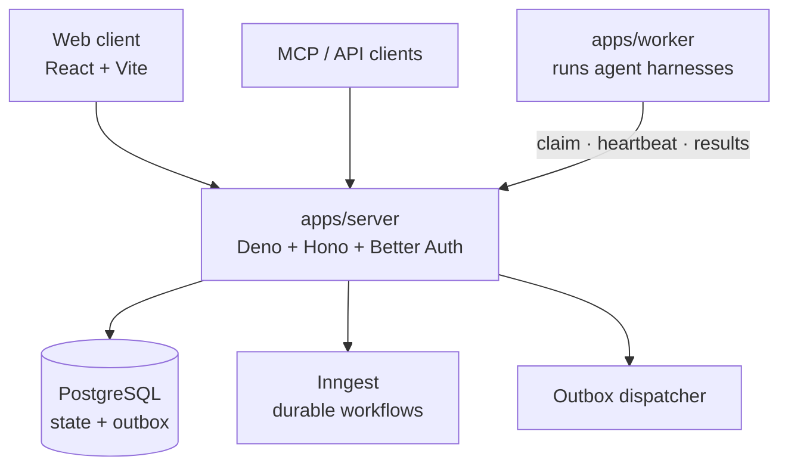

<div align="center">

<picture>
  <source media="(prefers-color-scheme: dark)" srcset="assets/brand/logo/png/lockup-color-dark-h256.png">
  
</picture>

### The self-hosted software factory for coding agents

Track the work, run Claude Code, Codex and Pi on machines you own,<br> check
every result against your rules, and review it all in one place.

[](LICENSE)
[](#status)
[](https://deno.com)
[](https://nodejs.org)
[](https://www.postgresql.org)
[](CONTRIBUTING.md)

[Quickstart](#quickstart) · [Features](#features) ·
[Architecture](#architecture) · [Contributing](CONTRIBUTING.md) ·
[Design docs](docs/technical-design/README.md)

<br>

<picture>
  <source media="(prefers-color-scheme: dark)" srcset="assets/brand/scenes/sign-in-hero/sign-in-hero-dark.png">
  
</picture>

</div>

## Why Bakery

Coding agents are good at writing code and bad at being managed. Bakery is the
kitchen around them: it turns tickets into tasks, hands each task to an agent
running on a worker you control, holds the output to your repository's rules,
and keeps a reviewable record of every plan, run, artifact and approval.

- **Model-agnostic.** Claude Code, Codex, Pi or a scripted harness, side by
  side.
- **Self-hosted.** Your code, secrets and agent output stay on your machines.
- **Everything included.** SSO, SCIM, custom roles and audit are open source and
  always on. There is no paid edition.

<a id="status"></a>

> [!WARNING]
> **Early, pre-1.0.** Interfaces, database schema and configuration change
> without deprecation periods. Expect rough edges and breaking changes.

## Features

<table>
<tr>
<td width="50%" valign="top">

**🎫 Projects, tickets and tasks**<br> Ticket intake from GitHub through a
GitHub App, readiness and admission policy, dependencies, budgets and
multi-stage workflow presets.

</td>
<td width="50%" valign="top">

**🤖 Agents on your machines**<br> Workers enroll, claim work and run a harness
in a repository checkout, isolated with cgroups, with heartbeats, recovery and
archived output.

</td>
</tr>
<tr>
<td valign="top">

**✅ Delivery checks**<br> Repository rules, quality checks bound to the
candidate commit, pull request metadata checks, independent review and recorded
verdicts.

</td>
<td valign="top">

**📄 Artifacts and conversations**<br> Versioned task artifacts with comments,
previews and imports; task conversations with questions and approval requests.

</td>
</tr>
<tr>
<td valign="top">

**🔐 Secrets and integrations**<br> Encrypted secrets with a broker and output
redaction; integrations declared through a typed manifest
(`packages/integration-sdk`).

</td>
<td valign="top">

**🏢 Access and governance**<br> Passkeys, TOTP, organizations and invitations,
OAuth clients, an MCP server with scoped tools, SSO (OIDC, SAML), SCIM, custom
roles and audit export.

</td>
</tr>
</table>

## Architecture



| Path                     | Contents                                               |
| ------------------------ | ------------------------------------------------------ |
| `apps/server`            | API, migrations, workflows and MCP server              |
| `apps/worker`            | Worker that runs agent harnesses against repositories  |
| `apps/web`               | React web client                                       |
| `packages/`              | Shared contracts, config, persistence, i18n, UI, SDKs  |
| `infra/`                 | Compose stack for local development, deployment images |
| `docs/technical-design/` | System design records and interface references         |
| `learnings/`             | Engineering corrections, indexed by `index.xml`        |
| `assets/`, `brand/`      | Brand assets ([usage rules](assets/brand/README.md))   |

## Quickstart

You need Docker with Compose and the toolchain pinned in `.tool-versions` (Deno,
Node.js, pnpm).

```sh
pnpm install --frozen-lockfile

export BAKERY_ENV=development
export BETTER_AUTH_SECRET="$(openssl rand -base64 32)"
export INNGEST_EVENT_KEY=local-event-key   # matches the compose Inngest default

# Start Postgres, Redis and Inngest on free ports; writes .env.local-dev
scripts/dev/compose-up.sh local-dev postgres redis inngest
set -a; . ./.env.local-dev; set +a

pnpm migrate
pnpm createsuperuser
pnpm dev
```

`pnpm dev` runs the API and the web dev server and prints the web URL when it is
ready. Set `BAKERY_WORKER_PROFILE=worker` to also run a local worker, or use
`pnpm start` to serve the production web build. Stop the containers with
`scripts/dev/compose-down.sh local-dev`.

To use your own Postgres and Inngest, start from [`.env.example`](.env.example)
and export the values (for example `set -a; . ./.env; set +a`).

## Development

```sh
pnpm fmt
pnpm lint
pnpm typecheck
pnpm test:unit        # also: test:rails, test:integration, test:security, ...
```

Lanes that need a database take `DATABASE_URL` and `BAKERY_APP_DATABASE_URL` per
command; run `pnpm test:rails` with neither set.

## Contributing

Contributions are welcome. Start with [CONTRIBUTING.md](CONTRIBUTING.md); rules
for human and agent contributors are in [AGENTS.md](AGENTS.md) and
[docs/engineering-rules.md](docs/engineering-rules.md). Participation is
governed by the [code of conduct](CODE_OF_CONDUCT.md).

Report security issues privately; see [SECURITY.md](SECURITY.md).

## License

Bakery is released under the [Apache License 2.0](LICENSE). See [NOTICE](NOTICE)
for attributions.

<div align="center">
<br>

<br>
<sub>Baked with care. Fresh out of the oven.</sub>
</div>
