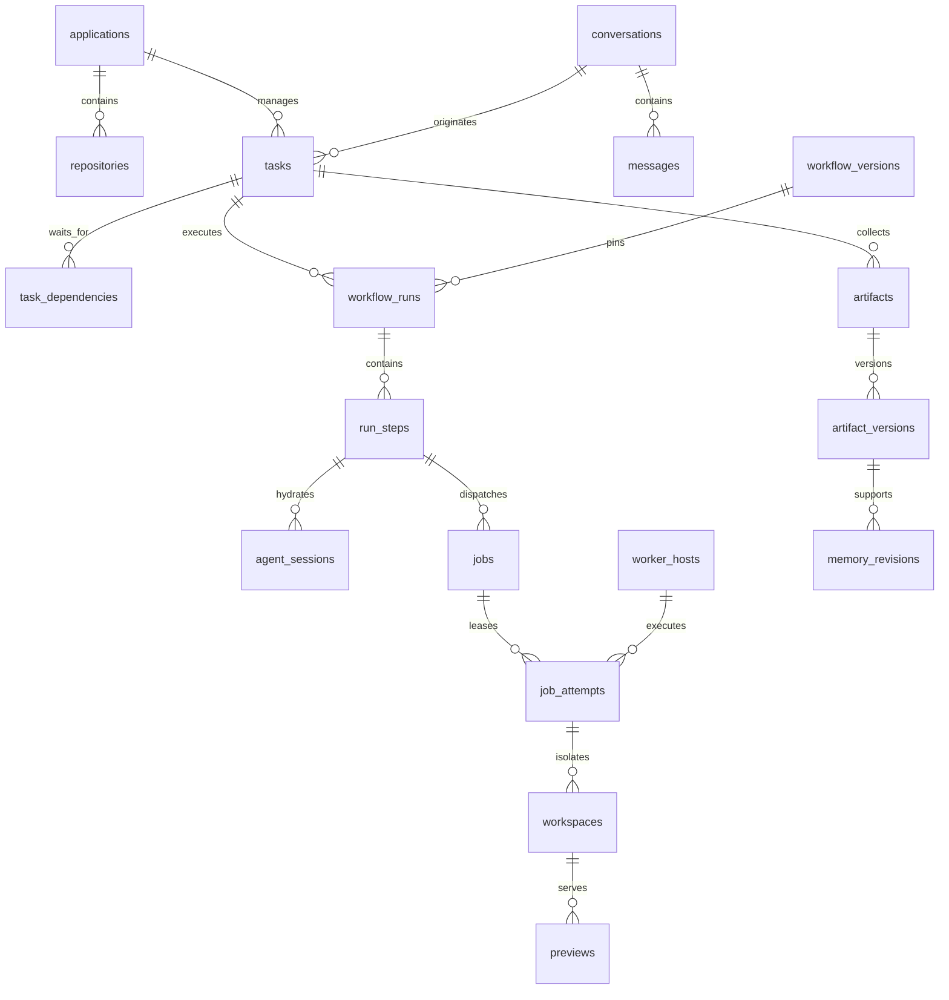
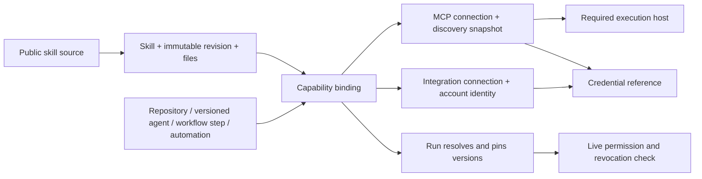
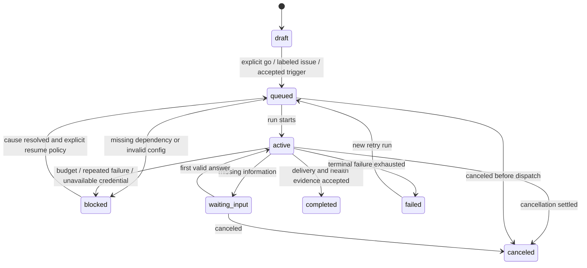

# Data model and state ownership

**Design status:** proposed logical model, not executed migrations. The structured inventory is [data-model.json](data-model.json). Each record exists for a requested capability; these are relational tables within one Postgres database, not services. Delivery slices create the subset they need. Better Auth owns human authentication identity rows and their additional session, account, verification, OAuth token/client/consent and signing-key tables; Bakery owns organization, membership, invitation and grant lifecycle. Bakery does not fork the authentication schema. The ERD is a logical model, not an exhaustive provider migration dump.

**Account protection:** the pinned Better Auth migrations also own the TOTP enrollment
flag, `twoFactor`, `passkey`, and private session/verification metadata. These belong
to the human account across organizations. They remain provider-owned schema, not a
second Bakery credential store or public DTO. See the [account-protection contract](04-backend-and-errors.md#account-protection-totp-backup-codes-and-passkeys)
for encrypted storage, safe projections and runtime gates.

The [multiplayer contract](07-multiplayer.md) specifies shared chat admission, version-pinned comment threads and current-access filtering.

**Workflow ownership and multi-repository addition:**
[Packaged workflows and coordination](06-workflows-delivery-and-acceptance.md#workflow-ownership-and-multi-repository-work)
adds locked Bakery catalog origins, editable organization forks, task/repository
links, application repository roles and run/repository profile pins. A parent task
can coordinate multiple repository-specific children without a user-selected
workflow; each code job still has one concrete repository. This supersedes the
inventory's “repository required before executable kickoff” rule for coordination
parents and its single-profile assumption. Reuse parent tasks and the dependency
DAG, with explicit joins, capacity, budget and partial-delivery semantics. These
are documented catalog/migration deltas; the generated inventory and ERDs below
have not yet incorporated them. Tenant and transcript visibility constraints
remain in force.

**Shared editing addition:** [Collaborative documents and presence](20-collaborative-documents.md) proposes linked artifact drafts, immutable CRDT checkpoints, accepted update logs and draft-target discussions. These additions are not yet included in this structured catalog or its ERDs. They preserve immutable published versions and add explicit provenance/retention pins; presence remains ephemeral.

## Relationships that drive the factory

**Repository rules addition:** [Repository rules](22-repository-rules.md#proposed-model-and-operation-additions)
adds immutable organization rule revisions, typed overrides in existing
repository profiles, effective rule snapshots and metadata-bound delivery
evidence. These are proposed catalog/ERD deltas, not generated records below.

**Machine lifecycle addition:** [Machines](21-machines.md#data-model-additions) specifies enrollment intent/host linkage, desired mode versus observed readiness, component/check inventory, provider-account bindings and host-maintenance records. It also adds worker/enrollment event scope. These are explicit additions to the inventory below, not yet generated tables or ERDs. Machine organization ownership remains immutable; observed liveness and tool versions are not Admin-writable state.





A definition explains what something is; a connection configures an account or host; a binding permits a concrete capability in a scope; a run records exactly what it resolved. Pins preserve content, never revoked authority.

## Storage conventions

- Better Auth authentication identity rows retain their provider schema. Bakery-owned entity tables use `id uuid`, `created_at timestamptz`, `updated_at timestamptz`, and `version integer >=1`. Operational coordination and migration-ledger tables may instead use documented natural or composite keys and omit entity lifecycle columns. IDs use UUIDs, never sequential public identifiers. `timestamp` in the inventory means `timestamptz`; all instants serialize RFC3339 UTC. Calendar schedules separately retain an IANA timezone.
- Required fields are NOT NULL unless marked `?`. `uuid>table` is a real FK to `table.id`. Event sequence/highwater values serialize as decimal strings to avoid JS precision loss; collection pagination cursors are opaque authenticated strings. Currency is `numeric(14,6)`, serialized as decimal strings; unknown costs remain null.
- Lifecycle states use text CHECK constraints with centrally exported constants. A new enum-like state is an additive migration plus protocol compatibility decision. Free text, identifiers, config, path and collections have bounded DTO validation.
- Most deletes archive/revoke. ON DELETE RESTRICT protects provenance. Explicit retention jobs may cascade disposable child data only after preserving evidence/usage/audit relationships. A principal can be disabled without deleting past authorship.
- Published skill/workflow/agent/profile versions and artifact/memory revisions are immutable except the explicitly audited artifact-byte purge described in chapter 14. Enforce with DB grants/triggers; active-version pointers use composite ownership constraints and compare-and-swap. Mutable rows increment version in the same transaction as state changes.
- JSONB is for versioned typed config, bounded payloads and discovery manifests. Validate exact schema version on write/read. Relationships needed for ownership, scheduling, scope or provenance use FKs. Capability bindings use mutually exclusive concrete FKs, not arbitrary `owner_type/owner_id` references.
- Each binding owner and target is FK constrained. Repository policy supplies the allowed capability universe; workflow/agent/step bindings narrow it; current actor grants narrow again. A workflow cannot expand a repository or principal grant by naming a tool.
- Cross-record invariants (task/repository/application ownership, parent cycles, artifact/task lineage, version-owner agreement) are enforced in the same transaction with locked roots. Use composite FKs where expressible; no validate-then-write race.

### Personal user profile

The personal profile lives on `auth_users`, independent of organization membership
and `user_preferences`. Admin, Developer and future custom roles edit only their
own profile through the authenticated Better Auth user boundary.

| Profile control | API field | Logical column | Validation and existing-user behavior |
| --- | --- | --- | --- |
| Display name | `name` | `auth_users.name` | Existing required field; 1–200 trimmed Unicode characters. Preserve it independently of name parts. |
| First name | `firstName` | `auth_users.first_name` | New nullable text; up to 100 trimmed Unicode characters. |
| Last name | `lastName` | `auth_users.last_name` | New nullable text; up to 100 trimmed Unicode characters. Supports people without a family name. |
| Job title | `title` | `auth_users.title` | New nullable text; up to 120 trimmed Unicode characters. Self-described presentation, never an access role. |
| Profile photo URL | `image` | `auth_users.image` | Existing nullable field; absolute HTTPS URL, at most 2048 characters, no embedded credentials. |

Configure the three new fields through Better Auth `user.additionalFields` with
`required: false` and explicit logical-column mapping, then generate and review
the provider migration. Existing rows retain `name` and `image`; new columns start
null. Do not split old names, require a surname, or reset an edited profile when
linking a sign-in provider. This repository records the schema contract; no
application database or migration is being executed here.

Omitted update fields remain unchanged; blank optional fields normalize to null
and null clears them. Reject blank display names, overlong values and invalid
image URLs. Profile writes never accept a target user ID, membership role,
permission grant or verification state. Email changes use their separate verified
flow. Update the canonical display name and its human-principal display cache
consistently; attribution reads the canonical name until any cache refresh completes.
Do not expand member/Principal public projections with these personal fields by default.

The initial photo control accepts an image URL and uses the existing provider
field; it does not add a blob store or file-upload endpoint. Render only validated
HTTPS sources through the image policy with no referrer and an initials fallback
for absent or failed images. Do not server-fetch arbitrary user URLs. Signed
credential URLs, data URLs, SVG markup and base64 bytes are not profile values.

The declarative `userProfile` boundary in [transport-schemas.json](transport-schemas.json)
maps the same fields and preserves provider-owned `/api/auth/*` routes outside
the Bakery operation catalog. Source: Better Auth's
[additional user fields](https://better-auth.com/docs/concepts/database#extending-core-schema)
and [user updates](https://better-auth.com/docs/concepts/users-accounts#update-user-information).

### Skill content storage

Postgres stores skill identities, immutable revisions, manifests and file metadata. `skill_files.object_key` addresses the complete file bytes in **Cloudflare R2 in cloud mode** or **an application-owned filesystem directory in local mode**. This includes `SKILL.md`, scripts, templates, references and supporting assets. The selected backend is installation configuration; database records use the same logical keys in both modes. Runtime artifacts and repository memory retain their separate Postgres storage decision.

Keys are generated as `skills/{skillId}/{versionDigest}/{fileSha256}`. Identical bytes within one revision may share a key; user paths never become filesystem/object-store keys. The manifest records the original safe relative path and executable bit so a worker can reconstruct the directory. No file contents, base64 payloads or bucket credentials belong in manifests, workflow snapshots, outbox records or Inngest events.

A remote import remains draft until every manifest entry has a verified object; a direct upload publishes only after the same complete verification. Publication, the active-version pointer and the publication event commit together in Postgres after the storage writes. There is no transaction spanning Postgres and the file store. Retry the same immutable keys after an interruption; never publish a partial bundle. The backend chapter defines this boundary and the runtime chapter defines materialization and backups.

## Core state machines



Task status is a server projection of the current run plus dependency/input conditions. A browser does not set it by PATCH. A retry creates a new run linked to the prior run through the snapshot, never rewrites completed history. A delivery workflow completes only after health verification; research/freeform workflows complete against their own published terminal criteria. Parent epics complete after required children, not after decomposition.

```text
job: queued -> leased -> running -> completed
                         |           (only current fence)
                         +-> awaiting_reconciliation -> queued | failed
                         +-> canceled
attempt: leased -> running -> completed | failed | canceled | lost | quarantined
                         -> canceling -> canceled
run: queued -> running <-> waiting_input | waiting_capacity | paused
                    -> canceling -> canceled
                    -> completed | failed | blocked
```

A worker offline event is not job completion. `lost` records absence of execution authority, not proof that its process exited. New workspaces are allocated after loss; old ones remain quarantined until the host proves process termination. A late old result cannot mark the task completed. Repeating an already-confirmed terminal result returns its original acknowledgment after digest validation, including after lease expiry.

Pause prevents new node dispatch and asks active harnesses to checkpoint/stop at a safe boundary. It does not roll back a confirmed external effect. Cancel and result ingestion lock the same job row. First commit wins: a committed success makes a later cancel an already-terminal response; a committed cancel_requested_at rejects later success with CANCEL_REQUESTED and keeps reconciliation visible until exit evidence. Cancel is durably requested before signaling processes. If unreachable, revoke execution authority and show the remaining cleanup/reconciliation state; never claim a process was killed without evidence.

## Transactions and replay

```text
createTask(input, actor, idempotencyKey)
  authenticate; authorize; validate
  BEGIN
    claim (organization, actor, operation, key); compare payload digest
    if complete: return saved response
    insert task + conversation linkage
    append audit
    lock event_clock -> allocate next sequence
    insert domain_event + outbox
    persist exact success status/body in idempotency record
  COMMIT
  return response; dispatcher delivers later
```

The event clock row stays locked until commit. This avoids the subtle BIGSERIAL failure where transaction B commits cursor 102 before A commits cursor 101 and a reconnecting client permanently skips A. Each organization has an independent stream, preventing tenant activity from leaking through sequence gaps while keeping allocation contention tenant-local. A `GET /v1/sync` repeatable-read snapshot returns authorized resource state and its high-water cursor from one database snapshot; subscribe after that cursor closes the REST/WebSocket race without exposing another tenant's watermark.

The event-clock rollout is expand/backfill/contract. The compatible schema first adds `organization_sequence`, the per-organization clock, and its indexes while retaining the legacy identity column. A temporary partial index keeps every bounded backfill batch proportional to remaining work and is removed after the contract closes. The migration task transactionally records and revokes application connection privileges, refuses to proceed while any `bakery_app` session remains, and repeats bounded, committed backfill passes until completion. A 15-minute task deadline fails safely for an operator-controlled retry instead of holding the drain indefinitely. Only then does it apply the NOT NULL/unique contract and restore the exact prior privileges. A persisted drain record restores those privileges after an interrupted migrator, including one interrupted after the contract commits. Server startup rejects the pre-contract or partially backfilled schema. The physical global identity remains temporarily for mixed-version storage compatibility but is never exposed as the client cursor; `organization_sequence` is the canonical tenant-local event order.

Workers atomically claim jobs with `FOR UPDATE SKIP LOCKED`, but also lock the worker-host row to enforce slots, repository capacity and budget rows in a fixed order. Claim eligibility includes live grants, platform/toolchain/MCP locality, dependencies, priority and available_at. Increment current_fence; create job_attempt; return opaque lease token only once. Do not trust a claimed free-slot count over server live-attempt accounting.

A new attempt starts at last_event_seq=0; its first event is 1. Worker journal batches must be contiguous from last_event_seq+1. Identical duplicates acknowledge the persisted prefix; changed duplicate payloads are a protocol fault; gaps return expectedSequence without applying later entries. Server time determines expiry. Terminal result ingestion inserts/deduplicates the same (attempt_id, local_seq, payload_digest) journal event as the event endpoint through one shared ingestion operation, then updates attempt/job/step evidence refs and the completion outbox in one transaction. The two HTTP routes never arbitrate terminal state independently. Inngest is woken after commit.

## Indices and retention

| Family | Required access path | Initial retention / sizing policy |
|---|---|---|
| Tasks | (application_id,status,priority DESC,created_at,id), (repository_id,status); dependencies in both directions | Archive manually; preserve delivered evidence |
| Runs/jobs | (task_id,created_at,id), partial active-run unique; jobs (status,available_at,priority DESC); attempts (host,status,lease_expires_at) | Keep run summaries; raw attempt events 7 days |
| Domain events | UNIQUE(organization_id,organization_sequence), (organization_id,task_id,organization_sequence), (organization_id,repository_id,organization_sequence) | 7-day replay, return reset_required below the organization's retained floor |
| Outbox/effects | pending(next_attempt_at), UNIQUE destination/delivery key; uncertain effects(last_checked_at) | Outbox delivered 30 days; retain effect identity with delivery history |
| Versions/artifacts | UNIQUE(owner,revision), UNIQUE skill digest, comments(version,status) | 10MiB/version; default text/log 30 days, accepted plan/review/delivery evidence 180 days, pin important artifacts; dangling provenance forbids GC |
| Memory | (repository_id,status), GIN tags, weighted full-text body/summary index | Until superseded/expired; preserve referenced revisions |
| Automations | enabled(next_fire_at), UNIQUE(version,scheduled_at) | Firings 90 days; schedules durable across downtime |
| Identity/grants | auth subject unique; (principal,scope,repository), current secret revision | Revoke immediately; auth provider owns session/token expiry |
| Audit/usage/evals | (created_at,id), (principal,created_at), (run,occurred_at), (evaluation_run,case) | Audit/usage 180 days; sanitized evaluation corpus pinned |
| Budget | unique scope/run/period, outstanding reservations by step | Keep settled monthly totals; never release an uncertain active charge on timeout alone |

Artifact pinning, byte tombstones, protected references, disk thresholds and full restore objectives are specified in [Artifacts](14-artifacts.md). These are proposed defaults under a repository/organization retention policy, not unexplained magic values. Store binary artifact bytes in Postgres as requested. Use byte limits, compression for textual traces, selective checkpoints and retention to stay within the host budget. Large video recordings are not silently offloaded to a new storage system: reject over-limit uploads clearly and revisit only with measured need.

Every paginated collection uses indexed keyset traversal. Start tenant access indices with `organization_id`. Put equality scope/filter columns before the immutable ordering tuple and unique ID tie-breaker in the relevant index; the default tuple is `(created_at DESC, id DESC)`. Use the same comparison/order on every continuation request. Scheduling indices and mutable priority order do not define API page positions. No OFFSET-based query is used for pagination.

## Model inventory

<!-- Derived from data-model.json. -->

Bakery entity tables inherit the common fields unless their model records a natural or composite operational key. Provider-owned identity records retain the pinned Better Auth schema; their fields here document logical relationships, not a fork of that schema. Private hashes and encrypted fields never become public DTO fields.

### Access

#### `principals`

Authenticated human, service or worker identity.

| Field | Type | Nullable | Reference |
|---|---|---|---|
| `auth_user_id` | `uuid?` | yes | `auth_users` |
| `principal_type` | `enum(human,service,worker)` | no | none |
| `display_name` | `text` | no | none |
| `disabled_at` | `timestamp?` | yes | none |

**Integrity:** UNIQUE(auth_user_id) for humans; human principals map one Better Auth user and receive organization role only through organization_memberships. Service and worker principals may use exact grants without a role-bearing membership; any Bakery membership may carry a shared role bundle or role null for grant-only access. Better Auth owns auth user/session/account/verification/OAuth tables from the pinned provider schema.

#### `auth_users`

Better Auth provider-owned human login identity and personal profile.

| Field | Type | Nullable | Reference |
|---|---|---|---|
| `email` | `text` | no | none |
| `name` | `text` | no | none |
| `first_name` | `text?` | yes | none |
| `last_name` | `text?` | yes | none |
| `title` | `text?` | yes | none |
| `email_verified` | `boolean` | no | none |
| `image` | `text?` | yes | none |

**Integrity:** UNIQUE(email); provider authentication lifecycle owns this row. first_name, last_name and title are nullable provider additional fields with no inferred backfill; name and image remain the provider's existing fields. Profile writes target only the session's own user and cannot change email verification, membership or privileges. Personal details are account-wide, not organization preferences. Shared name display resolves the canonical auth_users.name; principals.display_name is a synchronized human display cache, not a second editable profile. Safe Bakery projections resolve through principals and never expose provider account/session columns.

#### `organizations`

Bakery-owned organization identity.

| Field | Type | Nullable | Reference |
|---|---|---|---|
| `name` | `text` | no | none |
| `slug` | `text` | no | none |
| `logo` | `text?` | yes | none |
| `metadata` | `jsonb` | no | none |

**Integrity:** UNIQUE(slug); bootstrap may create one Personal organization; organization creation remains authenticated and authorized. Bakery owns this lifecycle and is the canonical FK target. Retained Better Auth organization rows are historical compatibility data only and never a runtime fallback.

#### `organization_memberships`

Bakery-owned principal-keyed per-organization membership.

| Field | Type | Nullable | Reference |
|---|---|---|---|
| `organization_id` | `uuid` | no | `organizations` |
| `principal_id` | `uuid` | no | `principals` |
| `role` | `enum(admin,developer)?` | yes | none |
| `status` | `enum(active,inactive)` | no | none |
| `joined_at` | `timestamp` | no | none |

**Integrity:** UNIQUE(organization_id,principal_id); every human, service and worker membership points to one Bakery principal. Human memberships are role-bearing; a service or worker membership may use role null for grant-only access or an Admin/Developer shared permission bundle. Role is per organization and checked live with active status for every protected action. An inactive membership denies organization access even when exact grants remain; membership deletion revokes that principal's organization grants atomically, while demotion alone does not remove independent grants. UNIQUE(organization_id,id) supports composite foreign keys; tenant-owned parent references are constrained to the same organization unless this record documents a host-owned exception.

#### `organization_invitations`

Bakery-owned organization invitation lifecycle.

| Field | Type | Nullable | Reference |
|---|---|---|---|
| `organization_id` | `uuid` | no | `organizations` |
| `email` | `text` | no | none |
| `role` | `enum(admin,developer)` | no | none |
| `status` | `enum(pending,accepted,rejected,canceled)` | no | none |
| `expires_at` | `timestamp` | no | none |
| `inviter_principal_id` | `uuid` | no | `principals` |

**Integrity:** Invitation ID remains opaque and stable for the three Better Auth-compatible recipient routes. Email is normalized and recipient matching uses the current authenticated human provider identity, never request-supplied email. Pending and unexpired state is required for acceptance; pending invitations survive inviter demotion, disablement or removal. The inviter principal is retained independently of continuing membership. UNIQUE(organization_id,email) WHERE status = 'pending'; organization and inviter relationships are server-derived and never authority granted by possession of the invitation.

#### `installation_administrators`

Deployment administration independent of organization membership.

| Field | Type | Nullable | Reference |
|---|---|---|---|
| `principal_id` | `uuid` | no | `principals` |
| `granted_by_principal_id` | `uuid` | no | `principals` |
| `revoked_at` | `timestamp?` | yes | none |

**Integrity:** UNIQUE(principal_id); human principal only. Installation administration grants no organization membership, repository access, execution authority or plugin capability.

#### `permission_grants`

Exact organization, operation or external-action authority.

| Field | Type | Nullable | Reference |
|---|---|---|---|
| `organization_id` | `uuid` | no | `organizations` |
| `subject_principal_id` | `uuid?` | yes | `principals` |
| `automation_definition_id` | `uuid?` | yes | `automation_definitions` |
| `direction` | `enum(into_bakery,out_of_bakery)` | no | none |
| `capability` | `text` | no | none |
| `action_version` | `int?` | yes | none |
| `integration_connection_id` | `uuid?` | yes | `integration_connections` |
| `integration_resource_id` | `uuid?` | yes | `integration_resources` |
| `application_id` | `uuid?` | yes | `applications` |
| `repository_id` | `uuid?` | yes | `repositories` |
| `expires_at` | `timestamp?` | yes | none |
| `revoked_at` | `timestamp?` | yes | none |
| `granted_by_principal_id` | `uuid` | no | `principals` |
| `policy_revision` | `int` | no | none |

**Integrity:** Exactly one of subject_principal_id or automation_definition_id is set. This is an exact capability record, never a role assignment: it has no role column and cannot promote a principal. External actions require action_version, connection and selected resource; into-Bakery scopes bind supported internal targets. No wildcard or prefix inheritance. UNIQUE NULLS NOT DISTINCT over subject, direction, capability/version, connection/resource/internal target. Composite FKs keep every target in organization. New actions and resources never expand a grant. Expiry, revocation and policy revision are checked live. UNIQUE(organization_id,id) supports composite foreign keys; tenant-owned parent references are constrained to the same organization unless this record documents a host-owned exception.

### Projects

#### `applications`

Managed product, including Bakery itself.

| Field | Type | Nullable | Reference |
|---|---|---|---|
| `organization_id` | `uuid` | no | `organizations` |
| `slug` | `text` | no | none |
| `name` | `text` | no | none |
| `description` | `text` | no | none |
| `archived_at` | `timestamp?` | yes | none |

**Integrity:** UNIQUE(organization_id,slug); organization is the ownership root. UNIQUE(organization_id,id) supports composite foreign keys; tenant-owned parent references are constrained to the same organization unless this record documents a host-owned exception.

#### `repositories`

Git source identity and application ownership.

| Field | Type | Nullable | Reference |
|---|---|---|---|
| `organization_id` | `uuid` | no | `organizations` |
| `application_id` | `uuid` | no | `applications` |
| `slug` | `text?` | yes | none |
| `integration_connection_id` | `uuid` | no | `integration_connections` |
| `provider_repo_id` | `text` | no | none |
| `owner` | `text` | no | none |
| `name` | `text` | no | none |
| `default_branch` | `text` | no | none |
| `active_profile_id` | `uuid?` | yes | `repository_profiles` |
| `archived_at` | `timestamp?` | yes | none |

**Integrity:** The nullable slug field is reserved for an explicit caller-supplied slug contract; migration 0046 enforces only its lowercase format and no uniqueness today. UNIQUE(integration_connection_id,provider_repo_id) is the stable provider identity. Repository name is display-only. The active-profile FK is tenant-bound by organization and profile ID; the API validates that the selected profile belongs to this repository. UNIQUE(organization_id,application_id,id) and UNIQUE(organization_id,id) support composite foreign keys; tenant-owned parent references are constrained to the same organization.

#### `repository_profiles`

Immutable runtime, tests and delivery policy.

| Field | Type | Nullable | Reference |
|---|---|---|---|
| `organization_id` | `uuid` | no | `organizations` |
| `application_id` | `uuid` | no | `applications` |
| `repository_id` | `uuid` | no | `repositories` |
| `revision` | `int` | no | none |
| `config` | `jsonb` | no | none |
| `digest` | `text` | no | none |
| `created_by` | `uuid` | no | `principals` |

**Integrity:** UNIQUE(repository_id,revision); UNIQUE(organization_id,application_id,repository_id,id,revision,digest) supports observation and execution profile-identity pins; config schema RepositoryProfile; every new profile publish requires config.branches.base to equal the repository's current default branch; an unobserved digest-valid v1 active profile permits a version-matched default-branch PATCH, followed by a newly published matching-base v1 profile that autoactivates; an observed v2 active profile cannot rotate through this path; published contents immutable. UNIQUE(organization_id,id) supports composite foreign keys.

#### `repository_profile_observations`

One immutable v2 readiness observation for one immutable profile revision.

| Field | Type | Nullable | Reference |
|---|---|---|---|
| `organization_id` | `uuid` | no | `organizations` |
| `application_id` | `uuid` | no | `applications` |
| `repository_id` | `uuid` | no | `repositories` |
| `profile_id` | `uuid` | no | `repository_profiles` |
| `profile_revision` | `int` | no | `repository_profiles` |
| `profile_digest` | `text` | no | none |
| `observation_digest` | `text` | no | none |
| `observed_at` | `timestamp` | no | none |
| `source_mapping_revision` | `int` | no | none |
| `source_mapping_digest` | `text` | no | none |
| `base_sha` | `text` | no | none |
| `payload` | `jsonb` | no | none |
| `readiness` | `enum(eligible,blocked)` | no | none |
| `schema_version` | `int` | no | none |

**Integrity:** UNIQUE(organization_id,profile_id); one full composite foreign key to the matching repository_profiles row enforces the profile ID, repository, application, revision and digest as one identity. The full observation pin key supports exact task/run/job evidence pins. Exactly one immutable observation belongs to one new v2 profile revision. Base SHA is 40 or 64 lowercase hexadecimal characters; separate profile and observation digests, payload, source mapping, and readiness are immutable.

#### `repository_role_bindings`

Organization/application-scoped role and alias binding to one concrete repository.

| Field | Type | Nullable | Reference |
|---|---|---|---|
| `organization_id` | `uuid` | no | `organizations` |
| `application_id` | `uuid` | no | `applications` |
| `repository_id` | `uuid` | no | `repositories` |
| `role` | `text` | no | none |
| `alias` | `text?` | yes | none |
| `provenance` | `text?` | yes | none |
| `archived_at` | `timestamp?` | yes | none |
| `version` | `int` | no | none |

**Integrity:** Role and alias keys are normalized within the organization/application scope. Duplicate bindings remain legal so the resolver can return durable ambiguity rather than selecting a first row. `archived_at` is the removal path; future resolution excludes archived bindings. Mutable edits use version compare-and-swap; concrete task/run/job pins are not retargeted.

### Conversation

#### `conversations`

Shared discussion with an immutable authorization boundary.

| Field | Type | Nullable | Reference |
|---|---|---|---|
| `organization_id` | `uuid` | no | `organizations` |
| `application_id` | `uuid?` | yes | `applications` |
| `repository_id` | `uuid?` | yes | `repositories` |
| `title` | `text` | no | none |
| `created_by` | `uuid` | no | `principals` |
| `archived_at` | `timestamp?` | yes | none |

**Integrity:** Repository conversation: repository belongs to application and current repository read/operate guards apply. NULL repository means organization-wide shared discussion, restricted by current organization membership and explicit grants. Scope cannot change through PATCH. Creation, listing, transcript, events and referenced content use the same boundary. One conversation may originate multiple tasks within its scope. UNIQUE(organization_id,id) supports composite foreign keys; tenant-owned parent references are constrained to the same organization unless this record documents a host-owned exception.

#### `messages`

Durable cross-channel transcript.

| Field | Type | Nullable | Reference |
|---|---|---|---|
| `organization_id` | `uuid` | no | `organizations` |
| `conversation_id` | `uuid` | no | `conversations` |
| `author_id` | `uuid?` | yes | `principals` |
| `agent_session_id` | `uuid?` | yes | `agent_sessions` |
| `message_type` | `enum(user,assistant,system,tool_summary)` | no | none |
| `body` | `text` | no | none |
| `client_message_id` | `text` | no | none |
| `reply_to_id` | `uuid?` | yes | `messages` |
| `sequence` | `bigint` | no | none |
| `intent` | `enum(discussion,agent_request,agent_output)` | no | none |
| `comment_context` | `jsonb?` | yes | none |

**Integrity:** UNIQUE(conversation_id,sequence); UNIQUE(conversation_id,author_id,client_message_id) NULLS NOT DISTINCT. Lock conversation while allocating max(sequence)+1 and committing message/turn/outbox/events. Human author comes from authentication; internal agent author/session is server-assigned. Replies stay in the conversation. Body <=32KiB UTF-8; immutable server-built CommentContext <=32KiB; no raw secrets/tool arguments. Same client ID with changed payload is IDEMPOTENCY_PAYLOAD_MISMATCH; authorized duplicates return original message/turn. User messages are immutable after send. UNIQUE(organization_id,id) supports composite foreign keys; tenant-owned parent references are constrained to the same organization unless this record documents a host-owned exception.

#### `conversation_turns`

Durable admission and outcome of one shared-chat agent request.

| Field | Type | Nullable | Reference |
|---|---|---|---|
| `organization_id` | `uuid` | no | `organizations` |
| `conversation_id` | `uuid` | no | `conversations` |
| `trigger_message_id` | `uuid` | no | `messages` |
| `agent_session_id` | `uuid?` | yes | `agent_sessions` |
| `status` | `enum(queued,active,cancel_requested,completed,failed,canceled)` | no | none |
| `context_through_sequence` | `bigint?` | yes | none |
| `finished_at` | `timestamp?` | yes | none |
| `failure` | `jsonb?` | yes | none |

**Integrity:** UNIQUE(trigger_message_id); trigger is an agent_request in this conversation. UNIQUE(agent_session_id) when set; session belongs to this conversation. Partial UNIQUE(conversation_id) WHERE status IN (active,cancel_requested). FIFO by trigger message sequence. Inngest owns retry/checkpoints, this row owns semantic admission/outcome. Context cutoff frozen on admission; failure is bounded redacted Fault. Terminal state immutable. Requester is trigger_message.author_id; privileges are checked again on admission/effects, never inherited from another participant. UNIQUE(organization_id,id) supports composite foreign keys; tenant-owned parent references are constrained to the same organization unless this record documents a host-owned exception.

#### `channel_links`

External thread routing.

| Field | Type | Nullable | Reference |
|---|---|---|---|
| `organization_id` | `uuid` | no | `organizations` |
| `conversation_id` | `uuid` | no | `conversations` |
| `integration_connection_id` | `uuid` | no | `integration_connections` |
| `external_channel_id` | `text` | no | none |
| `external_thread_id` | `text` | no | none |
| `enabled` | `boolean` | no | none |

**Integrity:** UNIQUE(connection,external_channel_id,external_thread_id); authorize Slack identity before accepting steering. UNIQUE(organization_id,id) supports composite foreign keys; tenant-owned parent references are constrained to the same organization unless this record documents a host-owned exception.

### Work

#### `tasks`

User-visible work and parent epic.

| Field | Type | Nullable | Reference |
|---|---|---|---|
| `organization_id` | `uuid` | no | `organizations` |
| `application_id` | `uuid` | no | `applications` |
| `repository_id` | `uuid?` | yes | `repositories` |
| `repository_profile_id` | `uuid?` | yes | `repository_profiles` |
| `repository_profile_revision` | `int?` | yes | `repository_profiles` |
| `repository_profile_digest` | `text?` | yes | none |
| `conversation_id` | `uuid` | no | `conversations` |
| `parent_task_id` | `uuid?` | yes | `tasks` |
| `title` | `text` | no | none |
| `description` | `text` | no | none |
| `task_type` | `enum(feature,bug,epic,maintenance)` | no | none |
| `status` | `enum(draft,queued,active,waiting_input,blocked,completed,failed,canceled)` | no | none |
| `priority` | `int` | no | none |
| `created_by` | `uuid` | no | `principals` |
| `current_run_id` | `uuid?` | yes | `workflow_runs` |
| `archived_at` | `timestamp?` | yes | none |
| `observation_id` | `uuid?` | yes | `repository_profile_observations` |
| `observation_digest` | `text?` | yes | none |
| `base_sha` | `text?` | yes | none |

**Integrity:** repository required before executable kickoff; priority 0..100; versioned CAS edits; parent and repository must belong to application; repository profile ID, revision and digest are jointly nullable and, when present, identify one repository profile; an observation pin may be absent only with observation_id, observation_digest and base_sha all null, otherwise application, repository, profile ID, profile revision, profile digest, observation ID, observation digest and base SHA are all required; base SHA is 40 or 64 lowercase hexadecimal characters; task observation and profile identity references use same-organization/application/repository/profile composite keys. Migration 0046 adds same-organization observation-owner, profile-identity and exact observation-pin composite foreign keys with ON DELETE NO ACTION DEFERRABLE INITIALLY DEFERRED; existing profile pins are checked against their complete tenant-scoped identity and the profile-identity foreign key is validated before migration commit. Strict-v1 tasks may carry a complete profile identity without an observation; observation_id, observation_digest and base_sha are independently all null or a complete matching evidence pin. A direct delete of a referenced observation fails at commit under the new deferred pin; pre-0046 ON DELETE RESTRICT profile references can reject a direct profile delete at the DELETE statement. Both referenced rows remain protected by the end of the transaction; whole-organization cascade may remove tenant rows together. Task/conversation scope must agree: a repository-scoped conversation permits only that repository; installation conversations and their linked tasks remain visible only to principals with the installation grant plus any repository grant required for task effects. Creating a task never widens transcript or artifact access. UNIQUE(organization_id,id) supports composite foreign keys; tenant-owned parent references are constrained to the same organization unless this record documents a host-owned exception.

#### `task_dependencies`

Executable DAG, not a second job queue.

| Field | Type | Nullable | Reference |
|---|---|---|---|
| `organization_id` | `uuid` | no | `organizations` |
| `task_id` | `uuid` | no | `tasks` |
| `depends_on_task_id` | `uuid` | no | `tasks` |
| `condition` | `enum(completed)` | no | none |

**Integrity:** UNIQUE pair; no self edge; application lock + recursive cycle check within transaction; same application. UNIQUE(organization_id,id) supports composite foreign keys; tenant-owned parent references are constrained to the same organization unless this record documents a host-owned exception.

### Integrations

#### `inbound_events`

Host-level verified and deduplicated provider receipt.

| Field | Type | Nullable | Reference |
|---|---|---|---|
| `provider` | `text` | no | none |
| `registration_id` | `uuid` | no | `integration_app_registrations` |
| `external_delivery_id` | `text` | no | none |
| `payload_digest` | `text` | no | none |
| `event_kind` | `text` | no | none |
| `event_action` | `text?` | yes | none |
| `installation_id` | `uuid?` | yes | `integration_installations` |
| `normalized_projection` | `jsonb?` | yes | none |
| `status` | `enum(received,routed,ignored,rejected)` | no | none |
| `rejection_reason` | `text?` | yes | none |
| `received_at` | `timestamp` | no | none |
| `expires_at` | `timestamp` | no | none |

**Integrity:** UNIQUE(registration_id,external_delivery_id); same identity with a different digest or event kind is IDEMPOTENCY_PAYLOAD_MISMATCH. Raw bytes are bounded, verified and digested before parsing/redaction; an unbound receipt has no organization authority. Per-organization work is represented by inbound_event_routes. No organization_id: installation_id is the verified installation the payload named and stays null when the installation is unknown or the event carries none. Receipts keep a bounded projection, never the body, and expire at expires_at (received_at plus 7 days); a retention sweep deletes expired receipts and their routes, and keeps a receipt while one of its routes is pending, processing or deferred. The receipt statuses are enforced in TypeScript.

### Work

#### `questions`

Missing information with first-answer-wins.

| Field | Type | Nullable | Reference |
|---|---|---|---|
| `organization_id` | `uuid` | no | `organizations` |
| `task_id` | `uuid` | no | `tasks` |
| `run_id` | `uuid?` | yes | `workflow_runs` |
| `conversation_id` | `uuid` | no | `conversations` |
| `prompt` | `text` | no | none |
| `response_schema` | `jsonb?` | yes | none |
| `status` | `enum(open,answered,withdrawn)` | no | none |
| `answer` | `jsonb?` | yes | none |
| `answered_by` | `uuid?` | yes | `principals` |
| `answered_at` | `timestamp?` | yes | none |

**Integrity:** CAS open->answered; answer validated. Rows of `kind=approval` are typed approvals bound at creation to `subject_type` (`plan_revision`; `merge`/`deploy` are unsupported), `subject_id`, `subject_digest`, stage `scope` and `policy_digest`, and carry `decision` (`approve|request_changes|reject`), `decided_by/at`, `consumed_at`, `consumed_by_run_id`, `revoked_at/by`; status adds `revoked` and `consumed`. Only a human principal decides or revokes. Run admission consumes an approval with one conditional update binding organization, task, current approved revision id and digest, stage, policy digest, decision, revocation and expiry; revoke is the mirror update, so exactly one wins. `plan_revisions` (migration 0115) holds immutable revisions (`task_id`, `revision`, `body`, `digest` = sha256 over task id, revision and body, `status`), and `tasks` gains `approval_policy` and `planning_only`. Later feedback is a new message. UNIQUE(organization_id,id) supports composite foreign keys; tenant-owned parent references are constrained to the same organization unless this record documents a host-owned exception.

### Definitions

#### `workflow_definitions`

Named workflow catalog.

| Field | Type | Nullable | Reference |
|---|---|---|---|
| `organization_id` | `uuid` | no | `organizations` |
| `slug` | `text` | no | none |
| `name` | `text` | no | none |
| `description` | `text` | yes | none |
| `active_version_id` | `uuid?` | yes | `workflow_versions` |
| `enabled` | `boolean` | no | none |

**Integrity:** UNIQUE slug; deactivate blocks new kickoff, current run follows cancellation policy. UNIQUE(organization_id,id) supports composite foreign keys; tenant-owned parent references are constrained to the same organization unless this record documents a host-owned exception.

#### `workflow_versions`

Pinned validated executable definition.

| Field | Type | Nullable | Reference |
|---|---|---|---|
| `organization_id` | `uuid` | no | `organizations` |
| `workflow_id` | `uuid` | no | `workflow_definitions` |
| `revision` | `int` | no | none |
| `source_yaml` | `text` | no | none |
| `normalized_spec` | `jsonb` | no | none |
| `digest` | `text` | no | none |
| `status` | `enum(draft,published,retired)` | no | none |
| `created_by` | `uuid` | no | `principals` |

**Integrity:** UNIQUE(workflow_id,revision); publish validates references, DAG, budgets and registered actions; immutable once published. UNIQUE(organization_id,id) supports composite foreign keys; tenant-owned parent references are constrained to the same organization unless this record documents a host-owned exception.

#### `agent_definitions`

Small cloud agent and harness profiles.

| Field | Type | Nullable | Reference |
|---|---|---|---|
| `organization_id` | `uuid` | no | `organizations` |
| `slug` | `text` | no | none |
| `name` | `text` | no | none |
| `description` | `text` | yes | none |
| `active_version_id` | `uuid?` | yes | `agent_versions` |
| `enabled` | `boolean` | no | none |

**Integrity:** UNIQUE slug; no always-running agent process implied. UNIQUE(organization_id,id) supports composite foreign keys; tenant-owned parent references are constrained to the same organization unless this record documents a host-owned exception.

#### `agent_versions`

Pinned prompts, harness, model and constraints.

| Field | Type | Nullable | Reference |
|---|---|---|---|
| `organization_id` | `uuid` | no | `organizations` |
| `agent_id` | `uuid` | no | `agent_definitions` |
| `revision` | `int` | no | none |
| `config` | `jsonb` | no | none |
| `digest` | `text` | no | none |
| `created_by` | `uuid` | no | `principals` |

**Integrity:** UNIQUE(agent_id,revision); AgentConfig schema; credentials are references; human and machine grants not embedded. UNIQUE(organization_id,id) supports composite foreign keys; tenant-owned parent references are constrained to the same organization unless this record documents a host-owned exception.

#### `organization_repository_rule_versions`

Immutable published organization repository rule baselines.

| Field | Type | Nullable | Reference |
|---|---|---|---|
| `organization_id` | `uuid` | no | `organizations` |
| `revision` | `int` | no | none |
| `config` | `jsonb` | no | none |
| `digest` | `text` | no | none |
| `created_by` | `uuid` | yes | `principals` |

**Integrity:** UNIQUE(organization_id,revision); UNIQUE(organization_id,id) supports composite foreign keys; append-only, the application role has no update or delete privilege; config holds {revision, entries}; digest is SHA-256 hex of the canonical JSON of config; created_by is null only for system-published revisions. The application serializes publishers per organization and compares the expected revision before inserting.

### Skills

#### `skill_sources`

Public or local import origin.

| Field | Type | Nullable | Reference |
|---|---|---|---|
| `organization_id` | `uuid` | no | `organizations` |
| `source_type` | `enum(git,url,local_bundle)` | no | none |
| `locator` | `text` | no | none |
| `publisher` | `text?` | yes | none |
| `license` | `text?` | yes | none |
| `last_checked_at` | `timestamp?` | yes | none |
| `enabled` | `boolean` | no | none |

**Integrity:** Normalized locator; importer uses permitted origins and checked archive paths; no executable mutable URL. UNIQUE(organization_id,id) supports composite foreign keys; tenant-owned parent references are constrained to the same organization unless this record documents a host-owned exception.

#### `skills`

Stable skill identity.

| Field | Type | Nullable | Reference |
|---|---|---|---|
| `organization_id` | `uuid` | no | `organizations` |
| `source_id` | `uuid?` | yes | `skill_sources` |
| `slug` | `text` | no | none |
| `name` | `text` | no | none |
| `active_version_id` | `uuid?` | yes | `skill_versions` |
| `enabled` | `boolean` | no | none |

**Integrity:** UNIQUE slug; built-in skills may have no public source. UNIQUE(organization_id,id) supports composite foreign keys; tenant-owned parent references are constrained to the same organization unless this record documents a host-owned exception.

#### `skill_versions`

Immutable skill revision and manifest metadata; no embedded file bytes.

| Field | Type | Nullable | Reference |
|---|---|---|---|
| `organization_id` | `uuid` | no | `organizations` |
| `skill_id` | `uuid` | no | `skills` |
| `revision` | `int` | no | none |
| `source_revision` | `text` | no | none |
| `digest` | `text` | no | none |
| `entry_path` | `text` | no | none |
| `manifest` | `jsonb` | no | none |
| `status` | `enum(draft,published,retired)` | no | none |
| `created_by` | `uuid` | no | `principals` |

**Integrity:** UNIQUE(skill_id,digest); manifest schema includes input/output, license, tools, MCP requirements, compatibility, limits and the exact file inventory (path, mediaType, sizeBytes, sha256, isExecutable). Digest covers the canonical manifest, excluding storage keys. Publish only after every file has been durably written and verified; draft versions cannot be pinned. UNIQUE(organization_id,id) supports composite foreign keys; tenant-owned parent references are constrained to the same organization unless this record documents a host-owned exception.

#### `skill_files`

Skill file metadata; bytes live in private R2 or the local filesystem.

| Field | Type | Nullable | Reference |
|---|---|---|---|
| `organization_id` | `uuid` | no | `organizations` |
| `skill_version_id` | `uuid` | no | `skill_versions` |
| `path` | `text` | no | none |
| `media_type` | `text` | no | none |
| `object_key` | `text` | no | none |
| `size_bytes` | `int` | no | none |
| `sha256` | `text` | no | none |
| `is_executable` | `boolean` | no | none |

**Integrity:** UNIQUE(skill_version_id,path); generated object_key identifies immutable bytes in the installation-selected store, never a public URL. Safe relative POSIX paths only; reject traversal, links and normalized/case-fold collisions. At most 256 regular files and 10MiB decoded bytes per revision. Published file metadata is immutable. UNIQUE(organization_id,id) supports composite foreign keys; tenant-owned parent references are constrained to the same organization unless this record documents a host-owned exception.

### Integrations

#### `integration_providers`

Deployment registry for native and later packaged integration contracts.

| Field | Type | Nullable | Reference |
|---|---|---|---|
| `slug` | `text` | no | none |
| `name` | `text` | no | none |
| `native` | `boolean` | no | none |
| `adapter_version` | `text` | no | none |
| `manifest_digest` | `text` | no | none |
| `auth_modes` | `jsonb` | no | none |
| `resource_kinds` | `jsonb` | no | none |
| `config_schema` | `jsonb` | no | none |
| `action_schemas` | `jsonb` | no | none |
| `event_schemas` | `jsonb` | no | none |

**Integrity:** UNIQUE(slug,adapter_version); immutable manifest digest and complete bounded JSON Schemas for config, actions, outputs and events. Registry JSON is data, never executable code. GitHub and Slack are bundled native entries; public integration packages wait for SDK/sandbox acceptance.

#### `integration_connections`

Organization binding to a host-owned provider installation.

| Field | Type | Nullable | Reference |
|---|---|---|---|
| `organization_id` | `uuid` | no | `organizations` |
| `provider` | `text` | no | none |
| `installation_id` | `uuid` | no | `integration_installations` |
| `external_authorization_id` | `text` | no | none |
| `external_account_id` | `text` | no | none |
| `label` | `text` | no | none |
| `config` | `jsonb` | no | none |
| `config_schema_version` | `int` | no | none |
| `adapter_version` | `text` | no | none |
| `secret_id` | `uuid?` | yes | `secrets` |
| `granted_permissions` | `jsonb` | no | none |
| `authorization_revision` | `int` | no | none |
| `status` | `enum(pending,enabled,disabled,revoked)` | no | none |
| `health` | `enum(unknown,healthy,degraded,auth_required)` | no | none |
| `last_checked_at` | `timestamp?` | yes | none |
| `last_success_at` | `timestamp?` | yes | none |
| `next_allowed_at` | `timestamp?` | yes | none |
| `last_problem_code` | `text?` | yes | none |
| `archived_at` | `timestamp?` | yes | none |
| `created_by` | `uuid` | no | `principals` |

**Integrity:** UNIQUE(organization_id,id); FK(installation_id,external_authorization_id,external_account_id) to the installation identity so they must agree; external_account_id has no update grant, and installation_id with external_authorization_id may move only together when a same-account reinstall reconnects the connection, so the key keeps it on an installation of the same account. One live connection per (organization_id, installation_id) where archived_at is null. Generic config cannot change secrets or URLs. Disable blocks this organization only; installation revoke blocks all dependent connections. Composite FKs constrain secret and all children to organization where applicable. UNIQUE(organization_id,id) supports composite foreign keys; tenant-owned parent references are constrained to the same organization unless this record documents a host-owned exception.

### Tickets

#### `ticket_requests`

Immutable ticket admission generation and authority evidence.

| Field | Type | Nullable | Reference |
|---|---|---|---|
| `organization_id` | `uuid` | no | `organizations` |
| `ticket_task_link_id` | `uuid` | no | `ticket_task_links` |
| `external_ticket_id` | `uuid` | no | `external_tickets` |
| `intent` | `enum(plan,start)` | no | none |
| `generation` | `int` | no | none |
| `origin` | `enum(manual,adoption,webhook,poll)` | no | none |
| `authority_principal_id` | `uuid?` | yes | `principals` |
| `authority_evidence` | `jsonb` | no | none |
| `inbound_event_route_id` | `uuid?` | yes | `inbound_event_routes` |
| `source_policy_revision` | `int` | no | none |
| `requirements_digest` | `text` | no | none |
| `readiness_report_id` | `uuid?` | yes | `ticket_readiness_reports` |
| `pinned_preset` | `jsonb` | no | none |
| `disposition` | `enum(pending,waiting,admitted,active,suspended,rejected,completed,failed,canceled)` | no | none |
| `disposition_reason` | `text?` | yes | none |
| `workflow_run_id` | `uuid?` | yes | `workflow_runs` |
| `pause_requested_at` | `timestamp?` | yes | none |

**Integrity:** UNIQUE(ticket_task_link_id,generation). external_ticket_id must match the link (composite FK on organization, ticket and link). Partial UNIQUE(external_ticket_id) for waiting/admitted/active/suspended prevents parallel admission; terminal generations free it. Admission locks ticket/link/task and records the exact source policy revision, a pinned readiness report and a pinned preset; it stores no plan artifact version (the API field planArtifactVersionId is always null). origin, authority_principal_id, authority_evidence, inbound_event_route_id and pinned_preset have no update grant; a re-pin rewrites requirements_digest, readiness_report_id and source_policy_revision, and a lifecycle step rewrites intent, disposition, disposition_reason, workflow_run_id and pause_requested_at. Receipt retention sets inbound_event_route_id to null and authority_evidence keeps the durable facts. No delete grant. Vocabulary and transitions are enforced in TypeScript. UNIQUE(organization_id,id) supports composite foreign keys; tenant-owned parent references are constrained to the same organization unless this record documents a host-owned exception.

#### `ticket_readiness_reports`

Immutable readiness evaluation of one external ticket for one observed basis.

| Field | Type | Nullable | Reference |
|---|---|---|---|
| `organization_id` | `uuid` | no | `organizations` |
| `external_ticket_id` | `uuid` | no | `external_tickets` |
| `version` | `int` | no | none |
| `verdict` | `enum(ready,waiting,rejected)` | no | none |
| `basis_digest` | `text` | no | none |
| `requirements_digest` | `text?` | yes | none |
| `dependency_digest` | `text?` | yes | none |
| `source_policy_revision` | `int` | no | none |
| `preset` | `jsonb` | no | none |
| `checks` | `jsonb` | no | none |
| `origin` | `enum(manual,adoption,webhook,poll)` | no | none |
| `evaluated_at` | `timestamp` | no | none |

**Integrity:** Insert-only: bakery_app has select and insert and no update or delete grant, so a recorded evaluation cannot be rewritten. Inherits only id and created_at; version is the per-ticket report sequence, not a concurrency counter, and there is no updated_at. UNIQUE(external_ticket_id,version). A new report is stored only when its basis_digest differs from the newest one of the ticket. checks holds one entry per check id with status pass, wait or reject, a reason code and bounded evidence; verdict follows from the checks. origin names the call that first saw the basis. UNIQUE(organization_id,external_ticket_id,id) lets ticket_requests pin a report of its own ticket. UNIQUE(organization_id,id) supports composite foreign keys; tenant-owned parent references are constrained to the same organization unless this record documents a host-owned exception.

#### `ticket_task_links`

Explicit same-organization link between an external ticket and Bakery task.

| Field | Type | Nullable | Reference |
|---|---|---|---|
| `organization_id` | `uuid` | no | `organizations` |
| `external_ticket_id` | `uuid` | no | `external_tickets` |
| `task_id` | `uuid` | no | `tasks` |
| `role` | `enum(primary,reference)` | no | none |
| `status_comment_external_id` | `text?` | yes | none |
| `last_synced_run_revision` | `int?` | yes | none |
| `sync_health` | `enum(unknown,healthy,pending,failed)` | no | none |
| `last_problem_code` | `text?` | yes | none |

**Integrity:** UNIQUE(organization_id,external_ticket_id,task_id); one primary ticket per task. Linking does not start work or widen audiences. A partial unique request constraint owns nonterminal execution per external ticket. UNIQUE(organization_id,id) supports composite foreign keys; tenant-owned parent references are constrained to the same organization unless this record documents a host-owned exception.

#### `external_tickets`

Bounded current snapshot of a provider-owned ticket.

| Field | Type | Nullable | Reference |
|---|---|---|---|
| `organization_id` | `uuid` | no | `organizations` |
| `ticket_source_id` | `uuid` | no | `ticket_sources` |
| `external_ticket_id` | `text` | no | none |
| `key` | `text` | no | none |
| `number` | `text?` | yes | none |
| `safe_url` | `text` | no | none |
| `snapshot` | `jsonb` | no | none |
| `requirements_digest` | `text` | no | none |
| `provider_update_marker` | `text` | no | none |
| `visibility` | `enum(public,private)` | no | none |
| `state` | `text` | no | none |
| `last_observed_at` | `timestamp` | no | none |

**Integrity:** UNIQUE(organization_id,ticket_source_id,external_ticket_id); remote identity is independent of URL or connection credential. Snapshot and schema are bounded; attachments remain remote through the selected adapter. UNIQUE(organization_id,id) supports composite foreign keys; tenant-owned parent references are constrained to the same organization unless this record documents a host-owned exception.

#### `ticket_sources`

Authorized external ticket container, mapping and versioned intake policy.

| Field | Type | Nullable | Reference |
|---|---|---|---|
| `organization_id` | `uuid` | no | `organizations` |
| `provider` | `text` | no | none |
| `integration_connection_id` | `uuid` | no | `integration_connections` |
| `integration_resource_id` | `uuid` | no | `integration_resources` |
| `application_id` | `uuid` | no | `applications` |
| `repository_id` | `uuid?` | yes | `repositories` |
| `external_container_id` | `text` | no | none |
| `enabled` | `boolean` | no | none |
| `policy` | `jsonb` | no | none |
| `policy_revision` | `int` | no | none |
| `sync_checkpoint` | `jsonb?` | yes | none |
| `sync_health` | `enum(unknown,healthy,degraded,auth_required)` | no | none |
| `last_synced_at` | `timestamp?` | yes | none |
| `last_problem_code` | `text?` | yes | none |

**Integrity:** UNIQUE(organization_id,integration_connection_id,external_container_id); one authoritative source per external container in an organization. provider defaults to github. Policy is strict data, never executable code or an arbitrary URL. Identity columns (provider, connection, resource, application, repository, external container) have no update grant; the poll writes only sync_checkpoint, sync_health, last_synced_at and last_problem_code, never version or policy_revision. No delete grant. Every parent is constrained to organization. UNIQUE(organization_id,id) supports composite foreign keys; tenant-owned parent references are constrained to the same organization unless this record documents a host-owned exception.

### Integrations

#### `external_identity_links`

Verified external human identity scoped to one organization and provider installation.

| Field | Type | Nullable | Reference |
|---|---|---|---|
| `organization_id` | `uuid` | no | `organizations` |
| `principal_id` | `uuid` | no | `principals` |
| `provider_id` | `uuid` | no | `integration_providers` |
| `provider_registration_id` | `text` | no | none |
| `identity_scope` | `text` | no | none |
| `external_user_id` | `text` | no | none |
| `verification_method` | `enum(oauth_oidc,provider_admin)` | no | none |
| `verified_at` | `timestamp` | no | none |
| `status` | `enum(active,revoked)` | no | none |
| `revoked_at` | `timestamp?` | yes | none |

**Integrity:** UNIQUE(organization_id,provider_registration_id,identity_scope,external_user_id). Principal must be a current organization member when used. No raw proof token, handle, display name or email resemblance establishes authority. UNIQUE(organization_id,id) supports composite foreign keys; tenant-owned parent references are constrained to the same organization unless this record documents a host-owned exception.

#### `integration_event_subscriptions`

Organization-owned safe event projection and destination policy.

| Field | Type | Nullable | Reference |
|---|---|---|---|
| `organization_id` | `uuid` | no | `organizations` |
| `integration_connection_id` | `uuid` | no | `integration_connections` |
| `source_resource_ids` | `uuid[]` | no | none |
| `event_types` | `text[]` | no | none |
| `projection_id` | `text` | no | none |
| `destination_resource_id` | `uuid` | no | `integration_resources` |
| `action_id` | `text` | no | none |
| `action_version` | `int` | no | none |
| `sender_principal_id` | `uuid` | no | `principals` |
| `enabled` | `boolean` | no | none |
| `policy_revision` | `int` | no | none |
| `last_delivery_status` | `enum(none,pending,confirmed,failed,uncertain)` | no | none |
| `archived_at` | `timestamp?` | yes | none |

**Integrity:** Source and destination resources belong to the same organization and selected connections. Creation is disabled; activation rechecks events:subscribe, underlying reads, exact destination action grant, sender, provider permissions and budget. Policy changes never retarget existing effects. UNIQUE(organization_id,id) supports composite foreign keys; tenant-owned parent references are constrained to the same organization unless this record documents a host-owned exception.

#### `inbound_event_routes`

Per-organization authorized processing of a host receipt.

| Field | Type | Nullable | Reference |
|---|---|---|---|
| `organization_id` | `uuid` | no | `organizations` |
| `inbound_event_id` | `uuid` | no | `inbound_events` |
| `connection_id` | `uuid` | no | `integration_connections` |
| `installation_id` | `uuid` | no | `integration_installations` |
| `resource_id` | `uuid?` | yes | `integration_resources` |
| `purpose` | `enum(installation_reconcile,discovery,fact_refresh)` | no | none |
| `status` | `enum(pending,processing,deferred,completed,ignored,failed)` | no | none |
| `outcome_code` | `text?` | yes | none |
| `attempts` | `int` | no | none |
| `not_before` | `timestamp` | no | none |

**Integrity:** UNIQUE(inbound_event_id,connection_id,purpose); UNIQUE(organization_id,id); FK(organization_id,connection_id) to integration_connections(organization_id,id), FK(connection_id,installation_id) to integration_connections(id,installation_id) (ON UPDATE CASCADE so a same-account reconnect moves the route with its connection) and FK(resource_id,connection_id) to integration_resources(id,connection_id), all ON DELETE CASCADE. A plain btree index on (connection_id, installation_id) backs the cascading key, so a reconnect does not scan the table. Routing derives from verified installation/resource bindings. Each item rechecks organization grants independently; raw cross-organization payloads are never organization-readable. The route lifecycle, attempt bound and retry timing (attempts, not_before) are enforced in TypeScript. UNIQUE(organization_id,id) supports composite foreign keys; tenant-owned parent references are constrained to the same organization unless this record documents a host-owned exception.

#### `integration_resources`

Discovered organization-selected provider resource or webhook destination.

| Field | Type | Nullable | Reference |
|---|---|---|---|
| `organization_id` | `uuid` | no | `organizations` |
| `connection_id` | `uuid` | no | `integration_connections` |
| `installation_id` | `uuid` | no | `integration_installations` |
| `external_id` | `text` | no | none |
| `kind` | `enum(repository,team,project,channel,thread,webhook_endpoint)` | no | none |
| `display_name` | `text` | no | none |
| `safe_url` | `text?` | yes | none |
| `selected` | `boolean` | no | none |
| `available` | `boolean` | no | none |
| `enabled` | `boolean` | no | none |
| `capability_snapshot` | `jsonb` | no | none |
| `last_discovery_generation` | `int` | no | none |
| `secret_id` | `uuid?` | yes | `secrets` |
| `archived_at` | `timestamp?` | yes | none |

**Integrity:** UNIQUE(connection_id,kind,external_id); UNIQUE(organization_id,id); FK(organization_id,connection_id) to integration_connections(organization_id,id) and FK(connection_id,installation_id) to integration_connections(id,installation_id), so a resource always shares its connection's organization and installation; no update grant covers those columns, kind or external_id. Setup records only repositories the connecting user administers, available and unselected; a scan that fails or is cut short records nothing. Complete successful discovery may mark unavailable; partial scans do not. URL identity is immutable and uses the approved DNS/IP/redirect policy. Selected GitHub repositories are exclusive across active connections backed by one installation. UNIQUE(organization_id,id) supports composite foreign keys; tenant-owned parent references are constrained to the same organization unless this record documents a host-owned exception.

#### `integration_remote_facts`

Bounded provider fact (issue or check run) observed from a fresh provider read; pull requests are stored in `pull_requests`.

| Field | Type | Nullable | Reference |
|---|---|---|---|
| `organization_id` | `uuid` | no | `organizations` |
| `connection_id` | `uuid` | no | `integration_connections` |
| `installation_id` | `uuid` | no | `integration_installations` |
| `resource_id` | `uuid` | no | `integration_resources` |
| `kind` | `enum(issue,check_run)` | no | none |
| `external_id` | `text` | no | none |
| `number` | `int?` | yes | none |
| `head_sha` | `text?` | yes | none |
| `state` | `text` | no | none |
| `conclusion` | `text?` | yes | none |
| `provider_updated_at` | `timestamp` | no | none |
| `observed_started_at` | `timestamp` | no | none |
| `observed_at` | `timestamp` | no | none |
| `digest` | `text` | no | none |
| `summary` | `jsonb` | no | none |

**Integrity:** UNIQUE(resource_id,kind,external_id); UNIQUE(organization_id,id); FK(organization_id,connection_id) to integration_connections(organization_id,id), FK(connection_id,installation_id) to integration_connections(id,installation_id) (ON UPDATE CASCADE) and FK(resource_id,connection_id) to integration_resources(id,connection_id), all ON DELETE CASCADE, so a fact shares its resource's connection, organization and installation and disappears with them. A plain btree index on (connection_id, installation_id) backs the cascading key, so a reconnect does not scan the table. A write comes only from a fresh provider read and replaces the stored row only when the (provider_updated_at, observed_started_at) pair is greater and the digest differs. A later-started read of the state already stored leaves the state, digest and version alone and moves only the read clock (observed_started_at and observed_at); an equal or older read changes nothing. A check run has no updated_at, so its provider_updated_at is completed_at, else started_at. The summary is bounded (2 KiB) and carries no issue body. Absence from a list or a partial scan never marks a fact gone. Facts are never deleted by the application. UNIQUE(organization_id,id) supports composite foreign keys; tenant-owned parent references are constrained to the same organization unless this record documents a host-owned exception.

#### `integration_sync_checkpoints`

Resumable reconciliation progress for one repository resource and stream.

| Field | Type | Nullable | Reference |
|---|---|---|---|
| `organization_id` | `uuid` | no | `organizations` |
| `connection_id` | `uuid` | no | `integration_connections` |
| `installation_id` | `uuid` | no | `integration_installations` |
| `resource_id` | `uuid` | no | `integration_resources` |
| `stream` | `enum(issues,pull_requests,checks)` | no | none |
| `cursor` | `jsonb?` | yes | none |
| `status` | `enum(idle,partial,blocked)` | no | none |
| `generation` | `int` | no | none |
| `not_before` | `timestamp` | no | none |
| `outcome_code` | `text?` | yes | none |
| `last_started_at` | `timestamp?` | yes | none |
| `last_completed_at` | `timestamp?` | yes | none |
| `pages_read` | `int` | no | none |

**Integrity:** UNIQUE(resource_id,stream); UNIQUE(organization_id,id); FK(organization_id,connection_id) to integration_connections(organization_id,id), FK(connection_id,installation_id) to integration_connections(id,installation_id) (ON UPDATE CASCADE) and FK(resource_id,connection_id) to integration_resources(id,connection_id), all ON DELETE CASCADE. A plain btree index on (connection_id, installation_id) backs the cascading key, so a reconnect does not scan the table. One row per selected, available repository and stream. The cursor is committed after each provider request so a failed or capped scan resumes where it stopped; a partial scan concludes nothing about items it did not read. Claims are row-locked (skip locked) and ordered by last_completed_at, never before not_before. The status, cursor shape and scheduling are enforced in TypeScript. UNIQUE(organization_id,id) supports composite foreign keys; tenant-owned parent references are constrained to the same organization unless this record documents a host-owned exception.

#### `integration_auth_attempts`

Single-use provider authorization and reconnect handoff.

| Field | Type | Nullable | Reference |
|---|---|---|---|
| `organization_id` | `uuid` | no | `organizations` |
| `initiating_principal_id` | `uuid` | no | `principals` |
| `session_id` | `text` | no | none |
| `provider` | `text` | no | none |
| `reconnect_connection_id` | `uuid?` | yes | `integration_connections` |
| `return_path` | `text?` | yes | none |
| `state_hash` | `text` | no | none |
| `pkce_verifier_ciphertext` | `bytea` | no | none |
| `pkce_verifier_nonce` | `bytea` | no | none |
| `pkce_key_id` | `text` | no | none |
| `idempotency_key_hash` | `text` | no | none |
| `request_digest` | `text` | no | none |
| `expires_at` | `timestamp` | no | none |
| `status` | `enum(pending,exchanging,completed,failed)` | no | none |
| `result_connection_id` | `uuid?` | yes | `integration_connections` |
| `failure_code` | `text?` | yes | none |
| `consumed_at` | `timestamp?` | yes | none |
| `setup_installation_id` | `text?` | yes | none |
| `setup_received_at` | `timestamp?` | yes | none |
| `exchanged_at` | `timestamp?` | yes | none |
| `verified_installation_ids` | `jsonb?` | yes | none |
| `discovered_repositories` | `jsonb?` | yes | none |

**Integrity:** UNIQUE(state_hash); state is single-use and atomically claimed before exchange. The PKCE verifier is AES-GCM ciphertext bound to organization, attempt, state hash and key id; the raw state and verifier are never stored. UNIQUE(organization_id,initiating_principal_id,idempotency_key_hash): a same-key retry rotates state and verifier on the same attempt instead of storing a replayable response. (organization_id,initiating_principal_id) references organization_memberships(organization_id,principal_id) on delete cascade, so removing a member removes their attempts. Callback data cannot choose organization; membership is rechecked before binding. Short retention; no proof token or OAuth code is returned. verified_installation_ids and discovered_repositories (administered repository identities per completely scanned installation) hold callback results until the bind and are cleared when the attempt completes or fails; the provider user token is never stored. UNIQUE(organization_id,id) supports composite foreign keys; tenant-owned parent references are constrained to the same organization unless this record documents a host-owned exception.

#### `integration_installations`

Host-owned provider authorization shared by organization connections.

| Field | Type | Nullable | Reference |
|---|---|---|---|
| `provider` | `text` | no | none |
| `registration_id` | `uuid` | no | `integration_app_registrations` |
| `external_authorization_id` | `text` | no | none |
| `external_account_id` | `text` | no | none |
| `account_login` | `text` | no | none |
| `account_type` | `text` | no | none |
| `repository_selection` | `text` | no | none |
| `granted_permissions` | `jsonb` | no | none |
| `credential_secret_id` | `uuid?` | yes | `secrets` |
| `authorization_revision` | `int` | no | none |
| `status` | `enum(pending,enabled,suspended,revoked)` | no | none |
| `last_checked_at` | `timestamp?` | yes | none |

**Integrity:** No organization_id. UNIQUE(registration_id,external_authorization_id); UNIQUE(id,external_authorization_id,external_account_id) lets connections pin the identity; external authorization and account ids are immutable (no update grant). credential_secret_id must reference a secrets row owned by this installation. Shared refresh, quota and lifecycle serialize here; every use still checks the requesting organization connection/resource/grant.

#### `integration_app_registrations`

Installation-owned provider app registration and its encrypted credential references.

| Field | Type | Nullable | Reference |
|---|---|---|---|
| `provider` | `text` | no | none |
| `external_app_id` | `bigint` | no | none |
| `slug` | `text` | no | none |
| `name` | `text` | no | none |
| `client_id` | `text` | no | none |
| `owner_login` | `text` | no | none |
| `owner_id` | `bigint` | no | none |
| `owner_type` | `text` | no | none |
| `html_url` | `text` | no | none |
| `permissions` | `jsonb` | no | none |
| `events` | `jsonb` | no | none |
| `client_secret_id` | `uuid` | no | `secrets` |
| `private_key_secret_id` | `uuid` | no | `secrets` |
| `webhook_secret_id` | `uuid?` | yes | `secrets` |
| `status` | `enum(registered)` | no | none |
| `registered_by` | `uuid` | no | `principals` |

**Integrity:** No organization_id. UNIQUE(provider): one registration per provider per installation. The client secret, private key and webhook secret are installation-owned secrets rows (organization_id and application_id null) whose secret_versions hold AES-GCM ciphertext bound to the installation scope; this table stores only their ids; webhook_secret_id is null when the App has no webhook secret. Credentials are configured through the product UI (manifest flow or pasted existing-App credentials), never deployment environment variables. Replacing a credential adds the next secret_versions revision and moves active_version_id; earlier revisions are kept for audit. Read projections expose configured flags and active revision numbers only.

#### `integration_app_registration_attempts`

Single-use, session-bound GitHub App manifest registration handoff.

| Field | Type | Nullable | Reference |
|---|---|---|---|
| `provider` | `text` | no | none |
| `state_hash` | `text` | no | none |
| `initiating_principal_id` | `uuid` | no | `principals` |
| `session_id` | `text` | no | none |
| `organization_login` | `text?` | yes | none |
| `expires_at` | `timestamp` | no | none |
| `consumed_at` | `timestamp?` | yes | none |
| `outcome` | `enum(registered,already_registered,conversion_failed,storage_failed)?` | yes | none |
| `external_app_id` | `bigint?` | yes | none |
| `slug` | `text?` | yes | none |
| `registration_id` | `uuid?` | yes | `integration_app_registrations` |

**Integrity:** No organization_id. UNIQUE(state_hash); the raw state is never stored. consumed_at is set by one conditional update that also matches the initiating principal, the browser session and an unexpired expires_at, before the provider code is converted; replay, expiry and cross-session use claim nothing. external_app_id and slug record a converted App even when storing it failed, so an administrator can remove the orphan on GitHub. Short retention; no code, token or credential is stored.

#### `skill_storage_settings`

Single installation row naming the active skill object storage backend and the saved R2 account and bucket.

| Field | Type | Nullable | Reference |
|---|---|---|---|
| `backend` | `enum(filesystem,r2)` | no | none |
| `account_id` | `text?` | yes | none |
| `bucket` | `text?` | yes | none |
| `secret_id` | `uuid?` | yes | `secrets` |
| `endpoint_override` | `text?` | yes | none |
| `credential_updated_at` | `timestamp?` | yes | none |
| `version` | `integer` | no | none |
| `updated_by` | `uuid?` | yes | `principals` |

**Integrity:** No organization_id. One row, id installation, enforced in TypeScript. bakery_app has column-scoped INSERT and UPDATE that exclude backend and endpoint_override, so backend takes its filesystem default on the first row. backend is filesystem until the paused copy, verify and switch procedure writes r2; saving settings never changes it. The R2 access key id and secret access key are one installation-owned secrets row (organization_id and application_id null) whose secret_versions hold AES-GCM ciphertext bound to the installation scope; this table stores only its id. account_id and bucket are validated and the endpoint is pinned to the account's r2.cloudflarestorage.com host; endpoint_override is a loopback fixture endpoint honoured only when BAKERY_ENV is test and is never written by the application. version is the If-Match precondition and the cache key every running store compares on each operation, so a credential rotation or backend switch applies without a restart. No credential value is stored in clear, returned, logged or audited.

### Extensions

#### `mcp_servers`

External server definition.

| Field | Type | Nullable | Reference |
|---|---|---|---|
| `organization_id` | `uuid` | no | `organizations` |
| `slug` | `text` | no | none |
| `name` | `text` | no | none |
| `transport` | `enum(stdio,streamable_http)` | no | none |
| `launch_spec` | `jsonb?` | yes | none |
| `endpoint_template` | `text?` | yes | none |
| `config_schema` | `jsonb` | no | none |
| `required_capabilities` | `jsonb` | no | none |
| `source_revision` | `text` | no | none |
| `enabled` | `boolean` | no | none |

**Integrity:** UNIQUE slug; stdio command allowlisted/pinned; no direct shell interpolation. UNIQUE(organization_id,id) supports composite foreign keys; tenant-owned parent references are constrained to the same organization unless this record documents a host-owned exception.

#### `mcp_connections`

Configured external MCP with host locality.

| Field | Type | Nullable | Reference |
|---|---|---|---|
| `organization_id` | `uuid` | no | `organizations` |
| `server_id` | `uuid` | no | `mcp_servers` |
| `integration_connection_id` | `uuid?` | yes | `integration_connections` |
| `worker_host_id` | `uuid?` | yes | `worker_hosts` |
| `label` | `text` | no | none |
| `config` | `jsonb` | no | none |
| `secret_id` | `uuid?` | yes | `secrets` |
| `enabled_capabilities` | `jsonb` | no | none |
| `status` | `enum(enabled,disabled,degraded,revoked)` | no | none |
| `current_snapshot_id` | `uuid?` | yes | `mcp_capability_snapshots` |

**Integrity:** Local stdio must declare host or required host capability; localhost endpoints refer to that host, not cloud loopback. Typed config.auth records OAuth issuer, clientId, resource and granted scopes; tokens/refresh credentials reside only in encrypted secret versions referenced by secret_id. Registration and token state are bound to this connection and issuer; changing issuer requires reauthorization, never token reuse. UNIQUE(organization_id,id) supports composite foreign keys; tenant-owned parent references are constrained to the same organization unless this record documents a host-owned exception.

#### `mcp_capability_snapshots`

Discovered tools/resources/prompts and schema digests.

| Field | Type | Nullable | Reference |
|---|---|---|---|
| `organization_id` | `uuid` | no | `organizations` |
| `connection_id` | `uuid` | no | `mcp_connections` |
| `observed_at` | `timestamp` | no | none |
| `protocol_version` | `text` | no | none |
| `manifest` | `jsonb` | no | none |
| `digest` | `text` | no | none |

**Integrity:** UNIQUE(connection_id,digest); discovery cannot auto-grant a new tool; schema drift requires re-resolution. Record the actually observed protocol_version; Bakery targets 2026-07-28 and does not claim old upstream versions are compatible. No MCP session identity is persisted. UNIQUE(organization_id,id) supports composite foreign keys; tenant-owned parent references are constrained to the same organization unless this record documents a host-owned exception.

#### `capability_bindings`

FK-backed ownership and target assignment.

| Field | Type | Nullable | Reference |
|---|---|---|---|
| `organization_id` | `uuid` | no | `organizations` |
| `repository_id` | `uuid?` | yes | `repositories` |
| `agent_version_id` | `uuid?` | yes | `agent_versions` |
| `workflow_version_id` | `uuid?` | yes | `workflow_versions` |
| `skill_version_owner_id` | `uuid?` | yes | `skill_versions` |
| `automation_version_id` | `uuid?` | yes | `automation_versions` |
| `step_key` | `text?` | yes | none |
| `mcp_connection_id` | `uuid?` | yes | `mcp_connections` |
| `integration_connection_id` | `uuid?` | yes | `integration_connections` |
| `skill_version_id` | `uuid?` | yes | `skill_versions` |
| `allowed_operations` | `jsonb` | no | none |
| `required` | `boolean` | no | none |

**Integrity:** CHECK exactly one owner FK and exactly one target FK; step_key requires workflow owner; no unvalidated polymorphic ids; bindings immutable with versioned owners. UNIQUE(organization_id,id) supports composite foreign keys; tenant-owned parent references are constrained to the same organization unless this record documents a host-owned exception.

### Secrets

#### `secrets`

Stable credential reference and policy.

| Field | Type | Nullable | Reference |
|---|---|---|---|
| `organization_id` | `uuid?` | yes | `organizations` |
| `name` | `text` | no | none |
| `active_version_id` | `uuid?` | yes | `secret_versions` |
| `allowed_principals` | `jsonb` | no | none |
| `allowed_actions` | `jsonb` | no | none |
| `revoked_at` | `timestamp?` | yes | none |
| `integration_installation_id` | `uuid?` | yes | `integration_installations` |
| `application_id` | `uuid?` | yes | `applications` |
| `provider` | `text?` | yes | none |
| `verified_provider_account_id` | `text?` | yes | none |
| `verified_login` | `text?` | yes | none |
| `active_version_revision` | `int` | no | none |
| `generation` | `int` | no | none |
| `policy_revision` | `int` | no | none |
| `invalidation_generation` | `int` | no | none |
| `expires_at` | `timestamp?` | yes | none |

**Integrity:** Exactly one owner is set: organization_id XOR integration_installation_id. Organization-owned secret references use composite same-organization FKs; host integration credentials may be read only by the central broker for the owning installation. Secret values never appear in projections, logs or generic config. UNIQUE(organization_id,id) supports tenant composite FKs. Project APIs require non-null same-organization application ownership and exclude installation rows. TypeScript owns ownership/policy/counter validation; SQL stores relational structure only.

#### `secret_versions`

Encrypted credential bytes.

| Field | Type | Nullable | Reference |
|---|---|---|---|
| `organization_id` | `uuid?` | yes | `organizations` |
| `secret_id` | `uuid` | no | `secrets` |
| `revision` | `int` | no | none |
| `ciphertext` | `bytea` | no | none |
| `nonce` | `bytea` | no | none |
| `key_id` | `text` | no | none |
| `created_by` | `uuid` | no | `principals` |
| `expires_at` | `timestamp?` | yes | none |
| `integration_installation_id` | `uuid?` | yes | `integration_installations` |
| `application_id` | `uuid?` | yes | `applications` |

**Integrity:** Owner columns exactly match the parent secret. Organization-owned versions use the composite same-organization FK; installation-owned versions are accessible only through the central broker. Ciphertext is AES-GCM with external master key; version is immutable and secret bytes are never projected.

### Automation

#### `automation_definitions`

Scheduled or event-driven jobs.

| Field | Type | Nullable | Reference |
|---|---|---|---|
| `organization_id` | `uuid` | no | `organizations` |
| `slug` | `text` | no | none |
| `name` | `text` | no | none |
| `description` | `text` | yes | none |
| `active_version_id` | `uuid?` | yes | `automation_versions` |
| `enabled` | `boolean` | no | none |
| `next_fire_at` | `timestamp?` | yes | none |

**Integrity:** UNIQUE slug; active version changes schedule cursor transactionally. UNIQUE(organization_id,id) supports composite foreign keys; tenant-owned parent references are constrained to the same organization unless this record documents a host-owned exception.

#### `automation_versions`

Pinned trigger and workflow inputs.

| Field | Type | Nullable | Reference |
|---|---|---|---|
| `organization_id` | `uuid` | no | `organizations` |
| `automation_id` | `uuid` | no | `automation_definitions` |
| `revision` | `int` | no | none |
| `trigger` | `jsonb` | no | none |
| `workflow_version_id` | `uuid` | no | `workflow_versions` |
| `actor_id` | `uuid` | no | `principals` |
| `inputs` | `jsonb` | no | none |
| `misfire_policy` | `enum(coalesce,skip)` | no | none |
| `overlap_policy` | `enum(skip,queue_one)` | no | none |
| `digest` | `text` | no | none |

**Integrity:** UNIQUE(automation_id,revision); cron+IANA timezone or registered event predicate, never executable expressions. UNIQUE(organization_id,id) supports composite foreign keys; tenant-owned parent references are constrained to the same organization unless this record documents a host-owned exception.

#### `automation_firings`

Deduplicated schedule occurrence.

| Field | Type | Nullable | Reference |
|---|---|---|---|
| `organization_id` | `uuid` | no | `organizations` |
| `automation_version_id` | `uuid` | no | `automation_versions` |
| `scheduled_at` | `timestamp` | no | none |
| `trigger_event_id` | `uuid?` | yes | `inbound_events` |
| `status` | `enum(queued,skipped,started,failed)` | no | none |
| `run_id` | `uuid?` | yes | `workflow_runs` |
| `pending` | `boolean` | no | none |
| `skipped_count` | `integer` | no | none |

**Integrity:** UNIQUE(automation_version_id,scheduled_at); event triggers additionally UNIQUE(automation_version_id,trigger_event_id); UTC instant handles repeated DST hour. UNIQUE(organization_id,id) supports composite foreign keys; tenant-owned parent references are constrained to the same organization unless this record documents a host-owned exception. skipped_count >= 0 records missed occurrences; API pending is derived as status = queued and is not separately mutable.

### Execution

#### `workflow_runs`

Pinned run and domain-visible execution state.

| Field | Type | Nullable | Reference |
|---|---|---|---|
| `organization_id` | `uuid` | no | `organizations` |
| `task_id` | `uuid` | no | `tasks` |
| `workflow_version_id` | `uuid` | no | `workflow_versions` |
| `repository_profile_id` | `uuid?` | yes | `repository_profiles` |
| `application_id` | `uuid?` | yes | `applications` |
| `repository_id` | `uuid?` | yes | `repositories` |
| `repository_profile_revision` | `int?` | yes | `repository_profiles` |
| `repository_profile_digest` | `text?` | yes | none |
| `observation_id` | `uuid?` | yes | `repository_profile_observations` |
| `observation_digest` | `text?` | yes | none |
| `base_sha` | `text?` | yes | none |
| `requested_by` | `uuid` | no | `principals` |
| `inngest_run_id` | `text?` | yes | none |
| `status` | `enum(queued,running,waiting_input,waiting_capacity,paused,canceling,canceled,completed,failed,blocked)` | no | none |
| `snapshot` | `jsonb` | no | none |
| `budget_limit_usd` | `numeric` | no | none |
| `started_at` | `timestamp?` | yes | none |
| `finished_at` | `timestamp?` | yes | none |

**Integrity:** UNIQUE active run per task; snapshot holds immutable config/skill refs + base commit, not granted authority; Inngest owns checkpoint scheduling. Non-repository automation/import runs may omit repository profile; repository execution cannot. Migration 0046 adds same-organization application and repository owner, profile-identity, observation-owner and exact observation-pin composite foreign keys, all with ON DELETE NO ACTION DEFERRABLE INITIALLY DEFERRED; legacy runs with a profile are checked and backfilled from their matching same-organization task and profile, mismatches are rejected, and the profile-identity foreign key is validated before migration commit. A direct delete of a referenced observation fails at commit under the new deferred pin; pre-0046 ON DELETE RESTRICT profile references can reject a direct profile delete at the DELETE statement. Both referenced rows remain protected by the end of the transaction; whole-organization cascade may remove tenant rows together. Strict-v1 runs may carry complete application, repository, profile ID, revision and digest identity with observation_id, observation_digest and base_sha all null; null-profile non-repository runs retain null identity fields. Profile identity is all absent or all present; a v2 observation pin requires the complete application, repository, profile ID, revision, digest, observation ID, observation digest and base SHA tuple, with base SHA 40 or 64 lowercase hexadecimal characters. UNIQUE(organization_id,id) supports composite foreign keys; tenant-owned parent references are constrained to the same organization unless this record documents a host-owned exception.

#### `run_steps`

Stable semantic node attempts in a workflow.

| Field | Type | Nullable | Reference |
|---|---|---|---|
| `organization_id` | `uuid` | no | `organizations` |
| `run_id` | `uuid` | no | `workflow_runs` |
| `step_key` | `text` | no | none |
| `iteration` | `int` | no | none |
| `status` | `enum(pending,running,waiting,completed,failed,skipped,canceled)` | no | none |
| `input` | `jsonb` | no | none |
| `output` | `jsonb?` | yes | none |
| `error` | `jsonb?` | yes | none |
| `started_at` | `timestamp?` | yes | none |
| `finished_at` | `timestamp?` | yes | none |

**Integrity:** UNIQUE(run_id,step_key,iteration); output stores refs/small typed summaries, not a duplicate artifact body; Inngest retries not new logical nodes. UNIQUE(organization_id,id) supports composite foreign keys; tenant-owned parent references are constrained to the same organization unless this record documents a host-owned exception.

#### `agent_sessions`

Cloud or worker harness conversation segment.

| Field | Type | Nullable | Reference |
|---|---|---|---|
| `organization_id` | `uuid` | no | `organizations` |
| `run_step_id` | `uuid?` | yes | `run_steps` |
| `conversation_id` | `uuid` | no | `conversations` |
| `agent_version_id` | `uuid` | no | `agent_versions` |
| `harness` | `enum(mastra,pi,claude_code,codex)` | no | none |
| `status` | `enum(starting,active,waiting,finished,failed,interrupted)` | no | none |
| `resume_ref` | `jsonb?` | yes | none |
| `parent_session_id` | `uuid?` | yes | `agent_sessions` |

**Integrity:** Resume ref bound to host + harness version + workspace revision, encrypted when sensitive; human-facing task is not a session. UNIQUE(organization_id,id) supports composite foreign keys; tenant-owned parent references are constrained to the same organization unless this record documents a host-owned exception.

#### `jobs`

Work waiting for compatible worker capacity.

| Field | Type | Nullable | Reference |
|---|---|---|---|
| `organization_id` | `uuid` | no | `organizations` |
| `run_step_id` | `uuid` | no | `run_steps` |
| `repository_id` | `uuid?` | yes | `repositories` |
| `application_id` | `uuid?` | yes | `applications` |
| `repository_profile_id` | `uuid?` | yes | `repository_profiles` |
| `repository_profile_revision` | `int?` | yes | `repository_profiles` |
| `repository_profile_digest` | `text?` | yes | none |
| `observation_id` | `uuid?` | yes | `repository_profile_observations` |
| `observation_digest` | `text?` | yes | none |
| `base_sha` | `text?` | yes | none |
| `action` | `text` | no | none |
| `requirements` | `jsonb` | no | none |
| `status` | `enum(queued,leased,running,awaiting_reconciliation,completed,failed,canceled)` | no | none |
| `available_at` | `timestamp` | no | none |
| `priority` | `int` | no | none |
| `current_fence` | `bigint` | no | none |
| `cancel_requested_at` | `timestamp?` | yes | none |

**Integrity:** UNIQUE(run_step_id,action); Inngest materializes job once, workers pull jobs; no Redis queue. Repository may be absent only for explicitly registered non-code host actions such as MCP discovery. Migration 0046 adds same-organization application, repository, repository-profile, profile-identity, observation-owner and exact observation-pin composite foreign keys, all with ON DELETE NO ACTION DEFERRABLE INITIALLY DEFERRED; existing non-null profile identities are checked against their complete tenant-scoped tuple and the profile-identity foreign key is validated before migration commit. A direct delete of a referenced observation fails at commit under the new deferred pin; pre-0046 ON DELETE RESTRICT profile references can reject a direct profile delete at the DELETE statement. Both referenced rows remain protected by the end of the transaction; whole-organization cascade may remove tenant rows together. Legacy repository-only jobs may retain repository_id while application_id, repository_profile_id, repository_profile_revision, repository_profile_digest, observation_id, observation_digest and base_sha remain null; strict-v1 jobs may carry complete application, repository, profile ID, revision and digest identity without an observation. Profile identity is all absent or all present; an observation pin is independently all absent or the exact complete matching identity and observation ID, observation digest and base SHA tuple, with base SHA 40 or 64 lowercase hexadecimal characters. UNIQUE(organization_id,id) supports composite foreign keys; tenant-owned parent references are constrained to the same organization unless this record documents a host-owned exception.

#### `worker_hosts`

Machine identity and declared toolchain capacity.

| Field | Type | Nullable | Reference |
|---|---|---|---|
| `organization_id` | `uuid` | no | `organizations` |
| `principal_id` | `uuid` | no | `principals` |
| `name` | `text` | no | none |
| `os` | `enum(linux,macos)` | no | none |
| `architecture` | `text` | no | none |
| `capabilities` | `jsonb` | no | none |
| `toolchain_versions` | `jsonb` | no | none |
| `slots` | `int` | no | none |
| `status` | `enum(online,offline,draining,revoked)` | no | none |
| `last_heartbeat_at` | `timestamp?` | yes | none |
| `credential_hash` | `text` | no | none |
| `credential_generation` | `integer` | no | none |
| `worker_session_id` | `uuid?` | yes | none |
| `worker_session_generation` | `bigint` | no | none |
| `protocol_version` | `int` | no | none |

**Integrity:** UNIQUE principal; slots >0; host capability inventory validated; no provider/model secret values. Credential hash is private; generation starts at 1 for base-compatible protocol v1 hosts and at 0 with a null session for protocol v2 hosts; protocol_version is the negotiated worker contract. A v2 initial heartbeat proposes a UUID with generation 0 and atomically receives generation 1. worker_session_generation is a server-issued monotonic process fence and worker_session_id identifies the currently accepted process session. Revocation/rotation invalidates prior bearer credentials atomically. The worker generates and sends the credential once during registration; Bakery stores only its hash and never returns the credential in a response. UNIQUE(organization_id,id) supports composite foreign keys; tenant-owned parent references are constrained to the same organization unless this record documents a host-owned exception.

#### `job_attempts`

Fenced execution lease and recovery truth.

| Field | Type | Nullable | Reference |
|---|---|---|---|
| `organization_id` | `uuid` | no | `organizations` |
| `job_id` | `uuid` | no | `jobs` |
| `worker_host_id` | `uuid` | no | `worker_hosts` |
| `attempt_no` | `int` | no | none |
| `fence` | `bigint` | no | none |
| `lease_token_hash` | `text` | no | none |
| `lease_expires_at` | `timestamp` | no | none |
| `worker_session_id` | `uuid` | no | none |
| `worker_session_generation` | `bigint` | no | none |
| `status` | `enum(leased,running,canceling,completed,failed,canceled,lost,quarantined)` | no | none |
| `last_event_seq` | `bigint` | no | none |
| `result` | `jsonb?` | yes | none |
| `started_at` | `timestamp?` | yes | none |
| `ended_at` | `timestamp?` | yes | none |

**Integrity:** UNIQUE(job_id,attempt_no); UNIQUE(job_id,fence); one live attempt per job; completion requires current fence, active lease and matching host. worker_session_id and worker_session_generation preserve the process session that claimed the attempt while allowing a replacement process to report it after restart with the current server-issued session fence. started_at records the first accepted execution start; last_event_seq defaults to 0; first accepted event is 1; all event/result submissions share one contiguous journal ingestion transaction. UNIQUE(organization_id,id) supports composite foreign keys; tenant-owned parent references are constrained to the same organization unless this record documents a host-owned exception.

#### `prepared_operations`

One-attempt server-only fixed credential operation authority and terminal safe result.

| Field | Type | Nullable | Reference |
|---|---|---|---|
| `organization_id` | `uuid` | no | `organizations` |
| `application_id` | `uuid` | no | `applications` |
| `repository_id` | `uuid` | no | `repositories` |
| `repository_profile_id` | `uuid` | no | `repository_profiles` |
| `repository_profile_revision` | `int` | no | `repository_profiles` |
| `repository_profile_digest` | `text` | no | none |
| `observation_id` | `uuid?` | yes | `repository_profile_observations` |
| `observation_digest` | `text?` | yes | none |
| `base_sha` | `text?` | yes | none |
| `run_id` | `uuid` | no | `workflow_runs` |
| `run_step_id` | `uuid` | no | `run_steps` |
| `job_id` | `uuid` | no | `jobs` |
| `attempt_id` | `uuid` | no | `job_attempts` |
| `worker_host_id` | `uuid` | no | `worker_hosts` |
| `worker_session_id` | `uuid` | no | none |
| `worker_session_generation` | `bigint` | no | none |
| `requester_id` | `uuid` | no | `principals` |
| `secret_id` | `uuid` | no | `secrets` |
| `secret_version_id` | `uuid` | no | `secret_versions` |
| `secret_generation` | `int` | no | none |
| `policy_revision` | `int` | no | none |
| `invalidation_generation` | `int` | no | none |
| `provider` | `text` | no | none |
| `action` | `text` | no | none |
| `input_digest` | `sha256` | no | none |
| `fence` | `bigint` | no | none |
| `lease_token_hash` | `sha256` | no | none |
| `lease_expires_at` | `timestamp` | no | none |
| `status` | `enum(prepared,in_flight,completed,denied,uncertain)` | no | none |
| `expires_at` | `timestamp` | no | none |
| `io_attempt` | `int` | no | none |
| `request_digest` | `sha256?` | yes | none |
| `safe_result` | `jsonb?` | yes | none |
| `safe_code` | `text?` | yes | none |
| `result_digest` | `sha256?` | yes | none |
| `completed_at` | `timestamp?` | yes | none |

**Integrity:** UNIQUE(organization_id,attempt_id) and UNIQUE(organization_id,job_id,attempt_id) admit one operation per claimed attempt. Composite foreign keys bind the run/step/job/attempt/worker-session chain and the organization/application/repository/profile/secret/version scope. Database checks enforce provider=github, action=identity.read, SHA-256 digests, 30-second lease-bounded expiry, status/io_attempt lifecycle coherence, a 1,024-byte strict safe-result envelope, bounded account/login/code values, and one I/O admission. No credential, ciphertext, key, bearer, or raw provider response is stored.

#### `attempt_events`

Idempotent worker journal ingestion.

| Field | Type | Nullable | Reference |
|---|---|---|---|
| `organization_id` | `uuid` | no | `organizations` |
| `attempt_id` | `uuid` | no | `job_attempts` |
| `local_seq` | `bigint` | no | none |
| `event_id` | `uuid` | no | none |
| `event_type` | `text` | no | none |
| `payload` | `jsonb` | no | none |
| `payload_digest` | `text` | no | none |
| `occurred_at` | `timestamp` | no | none |
| `saved_ack` | `jsonb` | no | none |

**Integrity:** UNIQUE(attempt_id,local_seq); UNIQUE(attempt_id,event_id); duplicates identical accepted, changed payload rejected; redacted <=32KiB/event. saved_ack is bounded to 8KiB, written with the semantic event transaction and replayed byte-identically after lease expiry; it contains no credential. Clients only advance their acknowledged prefix monotonically. UNIQUE(organization_id,id) supports composite foreign keys; tenant-owned parent references are constrained to the same organization unless this record documents a host-owned exception.

#### `workspaces`

Prepared worktree and cleanup lifecycle.

| Field | Type | Nullable | Reference |
|---|---|---|---|
| `organization_id` | `uuid` | no | `organizations` |
| `attempt_id` | `uuid` | no | `job_attempts` |
| `repository_id` | `uuid` | no | `repositories` |
| `worker_host_id` | `uuid` | no | `worker_hosts` |
| `base_sha` | `text` | no | none |
| `branch_name` | `text` | no | none |
| `path` | `text` | no | none |
| `status` | `enum(preparing,ready,active,retained,cleaning,removed,quarantined)` | no | none |
| `cleanup_after` | `timestamp?` | yes | none |

**Integrity:** Paths validated beneath worker workspace root; no reuse of live/lost workspace until process termination is proved. UNIQUE(organization_id,id) supports composite foreign keys; tenant-owned parent references are constrained to the same organization unless this record documents a host-owned exception.

#### `previews`

Authenticated dev URL registration.

| Field | Type | Nullable | Reference |
|---|---|---|---|
| `organization_id` | `uuid` | no | `organizations` |
| `workspace_id` | `uuid` | no | `workspaces` |
| `head_sha` | `text` | no | none |
| `route_key` | `text` | no | none |
| `upstream_port` | `int` | no | none |
| `status` | `enum(starting,ready,stopped,expired)` | no | none |
| `expires_at` | `timestamp` | no | none |

**Integrity:** UNIQUE route_key; port 1024..65535; private origin, separate preview origin, session-bound access, no API cookies forwarded. UNIQUE(organization_id,id) supports composite foreign keys; tenant-owned parent references are constrained to the same organization unless this record documents a host-owned exception.

### Artifacts

#### `artifacts`

Named task evidence document.

| Field | Type | Nullable | Reference |
|---|---|---|---|
| `organization_id` | `uuid` | no | `organizations` |
| `task_id` | `uuid` | no | `tasks` |
| `artifact_type` | `enum(research,plan,design,check,review,log,image,patch,other)` | no | none |
| `name` | `text` | no | none |
| `current_version_id` | `uuid?` | yes | `artifact_versions` |
| `pinned_at` | `timestamp?` | yes | none |
| `pinned_by` | `uuid?` | yes | `principals` |

**Integrity:** UNIQUE(task_id,name); content in artifact_versions, not Git. pinned_at and pinned_by are both null or both non-null. Pin/unpin, evidence-reference writes and purge share artifact/version locks so the purge guard is atomic. UNIQUE(organization_id,id) supports composite foreign keys; tenant-owned parent references are constrained to the same organization unless this record documents a host-owned exception.

#### `artifact_versions`

Immutable evidence bytes and source revision.

| Field | Type | Nullable | Reference |
|---|---|---|---|
| `organization_id` | `uuid` | no | `organizations` |
| `artifact_id` | `uuid` | no | `artifacts` |
| `revision` | `int` | no | none |
| `run_step_id` | `uuid?` | yes | `run_steps` |
| `author_id` | `uuid` | no | `principals` |
| `media_type` | `text` | no | none |
| `content` | `bytea?` | yes | none |
| `size_bytes` | `int` | no | none |
| `sha256` | `text` | no | none |
| `subject_head_sha` | `text?` | yes | none |
| `subject_base_sha` | `text?` | yes | none |
| `metadata` | `jsonb` | no | none |
| `retention_class` | `enum(transient,evidence)` | no | none |
| `expires_at` | `timestamp?` | yes | none |
| `purged_at` | `timestamp?` | yes | none |

**Integrity:** UNIQUE(artifact_id,revision); <=10MiB/version; SHA-256 enforced at ingress; HTML/SVG never render in the application origin (previews: separate origin, script-less CSP sandbox); images/patches also stored here. Repository file imports carry validated sourceRepositoryId/path/commitSha metadata and immutable bytes; source repository must match task scope. Publishing a new current version uses artifact If-Match so concurrent editors cannot overwrite a revision. UNIQUE(organization_id,id) supports composite foreign keys; tenant-owned parent references are constrained to the same organization unless this record documents a host-owned exception. Trusted policy computes expires_at (defaults: transient 30 days, evidence 180 days). content may be null only when purged_at is non-null; metadata, size, digest and every FK/reference row remain as a tombstone. The chapter 14 protected-reference matrix is canonical: the locked purge guard checks relational FKs plus pinned typed input/output references, and requires expired bytes, a terminal task, an unpinned parent, no active run/step, no retained check/review/decision/deployment/health/evaluation/memory evidence, and no unresolved comment. Audit/usage rows, expired or resolved comment metadata, and a terminal task current-version pointer preserve tombstones but alone do not retain bytes.

#### `artifact_comments`

Shared version-pinned discussion roots and flat replies.

| Field | Type | Nullable | Reference |
|---|---|---|---|
| `organization_id` | `uuid` | no | `organizations` |
| `artifact_version_id` | `uuid` | no | `artifact_versions` |
| `author_id` | `uuid` | no | `principals` |
| `body` | `text` | no | none |
| `anchor` | `jsonb?` | yes | none |
| `status` | `enum(open,resolved)?` | yes | none |
| `resolved_by` | `uuid?` | yes | `principals` |
| `root_id` | `uuid?` | yes | `artifact_comments` |
| `resolved_at` | `timestamp?` | yes | none |
| `deleted_at` | `timestamp?` | yes | none |

**Integrity:** Root: root_id NULL, status open/resolved, optional typed CommentAnchor. Reply: root_id references a root in the same artifact version, anchor/status/resolved_by/resolved_at NULL. Flat threads only. Root resolution stores actor/time; reopening clears them. Body <=10KiB UTF-8; author is authenticated principal. Author edits own body or soft-deletes/restores; Admin may moderate; permitted Developers resolve/reopen roots. All PATCHes require If-Match. New replies and every reply edit/delete/restore increment root version atomically, including on resolved threads; never auto-reopen. Soft-deleted bodies are redacted in reads/context, root tombstones preserve replies. Original version and anchor are immutable; derived placement never silently retargets history. UNIQUE(organization_id,id) supports composite foreign keys; tenant-owned parent references are constrained to the same organization unless this record documents a host-owned exception.

#### `artifact_preview_grants`

One-use, 30 second handoff grants to render one immutable artifact version on the isolated preview origin.

| Field | Type | Nullable | Reference |
|---|---|---|---|
| `organization_id` | `uuid` | no | `organizations` |
| `task_id` | `uuid` | no | `tasks` |
| `artifact_id` | `uuid` | no | `artifacts` |
| `artifact_version_id` | `uuid` | no | `artifact_versions` |
| `principal_id` | `uuid` | no | `principals` |
| `token_hash` | `text` | no | none |
| `expires_at` | `timestamp` | no | none |
| `consumed_at` | `timestamp?` | yes | none |
| `revoked_at` | `timestamp?` | yes | none |

**Integrity:** One-use browser handoff to the isolated artifact preview origin, an artifact-scoped sibling of preview_grants. The grant secret is 32 random bytes, base64url; only its sha256 is stored (token_hash), the secret leaves the server once in the create response and is never stored in a replayable idempotency body, audit record, event or log. expires_at is created_at plus 30 seconds. consumed_at is set by one conditional update that also matches an unexpired, unrevoked grant, so a replay or race wins at most once; the secret travels only in a POST form body, never in a URL. revoked_at ends the grant and every session it opened. Every preview request re-checks the grantor's live read authority and the version's tombstone state in TypeScript, so a removed membership or a purged version ends access without a revoke call. UNIQUE(token_hash); UNIQUE(organization_id,id); FKs (organization_id,task_id) to tasks, (organization_id,artifact_id) to artifacts and (organization_id,artifact_version_id) to artifact_versions all cascade; index(expires_at).

#### `artifact_preview_sessions`

Short-lived HttpOnly sessions opened by exchanging an artifact preview grant.

| Field | Type | Nullable | Reference |
|---|---|---|---|
| `organization_id` | `uuid` | no | `organizations` |
| `grant_id` | `uuid` | no | `artifact_preview_grants` |
| `session_hash` | `text` | no | none |
| `expires_at` | `timestamp` | no | none |
| `revoked_at` | `timestamp?` | yes | none |

**Integrity:** Session opened by exchanging one preview grant on the preview origin. id is the non-secret public id carried in the view path; the cookie secret is 32 random bytes, base64url, stored only as session_hash (sha256). The HttpOnly cookie is host only, SameSite=Lax and scoped by Path to its own view path (/artifact-preview/view/{id}), so several previews coexist; https uses the __Secure- prefix because __Host- would force Path=/. expires_at is at most five minutes after creation. revoked_at is set with the grant's. UNIQUE(session_hash); FK(organization_id,grant_id) to artifact_preview_grants cascades; index(expires_at).

### Memory

#### `memory_entries`

Stable repository-scoped learning.

| Field | Type | Nullable | Reference |
|---|---|---|---|
| `organization_id` | `uuid` | no | `organizations` |
| `repository_id` | `uuid` | no | `repositories` |
| `topic` | `text` | no | none |
| `tags` | `jsonb` | no | none |
| `current_revision_id` | `uuid?` | yes | `memory_revisions` |
| `status` | `enum(proposed,active,retired)` | no | none |

**Integrity:** Search by repo+status+tags and text index; no global cross-repo retrieval by default. UNIQUE(organization_id,id) supports composite foreign keys; tenant-owned parent references are constrained to the same organization unless this record documents a host-owned exception.

#### `memory_revisions`

Sourced, reversible learning content.

| Field | Type | Nullable | Reference |
|---|---|---|---|
| `organization_id` | `uuid` | no | `organizations` |
| `memory_id` | `uuid` | no | `memory_entries` |
| `revision` | `int` | no | none |
| `body` | `text` | no | none |
| `reason` | `text` | yes | none |
| `source_artifact_version_id` | `uuid` | no | `artifact_versions` |
| `supersedes_id` | `uuid?` | yes | `memory_revisions` |
| `confidence` | `numeric` | no | none |
| `expires_at` | `timestamp?` | yes | none |
| `created_by` | `uuid` | no | `principals` |

**Integrity:** UNIQUE(memory_id,revision); confidence is model judgment, not factual proof; promotion requires provenance validation + conflict scan. UNIQUE(organization_id,id) supports composite foreign keys; tenant-owned parent references are constrained to the same organization unless this record documents a host-owned exception.

### Delivery

#### `pull_requests`

Remote PR identity and current SHAs.

| Field | Type | Nullable | Reference |
|---|---|---|---|
| `organization_id` | `uuid` | no | `organizations` |
| `task_id` | `uuid` | no | `tasks` |
| `repository_id` | `uuid` | no | `repositories` |
| `provider_number` | `int` | no | none |
| `url` | `text` | no | none |
| `head_sha` | `text` | no | none |
| `base_sha` | `text` | no | none |
| `status` | `enum(open,merged,closed)` | no | none |
| `merged_sha` | `text?` | yes | none |
| `provider_updated_at` | `timestamp?` | yes | none |
| `observed_started_at` | `timestamp?` | yes | none |
| `last_observed_at` | `timestamp?` | yes | none |

**Integrity:** UNIQUE(repository_id,provider_number); webhook updates reconciled against provider current state. The observation columns stay null until the first provider read; a read replaces the row only when its (provider_updated_at, observed_started_at) pair is newer than the stored pair, so a delayed or reordered delivery never overwrites newer state. Task and repository references are NO ACTION and the organization reference cascades, so only an organization delete removes a pull request. UNIQUE(organization_id,id) supports composite foreign keys; tenant-owned parent references are constrained to the same organization unless this record documents a host-owned exception.

#### `review_cycles`

One independent review of one exact candidate, with the provenance of who reviewed what.

| Field | Type | Nullable | Reference |
|---|---|---|---|
| `organization_id` | `uuid` | no | `organizations` |
| `run_id` | `uuid` | no | `workflow_runs` |
| `run_step_id` | `uuid` | no | none |
| `job_id` | `uuid?` | yes | none |
| `attempt_id` | `uuid?` | yes | none |
| `fence` | `bigint?` | yes | none |
| `ordinal` | `int` | no | none |
| `reviewer_session_id` | `uuid` | no | `agent_sessions` |
| `reviewer_principal_id` | `uuid` | no | none |
| `implementer_session_id` | `uuid` | no | `agent_sessions` |
| `implementer_principal_id` | `uuid` | no | none |
| `head_sha` | `text` | no | none |
| `base_sha` | `text` | no | none |
| `policy_digest` | `text` | no | none |
| `status` | `enum(running,changes_requested,approved,failed)` | no | none |
| `finding_count` | `int` | no | none |
| `blocking_count` | `int` | no | none |

**Integrity:** Immutable evidence: the application role holds SELECT and INSERT only, so a row is never updated or deleted, and it carries `created_at` but no `updated_at` or `version` (the read projection reports `version` 1 and `updatedAt` equal to `createdAt`). One row is written by the `review.independent` result transaction after the server verified the report against its own pins; a refused report writes nothing. `ordinal` counts the run's cycles from 0 and is UNIQUE(organization_id,run_id,ordinal). Only `approved` (no blocking finding) and `changes_requested` are written; `running` and `failed` stay in the vocabulary for later writers, and a review job that fails records a stop decision with no cycle. `head_sha`, `base_sha` and `policy_digest` are the candidate the review judged, derived from the review job's own pins and equal to what the report echoed; an approval never applies to another head, base or policy. Independence is recorded, not assumed: `reviewer_session_id` is the review step's own server-created session (never an implementing session of the run, with no parent and no resume), `reviewer_principal_id` is the worker principal that held the attempt, and `implementer_session_id` and `implementer_principal_id` name the latest harness step the review judged. The two principals may be equal (the same host may implement and review); what the row guarantees is a fresh, distinct session. `job_id`, `attempt_id` and `fence` are provenance written by the result transaction without foreign keys, as in `check_runs`, and a partial UNIQUE(organization_id,job_id,fence) where job_id is not null records one cycle per job attempt. UNIQUE(organization_id,id) supports composite foreign keys; FK(organization_id,run_id) to workflow_runs(organization_id,id) and FK(organization_id,reviewer_session_id) and FK(organization_id,implementer_session_id) to agent_sessions(organization_id,id) cascade with the run. `pull_request_id` and `artifact_version_id` are omitted until a run has a pull request (#97) and a writer sets them (`pull_requests` has a table now); the `ReviewCycle` projection reads `pullRequestId` and `artifactVersionId` as null. Principals are worker principals, which are not scoped to one organization, so they carry no composite foreign key.

#### `review_findings`

Structured deduplicated review issues, one row per fingerprint of a cycle.

| Field | Type | Nullable | Reference |
|---|---|---|---|
| `organization_id` | `uuid` | no | `organizations` |
| `review_cycle_id` | `uuid` | no | `review_cycles` |
| `fingerprint` | `text` | no | none |
| `severity` | `enum(blocker,major,minor,note)` | no | none |
| `path` | `text` | no | none |
| `line` | `int?` | yes | none |
| `body` | `text` | no | none |

**Integrity:** Immutable evidence: SELECT and INSERT only, `created_at` and no `updated_at` or `version`. UNIQUE(review_cycle_id,fingerprint); UNIQUE(organization_id,id); FK(organization_id,review_cycle_id) to review_cycles(organization_id,id) cascades. `fingerprint` is the worker-computed lowercase SHA-256 of the normalized path, category and title, with no line number, so the same issue keeps its fingerprint across cycles; the server checks the format and uniqueness and recomputes `blocking` from `severity` (blocker and major block). `line` is null or from 1 to 2147483647 (a Postgres `integer`); `path` and `body` are bounded (200 and 500 characters), not blank and free of U+0000 and lone surrogates. A finding row is never marked resolved or withdrawn: the `ReviewFinding.status` projection is derived on read, `open` exactly when the fingerprint is reported by the run's latest cycle (highest ordinal), otherwise `resolved`, so a finding that a middle cycle repeated but the latest cycle dropped reads `resolved` in every earlier cycle; `withdrawn` has no writer. `resolution_artifact_id` and `remote_comment_id` are omitted and read null until remote review comments exist. Unresolved blockers and majors block delivery; the implementer cannot dismiss a finding to pass.

#### `delivery_decisions`

The bounded proceed, repair or stop decision taken after a review, with the facts it was taken from.

| Field | Type | Nullable | Reference |
|---|---|---|---|
| `organization_id` | `uuid` | no | `organizations` |
| `run_id` | `uuid` | no | `workflow_runs` |
| `ordinal` | `int` | no | none |
| `review_cycle_id` | `uuid?` | yes | `review_cycles` |
| `decision` | `enum(proceed,repair,stop)` | no | none |
| `reason` | `enum(clean,repair_selected,policy_missing,stale_evidence,checks_unavailable,repeated_blocker,repair_cycles_exhausted,repair_time_exhausted,repair_budget_exhausted,reviewer_unavailable,review_failed)` | no | none |
| `head_sha` | `text` | no | none |
| `base_sha` | `text?` | yes | none |
| `policy_digest` | `text?` | yes | none |
| `failed_checks` | `jsonb` | no | none |
| `blocking_fingerprints` | `jsonb` | no | none |
| `limits` | `jsonb` | no | none |

**Integrity:** Immutable evidence: SELECT and INSERT only, `created_at` and no `updated_at` or `version`. UNIQUE(organization_id,run_id,ordinal) numbers the run's decisions from 0, so the newest decision is the highest ordinal and a replayed result cannot add a second decision for one review. `review_cycle_id` is null only for a review job that failed (`reviewer_unavailable` for fault `REVIEWER_UNAVAILABLE`, `review_failed` for any other fault), which produced no cycle. The decision and its reason are vocabulary enforced in TypeScript, and each reason belongs to exactly one decision (`clean` proceeds, `repair_selected` repairs, every other reason stops). `failed_checks` lists the required checks that failed on the judged head as `{checkRunId, checkId, result, reason, exitCode}`, the evidence a repair receives; `blocking_fingerprints` lists the fingerprints of the review's blocking findings; `limits` freezes `{maxRepairCycles, maxLoopDurationMs, maxFindings}` as they stood for the run. A stop decision is paired with a pre-failed `delivery_gate` run step whose error names the decision. UNIQUE(organization_id,id); FK(organization_id,run_id) to workflow_runs(organization_id,id) and FK(organization_id,review_cycle_id) to review_cycles(organization_id,id) cascade. A decision is never an approval: the delivery gate reads the newest decision and re-reads the required checks, so a later failed check row blocks a candidate an earlier `proceed` let through.

#### `check_runs`

Deterministic check results bound to the exact candidate and its pull request metadata.

| Field | Type | Nullable | Reference |
|---|---|---|---|
| `organization_id` | `uuid` | no | `organizations` |
| `run_id` | `uuid` | no | `workflow_runs` |
| `run_step_id` | `uuid?` | yes | none |
| `job_id` | `uuid?` | yes | none |
| `attempt_id` | `uuid?` | yes | none |
| `fence` | `bigint?` | yes | none |
| `check_id` | `text` | no | none |
| `kind` | `enum(command,commits,title,description,merge_message)` | no | none |
| `rule_key` | `enum(commits.semantic,changeRequest.semanticTitle,changeRequest.description,code.magicNumbers,code.magicStrings)?` | yes | none |
| `result` | `enum(pending,passed,failed,unavailable,canceled)` | no | none |
| `reason` | `enum(verified,exit_nonzero,signal,deadline,output_limit,rule_violation,description_placeholder,tool_missing,unsupported_checker,revision_unavailable,skipped,metadata_missing,metadata_too_large,rule_unbound,rule_binding_ambiguous,policy_missing,awaiting_result,canceled)` | no | none |
| `exit_code` | `int?` | yes | none |
| `duration_ms` | `int?` | yes | none |
| `output_digest` | `text?` | yes | none |
| `evidence_version_id` | `uuid?` | yes | `artifact_versions` |
| `provider_run_id` | `text?` | yes | none |
| `head_sha` | `text` | no | none |
| `base_sha` | `text?` | yes | none |
| `profile_digest` | `text?` | yes | none |
| `policy_digest` | `text` | no | none |
| `subject_digest` | `text` | no | none |
| `checker_digest` | `text?` | yes | none |
| `title_digest` | `text?` | yes | none |
| `body_digest` | `text?` | yes | none |
| `merge_message_digest` | `text?` | yes | none |
| `commit_selection_digest` | `text?` | yes | none |

**Integrity:** Immutable evidence: the application role holds SELECT and INSERT only, so a row is never updated or deleted, carries `created_at` and has no `updated_at` or `version`. UNIQUE(organization_id,id) supports composite foreign keys; FK(organization_id,run_id) to workflow_runs(organization_id,id) cascades with the run and FK(organization_id,evidence_version_id) to artifact_versions(organization_id,id) is the classified retained-evidence reference, so a retained check row protects its evidence bytes from collection. Partial UNIQUE(organization_id,job_id,fence,check_id) where job_id is not null records each check once per job attempt fence; metadata rows (commits, title, description, merge_message) carry no job, attempt or fence and repeat across evaluations, newest first. `run_step_id`, `job_id` and `attempt_id` are provenance written by the result transaction without foreign keys. Each row stores the head, base, profile, effective policy, subject, checker, title, body, merge-message and commit-selection digests it was observed under; a column is null when the check does not depend on that identity. `result` is `passed` only for a verified process exit or a satisfied rule, `failed` means the check ran and did not pass, and `unavailable` (missing tool, checker, metadata or revision, unbound rule, skipped) blocks a required check exactly like `failed` without being reported as one. `pull_request_id` is omitted until a run has a pull request (#97): `pull_requests` has a table now, but no writer sets this reference. Required check names come from the pinned repository profile; the exact tested head/base/policy must match the delivery candidate. Tenant-owned parent references are constrained to the same organization.

#### `merge_entries`

Serialized merge coordination.

| Field | Type | Nullable | Reference |
|---|---|---|---|
| `organization_id` | `uuid` | no | `organizations` |
| `pull_request_id` | `uuid` | no | `pull_requests` |
| `repository_id` | `uuid` | no | `repositories` |
| `target_branch` | `text` | no | none |
| `expected_head_sha` | `text` | no | none |
| `expected_base_sha` | `text` | no | none |
| `status` | `enum(queued,validating,merging,merged,blocked,canceled)` | no | none |
| `external_effect_id` | `uuid?` | yes | `external_effects` |
| `run_id` | `uuid` | no | `workflow_runs` |
| `policy_digest` | `text` | no | none |
| `review_cycle_id` | `uuid` | no | `review_cycles` |

**Integrity:** At most one merging entry per repository/target; rebase creates new SHA and invalidates previous review/check evidence. Each entry has 1..100 merge_entry_checks, validated with its review under one locked transaction; run/repository/head/base/policy match and checks pass with no blocking findings. UNIQUE(organization_id,id) supports composite foreign keys; tenant-owned parent references are constrained to the same organization unless this record documents a host-owned exception.

#### `merge_entry_checks`

Exact check evidence retained for a merge candidate.

| Field | Type | Nullable | Reference |
|---|---|---|---|
| `organization_id` | `uuid` | no | `organizations` |
| `merge_entry_id` | `uuid` | no | `merge_entries` |
| `check_run_id` | `uuid` | no | `check_runs` |

**Integrity:** UNIQUE(merge_entry_id,check_run_id); both FKs ON DELETE RESTRICT; linked evidence must match entry run/head/base/policy in its creation transaction. UNIQUE(organization_id,id) supports composite foreign keys; tenant-owned parent references are constrained to the same organization unless this record documents a host-owned exception.

#### `deployments`

Release, health verification and rollback.

| Field | Type | Nullable | Reference |
|---|---|---|---|
| `organization_id` | `uuid` | no | `organizations` |
| `repository_id` | `uuid` | no | `repositories` |
| `run_id` | `uuid` | no | `workflow_runs` |
| `environment` | `text` | no | none |
| `commit_sha` | `text` | no | none |
| `artifact_digest` | `text` | no | none |
| `previous_deployment_id` | `uuid?` | yes | `deployments` |
| `status` | `enum(queued,deploying,verifying,healthy,failed,rolling_back,rolled_back)` | no | none |
| `external_effect_id` | `uuid?` | yes | `external_effects` |
| `health_evidence_id` | `uuid?` | yes | `artifact_versions` |

**Integrity:** Only merged tested revision; same environment serialized; rollback records new effect referencing previous immutable release. UNIQUE(organization_id,id) supports composite foreign keys; tenant-owned parent references are constrained to the same organization unless this record documents a host-owned exception.

### Reliability

#### `event_clock`

Commit-ordered durable event cursor.

| Field | Type | Nullable | Reference |
|---|---|---|---|
| `organization_id` | `uuid` | no | `organizations` |
| `stream` | `text` | no | none |
| `next_seq` | `bigint` | no | none |
| `retained_from_seq` | `bigint` | no | none |

**Integrity:** One row per organization and stream; sequence allocation is atomic with domain-event insertion. Domain-event sequence values are unique within their organization and never disclose another tenant's write activity.

#### `application_migration_drain`

Crash-recoverable application connection drain for incompatible data cutovers.

| Field | Type | Nullable | Reference |
|---|---|---|---|
| `id` | `text` | no | none |
| `public_connect` | `boolean` | no | none |
| `application_connect` | `boolean` | no | none |
| `started_at` | `timestamp` | no | none |

**Integrity:** At most the database singleton row exists. Its transactionally persisted ACL snapshot makes connection revocation recoverable after process failure; bakery_app has no access.

#### `domain_events`

Durable client-visible changes.

| Field | Type | Nullable | Reference |
|---|---|---|---|
| `organization_id` | `uuid` | no | `organizations` |
| `sequence` | `bigint` | no | none |
| `organization_sequence` | `bigint` | no | none |
| `event_type` | `text` | no | none |
| `schema_version` | `int` | no | none |
| `application_id` | `uuid?` | yes | `applications` |
| `repository_id` | `uuid?` | yes | `repositories` |
| `task_id` | `uuid?` | yes | `tasks` |
| `aggregate_id` | `uuid` | no | none |
| `aggregate_version` | `int` | no | none |
| `payload` | `jsonb` | no | none |
| `trace_id` | `text` | no | none |
| `conversation_id` | `uuid?` | yes | `conversations` |

**Integrity:** UNIQUE(sequence) remains compatibility-only for mixed-version storage and is never exposed as a cursor; UNIQUE(organization_id,organization_sequence) is the canonical tenant-local event order. Payload is a bounded safe projection; authorization applies during replay and live broadcast. Conversation changes populate conversation_id even before task creation. Scope filtering always intersects live resource authorization; broad application/repository subscriptions cannot expose narrower conversation or task content. UNIQUE(organization_id,id) supports composite foreign keys; tenant-owned parent references are constrained to the same organization unless this record documents a host-owned exception.

#### `outbox`

Dispatch acknowledged domain events.

| Field | Type | Nullable | Reference |
|---|---|---|---|
| `organization_id` | `uuid` | no | `organizations` |
| `event_id` | `uuid` | no | `domain_events` |
| `destination` | `enum(inngest,slack,github)` | no | none |
| `delivery_key` | `text` | no | none |
| `status` | `enum(pending,sending,delivered,failed)` | no | none |
| `attempt_count` | `int` | no | none |
| `next_attempt_at` | `timestamp` | no | none |
| `lease_until` | `timestamp?` | yes | none |
| `last_error` | `jsonb?` | yes | none |

**Integrity:** UNIQUE(destination,delivery_key); transactional insert with domain mutation; repeated dispatch uses same provider/event id. UNIQUE(organization_id,id) supports composite foreign keys; tenant-owned parent references are constrained to the same organization unless this record documents a host-owned exception.

#### `idempotency_records`

HTTP/MCP mutation dedupe.

| Field | Type | Nullable | Reference |
|---|---|---|---|
| `scope` | `enum(organization,installation)` | no | none |
| `organization_id` | `uuid?` | yes | `organizations` |
| `principal_id` | `uuid` | no | `principals` |
| `operation` | `text` | no | none |
| `key` | `text` | no | none |
| `request_digest` | `text` | no | none |
| `status` | `enum(in_progress,completed)` | no | none |
| `response_status` | `int?` | yes | none |
| `response_body` | `text?` | yes | none |
| `response_headers` | `jsonb?` | yes | none |
| `expires_at` | `timestamp` | no | none |

**Integrity:** organization scope requires organization_id; installation scope requires it null and is limited to explicit installation-admin operations. UNIQUE NULLS NOT DISTINCT(scope,organization_id,principal_id,operation,key). Same key and changed digest returns IDEMPOTENCY_PAYLOAD_MISMATCH; replay still rechecks current authority. in_progress is published only with durable intent. Completed rows require response_status, response_body and response_headers together; response_status is the registered successful HTTP status, response_body is bounded UTF-8 JSON bytes, and response_headers is a bounded object containing only content-type, location and etag with safe values. In-progress rows keep all response fields null.

#### `external_effects`

Immutable external side-effect intent, delivery and reconciliation ledger.

| Field | Type | Nullable | Reference |
|---|---|---|---|
| `organization_id` | `uuid` | no | `organizations` |
| `run_step_id` | `uuid?` | yes | `run_steps` |
| `automation_definition_id` | `uuid?` | yes | `automation_definitions` |
| `subscription_id` | `uuid?` | yes | `integration_event_subscriptions` |
| `operation` | `text` | no | none |
| `action_version` | `int?` | yes | none |
| `target` | `text` | no | none |
| `integration_connection_id` | `uuid?` | yes | `integration_connections` |
| `integration_resource_id` | `uuid?` | yes | `integration_resources` |
| `mcp_connection_id` | `uuid?` | yes | `mcp_connections` |
| `repository_profile_id` | `uuid?` | yes | `repository_profiles` |
| `requesting_principal_id` | `uuid` | no | `principals` |
| `idempotency_key` | `text` | no | none |
| `request_digest` | `text` | no | none |
| `safe_arguments` | `jsonb?` | yes | none |
| `argument_artifact_version_id` | `uuid?` | yes | `artifact_versions` |
| `external_account_id` | `text?` | yes | none |
| `external_resource_id` | `text?` | yes | none |
| `adapter_version` | `text` | no | none |
| `credential_version_id` | `uuid?` | yes | `secret_versions` |
| `authorization_revision` | `int?` | yes | none |
| `budget_reservation_id` | `uuid?` | yes | `budget_reservations` |
| `status` | `enum(prepared,submitted,confirmed,uncertain,failed)` | no | none |
| `remote_id` | `text?` | yes | none |
| `safe_result` | `jsonb?` | yes | none |
| `next_retry_at` | `timestamp?` | yes | none |
| `dispatch_generation` | `int` | no | none |
| `lease_expires_at` | `timestamp?` | yes | none |
| `last_checked_at` | `timestamp?` | yes | none |
| `integration_install_id` | `text?` | yes | none |
| `integration_grant_id` | `text?` | yes | none |
| `adapter_manifest_digest` | `text?` | yes | none |
| `actor_ref` | `text` | no | none |
| `approval_id` | `uuid?` | yes | `questions` |
| `approval_stage` | `text?` | yes | none |
| `approval_policy_digest` | `text?` | yes | none |
| `failure_code` | `text?` | yes | none |
| `reconciliation_attempts` | `int` | no | none |
| `reconciliation_evidence` | `jsonb?` | yes | none |

**Integrity:** UNIQUE(organization_id,operation,target,idempotency_key). Request digest covers the request identity only: operation, action version, target, connection, resource, external account and resource identities, validated input, actor, run step, automation, reservation and approval reference. It deliberately excludes authority version counters (authorization revision, install, grant, manifest digest), so an unrelated grant edit never turns a replay into a mismatch; claim rechecks all of them against fresh authority (and the broker rechecks the grant again before send). Changed input/resource is IDEMPOTENCY_PAYLOAD_MISMATCH. Integration effects require connection, resource, action_version, immutable external identities and authorization revision; MCP/deployment effects retain their existing connection/profile provenance without fake integration IDs. Subscription deliveries require subscription and integration provenance. One executor claims a dispatch generation. Unknown results reconcile with the same immutable identity and current grant; absence alone never authorizes another write. Safe arguments/results are bounded (64 KiB) but not redacted by the ledger: secrets stay out because action input schemas carry no credential fields and the broker refuses any response that echoes a credential. A result over the bound is stored as null (the remote id is kept). UNIQUE(organization_id,id) supports composite foreign keys; tenant-owned parent references are constrained to the same organization unless this record documents a host-owned exception. Credential provenance may reference a same-organization secret version OR an installation-owned version whose installation matches this effect’s authorized integration connection. The broker checks that explicit exception under the effect/credential locks; no arbitrary cross-organization credential reference is allowed. Migration 0127 persists this table: the status state machine, bounds and the integration-effect non-null invariant are enforced in TypeScript (no CHECK constraints); identity columns are immutable via column-scoped grants. Migration 0135 adds FK(organization_id,integration_connection_id) to integration_connections(organization_id,id) and FK(integration_resource_id,integration_connection_id) to integration_resources(id,connection_id), both NO ACTION, so an effect keeps its connection and that connection's resource across suspend, revoke and reconnect. MCP connection, automation, subscription, install and grant columns have no foreign key until their parent tables exist; integration_install_id names the integration gate's deployed install, not an integration_installations row. credential_version_id is unwritten until credential provenance. All parent references are ON DELETE NO ACTION except the organization cascade; budget_reservations.external_effect_id references this table.

#### `audit_events`

Redacted actor/action outcome trail.

| Field | Type | Nullable | Reference |
|---|---|---|---|
| `organization_id` | `uuid` | no | `organizations` |
| `principal_id` | `uuid?` | yes | `principals` |
| `operation` | `text` | no | none |
| `resource_type` | `text` | no | none |
| `resource_id` | `text` | no | none |
| `outcome` | `enum(allowed,denied,succeeded,failed)` | no | none |
| `request_id` | `text` | no | none |
| `trace_id` | `text` | no | none |
| `details` | `jsonb` | no | none |

**Integrity:** Append-only; no prompts/credentials; Admin read; separate retention from short-lived streams. UNIQUE(organization_id,id) supports composite foreign keys; tenant-owned parent references are constrained to the same organization unless this record documents a host-owned exception.

### Observation

#### `usage_records`

Measured and estimated provider usage with explicit provenance and replay
authority. Usage facts are retained independently of workflow-history and
artifact-export retention.

| Field | Type | Nullable | Reference |
|---|---|---|---|
| `organization_id` | `uuid` | no | `organizations` |
| `run_id` | `uuid` | no | logical execution identity |
| `run_step_id` | `uuid` | no | logical execution identity |
| `attempt_id` | `uuid` | no | worker attempt identity |
| `worker_host_id` | `uuid` | no | authenticated worker authority |
| `worker_session_id` | `uuid` | no | authenticated worker authority |
| `worker_session_generation` | `bigint` | no | authenticated worker authority |
| `fence` | `bigint` | no | authenticated worker authority |
| `result_event_id` | `uuid` | no | terminal result event |
| `usage_fact_id` | `text` | no | provider fact identity |
| `canonical_digest` | `text` | no | canonical receipt and authority digest |
| `provider` | `text` | no | immutable agent billing policy |
| `billing_account_id` | `text` | no | immutable agent billing policy |
| `model` | `text` | no | immutable agent billing policy |
| `billing_type` | `enum(subscription,api,compute,storage)` | no | none |
| `input_tokens` | `bigint?` | yes | provider usage |
| `output_tokens` | `bigint?` | yes | provider usage |
| `cost_usd` | `numeric(14,6)?` | yes | provider usage |
| `measurement` | `enum(reported,estimated,unknown)` | no | none |
| `provenance` | `enum(provider-authoritative,worker-unverified)` | no | immutable provider receipt or explicit worker assertion |
| `provider_call_id` | `text` | no | exact provider-call identity |
| `pricing_metadata_snapshot` | `text` | no | immutable agent billing policy |
| `dedupe_key` | `text` | no | provider-call identity |
| `occurred_at` | `timestamp` | no | provider usage |
| `budget_reservation_id` | `uuid` | no | logical reservation identity |

**Integrity:** UNIQUE(organization_id,usage_fact_id) and
UNIQUE(organization_id,provider,billing_account_id,provider_call_id). Unknown
is never coerced to zero. Only `provider-authoritative` rows with an exact
immutable provider receipt contribute to known cost; legacy or worker-asserted
measured rows remain `worker-unverified` and are exposed separately. Known
settlement updates both installation-month and run-lifetime ledgers in one
transaction; unknown facts retain both holds. Canonical digest and
authenticated worker authority make changed replays conflicts. This ledger is
not deleted with text artifacts or workflow-history expiry.

#### `evaluation_definitions`

Versioned score or deterministic evaluator.

| Field | Type | Nullable | Reference |
|---|---|---|---|
| `organization_id` | `uuid` | no | `organizations` |
| `slug` | `text` | no | none |
| `revision` | `int` | no | none |
| `evaluator_type` | `enum(code,model)` | no | none |
| `config` | `jsonb` | no | none |
| `digest` | `text` | no | none |
| `enabled` | `boolean` | no | none |

**Integrity:** UNIQUE(slug,revision); registered code evaluator or configured Mastra scorer; no untrusted arbitrary code in YAML. UNIQUE(organization_id,id) supports composite foreign keys; tenant-owned parent references are constrained to the same organization unless this record documents a host-owned exception.

#### `evaluation_cases`

Sanitized replay corpus.

| Field | Type | Nullable | Reference |
|---|---|---|---|
| `organization_id` | `uuid` | no | `organizations` |
| `repository_id` | `uuid?` | yes | `repositories` |
| `name` | `text` | no | none |
| `input_artifact_version_id` | `uuid` | no | `artifact_versions` |
| `expected` | `jsonb` | no | none |
| `tags` | `jsonb` | no | none |
| `revision` | `int` | no | none |

**Integrity:** Immutable corpus revision; no secret-bearing real transcripts; use the same schema in offline and online scoring. UNIQUE(organization_id,id) supports composite foreign keys; tenant-owned parent references are constrained to the same organization unless this record documents a host-owned exception.

#### `evaluation_runs`

Pinned evaluation batch or online sample.

| Field | Type | Nullable | Reference |
|---|---|---|---|
| `organization_id` | `uuid` | no | `organizations` |
| `definition_id` | `uuid` | no | `evaluation_definitions` |
| `subject_run_id` | `uuid?` | yes | `workflow_runs` |
| `mode` | `enum(online,offline)` | no | none |
| `config_digest` | `text` | no | none |
| `status` | `enum(queued,running,completed,failed)` | no | none |
| `budget_limit_usd` | `numeric` | no | none |

**Integrity:** Online model scores observational unless explicit versioned delivery policy requires that evaluator. UNIQUE(organization_id,id) supports composite foreign keys; tenant-owned parent references are constrained to the same organization unless this record documents a host-owned exception.

#### `evaluation_results`

Individual measured score and evidence.

| Field | Type | Nullable | Reference |
|---|---|---|---|
| `organization_id` | `uuid` | no | `organizations` |
| `evaluation_run_id` | `uuid` | no | `evaluation_runs` |
| `case_id` | `uuid?` | yes | `evaluation_cases` |
| `subject_artifact_version_id` | `uuid?` | yes | `artifact_versions` |
| `score` | `numeric?` | yes | none |
| `passed` | `boolean?` | yes | none |
| `explanation` | `text` | no | none |
| `error` | `jsonb?` | yes | none |
| `usage_record_id` | `uuid?` | yes | `usage_records` |

**Integrity:** Exactly one case or subject artifact; failure is not score zero; keep evaluator/model/corpus provenance through run. UNIQUE(organization_id,id) supports composite foreign keys; tenant-owned parent references are constrained to the same organization unless this record documents a host-owned exception.

### Access

#### `worker_enrollments`

One-use worker bootstrap.

| Field | Type | Nullable | Reference |
|---|---|---|---|
| `organization_id` | `uuid` | no | `organizations` |
| `principal_id` | `uuid` | no | `principals` |
| `token_hash` | `text` | no | none |
| `allowed_capabilities` | `jsonb` | no | none |
| `expires_at` | `timestamp` | no | none |
| `consumed_at` | `timestamp?` | yes | none |
| `public_key_fingerprint` | `text?` | yes | none |

**Integrity:** UNIQUE token_hash; 10 minute default; consume atomically; enrollment token never appears in normal logs or GET responses. Registration locks this row and requires normalized requested capabilities to be a subset of allowed_capabilities; consume only in the successful host/principal transaction. UNIQUE(organization_id,id) supports composite foreign keys; tenant-owned parent references are constrained to the same organization unless this record documents a host-owned exception.

### Execution

#### `worker_commands`

Durable steering and cancellation delivery.

| Field | Type | Nullable | Reference |
|---|---|---|---|
| `organization_id` | `uuid` | no | `organizations` |
| `attempt_id` | `uuid` | no | `job_attempts` |
| `message_id` | `uuid?` | yes | `messages` |
| `command_type` | `enum(steer,follow_up,cancel)` | no | none |
| `payload` | `jsonb` | no | none |
| `status` | `enum(pending,delivered,acknowledged,rejected)` | no | none |
| `acknowledged_at` | `timestamp?` | yes | none |

**Integrity:** UNIQUE(attempt_id,message_id) for steering; heartbeat returns pending commands until acked; terminal acknowledged/rejected rows are compacted into worker_command_ack_tombstones, whose compact status/time record is retained for exact duplicate acknowledgement after the command row is swept. Partial UNIQUE(attempt_id,kind) WHERE kind=cancel; repeated cancel returns the existing command. Server commands are steer/follow_up/cancel only; start is a claim assignment and shutdown is a local supervisor action. UNIQUE(organization_id,id) supports composite foreign keys; tenant-owned parent references are constrained to the same organization unless this record documents a host-owned exception.

#### `worker_command_ack_tombstones`

Compact durable command acknowledgement replay.

| Field | Type | Nullable | Reference |
|---|---|---|---|
| `command_id` | `uuid` | no | none |
| `organization_id` | `uuid` | no | `organizations` |
| `worker_host_id` | `uuid` | no | `worker_hosts` |
| `status` | `enum(acknowledged,rejected)` | no | none |
| `acknowledged_at` | `timestamp` | no | none |
| `created_at` | `timestamp` | no | none |
| `expires_at` | `timestamp` | no | none |

**Integrity:** PRIMARY KEY(command_id); exact host-scoped duplicate acknowledgements remain retrievable only until expires_at, then batched retention collection removes them; tombstones contain no command payload or credential. UNIQUE(organization_id,command_id) supports the tenant-scoped command identity; index(expires_at,command_id) bounds collection.

#### `preview_grants`

One-use browser handoff to isolated preview origin.

| Field | Type | Nullable | Reference |
|---|---|---|---|
| `organization_id` | `uuid` | no | `organizations` |
| `preview_id` | `uuid` | no | `previews` |
| `principal_id` | `uuid` | no | `principals` |
| `token_hash` | `text` | no | none |
| `expires_at` | `timestamp` | no | none |
| `consumed_at` | `timestamp?` | yes | none |
| `revoked_at` | `timestamp?` | yes | none |

**Integrity:** UNIQUE token_hash; POST handoff body, no URL token; 30 second one-use grant -> isolated HttpOnly session; reauthorize repository on access. UNIQUE(organization_id,id) supports composite foreign keys; tenant-owned parent references are constrained to the same organization unless this record documents a host-owned exception.

### Observation

#### `budget_accounts`

Installation and run budget ledgers.

| Field | Type | Nullable | Reference |
|---|---|---|---|
| `organization_id` | `uuid?` | yes | `organizations` for run attribution; null for global installation scope |
| `scope` | `enum(installation,run)` | no | none |
| `run_id` | `uuid?` | yes | `workflow_runs` for run scope |
| `period_start` | `timestamp` | no | UTC month for installation; run creation for run |
| `period_end` | `timestamp` | no | UTC month end for installation; run lifetime expiry for run |
| `limit_usd` | `numeric(14,6)` | no | policy |
| `reserved_usd` | `numeric(14,6)` | no | paired holds |
| `settled_usd` | `numeric(14,6)` | no | known usage |

**Integrity:** Installation scope is one global deployment-wide UTC monthly
account with organization_id and run_id null. Run scope requires organization_id
and same-organization run_id and has one lifetime account. UNIQUE NULLS NOT
DISTINCT(scope,organization_id,run_id,period_start); all currency values use
NUMERIC(14,6). Lock the global installation account before the run account.
Late/unknown settlement retains the original reservation; fixed provider costs
keep provider/account/billing-period dedupe.

#### `budget_action_intents`

Immutable model-action admission projection.

| Field | Type | Nullable | Reference |
|---|---|---|---|
| `organization_id` | `uuid` | no | `organizations` |
| `run_id` | `uuid` | no | logical execution identity |
| `run_step_id` | `uuid` | no | logical execution identity |
| `action` | `text` | no | frozen registry action |
| `action_version` | `text` | no | frozen workflow action version |
| `agent_version_id` | `uuid` | no | immutable agent version |
| `provider` | `text` | no | immutable billing policy |
| `billing_account_id` | `text` | no | immutable billing policy |
| `model` | `text` | no | immutable billing policy |
| `billing_route` | `enum(api,subscription)` | no | immutable billing policy |
| `pricing_metadata_snapshot` | `text` | no | immutable billing policy |
| `reserved_usd` | `numeric(14,6)` | no | paired hold amount |
| `content_digest` | `text` | no | exact replay identity |
| `dedupe_key` | `text` | no | one intent per run step/action |
| `status` | `enum(held,settled,released)` | no | lifecycle projection |
| `installation_reservation_id` | `uuid` | no | paired installation hold |
| `run_reservation_id` | `uuid` | no | paired run hold |

**Integrity:** The intent is inserted in the same transaction as both holds
before job enqueue. Repeated admission requires exact frozen content and pins;
changed content is a conflict. Missing policy or agent version fails closed.

#### `budget_reservations`

Concurrency-safe spend hold.

| Field | Type | Nullable | Reference |
|---|---|---|---|
| `organization_id` | `uuid` | no | `organizations` |
| `budget_account_id` | `uuid` | no | `budget_accounts` |
| `run_step_id` | `uuid?` | yes | `run_steps` |
| `dedupe_key` | `text` | no | none |
| `reserved_usd` | `numeric` | no | none |
| `settled_usd` | `numeric?` | yes | none |
| `status` | `enum(held,settled,released)` | no | none |
| `expires_at` | `timestamp` | no | none |
| `external_effect_id` | `uuid?` | yes | `external_effects` |

**Integrity:** Exactly one of run_step_id or external_effect_id is set. A reservation may reference the global installation budget account while retaining non-null organization_id for attribution; run-account reservations require the composite same-organization account FK. UNIQUE(budget_account_id,dedupe_key); cap before dispatch. Expiry triggers reconciliation and never refunds work that may still spend.

### Plugins

#### `user_preferences`

Private organization-specific workbench settings for one person.

| Field | Type | Nullable | Reference |
|---|---|---|---|
| `organization_id` | `uuid` | no | `organizations` |
| `principal_id` | `uuid` | no | `principals` |
| `preferences` | `jsonb` | no | none |
| `cas_version` | `int` | no | none |

**Integrity:** UNIQUE(organization_id,principal_id). Current membership required. Preferences are bounded private presentation state and never grant access. UNIQUE(organization_id,id) supports composite foreign keys; tenant-owned parent references are constrained to the same organization unless this record documents a host-owned exception.

#### `plugin_state`

Versioned bounded state isolated to one plugin install and optional personal owner.

| Field | Type | Nullable | Reference |
|---|---|---|---|
| `organization_id` | `uuid` | no | `organizations` |
| `plugin_install_id` | `uuid` | no | `plugin_installs` |
| `owner_principal_id` | `uuid?` | yes | `principals` |
| `namespace` | `text` | no | none |
| `key` | `text` | no | none |
| `schema_version` | `int` | no | none |
| `value` | `jsonb` | no | none |
| `cas_version` | `int` | no | none |

**Integrity:** UNIQUE NULLS NOT DISTINCT(plugin_install_id,owner_principal_id,namespace,key). Owner agrees with personal install; shared state requires organization scope. Value is bounded and schema validated; secrets remain references. UNIQUE(organization_id,id) supports composite foreign keys; tenant-owned parent references are constrained to the same organization unless this record documents a host-owned exception.

#### `plugin_installs`

Organization or personal installation pinned to one package version.

| Field | Type | Nullable | Reference |
|---|---|---|---|
| `organization_id` | `uuid` | no | `organizations` |
| `plugin_package_id` | `uuid` | no | `plugin_packages` |
| `plugin_version_id` | `uuid` | no | `plugin_versions` |
| `scope` | `enum(organization,personal)` | no | none |
| `owner_principal_id` | `uuid?` | yes | `principals` |
| `status` | `enum(staged,enabled,disabled,failed,uninstalled)` | no | none |
| `state_schema_version` | `int` | no | none |
| `activated_at` | `timestamp?` | yes | none |
| `disabled_at` | `timestamp?` | yes | none |

**Integrity:** Personal scope iff owner_principal_id is non-null; organization scope iff null. Selected version belongs to package. UNIQUE NULLS NOT DISTINCT over organization/package/scope/owner. Disable/uninstall blocks new authority; in-flight work keeps its pinned version but observes live revocation. UNIQUE(organization_id,id) supports composite foreign keys; tenant-owned parent references are constrained to the same organization unless this record documents a host-owned exception.

#### `plugin_versions`

Immutable validated plugin manifest and bundle identity.

| Field | Type | Nullable | Reference |
|---|---|---|---|
| `organization_id` | `uuid` | no | `organizations` |
| `plugin_package_id` | `uuid` | no | `plugin_packages` |
| `version_name` | `text` | no | none |
| `sdk_range` | `text` | no | none |
| `manifest` | `jsonb` | no | none |
| `bundle_digest` | `text` | no | none |
| `bundle_object_ref` | `text` | no | none |
| `source_evidence` | `jsonb` | no | none |
| `build_evidence` | `jsonb` | no | none |
| `published_at` | `timestamp?` | yes | none |

**Integrity:** UNIQUE(plugin_package_id,version_name); UNIQUE(bundle_digest). Manifest and file-digest archive are immutable and bounded. Bundle bytes live behind the R2/filesystem storage boundary, not Postgres. UNIQUE(organization_id,id) supports composite foreign keys; tenant-owned parent references are constrained to the same organization unless this record documents a host-owned exception.

#### `plugin_packages`

Stable private package identity published by an organization.

| Field | Type | Nullable | Reference |
|---|---|---|---|
| `organization_id` | `uuid` | no | `organizations` |
| `name` | `text` | no | none |
| `display_name` | `text` | no | none |
| `provenance` | `jsonb` | no | none |
| `license` | `text` | no | none |
| `visibility` | `enum(private,public)` | no | none |
| `listing_status` | `enum(unlisted,listed,withdrawn)` | no | none |

**Integrity:** UNIQUE(organization_id,name). Public visibility exposes package metadata only, never organization state. Initial delivery uses private packages; public SDK/marketplace publication remains later. UNIQUE(organization_id,id) supports composite foreign keys; tenant-owned parent references are constrained to the same organization unless this record documents a host-owned exception.
