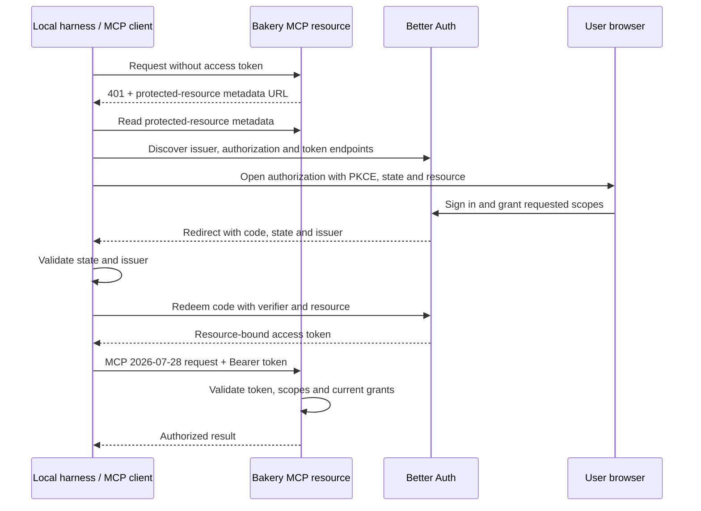

# Bakery transports and operations

**Mandatory semantic metadata:** Every Zod schema/type and every field requires a meaningful description, without exceptions. Preserve it through composition and generated contracts; reject missing descriptions. See [schema description rails](04-backend-and-errors.md).

The operation inventory is [`api-catalog.json`](./api-catalog.json), grouped and versioned there. This document defines how those entries execute; it does not repeat the catalog. A generated endpoint index and OpenAPI document must be derived from the catalog plus [`transport-schemas.json`](./transport-schemas.json). The JSON is an implementation-ready inventory, not a compiled Zod SDK.

## One operation boundary

**Repository rules addition:** [Repository rules](22-repository-rules.md#proposed-model-and-operation-additions)
owns the proposed organization publication/preview and effective repository rule
operations, profile preconditions and rule-change events. Reconcile these with
the model and transport schemas before generation; all clients share the same
Admin/repository authorization and inheritance resolver.

**Machine contract addition:** [Machines](21-machines.md#rest-mcp-and-worker-contract-additions) owns the proposed enrollment status/cancel/replacement, inventory, provider-auth and maintenance operations. It extends sync/event scopes with `worker_enrollment` and `worker`, and replaces writable host liveness/tool versions with desired-mode settings and authenticated observations. Those deltas must enter the JSON catalogs together before client generation; the older worker entries below do not yet represent the complete machine surface.

`apps/server` uses Hono. Each catalog `operation` maps to one entry in a plain typed registry. The registry validates the named input, resolves the current actor, checks the operation's required scope, executes the application port, and validates the named output. REST routes, MCP tools, scheduled work, Inngest functions, and worker adapters all call this registry. There is no generic `/execute` endpoint or untyped command bus.

```text
HTTP /v1/{resource} ─┐
MCP tools/call       ├─> operation registry -> authz -> application port
Inngest function     ┤                              -> Postgres transaction
worker protocol      ┘                              -> typed output/event
```

The catalog remains the route index: its methods, paths, MCP names and groups are generated into route tables and contract checks. Entries with an MCP name are discoverable through the same registry, but only an operational subset is enabled by default. Admin management operations are a separately scoped group and are discovered lazily after an authorized `tools/list` request; they are not loaded into every model context.

## REST conventions

All product routes use `/v1`. Better Auth's third-party handler owns `/api/auth/*`; those routes are not part of the operation catalog. Hono route files wire paths and operation names only. Handlers parse path/query/body through the named schema, pass the request context to the registry, and serialize the named output.

| Situation | Response |
|---|---|
| Successful read | `200` with a safe projection or `Page<T>` |
| Created resource | `201`, `Location`, and `ETag` when versioned |
| Accepted durable run | `202`, tracking `Location`, persisted idempotency response |
| Successful update | `200`, representation, and new `ETag` |
| Successful delete | `204` with no body |
| Conditional read hit | `304` with `ETag` and no body |
| Missing `If-Match` | `428 PRECONDITION_REQUIRED` |
| Stale `If-Match` | `412 PRECONDITION_FAILED`, current ETag only when caller may see it |
| Duplicate unsafe request | Exact persisted response with `Idempotent-Replayed: true` |
| Concurrent duplicate | `409 IDEMPOTENCY_IN_FLIGHT` |
| Different payload for an existing key | `422 IDEMPOTENCY_PAYLOAD_MISMATCH` |
| Rate/provider limit | `429` and `Retry-After` |
| Temporary dependency/worker absence | `503` and `Retry-After` |

Every Bakery-owned REST error is one RFC 9457 Problem Details object with `Content-Type: application/problem+json`. `type` is `${PUBLIC_BASE_URL}/problems/{lowercase-slug}`, `code` is the stable uppercase code, and `requestId`/`traceId` are correlation extensions. `title` and safe `detail` are catalog text; `type` is the primary identifier and `code` is its registered alias; clients never parse prose. MCP protocol and OAuth endpoint errors retain their required wire formats as defined in the backend chapter. The complete fault registry and mappings are in [transport-schemas.json](./transport-schemas.json) and the backend rail document.

The catalog and transport contract use the canonical `IDEMPOTENCY_PAYLOAD_MISMATCH` wire code with HTTP 422 and derive the matching lowercase Problem type. The generator rejects any suffixed duplicate rather than silently creating two public codes.

Unsafe `POST` and `PATCH` operations use `Idempotency-Key` (scoped to authenticated principal and operation). The key claim, state mutation, outbox intent, and serialized response are one transaction. A failed transaction leaves no orphan claim. `PATCH` additionally requires `If-Match` where the catalog says so. `PUT` resource creation uses a client ID and `If-None-Match: *` when a naturally idempotent operation is appropriate.

### Natural idempotency keys for destructive commands

Destructive commands explicitly marked `natural` in the API catalog derive a
stable natural key as `natural:<action>:<target>` for route-only identity, or
`natural:<action>:<target>:<field>:<encodedValue>` when the catalog declares a
required string input identity field; both forms are produced by
`createNormalizedCommandMetadata`. An explicit key is permitted only when the
catalog opts into that override and always replaces the derived key. `DELETE`
may also carry a strong `If-Match` validator. The first keyless natural DELETE
is unconditional and does not require `If-Match`; a stale supplied validator
returns `412 PRECONDITION_FAILED` before mutation. Retrying the same natural
request without a validator replays the recorded response. Reusing the same
explicit key with a changed or added `If-Match` changes the request digest and
returns `422 IDEMPOTENCY_PAYLOAD_MISMATCH`.

Example create:

```http
POST /v1/tasks HTTP/1.1
Host: bakery.example
Content-Type: application/json
Cookie: better-auth.session_token=...
Origin: https://bakery.example
Idempotency-Key: task-create-01
Traceparent: 00-4bf92f3577b34da6a3ce929d0e0e4736-00f067aa0ba902b7-01

{"applicationId":"018f0b4a-...","repositoryId":null,"taskType":"maintenance","title":"Repair preview","priority":50}
```

The response is `201` with `{ "task": ... }`, `Location: /v1/tasks/{id}`, and a representation from the `Task` projection. Before fingerprinting or dispatch, the registry canonicalizes UUID route parameters and top-level UUID resource-identifier fields to lowercase; nested user payload values are not rewritten. A retry with the same key and canonical request replays the same status and body. Any other changed input returns `422` with code `IDEMPOTENCY_PAYLOAD_MISMATCH`.
Completed command receipts have a 24-hour replay window. After `expires_at`,
the same scoped key may execute a new mutation and refresh the existing unique
receipt row atomically; a live row still replays or rejects a changed payload.

Example conditional update:

```http
PATCH /v1/tasks/018f0b4a-... HTTP/1.1
Content-Type: application/json
Cookie: better-auth.session_token=...
Idempotency-Key: task-update-01
If-Match: "task-v3"

{"priority":70}
```

The application locks the task, checks the version, writes version 4 and its domain event in one transaction, and returns the new ETag. A stale tag returns `412` without changing state.

### Skill file import and reads

`skillVersions.create` accepts a bounded `LocalSkillVersion` with regular files encoded as `SkillFileUpload[]`. This one REST/MCP operation has a 15MiB encoded request limit and a 10MiB decoded revision limit. The server validates the complete manifest and hashes, writes immutable file objects outside the database transaction, then commits the published version, metadata, event and exact idempotency response together. Reject payloads before allocating unbounded memory; file bytes must never enter a request log, idempotency response, database JSON or Inngest payload. Remote-source imports use the existing `skills.import` run; a failed import stays draft and resumes writes to the same keys.

`GET /v1/skill-versions/{id}` returns the manifest and `GET /v1/skill-versions/{id}/files/{path}` serves an exact listed file. Both use the same guards in local and cloud mode. Workers authenticate as their enrolled host and supply `X-Bakery-Attempt-Id`, `X-Bakery-Lease-Token` and `X-Bakery-Fence`; the server checks the live attempt and that the requested version is pinned in its job. A worker has no general catalog read permission. The assignment carries `{versionId,digest}` references; neither assignments nor responses contain storage keys or bucket credentials.

File reads authorize first, resolve metadata to an internal key, read and hash-check the bounded object before sending headers, then return the bytes with `Content-Type`, `Content-Length`, a quoted SHA256 `ETag`, `Cache-Control: private, no-store`, `X-Content-Type-Options: nosniff` and a safely encoded attachment filename. A missing manifest path is `RESOURCE_NOT_FOUND`; a missing/unavailable backing object for an existing file is `DEPENDENCY_UNAVAILABLE`; mismatched bytes are `SKILL_CONTENT_INTEGRITY_FAILED`. Conditional reads still authenticate. Workers also verify received bytes before use. MCP file metadata uses the shared version query; local harnesses download content through this authenticated REST route using a separately authorized REST-resource token; an MCP-audience token is not accepted as a generic REST credential.

## Pagination and synchronization

**All pagination is cursor-based.** Every catalog operation marked paginated uses `cursor` and `limit`; no endpoint accepts page numbers, offsets or skip counts. `Page<T>` means a cursor page with required `items` and `nextCursor` (null at the end), optional `prevCursor`, and `highwater` only where the endpoint defines snapshot/event semantics. Default limit is 25; maximum is 100. The item type references a named safe projection in `transport-schemas.json`.

```text
GET /v1/tasks?limit=25
-> { "items": [...], "nextCursor": "<opaque-token>" }

GET /v1/tasks?limit=25&cursor=<opaque-token>
-> { "items": [...], "nextCursor": null }
```

The database uses keyset queries with an immutable sort tuple and unique ID tie-breaker, normally `(created_at DESC, id DESC)`. Fetch `limit + 1` authorized rows to detect continuation, return only `limit`, and construct the next cursor from the last returned row. Never hide SQL OFFSET behind an encoded token. Queue scheduling may use mutable priority; collection traversal uses its independently documented stable ordering.

The server authenticates cursor tokens and binds them to the operation, principal/scope, normalized filters, sort/direction, schema version and last ordering tuple. Clients treat them as opaque. Malformed, tampered or mismatched cursors return `INVALID_CURSOR` (400); do not silently restart. Changing filters or ordering starts a fresh traversal. Current authorization applies on every request, including after revocation.

Pages are a live traversal, not a transaction held across requests. New leading rows appear on refresh; deletions and changing filter membership remain possible. The UI deduplicates IDs and invalidates affected queries when live events change membership. No total-page count or arbitrary page jump is promised.

Bakery MCP list tools use the same cursor contracts. Native MCP discovery methods retain the protocol's `cursor`/`nextCursor` convention and omit `nextCursor` at the end; do not add nonstandard page-size or offset fields. The event synchronization cursor below remains a separate continuation stream with its existing 500-event maximum.

`GET /v1/sync` requires an explicit scope type and UUID. With no cursor, it returns one scoped, coherent snapshot of the current resource state plus its event highwater. If that scope exceeds the bounded snapshot budget, it returns `413 SNAPSHOT_SCOPE_TOO_LARGE` with a deterministic `refineScope` hint; the client narrows the scope or uses ordinary REST pages. With a cursor, it returns only the retained event delta after that cursor; the cursor does not turn the request into another full reset. Both forms run in a Postgres `REPEATABLE READ` transaction:

```text
BEGIN ISOLATION LEVEL REPEATABLE READ
  authorize current principal and requested application/repository/task/conversation scopes
  read the organization's retained_from_seq and current highwater from event_clock
  if after is absent:
    read all scoped resource projections from this snapshot; return no historical events
  else if after < retained_from_seq - 1:
    return reset_required with 409 and tell the client to retry /v1/sync without after
  else:
    read domain_events(after, limit) from this snapshot
  read highwater in this same snapshot
COMMIT
```

The response is `SyncSnapshot { resourceState, highwater, events, nextCursor, resetRequired }`. A no-cursor response carries projected `resourceState` and its organization-scoped highwater from the same repeatable-read view; a cursor response carries `{}` in `resourceState` plus the retained delta. The required empty-object sentinel keeps the wire shape stable; consumers distinguish a delta by the `after` cursor in their request, not by property presence. The highwater belongs to that exact tenant event snapshot, so a client can resume at `nextCursor` without a gap and cannot observe another organization's sequence activity. If retention has passed a supplied cursor, return `reset_required` and the earliest available sequence; the client discards its projection and retries without `after`.

Synchronization cursors are opaque strings; organization-local numeric sequence/highwater values are decimal strings. Clients never parse or construct opaque cursors. A no-cursor scope is bounded and deterministic; `SNAPSHOT_SCOPE_TOO_LARGE` carries a `refineScope` hint and the client uses ordinary REST pages for the narrowed resources.

## Shared conversation and comment operations

See [Multiplayer chat and artifact review](07-multiplayer.md) for the end-to-end call stack, permissions and concurrency rules. `messages.create` atomically appends a message and, for `agent_request`, its queued turn. The same operation handles explicitly selected version-checked comment threads through `commentRefs`. Conversation turn list/get/cancel operations expose admission and cancellation. Artifact comments support flat replies, edit, resolve/reopen and soft-delete/restore through the existing create/PATCH operations; the new artifact-wide cursor list keeps older-version threads discoverable. Every operation uses the existing StandardError/RFC 9457 boundary, including MCP tool failure mapping.

## WebSocket notifications

`GET /v1/events` is a notification channel only. It supports no domain write or arbitrary operation invocation. Resource writes use REST or MCP; the proposed collaboration socket below admits CRDT updates through the same operation guards. The browser must present a valid Better Auth same-origin cookie and an `Origin` exactly matching configured web origin; missing or cross-origin `Origin` is rejected. A non-browser client uses an authenticated bearer/session mechanism, still subject to the same actor and scope checks. The organization is supplied by the `Bakery-Organization-Id` header or the `organizationId` query parameter on upgrade; omitting both is rejected before upgrade.

The wire protocol is a tagged JSON union. Unknown tags are a `400` protocol Problem; frames are bounded to 256 KiB. A subscription accepts at most four scopes. `subscribe.after` is a decimal event sequence or `null`; `resume.cursor` and upgrade `after` are opaque cursors previously issued in `cursor` frames.

`maxFrameBytes` is enforced after the WebSocket runtime has assembled an
inbound message; the runtime's own message ceiling is the effective
wire-level bound for each connection. A lower wire-level frame limit belongs
at the ingress or reverse proxy (or a future Deno upgrade option), because the
userland handler cannot reject bytes before that assembly.

Client frames:

```json
{"type":"subscribe","requestId":"018f0b4a-82a2-4ef1-a100-842bde445334","scopes":[{"type":"repository","id":"018f0b4a-82a2-4ef1-a100-842bde445332"}],"after":"42"}
{"type":"resume","requestId":"018f0b4a-82a2-4ef1-a100-842bde445334","cursor":"cursor"}
{"type":"ack","requestId":"018f0b4a-82a2-4ef1-a100-842bde445334","eventId":"018f0b4a-82a2-4ef1-a100-842bde445335","sequence":"42"}
{"type":"ping","requestId":"018f0b4a-82a2-4ef1-a100-842bde445334"}
```

Server frames:

```json
{"type":"hello","protocolVersion":1,"connectionId":"018f0b4a-82a2-4ef1-a100-842bde445335","highwater":"42","retainedFrom":"1"}
{"type":"events","requestId":"018f0b4a-82a2-4ef1-a100-842bde445334","events":[{"id":"018f0b4a-82a2-4ef1-a100-842bde445332","sequence":"42","type":"tasks.updated","schemaVersion":1,"occurredAt":"2026-09-07T12:00:00Z","taskId":"018f0b4a-82a2-4ef1-a100-842bde445333","repositoryId":null,"conversationId":null,"payload":{"resourceId":"018f0b4a-82a2-4ef1-a100-842bde445333","resourceVersion":4}}],"highwater":"42"}
{"type":"cursor","requestId":"018f0b4a-82a2-4ef1-a100-842bde445334","cursor":"opaque-cursor","highwater":"42"}
{"type":"reset_required","requestId":"018f0b4a-82a2-4ef1-a100-842bde445334","reason":"cursor_expired","retainedFrom":"100","highwater":"142"}
{"type":"ack","requestId":"018f0b4a-82a2-4ef1-a100-842bde445334","eventId":"018f0b4a-82a2-4ef1-a100-842bde445335","sequence":"42","status":"accepted"}
{"type":"ping","requestId":"018f0b4a-82a2-4ef1-a100-842bde445334"}
{"type":"problem","requestId":"018f0b4a-82a2-4ef1-a100-842bde445334","problem":{"type":"https://bakery.example/problems/scope-required","status":403,"code":"SCOPE_REQUIRED","title":"Scope required","detail":"The subscription is outside the caller's scope."}}
```

Subscription scopes accept `application`, `repository`, `task` and `conversation`. A conversation scope works before task creation; safe event envelopes include nullable `conversationId`. Message events include message sequence; comment events include artifact/version/root IDs and root version. The server intersects every scope with current resource access before broadcasting or replaying. Chat/comments continue to write through REST/MCP; there are no socket mutation frames.

`hello` supplies the current cursor boundary. `events` is replay or live delivery. `ack` is delivery acknowledgment only. `ping` is answered with `ping`. `reset_required` means the cursor cannot be replayed and directs the client to `/v1/sync`; it is not a run failure. Backpressure closes a connection after a bounded grace period; the client reconnects with its last acknowledged cursor.

## Collaborative documents and presence

[The collaboration contract](20-collaborative-documents.md) proposes a lazy `WS /v1/collaboration` on the same Deno host. It multiplexes scoped rooms, bounded Loro sync/update/receipt frames and ephemeral presence. The existing `/v1/events` cursor stream remains read-only. Only committed document updates receive durable acknowledgments; presence expires and is never replayed from Postgres. Join, sync and each write recheck current authority.

Draft creation, checkpoint/slice reads, bounded agent edits, publication and draft-comment operations enter the same typed registry and REST/MCP authorization boundary. Agent tools receive text slices and checkpoint references, not CRDT history. New draft records, routes, frames and integration capabilities are explicit catalog deltas, not existing generated contracts. Reuse StandardError and safe Problem Details mapping for rejected operations; `resync_required` never claims a rejected change was saved.

## MCP 2026-07-28 and OAuth

**Selected release: 2026-07-28, verified 2026-09-07.** Use official SDK v2 packages `@modelcontextprotocol/server` and `@modelcontextprotocol/client`; exact dependency patches are pinned during implementation. The published Bakery endpoint supports this profile only. Real Pi, Claude Code and Codex compatibility is a release check, not permission to downgrade silently. [Official TypeScript SDK](https://github.com/modelcontextprotocol/typescript-sdk/blob/main/README.md)

### Wire contract

`POST /mcp` carries each self-contained request. JSON and request-scoped SSE responses are supported. There is no initialization handshake, protocol session or standalone GET event stream; GET/DELETE return 405. Each request carries version/client metadata in `_meta`, plus matching `MCP-Protocol-Version`, `Mcp-Method` and applicable `Mcp-Name` headers. The SDK validates their encoding and agreement before dispatch. Ignore legacy session/resume headers without echoing them. Invalid Origins fail; a native client without Origin still authenticates. [MCP Streamable HTTP](https://modelcontextprotocol.io/specification/2026-07-28/basic/transports/streamable-http)

```http
POST /mcp HTTP/1.1
Authorization: Bearer <resource-bound-access-token>
Content-Type: application/json
Accept: application/json, text/event-stream
MCP-Protocol-Version: 2026-07-28
Mcp-Method: tools/list

{"jsonrpc":"2.0","id":1,"method":"tools/list","params":{"_meta":{"io.modelcontextprotocol/protocolVersion":"2026-07-28","io.modelcontextprotocol/clientInfo":{"name":"bakery-local-client","version":"1.0.0"},"io.modelcontextprotocol/clientCapabilities":{}}}}
```

The registered methods are `server/discover` (optional discovery), `ping`, `tools/list`, `tools/call`, `resources/list`, `resources/templates/list`, `resources/read`, `prompts/list` and `prompts/get`. Do not advertise optional subscriptions, Tasks, sampling, roots or elicitation features before implementing them. Durable Bakery runs remain ordinary tool results containing run IDs; their lifecycle belongs to Inngest and Bakery.

Results carry `resultType: "complete"`. Argument/domain/provider failures from a valid tool call add `isError: true` and bounded `structuredContent.problem`; the tool output schema includes that failure shape. Authentication/scope failures occur before dispatch; unknown tools and malformed RPC envelopes remain SDK protocol errors. Protocol errors use SDK codes, including `HeaderMismatch` (-32020), `MissingRequiredClientCapability` (-32021) and `UnsupportedProtocolVersion` (-32022). Unknown methods use -32601. Do not allocate Bakery domain faults inside the reserved MCP error range. [MCP base protocol](https://modelcontextprotocol.io/specification/2026-07-28/basic/index)

Closing a request SSE response cancels that RPC's handling. It does not undo a committed run or external effect: durable cancellation uses `runs.control`. A response lost after commit is recovered by replaying the same Bakery idempotency key. HTTP clients do not send `notifications/cancelled`; browser `/v1/events` reconnects use their separate cursor protocol.

The existing default tools and catalog candidates are unchanged. `tools/list` uses standard cursor pagination, current authorization filters and deterministic order; start with zero catalog cache TTL to avoid stale grants. `tools/call` resolves an explicit registered tool, never an arbitrary operation name. Resource templates and skill-derived prompts retain their shared operation guards and redaction. Reading a prompt does not execute a skill. Binary artifact MCP uploads retain the existing 1MiB decoded limit and larger REST upload path; the distinct local skill upload operation retains its specified 10MiB decoded revision limit.

### OAuth ownership and discovery

Use Better Auth's `jwt()` plus `@better-auth/mcp` and `@better-auth/cimd` with `metadataProfile: "mcp-2026-07-28"`. `mcp()` already supplies the OAuth provider; do not install a second provider instance. The provider owns OAuth tables, signing keys, token endpoints and discovery. Keep SDK transport ownership separate and configure `legacy: "reject"`. [Better Auth MCP setup](https://better-auth.com/docs/plugins/mcp)

The resource identifier is `${PUBLIC_BASE_URL}/mcp`. Serve its protected-resource metadata at `/.well-known/oauth-protected-resource/mcp` and provide its URL in an unauthenticated request's `WWW-Authenticate` challenge. Use the authorization/token/JWKS URLs from validated provider discovery, including issuer path handling under `/api/auth`; do not invent parallel Bakery login endpoints. The client validates the discovered issuer before using those endpoints. [Authorization server discovery](https://modelcontextprotocol.io/specification/2026-07-28/basic/authorization/authorization-server-discovery)



Start with pre-registered local harness clients; CIMD supports other accepted clients without deprecated Dynamic Client Registration. DCR stays disabled. Redirect URIs must match registration, and client credentials are issuer-specific. [MCP client registration](https://modelcontextprotocol.io/specification/2026-07-28/basic/authorization/client-registration)

CIMD uses the provider's MCP profile pinned to draft-00. Deno needs a fetch transport that validates DNS addresses, pins the approved connection address and rejects redirects for metadata and JWKS; ordinary fetch after a DNS precheck is insufficient. Enable and advertise CIMD only with that tested transport; pre-registration supplies the local path while it is verified. [Better Auth CIMD boundary](https://better-auth.com/docs/plugins/cimd)

### Tokens, scopes and local mode

Require authorization code + PKCE S256, validated state, and `resource` on authorization and token requests. Bakery emits RFC 9207 `iss` and advertises support. An outbound client compares any returned issuer exactly before redeeming the code; a missing issuer fails when the server advertised it. Access tokens are supplied in the Authorization header on every call, never in query strings. Missing/invalid tokens produce 401; insufficient scope produces 403 with a Bearer scope challenge. [MCP authorization](https://modelcontextprotocol.io/specification/2026-07-28/basic/authorization)

| Bakery OAuth scope | Required for | Additional guard |
|---|---|---|
| `bakery:read` | Exposed queries, catalogs and resources | Current repository/catalog read permission |
| `bakery:operate` | Exposed mutations | Current role, repository grant and workflow policy |
| `bakery:admin` | Admin-only operations, in addition to read/operate | Current Admin role |

Scopes restrict existing permissions; obtaining a scope never promotes the principal. Consent is recorded for the client/resource/scopes and reused within that grant. New scopes require an explicit authorization step; routine workflow steps do not add approval prompts. Disconnect/revoke is available in integration settings. Browser session cookies are for the web/login flow and cannot substitute for an MCP access token.

Validate signing keys, issuer, audience, expiry, revocation and scopes, then run Bakery's existing live guards. Use short-lived access tokens and rotate issued refresh tokens with reuse detection. Store upstream tokens encrypted per issuer/client/resource/connection; never forward a Bakery token to a third-party MCP server. [MCP authorization security](https://modelcontextprotocol.io/specification/2026-07-28/basic/authorization/security-considerations)

Full local mode keeps Better Auth and Postgres on the same machine and uses trusted local HTTPS for OAuth/MCP. Setup must provide a local certificate trusted by the browser and harness; no Cloudflare or hosted identity account is required. Native loopback callbacks remain allowed. Plain HTTP smoke mode does not count as OAuth conformance. Local stdio MCP subprocesses use their host credential boundary rather than an HTTP OAuth redirect flow.

For external HTTP MCP connections, Bakery is the OAuth client and stores the observed protocol version and authorization metadata on that connection. Protected upstreams use their own OAuth grant; unsupported protocol/auth behavior makes the connection unavailable with an actionable status. There is no automatic fallback to public access. Host-local Paper discovery continues to be checked against the actual host/server capability.

## Worker protocol route mapping

The execution output refinement adds a proposed `job.output` payload, session output cursor endpoint and separate output frames on the existing socket. Those additions are not yet present in this operation/schema inventory. Existing domain-event cursors describe status changes, not replayable token text.

Worker routes are catalog operations with explicit data-model ownership. They are not an open-ended command API:

| Catalog operation | Route | Durable records | Required checks |
|---|---|---|---|
| `worker.register` | `POST /v1/worker/registration` | `worker_hosts`, `principals`, `worker_enrollments` | Enrollment token plus worker-generated 32-byte base64 `workerCredential`; requested capabilities must be a subset of the locked enrollment allowed_capabilities; consume token only with successful registration; atomically stores the selected `X-Bakery-Worker-Protocol-Version` (base-compatible v1 when omitted, negotiated v2 when requested), and returns the selected version header |
| `worker.heartbeat` | `POST /v1/worker/heartbeat` | `worker_hosts`, `job_attempts`, `worker_commands`, `worker_heartbeat_replays`, `worker_command_ack_tombstones` | Worker principal, active host, bounded heartbeat; idempotency key stores the exact response bytes for the replay horizon and exact retries return `Idempotent-Replayed: true`; initial null session accepts generation 0 and issues generation 1, same-session retries are idempotent, and a replacement session rotates only when it supplies the current generation; `pendingClaimKey` rebinds a live lost-response claim before reconciliation; protocol v2 returns `reconciledAttemptIds` containing only reported attempts rebound by a PostgreSQL-time live-lease/current-job-fence CAS, and the worker resumes no other restored attempt; tombstones are retained only through indexed expiry |
| `worker.claim` | `POST /v1/worker/claims` | `jobs`, `job_attempts`, `worker_claim_replays` | Capability and supported-action match, capacity, durable `claimKey` dedupe under a host/claim lock; exact replays are checked before current-session fencing and atomically rebind their live attempt to the authenticated session, but reject changed non-session payloads; atomic fence/lease; returns a complete `JobAssignment` with session fence, lease duration, and PostgreSQL server time |
| `worker.events` | `POST /v1/worker/attempts/{id}/events` | `attempt_events`, `job_attempts`, `jobs` | Authorization worker token plus attempt-path ID, `leaseToken`, current fence and protocol-v2 worker session pair; current job fence, PostgreSQL-time active lease and contiguous `local_seq`; nonterminal lifecycle events only; server recomputes digests, rejects duplicate event IDs at another sequence, and validates every reference |
| `worker.renew` | `POST /v1/worker/attempts/{id}/lease-renewals` | `job_attempts`, `jobs`, `worker_lease_renewal_replays` | Host/token/fence/current job fence and protocol-v2 worker session pair with PostgreSQL-time unexpired lease under the attempt lock; durable idempotency key replays the exact saved response only after authenticating the current host session and locked attempt binding (the replay path does not require a live lease); returns lease duration and PostgreSQL server time |
| `worker.result` | `POST /v1/worker/attempts/{id}/result` | `job_attempts`, `jobs`, `workflow_runs` | Authorization worker token plus attempt-path ID, lease token, fence and protocol-v2 worker session pair; canceled jobs cannot resurrect; server recomputes digests and validates check-run, session, snapshot, artifact/checkpoint, and effect references against the current organization/run/step/attempt |

| `worker.artifacts` | `POST /v1/worker/attempts/{id}/artifacts` | `artifact_versions`, `attempt_events` | Authorization worker token plus attempt-path ID, lease token and fence; bounded streamed content bytes and server-computed digest |
| `worker.previews` | `POST /v1/worker/attempts/{id}/previews` | `previews`, `preview_grants` | Authorization worker token plus attempt-path ID, lease token and fence; current attempt, route/port bounds, expiry |
| `worker.invokeTool` | `POST /v1/worker/attempts/{id}/tool-invocations` | `external_effects`, `usage_records`, `budget_accounts`, `budget_reservations` | Authorization worker token plus attempt-path ID, lease token and fence; capability grant, repository-profile/run budget caps, provider quota, effect reconciliation |
`worker.events` stores each `(attemptId, localSeq)` once and separately fences the event UUID. For an already committed sequence, an identical event type and digest replay the byte-identical `WorkerAck`, including its saved contiguous highwater, even after lease expiry; a changed duplicate or an event UUID reused at another sequence returns `IDEMPOTENCY_PAYLOAD_MISMATCH` before the database unique constraint. The route accepts nonterminal lifecycle events only; `job.succeeded`, `job.failed`, and `job.cancelled` are authoritative `/result` mutations and are rejected here. For an unseen sequence, the handler checks the worker Authorization token, attempt path, lease token, current job fence, active lease using PostgreSQL `current_timestamp`, and reference ownership before applying an event; a stale proof returns `LEASE_FENCED`, while an expired proof returns `LEASE_EXPIRED`. A…

`WorkerResult.status` is the cancellation contract: `completed`, `failed`, or `canceled`; cancellation has no separate worker result endpoint and a canceled job cannot be resurrected by a late success. Under the job lock, cancellation commit wins over a concurrent success (`CANCEL_REQUESTED`); if a terminal result committed first, cancellation returns `ALREADY_TERMINAL`. A success is rejected when `cancel_requested_at` is present.

`worker.result` is the sole terminal-result adapter over the same attempt journal used by `worker.events`: it validates the exact output schema registered for the locked job action and all referenced durable evidence before inserting the terminal `attempt_events` row at the supplied `localSeq`, applies the result transition under the attempt/job lock, and deduplicates by `(attemptId, localSeq, digest)` in one transaction. Exact replays of a committed terminal row return its saved acknowledgement, including after expiry; a changed replay returns `IDEMPOTENCY_PAYLOAD_MISMATCH`. A stale lease or job fence on an unseen result returns `LEASE_FENCED`; PostgreSQL-time expiry returns `LEASE_EXPIRED`. A requested cancellation returns `CANCEL_REQUESTED` unless the terminal commit already won, in which case it returns `ALREADY_TERMINAL`.`
For unseen worker events, lease renewals, and terminal results, a zero-row authority CAS is re-read against PostgreSQL `clock_timestamp()` and the current job fence. The server returns `LEASE_EXPIRED` for the matching fence after expiry and `LEASE_FENCED` for a changed host, token, session, attempt fence, job fence, or lifecycle state; it never exposes an internal error or generic state conflict for this authority loss.

`GET /v1/external-effects` and `GET /v1/external-effects/{id}` expose the authorized `ExternalEffect` safe projection for reconciliation. The query supports `runId` and status filters. It includes requesting actor, fixed integration or MCP connection identity, repository profile, adapter version, and credential version, while omitting request/response payloads and secrets. Run usage summaries accept `runId`, count unknown measurements separately, and expose worker-unverified measured cost outside provider-authoritative known totals.

External-effect visibility is derived from the caller's authorized repository scope or requesting principal, with Admin policy applied centrally; an integration or MCP connection ID alone never grants global Developer visibility.

## Auth scopes and read redaction

Better Auth proves the human session; Bakery's `principals` and `permission_grants` decide what the actor may do. Initial roles are Admin and Developer. The operation definition declares required scope, and the central guard checks it against the current grant on every sensitive call. Worker and integration identities are separate principals. Revocation takes effect immediately for REST, MCP, sync replay, WebSocket delivery, and worker reports.

Safe projections are allowlists, not ORM serialization. `transport-schemas.json` names every output's projection and camelCase fields. Never expose secret values/ciphertext, lease token hashes, raw provider payloads, arbitrary shell output, or sensitive harness resume handles. Artifact and log content are returned only through scoped references or bounded content endpoints. Tool/provider credentials are resolved in a trusted broker; if an arbitrary-shell harness must receive one, it is short-lived, workspace-scoped, isolated from the control plane, recorded with expiry, and revoked after the attempt.

Secret creation accepts optional `allowedPrincipalIds` and `allowedActions`, each defaulting to an empty deny list. `PATCH /v1/secrets/{id}` uses `SecretPolicyUpdate` to replace both lists atomically; reads expose metadata and policy references, never values. A worker tool invocation binds one fixed `integrationConnectionId`; the server resolves and records that provider account identity in `external_effects` and never accepts a free-form account selector.

## Contract and acceptance checks

`transport-schemas.json` must cover every unique input and output name in the catalog. CI checks this set equality, verifies every projection points to a current logical table or explicit safe computed output, and rejects fields from a denylist (`ciphertext`, `leaseTokenHash`, `rawProviderPayload`, `resumeHandle`). A generator produces route registration, MCP metadata, JSON Schema, and OpenAPI from the catalog and schemas; no hand-maintained second route list is accepted.

Contract tests must prove REST/MCP parity for one read, one synchronous write, one `202` run request, one conditional patch, one worker claim, one worker event gap, one duplicate event, and one revoked grant. Sync tests use a repeatable-read fixture and assert atomic highwater/cursor behavior. WebSocket tests cover hello, subscribe, replay, ack, ping, reset_required, and problem frames. Worker tests cover host/token/fence/lease checks, cancellation, stale attempts, byte-identical duplicates, changed duplicate rejection, and uncertain effect reconciliation. The generated route index is a coverage report; it is not itself a claim that every route is enabled in the default MCP context.

Skipped compiled Zod/OpenAPI code generation and runtime route implementation because these files are the design inventory; add them in the first contracts implementation band.

## Budget read contract

`usage.list` (`GET /v1/usage`) is an installation-administrator query. It returns known cost, unknown measurement count, separately identified worker-unverified measurements, and `budgetAccounts` for the requested original reservation periods plus optional `runId`; it never substitutes the current calendar period for a reservation's persisted account. Each account includes exact decimal-string `limitUsd`, `reservedUsd`, `settledUsd` and `availableUsd`. `runs.get` returns the run account in `Run.budgetSummary`; its installation account is null unless the current principal also has a live installation-administrator grant. An organization administrator alone cannot read installation usage. Unknown charges retain reservations, and reads never create or release holds.

## Canonical event index

`transport-schemas.json.events` defines every catalog event type, its versioned payload and any Inngest translation. For example `run.requested` becomes `bakery/run.requested.v1`; `job.completed` becomes `bakery/job.completed.v1`; `question.answered` becomes `bakery/question.answered.v1`. There is no implicit singular/plural conversion. Events with `inngestTrigger: null` do not start Inngest functions. Browser notifications retain the canonical domain type and `schemaVersion: 1`. Cron ticks are registered Inngest schedules, not synthetic public domain events.

Worker claims have one dedupe identity: `Idempotency-Key` must equal body `claimKey`. Replays return the original assignment or original 204; the replay digest excludes only the process-session UUID/generation so a session replacement can retrieve the exact saved response but cannot change capabilities, supported actions, host identity, or any other claim field. A new poll uses a new UUID. `workerActions` and `workerEvents` in the schema inventory define exact input/output and payload discriminators. A completed result requires its assigned action output, a failed result requires a Problem, and canceled requires process-exit evidence; the other terminal fields are forbidden.

RPC examples and the machine-readable MCP contract target only the released 2026-07-28 profile. The implementation conformance check owns exact SDK/auth package versions.
# Integration routing addition

[Integrations](09-integrations.md) specifies GitHub App routing. A shared GitHub App uses `POST /v1/webhooks/github` and routes verified installation/repository identities to the correct organization; this replaces the earlier `/v1/webhooks/github/{connectionId}` proposal. [Tickets](10-tickets.md) documents source, snapshot, readiness and admission operations, which still need integration into the structured API/schema catalogs before implementation.
