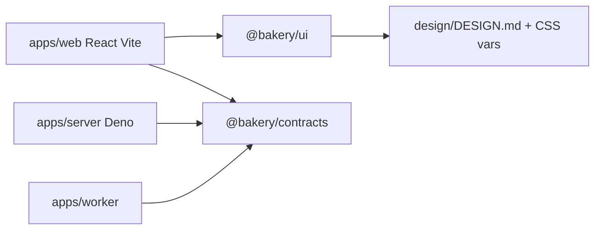
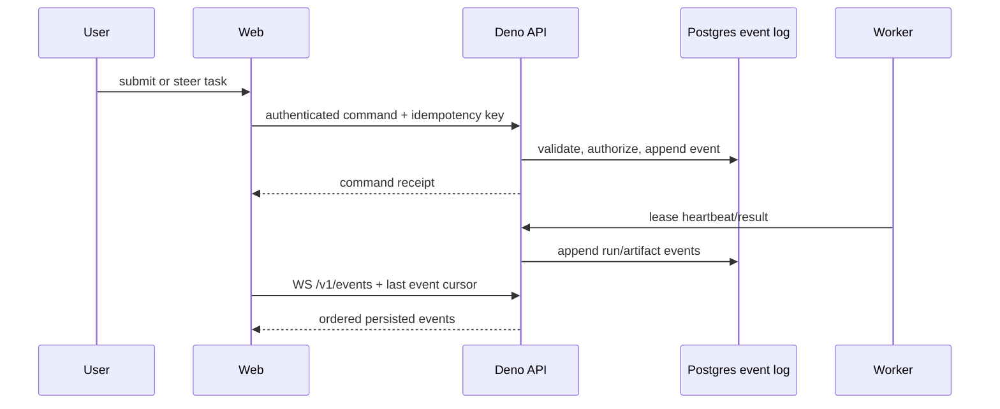

# Bakery frontend and design system

**Mandatory semantic metadata:** Every Zod schema/type and every field requires
a meaningful description, without exceptions. Preserve it through composition
and generated contracts; reject missing descriptions. See
[schema description rails](04-backend-and-errors.md).

Status: proposed implementation contract. This document describes the first
Bakery web client. Alidade remains unchanged. The
[enterprise Paper page](https://app.paper.design/file/01M1X504XVC45FC0VDK857A37D/3-0)
now contains 15 editable specimens: seven paired phone/desktop screen families
and one foundation reference sheet. Integration designs add 20 paired
screen/state views and four primitive sheets. The exported v1 system has 44
tokens; runtime components and Storybook implementation remain future work.

> **Visual direction superseded:** the enterprise mock round
> replaces the former warm palette, typography and screen compositions.
> Engineering rails, transport behavior, accessibility and responsive
> requirements remain. Review [the mock brief](enterprise-mocks/MOCK-BRIEF.md)
> and the current DESIGN.md before treating any layout below as settled.

## Boundary and evidence

Bakery uses a responsive React web application with shadcn/ui as its runtime
component foundation. It keeps the pnpm/Turborepo workspace and Deno API runtime
selected in the design goal. The web client owns presentation, query/mutation
orchestration, local form state, routing, and live event rendering. The Deno
service owns authentication, authorization, validation, task/run state, and the
event stream. A future BB client and Slack adapter consume the same API and
persisted events.

The following is observed in the Alidade reference project:

- The repository is pnpm + Turborepo with an Expo React Native app, a Deno 2
  Hono server, shared contracts, and a UI package (README.md:5-23).
- Its enforceable contract requires strict TypeScript, semantic components, no
  feature margins/raw colors/type literals/absolute overlays, and co-located
  stories plus worst-case specimens (AGENTS.md:34-53).
- The design language uses `sheet` through 743px, `pane` from 744px to 1279px,
  and `rail` from 1280px, with coarse/fine pointer axes and 44px/28px hit
  metrics (DESIGN.md:206-214; `packages/ui/src/responsive-core.ts`:3-47).
- Its token source has named colors, typography, spacing, density, radii,
  layout, and motion values (`packages/ui/src/tokens.ts`:1-191). The authored
  theme is dark first; light tokens are not invented (DESIGN.md:123-130).
- Storybook is a separate package surface with a Vite React Native Web
  framework, a global responsive decorator, and static build scripts
  (`packages/ui/.storybook/main.ts`:1-27;
  `packages/ui/.storybook/preview.tsx`:1-25; `packages/ui/package.json`:9-35).
  Current stories are organized by UI family, for example `UI/Controls`,
  `UI/Panel`, `UI/Screen contract`, and `UI/Typography`
  (`packages/ui/src/controls.stories.tsx`:9-49; `panel.stories.tsx`:12-58;
  `screen.stories.tsx`:13-89; `typography.stories.tsx`:8-35).
- Rails sweep six phone/tablet sizes, font scales 1.0 and 1.3, loaded fonts,
  overflow, ellipsis, and interactive target size; the current implementation is
  `tests/rails/design-rails.ts`:3-13,40-143. Its test setup fixes dark mode,
  DPR, touch, locale, and reduced motion
  (`tests/rails/design-rails.spec.ts`:5-33).
- The current conversion ledger reports 22 converted and 168 pending components
  (`packages/ui/CONVERSION.md`:1-8). Bakery therefore adopts the contract and
  useful vocabulary, not the entire catalog or domain components.
- No `.codegraph` directory exists at the Alidade repository root, so these
  observations came from the listed source files.

These observations are adaptation inputs, not Bakery dependencies. Bakery does
not import `alidade-design-system`, Tamagui, Expo, React Native components, or
Alidade's identity/cryptographic domain. Bakery's equivalents are CSS custom
properties, shadcn primitives, Radix accessibility behavior, and semantic React
components in `@bakery/ui`.

## Package shape and dependency direction

```text
.
├── apps/
│   ├── web/                 # React + Vite, TanStack Router/Query
│   ├── server/              # Deno + Hono; REST, WS, auth, domain calls
│   └── worker/              # host-local harness adapter and job protocol
├── packages/
│   ├── contracts/           # Zod fault/event schemas and generated clients
│   ├── i18n/                # locale resolution, typed keys and catalogs
│   ├── ui/                  # shadcn primitives + semantic Bakery components
│   └── config/              # shared TS/ESLint/Vite/Tailwind configuration
└── design/                  # DESIGN.md, Paper parity manifest, visual inputs
```

`packages/contracts` is the source of truth for DTOs, fault/problem schemas,
event envelopes, and generated REST/MCP client types. The root design token
roles live in `design/DESIGN.md`; `@bakery/ui` consumes its generated CSS
variables. `@bakery/i18n` owns translated copy, locale fallback, direction and
formatting for every client surface; see
[Internationalization](13-internationalization.md). This keeps the selected
workspace small and avoids speculative `events`, `faults`, `testkit`, or
standalone API-client packages.



Allowed directions are `contracts -> no UI/app`, `i18n -> no UI/app`,
`ui -> generated CSS from
design/DESIGN.md only`, `web -> ui/contracts`,
`server -> contracts`, and `worker -> contracts`. `contracts` contains
serializable schemas and DTOs, never React or database models. `ui` contains no
fetch, router, auth, task store, or worker logic. `web` never imports server
internals. `config` is a build dependency only. The root scripts are:

```text
pnpm dev                 # uncached web + Deno API + local dependencies
pnpm build               # Turbo dependency-ordered production builds
pnpm lint                # app and package lint, including UI rails
pnpm typecheck           # strict TypeScript in every package
pnpm test                # unit and contract tests
pnpm test:integration    # server + Postgres + event cursor tests
pnpm test:e2e            # browser task intake and recovery flow
pnpm test:visual         # cost-aware deterministic screenshot lane
pnpm storybook           # @bakery/ui component catalog
pnpm build-storybook     # CI artifact
```

Turbo follows Alidade's observed task shape: `build`, `lint`, `typecheck`, and
`test` depend on upstream package tasks; `dev` is persistent and uncached;
Storybook emits `storybook-static/**`.
(Alidade `turbo.json`.) Cache inputs
include lockfile, package source, config, and relevant environment version
files. Outputs are `dist/**`, `build/**`, and `storybook-static/**`. Migrations,
service startup, deployment, live previews, and visual baseline updates are
never cached Turbo tasks.

## Tokens and component contract

The approved enterprise direction is defined in [DESIGN.md](DESIGN.md): Geist
and Geist Mono, quiet neutral work surfaces, restrained cobalt selection, and
the approved conveyor mascot at app-icon size. Light and dark are authored as
equal themes. `System` follows the operating-system preference; `Light` and
`Dark` persist a user override and apply before first paint. The user selected
composition A (work queue) in review 947b2a38. Exact v1 values are exported from
Paper in [tokens.json](enterprise-mocks/tokens.json) and
[tokens.css](enterprise-mocks/tokens.css). The
[UI contract](enterprise-mocks/UI-CONTRACT.md) owns screen state, responsive
transforms, model selection and component specimen requirements. The
[Paper manifest](enterprise-mocks/paper-manifest.json) maps editable source
frames to static review exports; it is not a measured runtime parity baseline.

`@bakery/ui` is the only runtime owner of raw color, type, spacing, radius,
motion, and z-index values. It exports a typed token map and generated CSS
variables consumed by Tailwind/shadcn. Semantic names describe intent:

```text
surface.page/canvas/panel/card/raised/selected
text.primary/secondary/muted/disabled/inverse
action.primary/secondary/quiet/danger
state.live/healthy/pending/stale/offline/degraded/failed
focus.ring
type.display/title/heading/body/ui/data/label/caption
space.0/1/2/3/4/5/6/8/10/12
radius.control/card/panel/sheet/pill
```

The light palette uses `#F5F6F8` canvas, white surfaces, `#141A24` ink and
`#0B63C6` selection. The dark palette uses `#0B0E14` canvas, `#12161E` surfaces,
`#F2F4F8` ink and `#4A93E6` selection. Values mirror the Paper file, which is
the source of truth; see [DESIGN.md](DESIGN.md). Both themes provide semantic
success, warning and critical pairs that meet the same component contract. State
color is never the only state cue: use text, icon and accessible status
semantics together. Syntax highlighting, charts, code diffs, native desktop
chrome and embedded plugin surfaces consume these semantic tokens instead of
maintaining independent palettes.

All component copy uses typed `@bakery/i18n` keys with named arguments. Layouts
must tolerate the long pseudo-locale, mirrored RTL direction and 35% text
expansion. Directional icons mirror when meaning follows reading direction;
media controls, timelines and code remain physically oriented.

shadcn-generated primitives live under `packages/ui/src/components/ui/` and are
treated as implementation details. Semantic wrappers are the supported surface:

```tsx
<PageShell><Stack><Heading /><Inline><Button /></Inline></Stack></PageShell>
<TaskRow status="running" task={task} />
<RunTimeline events={events} />
<ProblemNotice problem={problem} />
```

Feature code uses `Stack`, `Inline`, `Panel`, `Card`, `Button`, `IconButton`,
`Text`, `Label`, `DataText`, `StatusLabel`, `StatusDot`, `Skeleton`,
`EmptyState`, `InlineNotice`, `AlertBanner`, `ErrorState`, `Toast`, and
`Dialog/Sheet` wrappers. It does not add arbitrary Tailwind classes, margins,
raw colors, one-off type sizes, or absolute overlays. A component may expose
semantic variants and slots; a feature may compose those props but does not
redefine their CSS.

Responsive structure follows Alidade's measured thresholds, implemented with CSS
media/container queries and a small `useViewportProfile` hook:

| Profile |      Width | Structure                                         | Interaction                        |
| ------- | ---------: | ------------------------------------------------- | ---------------------------------- |
| sheet   |    <=743px | one column, bottom navigation, drawers as sheets  | coarse defaults to 44px targets    |
| pane    | 744-1279px | collapsed navigation plus two prioritized columns | pointer still independent of width |
| rail    |   >=1280px | labelled rail, work canvas, inspector             | fine may use compact 32px rows     |

`pointer` is derived independently from media capability. Coarse pointers keep
44px minimum targets; fine pointers may use 28px controls where the enclosing
focus target remains usable. Reading content caps at 660px. Columns drop by
priority rather than squeezing. Intentional scrolling carries
`data-rail="scrollable"`; intentional ellipsis carries
`data-rail="truncation-allowed"`, matching the observed Alidade rails.

Component metadata: each catalog entry also records Paper specimen frames, usage alternatives, replaced raw elements, allowed consumer levels, a11y facts, and CSS tokens; `components.json` carries composition rules too. Zod schema `packages/ui/catalog/schema.ts` validates all of it; see [Component metadata](ui-baselines/README.md#component-metadata).

Composition rules and `bakery-ui` MCP: the architecture checker turns the catalog into `ui/raw-element-in-app` and `ui/composition-*` diagnostics, and `scripts/ui-catalog-mcp.mjs` serves the catalog, route references and the same per-file check to agents; see [Composition rules and the bakery-ui MCP](ui-baselines/README.md#composition-rules-and-the-bakery-ui-mcp).

## Routes and screen trees

The route tree is deliberately task-centered:

```text
/login
/
├── /inbox                    # intake queue and filters
├── /tasks/:taskId            # conversation, run timeline, artifacts
├── /tasks/:taskId/artifacts/:artifactId
├── /repositories             # managed repository catalog
├── /repositories/:repoId
├── /workers                  # hosts, capabilities, leases, health
├── /workflows                # primary destination: workflow list and versioned definitions
├── /skills                   # primary destination: scoped skill packages and revisions
├── /integrations             # provider connections and health
└── /settings                 # section index on phone; profile entry on desktop
    ├── /settings/profile
    ├── /settings/security
    │   ├── /settings/security/password
    │   └── /settings/security/email
    ├── /settings/sessions
    ├── /settings/clients
    ├── /settings/appearance   # theme, language and time zone
    └── /settings/access       # own effective access, read-only
```

All screens use the same `AppShell` and preserve a deep link that can be opened
on a phone. Admin-only controls are hidden for convenience but are always
rechecked by the API.

All multi-section areas follow the repo-wide
[SectionNavigation standard](DESIGN.md#section-navigation). A single section
route list supplies the desktop 224px sub-sidebar and narrow section index/menu,
with matching order, labels, visibility and selected-parent behavior. Settings
and the account-menu shortcut open the same area; there is no second User
settings destination. Password/email actions keep Account & security selected;
session and client confirmations keep their respective parent selected. Use real
route links and preserve browser history, focus and unsaved drafts.

Workflows and Skills are separate primary destinations in the global application
rail; there is no Library parent or shared secondary navigation between them.
`/workflows`, workflow details and workflow actions keep Workflows selected,
while `/skills`, skill versions, package files and evaluations keep Skills
selected. Editor, Runs and Evaluations remain local workflow tabs; Files, Test
cases, Evaluations and Versions remain local skill tabs.

The consolidated
[Settings Paper page](https://app.paper.design/file/01M1X504XVC45FC0VDK857A37D/O-0)
and [handoff](settings-mocks/SETTINGS.md) own profile, security, active
sessions, connected clients, appearance and read-only access. Admin, Developer
and future custom roles share the account controls. Organization administration
has its own page and does not appear in this section menu. Notification delivery
preferences remain future Settings concepts; the newly required
[Notifications inbox](24-mentions-and-notifications.md) is a separate
`/notifications` destination reached through the global top-right bell.

Inbox and task detail are the first vertical slice:

```text
<AppShell>
  <ResponsiveNav />
  <PageHeader><TaskComposer /></PageHeader>
  <MainRegion>
    <TaskFilters />
    <TaskList>
      <TaskRow>
        <StatusLabel /><TaskTitle /><DataText />
      </TaskRow>
    </TaskList>
  </MainRegion>
</AppShell>

<TaskDetailScreen>
  <TaskHeader><StatusLabel /><TaskActions /></TaskHeader>
  <ConversationPane><MessageList /><ReplyComposer /></ConversationPane>
  <RunInspector>
    <RunStatus /><RunTimeline /><VerificationSummary />
    <ArtifactList /><PreviewLink />
  </RunInspector>
</TaskDetailScreen>
```

At sheet width the inspector becomes a tabbed sheet and the composer remains
reachable after the timeline. At pane width it is a second column when space
allows. At rail width it is a persistent inspector. Artifacts render as a
bounded preview with a download/open action; raw large logs remain virtualized
or paginated.

The remaining principal trees are:

```text
<RepositoryScreen><RepositoryTable /><RepositoryDetail /></RepositoryScreen>
<WorkersScreen><WorkerFilters /><WorkerTable /><WorkerDetail /></WorkersScreen>
<WorkflowScreen><WorkflowVersions /><YamlEditor /><WorkflowRunPreview /></WorkflowScreen>
<SkillCatalogScreen><SkillSourceList /><SkillRevisionDetail /><InstallDialog /></SkillCatalogScreen>
<IntegrationScreen><ProviderList /><ConnectionHealth /><CredentialRotationDialog /></IntegrationScreen>
```

## Data, calls, and live boundary

Authentication uses the official Better Auth client, including its two-factor
and passkey plugins. Reuse the
[approved auth compositions](auth-mocks/AUTH-FLOWS.md) and the
[server account-protection contract](04-backend-and-errors.md#account-protection-totp-backup-codes-and-passkeys).
Keep QR material, codes and credential challenges in short-lived component
state, outside persisted query caches/telemetry. A pending-factor view cannot
mount protected queries or sockets; server guards independently enforce that
boundary.

The generated client in `@bakery/contracts` wraps `fetch` with the Better Auth
session cookie, CSRF protection for mutations, an `AbortSignal`, request ID, and
idempotency key. Bakery REST non-2xx responses are parsed as RFC 9457 Problem
Details with a stable `type`, `title`, `status`, `detail`, `instance`, and
optional field errors. The client never exposes credentials or raw provider
responses to a component. An empty/non-JSON proxy response or network failure
becomes a local transport error with safe copy; do not invent a server Problem
code or blindly JSON-parse HTML. MCP and OAuth adapters parse their own protocol
envelopes before supplying shared problem state to the UI.

All paginated screens use cursor continuation. TanStack Query cache keys include
the resource, scope, filters and ordering; `useInfiniteQuery` passes the
server's cursor unchanged and treats `nextCursor: null` as completion.
Filters/order changes reset the cursor chain. Use an accessible Load more action
or cursor-backed Next/Previous controls, with loading, retry, empty and end
states; no numbered pages or offset calculations. Deduplicate stable item IDs
when live updates arrive. A stale/mismatched cursor offers an explicit refresh
rather than silently merging a new traversal into old results.

Representative calls are:

| Hook/action                                                 | HTTP surface                                                       | Cache or event behavior                                                                                       |
| ----------------------------------------------------------- | ------------------------------------------------------------------ | ------------------------------------------------------------------------------------------------------------- |
| `useViewer()`                                               | `GET /v1/me`                                                       | session query; 401 returns to `/login`                                                                        |
| `useTasks(filters)`                                         | `GET /v1/tasks?...`                                                | keyed list; invalidate on task events                                                                         |
| `useTask(id)`                                               | `GET /v1/tasks/:id`                                                | detail query; stale data remains visible                                                                      |
| `useLiveEvents()`                                           | `WS /v1/events` (read-only notifications)                          | resume from durable cursor; dedupe event ID                                                                   |
| `useCollaborativeDraft(id)` / `usePresence(room)`           | Proposed `WS /v1/collaboration` and guarded draft operations       | Loro owns live editor text; ephemeral room state owns presence; Query caches metadata and immutable revisions |
| `useCreateTask()`                                           | `POST /v1/tasks`                                                   | idempotency key; invalidate list; navigate to detail                                                          |
| `useSendMessage(conversationId)`                            | `POST /v1/conversations/:id/messages`                              | optimistic local draft, reconcile by server event                                                             |
| `useRunControl(runId,control)`                              | `POST /v1/runs/:id/controls`                                       | command receipt; no client state machine                                                                      |
| `useCancelRun(id)`                                          | `POST /v1/runs/:id/controls` with `{action:"cancel"}`              | show pending cancellation until event confirms                                                                |
| `useArtifacts(taskId)`                                      | `GET /v1/artifacts?taskId=...`                                     | paginated; artifact event invalidates                                                                         |
| `useRepositories()`                                         | `GET /v1/repositories`                                             | standard query                                                                                                |
| `useWorkers()`                                              | `GET /v1/workers`                                                  | 15-30s health refresh plus worker events                                                                      |
| `useWorkflowVersions(workflowId)`                           | `GET /v1/workflows/{id}/versions`                                  | version list; active run pins its version                                                                     |
| `useSkillCatalog()`                                         | `GET /v1/skills`                                                   | revision/digest visible; mutations invalidate                                                                 |
| `useIntegrationProviders()` / `useIntegrationConnections()` | `GET /v1/integration-providers`; `GET /v1/integration-connections` | expose health and scopes, never secrets                                                                       |

TanStack Query is the web cache and mutation coordinator; TanStack Router owns
typed route params and deep links. The UI does not subscribe directly to
Inngest, worker sockets, GitHub, or Paper. The Deno service persists domain
events and exposes the authenticated, resumable WebSocket at `/v1/events`. REST
reads are authoritative for resources; that socket remains read-only.
[Collaborative editing](20-collaborative-documents.md) adds a lazy authenticated
socket for guarded CRDT updates and expiring chat/document presence. Do not
mirror every keystroke into TanStack Query or artifact-version mutations. MCP
may use its protocol-defined streaming transport, including SSE where that MCP
transport requires it, but that is separate from the browser event boundary.



Out-of-order or repeated events are handled by event ID and sequence/cursor; the
client ignores an already applied ID and refetches if a cursor gap is reported.
A dropped stream marks the screen `reconnecting` while retaining the last
durable state. A late worker result cannot overwrite a terminal run; the API
returns a problem and records the event for diagnosis.

### Data-model alignment and frontend gaps

The current logical model in [data-model.json](data-model.json) already supplies
the main screen resources: `conversations`, `messages`, `tasks`, `questions`,
`workflow_runs`, `run_steps`, `artifacts`, `artifact_versions`,
`artifact_comments`, `repositories`, `worker_hosts`, `previews`, `check_runs`,
and `review_findings`. Every query key and persisted UI cache includes
organization ID. Switching organizations closes streams, cancels pending reads
and clears inaccessible local data; a late response cannot populate the new
organization’s cache. The web contract exposes read DTOs that join these by
task/run IDs rather than leaking table shapes.

These boundaries apply before implementing the corresponding UI:

1. `event_clock` keeps an independent stream per organization and
   `domain_events` adds application/repository/task/conversation scope. The
   server must authorize every `/v1/events` replay against the current principal
   and selected organization and emit only safe, scoped projections. The client
   can keep its last applied cursor locally; add a durable read cursor only if
   cross-device unread state becomes a requirement.
2. The [notification inbox](24-mentions-and-notifications.md) now requires
   durable per-recipient items/read state and an unread count before its badge
   ships. Notification unread state is separate from per-conversation message
   read positions; the latter remain outside the first slice.
3. `previews` is keyed by `workspace_id` and `head_sha`, while the task detail
   is keyed by task/run. The read API must resolve the preview through the
   workflow run's workspace and revision and return an expiring, authenticated
   preview descriptor; the web client must never reconstruct that join.

The model intentionally has no Paper or visual-baseline tables. The Paper
manifest and immutable render inputs remain versioned design files and CI
artifacts, while measured screenshot results belong in `check_runs`/artifacts.
Slack routing is represented by `channel_links`; persistent notification
delivery preferences remain a future contract, separate from the new inbox, so
the `/settings` screen should expose only personal profile, appearance, session
controls and read-only access until that contract exists. Organization member
and role management belongs on Organization.

Personal profile controls map to the
[user profile contract](01-data-model.md#personal-user-profile): Display name,
optional First name, Last name, Job title and Profile photo URL. Keep Display
name independently editable and never infer name parts from it. The photo uses
the existing Better Auth image URL and an initials fallback. Save profile
persists these fields together; email keeps its separate verified change flow. A
profile's job title never changes or impersonates an access role.

## Shared chat and artifact comments

The [multiplayer contract](07-multiplayer.md) defines MessageList/ReplyComposer
author attribution, private drafts, queued agent turns, version-anchored comment
threads, stale-edit handling and matching Storybook/Paper states. Multiple
people work in the same conversation; permissions follow the existing repository
boundary. Native textarea drafts remain personal until sent. Comment threads use
the existing rail on desktop and a sheet on phones; original-revision links,
replies and resolve/reopen stay available in both layouts.

The [Chat workspace and composer](chat-composer/BEHAVIOR.md) specifies the full
conversation, Markdown/media rendering, artifact and remote-preview panels, side
chats, resizing/docking, linked open Jira issues and PRs/MRs, revision-pinned
Git diffs, supporting evidence, agent/call/workflow activity, and the writing
surface with files, long paste, skills, and integrations. Its
[dedicated Chat page](https://app.paper.design/file/01M1X504XVC45FC0VDK857A37D/N-0)
pairs desktop/phone and light/dark states; the
[manifest](chat-composer/paper-manifest.json) records editable nodes and
exports. These are design specimens awaiting review; rendering, playback,
uploads, messaging, resizing, remote connections, work-link enforcement, diffs,
and telemetry remain implementation work.

## State and error UI

Every query-bearing screen has explicit `loading`, `empty`, `ready`, `stale`,
`reconnecting`, `error`, and `forbidden` render paths. Every mutation has
`idle`, `submitting`, `accepted`, `failed`, and `cancel-requested` paths.

| Condition                          | UI                                        | Action                                       |
| ---------------------------------- | ----------------------------------------- | -------------------------------------------- |
| initial load                       | `Skeleton` matching final geometry        | no layout jump                               |
| no tasks/artifacts                 | `EmptyState` with one next action         | create task or adjust filter                 |
| stale but usable                   | `InlineNotice` + last-updated `DataText`  | retry/reconnect                              |
| WebSocket disconnected             | `AlertBanner` amber/unknown               | reconnect; never claim live state            |
| 401                                | session boundary                          | sign in and restore deep link                |
| 403                                | `ErrorState` with neutral permission copy | no retry loop; explain required role         |
| 404                                | `ErrorState`                              | return to parent list                        |
| 409/version conflict               | `InlineNotice`                            | refetch and offer reconcile                  |
| 422 field errors                   | field-level messages                      | focus first invalid field                    |
| 429/503                            | `AlertBanner`                             | retry with backoff and visible next attempt  |
| worker/provider unavailable        | status plus queued explanation            | choose retry/cancel; never fallback silently |
| command failure/destructive action | red `ErrorState`/toast                    | preserve receipt and diagnostics link        |

Problem Details `type` values map to a typed presentation registry. Details
shown to the user are safe server copy; request IDs and a short diagnostic link
are available for support. Secrets, bearer tokens, raw environment output, and
integration payloads are excluded from messages, artifacts, logs, and client
error telemetry. Red is reserved for failure, destructive, critical, or
unauthorized states, matching the Alidade design rule (DESIGN.md:157-175).

## Storybook and test rails

Storybook lives in `packages/ui` using the React Vite framework and mirrors the
semantic catalog:

```text
Bakery/
├── Foundations/Tokens
├── Foundations/Responsive
├── Primitives/{Stack,Inline,Text,DataText,Divider}
├── Controls/{Button,IconButton,Input,Select,CommandMenu}
├── Surfaces/{Card,Panel,Sheet,Dialog,Popover}
├── Feedback/{Skeleton,EmptyState,InlineNotice,AlertBanner,ErrorState,Toast}
├── Domain/{TaskRow,RunTimeline,ArtifactCard,WorkerStatus,ProblemNotice}
└── Compositions/{Inbox,TaskDetail,Repository,Workers}
```

Each component has a colocated `.stories.tsx` file with:

- default, every semantic variant, disabled/busy/failure states, and the
  worst-case long title/count/ID fixture;
- keyboard/focus/escape and pointer interaction stories using Storybook `play`
  checks where behavior matters;
- accessibility checks for role/name, labels, focus visibility, contrast, dialog
  focus return, and live-region announcements;
- responsive stories at 320, 360, 430, 768, 1024, and 1440 widths, plus coarse
  and fine pointer contexts;
- reduced-motion and pseudo-locale fixtures; intentional scroll/ellipsis is
  explicitly annotated.

`pnpm storybook` is for inspection. `Bakery CI` enforces this across dedicated
lanes: `ui / catalog and storybook` (Storybook build, catalog and export
bindings), `ui / tokens and architecture` (token and architecture contraction
gates), `ui / storybook browser` (Storybook Playwright accessibility/interaction
checks), `full / web shell browser` (real Postgres-backed API smoke), and
`ui / paper parity` (runtime capture followed by the Paper baseline comparison
in one job). The default `pnpm test:rails` also sweeps overflow, focus,
copy expansion, and touch targets at the six Alidade-derived viewports. The
cost-aware `pnpm test:visual --changed` lane captures only changed stories at
the canonical sheet (390px), pane (834px), and rail (1440px) widths. A main or
nightly `pnpm test:visual --all` run captures every story at all six viewports.
This preserves fast per-change feedback while keeping the full visual matrix
available; neither lane has been run for this design document.

The visual algorithm is deterministic and scores by content registration, not a
full-frame pixel or channel average. For each fixture, the manifest freezes the
Paper frame ID, token revision, component/route identity, fixture/data digest,
locale, timezone, font files and digest, Chromium version, DPR=1, viewport,
reduced-motion setting, and OS. The runner refuses to compare captures when any
expected input digest differs, and for design cases re-verifies the design
source digest and re-renders every reference before comparing any candidate. It
identifies the baseline's dominant colour as background, then within the union
of both images' non-background pixels splits pixels into `ink` (glyphs, icons,
edges — anywhere either image is locally non-flat; scored only where one image
is 48+ levels from the background, with +/-1px registration tolerance and a
perceptual YIQ delta at pixelmatch threshold 0.2, which absorbs cross-machine
anti-aliasing while still failing a moved or recoloured glyph) and `surface` (flat
panel/background colour on both sides, compared at the exact same position with
no tolerance, since a flat region is a design token). The reported `score` is
the minimum of the ink and surface scores; the gate requires `score >= 0.95` for
every expected input. The report includes the mismatch counts, ink score,
surface score, manifest digest, and artifact path.

Expected design/render inputs and baselines are immutable. A baseline update
requires a new Paper/token/component revision and a manifest change in the same
commit; it cannot be approved by subjective inspection. This is the explicit
Bakery adaptation of Alidade's deterministic overflow/touch rails; Alidade
currently defers native goldens (AGENTS.md:50-51).

The rail assertions also check document and element overflow, unintended
ellipsis, 44x44 coarse hit targets, keyboard focus, accessible names, and
`prefers-reduced-motion`. The web implementation may use compact visual controls
for fine pointers, but all controls retain a large enough focus and activation
area for touch. No test mirrors a component's internal CSS; tests target
observable behavior and contract failure.

## App shell

Every authenticated product route renders inside `AppShell`
(`packages/ui/src/templates/AppShell.tsx`), composed in
`apps/web/src/shell/AppLayout.tsx`. Auth entry routes and `/organizations`
keep their own `AuthEntry` layouts and never show the shell. The shell follows
the enterprise Paper frames 5J-0 (desktop work queue) and E8-0 (phone work
queue); `UI-CONTRACT.md` assigns the profiles.

| Profile | Viewport | Shell |
| --- | --- | --- |
| `sheet` | ≤743px | `TopBar` large-title row (menu or back, title, primary action); `SidebarNav` in a side `Sheet` drawer; `BottomNav` tabs above the safe area; inspector and status strip stack below the work. |
| `pane` | 744–1279px | Compact icon `SidebarNav`; `TopBar` breadcrumb bar; inspector below the work surface. |
| `rail` | ≥1280px | 208px labelled `SidebarNav`; 64px `TopBar` breadcrumb bar; work column with optional `StatusStrip`; 320px full-height `InspectorPanel` column. |

`useShellViewport` (`apps/web/src/app/responsive.ts`) picks the profile from
the same media queries. The frame is a wrapping row, so a rail or pane frame
narrower than its profile (200% zoom specimens) wraps the work column under
the sidebar rather than overflowing. The phone tab bar appears only on
top-level destinations; focused flows (Settings and its steps) keep the full
height for their own actions.

Slots: `sidebar` (`SidebarNav` with `WorkspaceSwitcher`, `ApplicationRail`,
recent sessions, `UserMenu`), `topBar` (`TopBar` with `Breadcrumbs` and
actions), `children` (page content, opened by `PageHeader` on product pages),
`inspector` (`InspectorPanel`), `statusStrip` (`StatusStrip`),
`bottomNavigation` (`BottomNav`), and `sectionNavigation` (Settings). The
shell exposes a skip link, one `<main id="bakery-main">`, a labelled sidebar
region, a banner header, and `aria-current` on the selected destination.
Destinations without a shipped route (Applications, Sessions, Workers,
Library, Automations) render disabled with a "Soon" hint, never as links.

Routes fill shell regions without owning the shell, through
`apps/web/src/shell/shell-slots.tsx`: `<ShellSlot name="breadcrumbs" |
"actions" | "inspector" | "statusStrip">` portals page content into the top
bar (breadcrumbs; trailing actions in Paper order, search then the page
primary), the full-height inspector (`size="wide"` for the 496px session
pane), and the 48px status band. `<ShellFlushMain/>` drops the main inset
for pages that carry their own Paper inset, and `<ShellActiveNavigation
id="sessions"/>` marks a destination current when the route path does not
(a session view under `/tasks/:id`). Work links to `/tasks` once that route
exists, `/` until then. The theme control lives in the account menu. Design
fixture routes under `/__fixtures__/work/` show Paper's synthetic sidebar
identity (workspace, recent sessions, person, provenance note) in
development builds only; production shows the signed-in identity. The phone
profile never draws an iOS status bar; Paper phone frames include one, and
goldens exclude that band.

Light values come from the Paper frames. Paper has no dark shell frame; dark
uses the existing semantic dark tokens and is verified by the Storybook dark
axe suite, not against a mock.

## Paper token and component parity

Paper is a design and review surface, not Bakery's runtime or source of truth
for server state. The existing live Paper file is **Alidade — Design System**;
its pages are `Foundations`, `Components`, `Views / Sheet`, `Views / Pane`,
`Views / Rail`, `States & Flows`, `Production Parity`, and `P12`. The file is
inspected read-only for its component-design conventions. The root agent will
use the separate Bakery Paper file linked above; Bakery work must never mutate
the Alidade file.

Paper Desktop must have the relevant file open on the local Mac. Its documented
MCP endpoint is `http://127.0.0.1:29979/mcp`; the official docs require the
Desktop app and say the currently open file supplies context
([Paper MCP documentation](https://paper.design/docs/mcp), accessed 2026-09-07).
A remote Linux worker cannot reach that localhost endpoint. The local Mac
session may read or write only the Bakery Paper file; workers receive only
exported, versioned design inputs unless an explicitly authenticated relay is
later designed.

Parity is maintained by a small manifest committed with the design artifact:

```text
Paper file/frame ID
  -> token group + component name + variant matrix
  -> design/DESIGN.md revision + CSS variable names
  -> Storybook story ID + fixture digest
  -> visual baseline metadata (viewport/DPR/locale)
```

The process is:

1. Build or update the Bakery Paper sticker sheet using the semantic token roles
   from `design/DESIGN.md`, the approved conveyor mascot at app-icon size,
   flex/container layout, and component variants used by the web kit. Include
   `Foundations`, `Components`, `Views / Sheet`, `Views / Pane`, `Views / Rail`,
   `States & Flows`, `Production Parity`, and `P12` pages. Every specimen
   carries a visible synthetic-example label, desktop/mobile equivalent, and
   state/behavior annotation.
2. Read the selected Bakery Paper frame through the local MCP and record frame
   IDs, exported measurements, token names, and a content digest in the
   manifest.
3. Change `design/DESIGN.md` or `@bakery/ui`, then update the corresponding
   Storybook story and deterministic baseline in the same change.
4. Run the 95% visual rail and responsive/a11y checks. A mismatch is fixed in
   code/tokens or explicitly represented as a new design revision; it is not
   waved through.
5. Keep Paper-only exploration unmerged until it has a manifest entry and a
   working Storybook specimen. Never copy secrets, user data, or domain records
   into Paper.

Paper write actions are scoped to the selected file and local Mac boundary. They
execute through the approved host-local tool adapter on the enrolled Mac worker,
never by treating cloud loopback as the Mac desktop. An unavailable Paper
session blocks design synchronization only; it does not block ordinary
application builds.

## Delivery sequence and acceptance checks

The frontend implementation order is:

1. Add `contracts`, the shadcn/ui package, shell, auth boundary, and Storybook
   foundations. Check strict types, keyboard navigation, token-only feature
   styling, and the six viewport rail.
2. Add the generated client Problem Details parsing and the inbox/task detail
   vertical slice. Prove create/read/message/cancel, 401/403/409/422/429
   rendering, and WebSocket reconnect after a browser network interruption.
3. Add artifact/preview rendering with bounded logs, then repositories and
   workers. Prove stale/empty/offline states and phone deep links.
4. Add workflows, skills, and integrations. Show installed revision/digest,
   connection health, permission revocation, and active-run version pinning.
5. Add visual baselines and Paper manifest parity. Run Storybook build,
   responsive/a11y/interaction rails, and the 95% similarity gate for every
   semantic component and principal composition.

The proving scenario is: submit a task from `/inbox` on a 320px viewport;
observe queued, running, verification, preview, and terminal events on
`/tasks/:id`; open its artifact on a phone; close and restart the web/API
process; reconnect with the last event cursor; and verify durable task,
conversation, run, artifact, and memory state. Kill the worker after a
checkpoint and prove the UI shows reconnect/queued recovery without inventing a
success. A separate Mac scenario opens Paper Desktop, synchronizes a selected
frame, runs the same Storybook/visual checks, and routes an iOS-capable job to
the registered Mac worker while Linux remains unable to claim it.

The frontend is complete when an implementation agent can locate every screen,
component, token, API call, event cursor, error state, responsive rule, Paper
frame mapping, and deterministic acceptance check without inventing ownership.

The run inspector reads `Run.budgetSummary` from `GET /v1/runs/{id}`; the usage
screen reads `UsageSummary.budgetAccounts` from `GET /v1/usage?runId={id}`.
Display limit, reserved, settled, available, and unknown counts for authorized
ledgers. Installation totals require the installation-administrator grant; a
null installation summary means unavailable, never zero. A budget-blocked run
explains which account prevents dispatch.

## MCP authorization states

Integration settings show OAuth connection status, approved scopes,
issuer/account identity and reconnect/revoke actions. The consent screen names
the client, redirect host, Bakery resource and requested permissions; it reuses
existing grants and never exposes tokens. Storybook covers connecting,
connected, expired, insufficient-scope, revoked and unsupported-protocol states.
Keep these screens responsive with the existing Paper tokens and shared
form/feedback components.

## Machine screens and onboarding

[Machines](21-machines.md) owns user stories, API/state mappings and acceptance
for inventory, enrollment, harnesses, provider bindings, maintenance and
settings. Use the approved
[Machines Paper page](https://app.paper.design/file/01M1X504XVC45FC0VDK857A37D/K-0),
existing shell and component geometry. Compose the vertical stepper from shared
primitives; do not introduce feature-local fonts, radii, colors or motion
literals. Product copy says **Machines**; existing `/v1/workers` routes retain
their names.

Required Storybook states: ready to listen, listening, early connection,
connected/verifying, ready for work, failed verification, no response, stream
reconnect, token expired/replaced/canceled, lost permission and busy/offline
update. Treat Start Listening as observation, not pairing authorization; Stop
Listening does not cancel enrollment. Use snapshot/cursor replay and
version-aware state so sleeping phones recover without false success. Keep focus
on the initiating control, announce state politely, and cover both themes,
320/390px phone, pane/rail modes, keyboard, touch, zoom, long copy,
pseudo-locale/RTL and reduced motion. The shared feedback/status motion roles in
DESIGN.md preserve the approved animation timing. Runtime components, generated
token export, stories and transport behavior remain to implement and verify.
