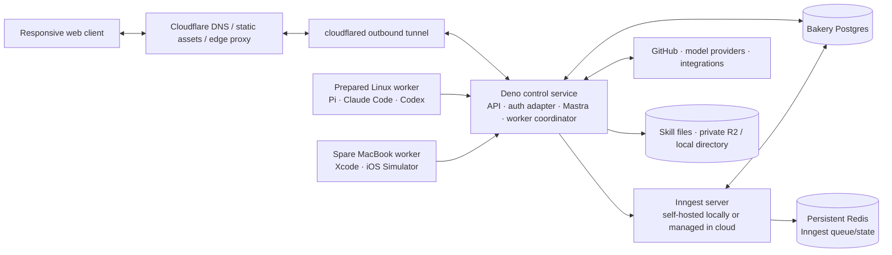
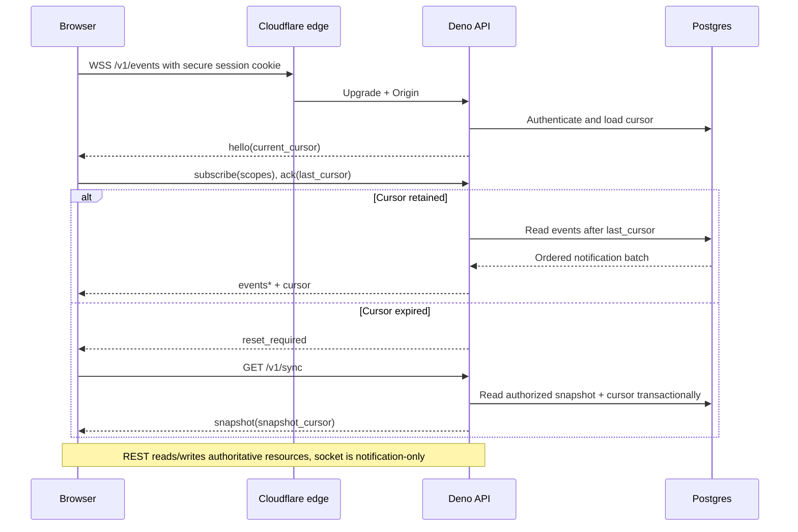
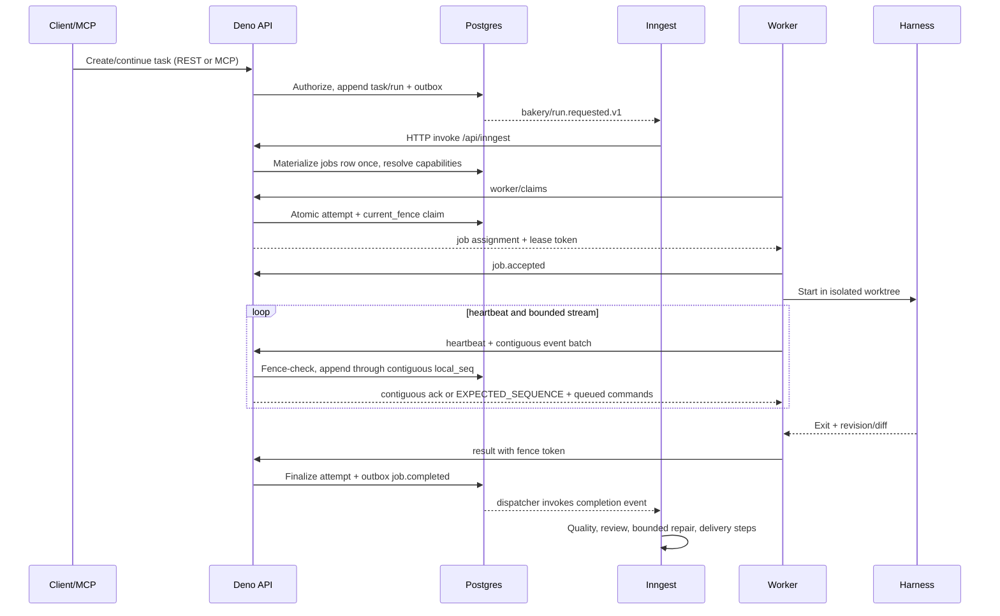
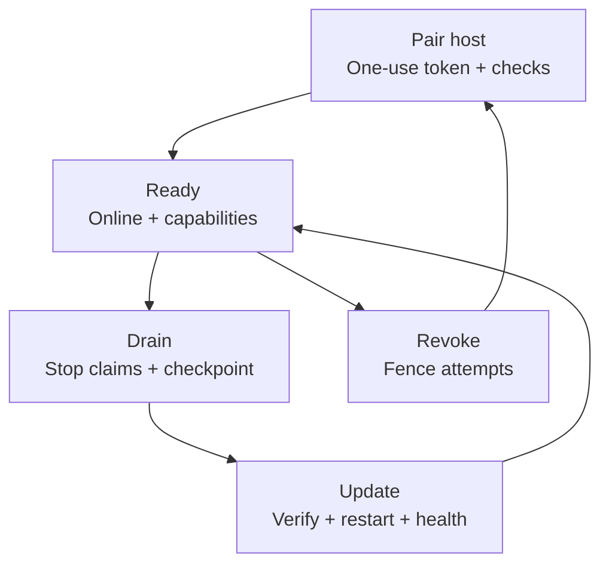

# Runtime and protocols

Status: design proposal, based on primary documentation checked 2026-09-07. This file defines runtime placement and the execution/event wire contracts. It does not define the complete entity schema or the full REST, WebSocket, or MCP operation inventory. Failure classification, recovery and reconciliation policy live in [Recovery and failures](16-recovery-and-failures.md).

**Multi-repository coordination:** a task may coordinate
repository-specific children in parallel or in dependency order, whether created
from a saved workflow or directly by an agent. Both paths persist the same versioned
plan and use Inngest plus the existing Postgres job/lease boundary. A coordinator
does not require a primary repository; each code-writing child/job resolves one
authorized repository, profile, base revision and isolated worktree. Reuse completed
children on retry, share the parent budget, block failed dependants and keep partial
delivery explicit. Context links and role labels do not grant repository access.
The [coordination contract and pending catalog changes](06-workflows-delivery-and-acceptance.md#workflow-ownership-and-multi-repository-work)
define the parallel join, cancellation and lineage rules. The single-repository
worker examples below describe a child execution boundary, not the whole task.

## Decisions and evidence

| Boundary | Documented capability | Design consequence |
|---|---|---|
| Deno | Deno supports npm packages, `package.json`, most `node:` built-ins, and a standard HTTP server. Its compatibility page says most pure JavaScript npm packages work, while native addons and package engine assumptions still need testing. [Deno Node and npm compatibility](https://docs.deno.com/runtime/fundamentals/node/) | Keep the control service in Deno. Pin Mastra versions and run a small compatibility spike before committing the dependency graph. |
| Mastra | Mastra documents `Agent`, `.generate()`, `.stream()`, tools, memory, MCP clients, and workflows. [Mastra agents](https://mastra.ai/docs/agents/overview) [Mastra tools and MCP](https://mastra.ai/docs/agents/mcp-guide) | Mastra Agent/core supplies agent and tool behavior inside durable workflow steps. It does not own Bakery job leases or the run ledger. |
| Mastra/Inngest connector | The current Mastra Inngest deployment guide documents a Node.js `>=22.13` connector path and long-running process. This constrains that connector path, not Mastra Agent/core in Deno. [Mastra Inngest deployment](https://mastra.ai/integrations/deploy/inngest) | Recommended path: Deno Hono server hosts the direct Inngest HTTP invoke endpoint alongside Mastra core and the dispatcher. Run a narrow compatibility experiment against the exact connector only; do not add a Node bridge to the baseline or silently replace Deno. |
| Inngest HTTP | Inngest documents `serve()` as an HTTP endpoint that receives and executes function requests, while `connect()` is a separate long-running WebSocket deployment mode. [Serve functions over HTTP](https://www.inngest.com/docs/learn/serving-inngest-functions) [Connect](https://www.inngest.com/docs/setup/connect) | `apps/server` exposes the versioned Inngest HTTP endpoint through Hono. The self-hosted Inngest executor invokes it; this is not the Bakery worker queue. |
| Cloudflare Workers | Workers run JavaScript in V8 isolates with Web APIs and only a subset of Node APIs; workerd is the open-source runtime behind Workers. It has per-invocation limits and no general local filesystem. [How Workers works](https://developers.cloudflare.com/workers/reference/how-workers-works/) [Runtime APIs](https://developers.cloudflare.com/workers/runtime-apis/) [workerd](https://blog.cloudflare.com/workerd-open-source-workers-runtime/) | Cloudflare is the edge for static web delivery, DNS, proxying, and optional WebSocket pass-through. Workers are not Deno hosts and cannot run the Linux harness, Xcode, Git worktrees, or the Deno control process. |
| Local Inngest | Inngest's self-hosting documentation describes a single binary/container, local port `8288` for API/UI, optional `8289` for Connect, SQLite default persistence, an in-memory Redis queue/state store by default, and external Postgres/Redis options. [Self-hosting Inngest](https://www.inngest.com/docs/self-hosting) | Local mode runs Deno API, self-hosted Inngest, Bakery Postgres, and workers on one machine. Bakery's job queue is Postgres and requires no Redis. Bakery selects external persistent Redis plus an engine-owned Postgres database for durable local/VPS operation. The default in-memory queue with periodic snapshots is reserved for disposable smoke runs. |
| MCP | Released 2026-07-28: stateless requests, per-request metadata and POST-based Streamable HTTP; local subprocesses use stdio. [MCP specification](https://modelcontextprotocol.io/specification/2026-07-28) | Official SDK v2; one OAuth-protected `/mcp`, no protocol session/initialize/GET stream. Exact wire and error contract is in chapter 02. |
| MCP authorization | OAuth 2.1, issuer/resource discovery and client registration are defined by the selected release. [MCP authorization](https://modelcontextprotocol.io/specification/2026-07-28/basic/authorization) | Better Auth owns inbound OAuth, with PKCE and the MCP CIMD profile; Bakery owns live permissions. Upstream grants remain distinct. |
| Browser WebSocket | Browsers provide WebSocket `open`, `message`, `error`, and `close` events and support a negotiated subprotocol. They do not provide a native replay or resume protocol. [MDN WebSocket](https://developer.mozilla.org/en-US/docs/Web/API/WebSocket) [MDN WebSocket constructor](https://developer.mozilla.org/en-US/docs/Web/API/WebSocket/WebSocket) | Bakery defines cursor-based replay over `/v1/events`; reconnect is a new authenticated connection followed by a resume frame. REST remains authoritative for writes. |

The [isolated compatibility probe](15-implementation-readiness.md) passed three Deno/Hono/Mastra/Inngest boundary checks; live engine recovery remains unrun. The compatibility evidence is deliberately narrow: documented runtime support is evidence for the proposed boundary, not proof that every pinned package works. Run two bounded slices before implementation expands: (1) a dependency compatibility slice that imports the pinned Deno/Hono/Mastra/MCP packages, executes one agent tool, performs one MCP client request, and reads one streamed result; (2) a durable core slice that invokes one Inngest HTTP step backed by Postgres, restarts the process, and proves checkpoint resume plus completion-before-wait registration. These slices do not prove worker, harness, provider-write, browser, deployment, or production behavior. The recommendation is one Deno server process; an HTTP adapter experiment must not reopen the selected Deno runtime decision.

## Minimum topology



The recommended cloud topology is one `apps/server` Deno control service on an existing or initially rented Linux VPS. Hono routes the API, MCP endpoint, browser event upgrade, and direct Inngest HTTP invoke endpoint; Mastra Agent/core runs in that service's workflow steps; a Postgres-backed dispatcher creates and assigns Bakery jobs. Cloudflare in the operator's account provides DNS, static web delivery, proxying, and an outbound Tunnel to the VPS. A Cloudflare Worker may serve the compiled React shell and proxy short API/WebSocket requests, subject to current Workers limits; long-lived coordination and all harness execution stay on Deno/Linux. [Cloudflare Workers pricing and limits](https://developers.cloudflare.com/workers/platform/pricing/) [Cloudflare Workers limits](https://developers.cloudflare.com/workers/platform/limits/) [Cloudflare Tunnel](https://developers.cloudflare.com/cloudflare-one/networks/connectors/cloudflare-tunnel/private-net/cloudflared/)

The first Linux host advertises `linux`, `web`, and `android-build` only after those toolchains pass health checks. `android-emulator` requires a real KVM/RAM test. `ios`, `xcode`, and `ios-simulator` are advertised only by the MacBook. The Mac may sleep or be offline: its jobs remain queued, and dispatch waits for an eligible host; there is no silent fallback to Linux for an iOS job. A worker never exposes its harness port publicly.

The local topology uses the same Deno service and workflow code. Docker Compose starts the portable services described below; native host capabilities connect through the same worker protocol. The local Inngest server's documented Docker arrangement exposes `8288`; `8289` is only needed for Connect and is not part of the recommended HTTP path. Bakery does not use Redis for its job queue. Durable mode configures `INNGEST_POSTGRES_URI` for a separate engine-owned database on the same Postgres service and `INNGEST_REDIS_URI` for persistent Redis. Use an owned Redis volume with AOF enabled, `appendfsync always`, and `noeviction`; a plain volume or periodic snapshot alone is not the selected crash-recovery contract. This is an engine dependency, not a second Bakery queue. Bind local services to localhost or a private interface and persist their volumes. Local development mode can use `INNGEST_DEV=1`; the durable acceptance mode must use persistent Postgres and restore-tested volumes. Inngest self-hosting support and operational terms are version-specific; this design makes no license or support guarantee. [Inngest self-hosting](https://www.inngest.com/docs/self-hosting)

The topology is configuration-selected, not code-selected:

| Mode | Control and data | Orchestration | Worker connection |
|---|---|---|---|
| Local | Deno + local Postgres + persistent Inngest Redis | Local Inngest server over HTTP invoke | Local worker claims; optional remote workers over authenticated HTTPS |
| Personal VPS | Deno + VPS Postgres + persistent Inngest Redis | Self-hosted Inngest on VPS over HTTP invoke | Outbound worker claims from Linux and Mac |
| Edge-assisted VPS | React/static and proxy at Cloudflare; Deno remains origin | Same as VPS | Same as VPS; edge never owns a lease |
| Managed experiment | Deno origin and Bakery Postgres remain explicit; managed Inngest is optional | Inngest HTTP serving endpoint | Same Bakery worker protocol; account limits are monitored |

The local or VPS Postgres service may host separate Bakery and Inngest databases/schemas, but ownership remains separate: Bakery migrations own `jobs`, `worker_hosts`, `job_attempts`, event journals, and domain events; Inngest migrations own its run state. Bakery never reads Inngest tables as a queue. The self-hosted single-node default can run with SQLite and in-memory Redis, but the durable Bakery acceptance mode uses persistent Postgres volumes and treats those defaults as disposable development conveniences.

### Containerized local development

**Required; implementation pending.** The complete portable Bakery stack must run locally through a repository-owned `infra/compose.yaml`. A `.devcontainer/devcontainer.json` must reuse that Compose stack and provide the pinned Deno, Node, pnpm and Git toolchain. Both entry points use the same application code, migrations and Turbo commands, with source mounts and hot reload. Dev containers support referencing existing Compose services. [Dev Container Compose guide](https://containers.dev/guide/dockerfile#using-docker-compose)

The stack includes:

- React/Vite and `apps/server`, including Hono, Better Auth, Mastra, Inngest HTTP handling, dispatch and collaboration.
- Postgres with separate Bakery and Inngest ownership, self-hosted Inngest and persistent Redis using the durable configuration above.
- Persistent filesystem storage for skill/plugin bundles, local previews on a separate origin, and local logs/traces. Ordinary artifact bytes remain in Postgres; R2 is unnecessary locally.
- One Linux worker with isolated job workspaces and the existing authentication/lease/fence protocol. Harnesses must not inherit control-service secrets, database access or the Docker socket.

Provide a documented bootstrap and one-command startup with pinned images, health checks, migrations, repeatable development seed data and untracked local secrets. Document service URLs, trusted local HTTPS for full OAuth/MCP, logs, shutdown and an explicit destructive reset; ordinary shutdown preserves volumes. Containers use Compose service addresses for internal calls, including Inngest callbacks; browser/native-worker origins remain separately configured and reachable from their hosts. Publish local ports on loopback.

Self-hosting covers Bakery's core infrastructure. After dependency/image setup, deterministic development fixtures must work without cloud accounts, model billing, Cloudflare, R2. Live model calls, harness subscriptions, GitHub/Slack integrations and hosted deployment still require their configured providers and credentials. Xcode/iOS Simulator and host-local Paper remain native capabilities connected to the local stack; Linux containers do not replace them. Live inbound provider webhooks may use an explicitly configured development tunnel.

### Skill storage configuration and materialization

The execution I/O path covers cold/warm cache reads, task pickup, output batching and replay. Its proposed output-store/frame additions still require catalog reconciliation; the worker queue and file endpoints below already exist in the design inventory.

| Mode | Skill bytes | Required configuration |
|---|---|---|
| Local single machine | Application-owned persistent directory, outside all worktrees | `BAKERY_SKILL_FILE_ROOT`, an absolute private directory; native Deno filesystem, no Cloudflare credentials; the default backend |
| Cloud / VPS | Private Cloudflare R2 bucket | An installation administrator enters the R2 account id, bucket, access key id and secret access key in the product UI at `/settings/installation/integrations`; the pair is stored AES-GCM encrypted in Postgres under the installation secrets key; the active backend becomes `r2` only through the paused copy, verify and switch procedure |

The Deno server uses R2's S3 endpoint with region `auto`; Cloudflare documents `@aws-sdk/client-s3` for this API. Pin and verify the selected SDK's Deno reads, writes and conditional publication before implementation rollout. The R2 bucket is private, with no public `r2.dev` or custom-domain download path. Keep the bucket credential encrypted in Postgres in the control service, never in environment variables or files, scoped to the necessary bucket operations; the endpoint is always `https://<account>.r2.cloudflarestorage.com` for the saved account, so no typed value redirects the client. The store reads its backend and credentials per operation from the saved settings, cached by settings version, so a rotation applies without a restart. [Cloudflare R2 JavaScript SDK example](https://developers.cloudflare.com/r2/examples/aws/aws-sdk-js-v3/)

```text
worker claims job -> pinned {versionId,digest} references
  GET version manifest with host auth + current attempt/lease/fence
  verify manifest digest and exact file inventory
  GET each file through Bakery with the same proof
  write temporary tree -> verify sizes and SHA256 -> set 0644/0755 only
  atomically install completed revision -> start permitted harness/skill
```

Materialize the complete skill directory, including `SKILL.md`, scripts and references. Reject traversal, symlinks and normalized/case-fold path collisions before writing on Linux or macOS. Use a digest-keyed cache owned by the worker supervisor; verify it before reuse and keep it read-only to harnesses. A writable execution copy is scoped to its attempt. The executable bit preserves script intent, but execution still requires the pinned workflow and current tool policy. A lease revoked during download prevents subsequent requests and cancels execution. Local workers use the same authenticated API so the local directory does not become a bypass around authorization.

Local backup/restore includes Postgres, the complete skill storage directory and the existing Inngest persistence. Cloud backup includes Postgres and a recoverable copy of referenced R2 objects; a database-only backup cannot restore skills. Restore verifies every referenced file hash before enabling work. Copying a deployment between modes preserves logical object keys; pause imports and scheduling, copy/verify bytes and metadata, switch the configured backend, then resume. No automatic migration or bucket deployment is claimed by this design update.

## Ownership split

Inngest owns workflow execution: event triggers, durable function runs, step state, waits, scheduling, cancellation expressions, step retries, flow control, and its own execution observability. Inngest's concurrency controls apply to active steps, not to Bakery's host slots. [Inngest concurrency](https://www.inngest.com/docs/guides/concurrency)

Bakery owns task state, conversations, permissions, artifacts, worker registration, capability matching, the Postgres-backed `jobs` ready queue, `job_attempts`, lease expiry, fencing values, subprocess cancellation, worktree identity, evidence, and external-effect reconciliation. Inngest materializes a job once from the durable workflow step; workers claim it from Bakery's Postgres queue. Bakery emits a durable domain outbox event after each authoritative transaction; the Deno server's dispatcher publishes the event to Inngest and notification fan-out. A workflow step may invoke Bakery to create a job, but it must not duplicate the queue in its own payload or assume Inngest retries make shell/Git/GitHub operations idempotent.

The minimum durable path is:

```text
task/run -> Inngest durable step -> Bakery job row + outbox
outbox -> Deno dispatcher -> Inngest invoke/notification
ready queue (Postgres) -> worker claims
worker attempt -> lease/fence -> events/artifacts in Postgres
completion event -> Inngest wait -> quality/review/delivery steps
```

Large logs, diffs, screenshots, previews, and model transcripts are Postgres artifacts addressed by IDs. Inngest payloads contain IDs and bounded summaries. This respects documented Inngest limits and prevents a workflow payload from becoming the artifact store. [Inngest limits](https://www.inngest.com/docs/usage-limits/inngest)

For MCP/OAuth, local setup supplies trusted HTTPS and verifies discovery through the same public base URL used by the local harness. Browser-only plain HTTP development remains a smoke convenience, not the full OAuth acceptance mode. Cloud proxy configuration must preserve Authorization and all required MCP headers and avoid buffering request-scoped SSE. No MCP protocol session store is required.

## Wire protocol names

The following names are intentionally early and narrow; root's operation inventory defines the complete request/response schemas.

| Surface | Proposal | Direction and authority |
|---|---|---|
| Worker REST | `POST /v1/worker/registration`, `POST /v1/worker/heartbeat`, `POST /v1/worker/claims` | Worker to Deno; registration, liveness, and claims are authoritative Bakery writes. Registration negotiates v1 when the version header is omitted or v2 when explicitly requested; each worker response returns the selected `X-Bakery-Worker-Protocol-Version`, and unsupported versions fail with a typed 426 Problem. |
| Worker enrollment and inventory | `POST /v1/worker/enrollment-inspection`, `POST /v1/worker/inventory` | Worker to Deno; enrollment inspection uses enrollment-token proof (rate-limited, no-store) and previews organization/intent/expiry without consuming the token. The inventory report uses the worker bearer credential plus the current protocol header, is idempotent by report ID, and is rejected when its host generation differs from the current credential generation, its expected inventory revision mismatches, or a component declares a capability outside the granted set. |
| Worker provider-auth reports | `POST /v1/worker/provider-auth-attempts/{id}/reports` | Worker to Deno; challenge/completion reports scoped to the attempt, its binding and the host generation. A completed authentication binds the verified account inside the same organization transaction and bumps the binding's auth generation; cross-binding or stale-generation completions are rejected. Credentials never persist. |
| Attempt REST | `POST /v1/worker/attempts/{attemptId}/events`, `POST .../lease-renewals`, `POST .../result`, `POST .../artifacts`, `POST .../previews`, `POST .../tool-invocations` | Worker to Deno; every mutation includes the lease token, current fence, and (for protocol v2 hosts) the workerSessionId/workerSessionGeneration pair. |
| Worker commands | `job.steer`, `job.follow_up`, `job.cancel` | Deno to worker in the authenticated heartbeat response; the worker acknowledges each command ID. Steering/follow-up support is adapter-specific and never assumed universal. |
| Worker event types | `job.accepted`, `job.started`, `job.progress`, `job.checkpoint`, `job.artifact`, `job.effect_pending`, `job.effect_committed`, `job.succeeded`, `job.failed`, `job.cancelled`, `job.lease_lost` | Worker to Deno; append-only and deduplicated by `(attempt_id,local_seq)` plus payload digest. |
| Browser events | `hello`, `subscribe`, `events`, `cursor`, `reset_required`, `ack`, `ping`, `problem` | Deno to browser except `subscribe`/`ack` client frames. `/v1/events` is read-only; REST performs domain writes and `/v1/sync` returns a coherent snapshot plus cursor. |
| Domain outbox | Canonical domain names such as `tasks.created`, `run.requested`, `job.completed`, `artifact.version_created` | Exact names and payloads come from `transport-schemas.json.events`; only entries with a non-null `inngestTrigger` emit the named versioned Inngest event. Other domain events remain the authorized browser notification stream or configured Slack/GitHub notification. |

Public wire fields use camelCase. Each endpoint and WebSocket frame uses its exact schema in `transport-schemas.json`; there is no additional mandatory blanket message envelope. Domain events carry their defined id, sequence, type, schemaVersion, occurredAt and scope fields. Timestamps are server-derived for state decisions. Unknown message types are rejected or ignored according to the endpoint's compatibility policy, never interpreted as an instruction.

`/v1/sync` and `/v1/events` gain `worker_enrollment` and `worker` scope types backed by the new nullable organization-constrained `domain_events` columns; `worker_enrollment.updated`, `worker.inventory_changed`, `worker.readiness_changed` and `worker.provider_binding_changed` payloads carry only resourceId/resourceVersion references. A subscription starts from one transactional `EnrollmentStatus`/safe `WorkerHost` snapshot plus its highwater cursor; replay resolves the true machine when registration races cancel/replace or an early check-in because the locked register/cancel transaction picks the single winner. Provider-auth challenge material never crosses this stream: challenge responses are session-scoped and no-store, and auth-attempt login/challenge routes are never events. Worker report bodies are bounded to 256 KiB and 100 entries; the inventory report is idempotent by `(worker_host_id, report_id)` and stale-generation or revision-mismatched reports are rejected before any state change.

## Worker contract: claims, lease, fence, heartbeat

`apps/worker` is a separate long-running Deno process. It speaks only the authenticated Bakery HTTPS contract, maintains no authoritative queue, and spawns native executables in an isolated worktree: `pi`, `claude`, or `codex` (plus Git, language toolchains, Android tools, or Xcode on the declared host). The Deno worker is an adapter supervisor, not a second Mastra or Inngest runtime. It reports `worker_hosts` capacity and consumes commands returned by heartbeat responses.

Worker identity is a registered worker-generated opaque bearer credential whose hash and generation are stored on the host record, separate from harness/provider credentials. Registration creates a `worker_hosts` row with a stable host identity, OS/architecture, toolchain profile and digest, capabilities, slots, health metadata, and the selected protocol version. It does not submit model secrets. Registration returns the assigned workerHostId/principalId and selected protocol header; a v2 host begins with a null session, proposes its UUID with generation 0 on its first heartbeat, and receives generation 1. Every worker request authenticates with that bearer credential; attempt mutations additionally carry the existing `X-Bakery-Attempt-Id`, `X-Bakery-Lease-Token` and `X-Bakery-Fence` proof plus the current process-session UUID/generation for protocol v2. The server serializes session takeover under the host lock: same-session retries are idempotent, while a differing session must present the current generation and receives the next generation, so a delayed old generation cannot reclaim the host. A lost claim response is recovered by sending `pendingClaimKey`; the server rebinds its live replayed attempt to the current authenticated session before heartbeat reconciliation.

Protocol v2 runtime validation is stricter than the base-compatible JSON shapes: `WorkerEventBatch`, `LeaseRenewal`, and `WorkerResult` require the worker-session UUID/generation pair on unseen mutations and authenticate it against both the host's current session and the attempt's binding. Heartbeat reconciliation is also authoritative: the server rebinds only attempts whose PostgreSQL-time lease is live and whose job `current_fence` equals the attempt fence, and returns those exact IDs as `reconciledAttemptIds`; a restarted worker resumes no reported attempt omitted from that list. The fields remain optional in the shared schema so older protocol records and adapters can be parsed during migration; the registered host protocol version selects the runtime requirement.

1. Select the highest-priority eligible ready job whose required capabilities and repository policy match.
2. Create `job_attempts` with a monotonically increasing attempt number.
3. Advance the job's `current_fence`, set the lease owner/expiry, and bind the attempt to that fence.
4. Return an opaque random lease token plus explicit jobId, attemptId, workerHostId, fence and leaseExpiresAt fields in JobAssignment; only the token hash is stored.

The worker must acknowledge `job.accepted` before starting the harness. Each
mutation is conditional on the exact tuple. An unseen mutation from a stale
worker, old process, or late result receives `409 LEASE_FENCED` and may only
stop/clean up locally; an exact replay of a committed tuple follows the
idempotent replay rule below. The old process cannot publish artifacts,
progress, success, failure, or external-effect completion after a newer fence
exists.

Proposed initial timings are operational defaults, not protocol guarantees: heartbeat every 15 seconds, lease TTL 45 seconds, and a coordinator sweep every 15 seconds. The server may renew only an active attempt owned by that fence. A worker pauses new work when its clock or registration health is invalid. Lease expiry is determined by server time and database state. Exact idempotent heartbeat and renewal replays preserve the saved response body/status; heartbeat replays are marked `Idempotent-Replayed: true`, and renewal replays are returned only after current host-session and locked attempt-binding authentication, without requiring the saved lease to remain live.

Events are idempotent by `(attempt_id, local_seq)` and include a SHA-256 `payload_digest`. For an already committed sequence, an identical event type and digest replay the saved acknowledgement, even after lease expiry; a changed duplicate returns `IDEMPOTENCY_PAYLOAD_MISMATCH`. For an unseen sequence, the server validates the active lease and current fence before applying the event; stale or expired proof returns `LEASE_FENCED`. It persists events only contiguously from `last_event_seq + 1`, returns `409 EXPECTED_SEQUENCE` with `expected_local_seq` and `acked_local_seq` for a gap, and acknowledges only through the highest contiguous persisted sequence. Out-of-order events remain unacknowledged for worker replay; the server never silently reorders them. Heartbeats are liveness only; they do not imply progress or success.

Checkpoints contain the durable `ArtifactRef` tuples, harness session ID where available, repository revision, worktree identity, and the last safe resume point. A worker reboot reconciles local processes and worktrees against Bakery state before pulling new jobs. A process belonging to an expired fence is terminated or quarantined. A lost worker cannot prove its process was killed: its workspaces remain quarantined until reconciliation, and external effects are brokered through the effect ledger. Worktrees are disposable by identity; the server never trusts a path as proof of ownership.

Cancellation has an authoritative state transition in Bakery and a best-effort process signal. The coordinator returns `job.cancel` in the worker's next heartbeat response; the worker interrupts the harness, records `job.cancelled` only after the process has exited, and cleans the worktree. If the worker is unreachable, the server advances `current_fence` after TTL, marks the attempt `lost` or `quarantined` according to reconciliation, and records the cancellation request. A late success cannot reopen a cancelled job.

External effects such as push, merge, deploy, or provider mutation require an explicit effect key and before/after evidence. The worker emits `job.effect_pending` before attempting one, then `job.effect_committed` only with provider-confirmed identity. An unseen result with an expired or superseded fence is rejected as `LEASE_FENCED`; an exact replay of an already committed result returns its saved acknowledgement without applying state again. A changed replay at the same journal key returns `IDEMPOTENCY_PAYLOAD_MISMATCH`. If the connection fails after submission and the outcome is unknown, the effect becomes `external_effects.status=uncertain`; Bakery performs a read-only reconciliation using the same effect key before any retry. There are no silent retries for uncertain external effects.
For an unseen event, renewal, or terminal result whose final authority CAS affects zero rows, the server re-reads the attempt and joined job with `clock_timestamp()`. Matching host/token/session/attempt-fence/job-fence proof after expiry returns `LEASE_EXPIRED`; any changed authority or lifecycle state returns `LEASE_FENCED`, never a 500 or generic `STATE_CONFLICT`.

The issue-39 attempt/fence proof authenticates the mutation and its append-only journal entry. Immutable evidence references intentionally remain scoped to the durable owner records: artifact handoffs use the exact `{artifactId, versionId, sha256}` tuple pinned to the run step, while checks, effects, and harness-session references are validated against their documented organization/run/task/connection or run-step scope. Those records can be created before a retry and reused by design; requiring an attempt/fence column at this layer would invent provenance that the current creation routes cannot atomically produce. Future artifact/effect/check creation boundaries may add attempt/fence provenance when they can write it as part of the authoritative creation transaction.

## Harness adapters

Every adapter implements the same host-local contract:

```text
prepare(job, worktree, policy) -> prepared
start(prompt, session?) -> session
stream() -> normalized events
steer(message) / follow_up(message) -> accepted | unsupported
cancel() -> exited | timed_out
resume(checkpoint, session) -> session
collect() -> revision, diff/artifact IDs, exit status
```

The adapter owns subprocess pipes, tool allowlists, session files, and provider authentication. Deno receives normalized bounded events and artifact IDs. The adapter must preserve raw harness output only as an artifact subject to retention policy; secrets are redacted at the tool boundary.

| Harness | Native interface | Bakery adapter rule |
|---|---|---|
| Pi | Official RPC mode is headless JSONL over stdin/stdout with `prompt`, `steer`, `follow_up`, and `abort`; it streams lifecycle, message, tool, and queue events. [Pi RPC](https://pi.dev/docs/latest/rpc) | Use LF framing, correlated request IDs, and `--session-dir` for resumable worker-local sessions. Postgres remains the source of job/attempt truth. |
| Claude Code | Official CLI supports `claude -p`, `json`/`stream-json`, `--max-turns`, `--resume`, and allowed/disallowed tools. [Claude Code CLI](https://docs.anthropic.com/en/docs/claude-code/cli-usage) | Invoke the pinned CLI in the prepared worktree, normalize stream events, persist its session ID, and enforce the Bakery tool policy. Anthropic SDK runtime support does not prove that the Claude Code process itself runs inside Deno. |
| Codex | Official Codex CLI supports non-interactive `codex exec`. The current Codex repository documents `codex app-server` v2 JSON-RPC over stdio/Unix socket with `thread/start`, `thread/resume`, `turn/start`, `turn/steer`, and `turn/interrupt`; its WebSocket listener is experimental/unsupported. [Codex CLI](https://developers.openai.com/codex/cli/) [Codex app-server](https://github.com/openai/codex/blob/main/codex-rs/app-server/README.md) | Baseline adapter uses `codex exec` for bounded batch work. An app-server adapter may be enabled only after pinning and validating its generated schema, subscription auth, resume, and interrupt behavior; do not claim `steer` or follow-up support for `exec` or every build. Use an explicitly authorized worker login and the existing ChatGPT subscription, never a pooled API credential. If quota is exhausted, leave the run queued/resumable and report it; never silently switch to API billing. |

Adapter resume is conditional: a harness session may be resumed only when its local session identity, worktree revision, and checkpoint match the current attempt. Otherwise start a fresh process from the last durable checkpoint and record the new session. A fresh process is not permission to repeat an uncertain external effect. The worker advertises adapter capabilities (`stream`, `resume`, `steer`, `follow_up`, `interrupt`); the workflow branches only on advertised capabilities and records `unsupported` where a harness cannot provide one.

## Browser event stream and reconnection

[Collaborative documents and presence](20-collaborative-documents.md) adds a separate lazy `/v1/collaboration` socket on this same Deno/auth host. Loro drafts persist checkpoints and accepted updates in Postgres; presence is scoped, ephemeral and expires. Start with one process owning live rooms; cross-process room delivery must be proven before scaling that endpoint. No new collaboration service is required. Its routes and schemas remain proposed additions; `/v1/events` below retains its read-only contract.

`GET /v1/events` upgrades to WebSocket for authenticated, read-only notifications. Authentication is established with the normal same-origin secure session cookie during the HTTP upgrade; the server validates `Origin`, user/session status, and subscription scope. Tokens in URLs are forbidden. For a separately hosted UI, use a short-lived, audience-bound upgrade token minted by an authenticated REST call, with strict origin and expiry checks. The socket carries notifications and cursors; it cannot create tasks, cancel jobs, approve delivery, or mutate artifacts. `GET /v1/sync` returns a coherent authorized snapshot and its cursor from one Postgres transaction so a client can recover without relying on a live socket.

The server keeps a bounded append-only notification cursor in Postgres. On connect the server sends `hello` with protocol version and current cursor. The client sends `subscribe { scopes }` and `ack { cursor }`; the server sends `events`, `cursor`, `ping`, or `problem`. If the requested cursor is outside retention, the server sends `reset_required`; the client calls `/v1/sync`, renders the snapshot, and subscribes from the returned cursor. Replays are safe because each organization and stream owns one `event_clock` row; the transaction allocates the externally visible `domain_events.organization_sequence` while holding that row's lock through commit. The legacy identity-backed `domain_events.sequence` remains only for mixed-version storage compatibility and is never exposed as a cursor. A bare shared database sequence is not used for cursor allocation: it can leak tenant activity and expose a higher sequence from a transaction that later commits after a lower one. REST resources remain authoritative.



On close, the browser backs off with jitter, refreshes its session through REST when needed, reconnects, and resumes from the last cursor it durably applied. A mobile browser may sleep for hours; it must recover via snapshot/replay and never assume the socket stayed alive.

## Runtime sequences and call trees

### Execute



```text
REST/MCP intake
  -> authorize + transaction(task/run/outbox)
  -> Inngest HTTP invoke
  -> materialize Bakery job once
  -> atomic claims(current_fence)
  -> harness stream/checkpoint
  -> fenced result/artifacts
  -> completion outbox
  -> quality -> review/repair loop -> merge/deploy -> health verify
```

### Worker reconnect

Inngest documents Connect as a separate long-running WebSocket deployment mode, but the recommended Bakery path uses its HTTP invoke endpoint. Bakery worker reconnect therefore uses HTTPS heartbeat/claims and durable Postgres cursors; no worker WebSocket is required in v1.

```text
worker HTTP request fails
  -> keep local subprocess bounded; stop accepting new work
  -> retry heartbeat with workerHostId + bearer credential; server checks generation
  -> reconcile current attempts
  -> heartbeat accepts/rejects the registered host
  -> replay unacknowledged immutable events from the local ack prefix
  -> event endpoint returns WorkerAck or EXPECTED_SEQUENCE; request checkpoint for a gap
  -> resume only if worktree/session/checkpoint match
  -> otherwise report lost attempt and claim a new fenced attempt
```

### Lease loss

```text
heartbeat rejected or TTL expires
  -> server marks attempt lost and advances current_fence
  -> worker receives LEASE_FENCED on next mutation
  -> old process stops publishing and is killed/quarantined
  -> coordinator inspects checkpoint and external-effect states
  -> safe retry creates a new attempt with a new fence
  -> unknown effect pauses automatic repeat until read-only reconciliation
```

### Cancel

```text
REST cancel (authorized)
  -> Bakery transaction marks run/job cancel_requested
  -> Inngest cancellation signal/wait is issued
  -> coordinator returns job.cancel in owning worker heartbeat response
  -> harness abort/terminate + collect bounded exit state
  -> worker posts cancel-ack/result with current fence
  -> server fences late output and records cancelled terminal state
  -> unreachable worker: wait TTL, advance fence, quarantine/reconcile, then terminal cancellation state
```

Cancellation and quota exhaustion release capacity where possible. Questions cover missing information, an unreconcilable effect or an explicit model/provider/budget choice; routine “go” runs proceed through quality checks, merge, deploy and health verification without recurring approval. Quota/outage notifications offer permitted alternatives, with verified or explicitly unknown usage. [Provider recovery](16-recovery-and-failures.md) defines isolated pauses, durable probes, actionable alarms and a newly pinned continuation when the user switches routes.

## Installed worker daemon

[Machines](21-machines.md) is the machine product contract: user stories, fresh-machine installation through a proposed pinned `npx` bootstrap or native binary, the four-step listening UX, readiness, inventory, provider bindings and maintenance. It supersedes the earlier abbreviated Add host flow and supplies explicit model/transport deltas. This section retains the daemon process and credential-isolation boundary.

The installed worker is a small host supervisor around `apps/worker`. It owns the native process tree, local session/cache/spool directories and graceful shutdown; Bakery remains the authority for jobs, attempts, leases, fences and effects. The daemon makes outbound HTTPS requests only. It never opens a worker listener, embeds a model login, or daemonizes itself. On shutdown it stops claiming, sends a final heartbeat when possible, and asks active adapters to cancel or checkpoint within the remaining valid lease; shutdown grace never extends a lease. It then exits; the next start reconciles before claiming.

Machine readiness runs through the issue-59 report operations rather than any client-controlled liveness flag. After check-in the daemon posts one bounded `worker.reportInventory` report (≤256 KiB, 100 entries, idempotent `report_id`) covering components, checks and provider-auth status; the server rejects reports from a superseded credential generation or with a mismatched expected inventory revision, and never accepts components whose declared capabilities exceed the host's granted set. Readiness, connectivity (`stale` after 30s receipt silence, `offline` after 60s) and the claim gate derive server-side from these authenticated reports in [Machines](21-machines.md). Provider login support is report-driven: the daemon issues `challenge_requested` and completion reports against its exact binding and generation, and the server challenges/completes inside one organization transaction as described in that chapter.

Linux uses a per-host `systemd` service running as a dedicated unprivileged user, with an explicit working directory, protected environment file or credential directory, bounded restart/backoff policy and standard journal output. `Restart=on-failure` is appropriate for the long-running supervisor; network readiness is handled by the worker's retry state machine because interfaces can disappear after boot. The service does not run the harness as root. The systemd service model and restart setting are documented in [systemd.service](https://www.freedesktop.org/software/systemd/man/latest/systemd.service.html).

macOS uses a user `LaunchAgent` in `~/Library/LaunchAgents` so Xcode, simulators and the user's keychain/session are available; a `LaunchDaemon` is reserved for a deliberately headless host. The plist supplies `Label`, `ProgramArguments`, `KeepAlive`, `WorkingDirectory` and bounded stdout/stderr paths. The worker handles network loss and backoff internally, catches `SIGTERM`, and never forks into the background. Apple documents the daemon/agent locations, `launchctl` management and these process rules in [Creating Launch Daemons and Agents](https://developer.apple.com/library/archive/documentation/MacOSX/Conceptual/BPSystemStartup/Chapters/CreatingLaunchdJobs.html) and [Script management with launchd](https://support.apple.com/en-il/guide/terminal/apdc6c1077b-5d5d-4d35-9c19-60f2397b2369/mac).

### Pairing and credential storage

An Admin selects **Add host** in the browser. Bakery creates the existing short-lived, one-use `workers.enroll` token scoped to the organization and allowed capabilities. The browser displays the token once with copy and expiry state. The operator pastes it into an interactive worker setup prompt or supplies it to a headless setup process through stdin or a protected file descriptor. A token is never placed in a command argument, URL, shell history, telemetry, or ordinary log line.

The worker generates exactly 32 random bytes locally, stores the resulting bearer credential in the host secret store or a mode-appropriate `0600` file outside any worktree, and submits it with `WorkerRegistration`. A lost registration response is retried with the same enrollment identity and idempotency key; it must not create a second host or consume a second enrollment. Bakery stores only the credential hash and `credential_generation`; `WorkerRegistrationResult` contains host/principal IDs and generation, never the credential. A lost credential is recovered by draining and revoking the host through the Admin worker update path, then pairing again with a newly generated credential. `workers.repairEnrollment` (`POST /v1/workers/{id}/enrollments`) issues a one-use re-pair token bound to the exact revoked host and its expected credential generation: registration consumes it under the locked enroll/register transaction, atomically replaces the credential hash/generation, and rejects any other host; the old generation stays revoked and its reports are discarded. Re-pairing never transfers organization. The credential is not the user session, OAuth token, or Codex/Claude/Pi login, and those credentials are never copied into Bakery worker registration.

`0600` protects a file from other users, but it does not protect a same-user unsandboxed harness process. The daemon therefore keeps the credential in a separate supervisor-owned secret boundary and passes it only to the worker process through an inherited protected descriptor or equivalent OS credential mechanism; harnesses receive no worker credential or inherited descriptor. Separate OS users or an enforced filesystem/process sandbox must prevent harness access to supervisor files and process memory. macOS support must prove that boundary before advertising the host as ready; a same-user unsandboxed shell is insufficient.

### Linux native action sandbox

Linux native execution requires `/usr/bin/bwrap` with user and PID namespace support. Readiness MUST fail closed when the executable or namespace probe is unavailable; installing a package, changing host sysctls/AppArmor, using sudo, or falling back to a privileged runner is not part of worker startup. The native CI job proves the prerequisite with `bwrap --version` followed by the worker's exact `probeNativeSandboxCapability` command: `deno eval 'import { probeNativeSandboxCapability } from "./apps/worker/src/executor.ts"; await probeNativeSandboxCapability();'`. The helper resolves the same code-owned executable/tool closure and passes the same `/usr/bin/bwrap` arguments used at worker startup.

The Deno executable in the runtime read allowlist comes from the executing host's `Deno.execPath()`, not a developer installation prefix. Host-specific paths do not broaden the code-owned runtime or secret-isolation boundary.

The existing native bootstrap remains the cgroup owner and watcher. It consumes its gate byte, is attached to the delegated cgroup, and only then starts the action inside bubblewrap. The sandbox uses a private `/proc`, isolated user/PID/IPC/UTS namespaces, `/dev`, and a fresh writable `/tmp`; `/` and host home/state/credential directories are never mounted. Runtime access is an exact canonical closure of the code-owned executable, fixed tools, ELF loader and shared libraries; no host root, home, or `/usr` directory is bind-mounted. The worker rejects canonical path or file-identity overlap between that closure or code-owned source mounts and supervisor state, registration, spool, enrollment-token, and other secret roots. Authorized prepared skill and repository-inspection source descendants are independently revalidated and mounted read-only. Action arguments do not grant mounts. Repository inspection uses the same boundary and retains its existing Deno read/run allowlist, stdin payload, output capture and provenance.

This primitive does not define a new network or provider policy. Existing egress policy remains in force; Codex traffic and authenticated provider boundaries remain owned by their respective runtime work.

```text
Proposed CLI UX (binary and commands still to build):
  bakery-worker pair --server https://bakery.example
    Organization: selected by the enrollment token
    Enrollment token: [hidden interactive input]
    Paired: worker identity + capability check results
  bakery-worker status
    Connection, last acknowledgment, active attempts, toolchain problems
  bakery-worker drain
    Stop claims, preserve checkpoints, finish bounded shutdown
```

Headless pairing reads a protected input descriptor instead of a terminal. Diagnostics show allowlisted versions and safe Problem fields, never a dump of environment variables or provider output. Pairing/status use the worker protocol and local state; local drain signals the supervisor. Remote Admin actions require the signed-in Admin operation path, never the worker bearer credential.



### Desktop and mobile control surface

Desktop and mobile expose the same worker operations and authorization. The **Machines** view separates Admin intent, authenticated liveness, readiness checks and available capacity as defined in chapter 21; legacy `WorkerHost.status` is not a client-writable health assertion. **Add machine** collects enrollment intent, then shows **Copy command → Go into the machine → Paste into terminal → Start Listening**. Observation reads a snapshot before subscribing and catches an early check-in. Connected, verifying and ready remain distinct. A headless bootstrap command never contains a live token or persists it in a URL/local storage.

The operator can pause new claims, inspect a bounded recovery explanation, request drain/update, revoke the credential, and start reconciliation. Mobile keeps the same actions and status projections with stacked cards and large copy/expiry controls; when the phone sleeps, it resumes by REST snapshot/replay rather than assuming a live socket. Destructive actions require the same Admin scope and explicit current-state confirmation on both surfaces. A worker status card is evidence of registration/heartbeat state only; it does not claim that a harness, provider effect or deployment succeeded.

Release install/update is a verified, reversible flow: stage the pinned release, verify its digest against a release manifest signed by the configured trusted release key, show **ready to drain**, stop new claims, let active attempts checkpoint or cancel within their current leases, switch atomically, and run the toolchain/heartbeat health check. An unsigned checksum served beside a binary is insufficient provenance. Keep the previous binary and compatible local state; a state migration needs a backup and explicit compatibility check before rollback. If verification or health fails, report the failed check and restore the compatible known-good release. Desktop and mobile show the same staged, draining, updated, failed or rolled-back state and never imply that an update completed because the process merely restarted.

## Quality-gated autonomous delivery

After `go`, Inngest runs deterministic checks, independent review, bounded repairs, merge coordination, deployment, and health verification automatically. A review loop has a maximum repair count, wall-clock budget, model/cost budget, and repeated-finding detector. Every check and reviewer finding references the exact repository revision and attempt. A changed base/head invalidates stale evidence and restarts only the affected checks.

Merge/deploy actions use stable effect keys and provider read-after-write verification. A failed or ambiguous provider response creates a reconciliation item and does not run a blind duplicate mutation. A quality failure can produce a repair job; a broken Bakery deployment can be repaired through the last known-good version and an independent bootstrap/recovery path. No model output can weaken required checks, permissions, or effect policy.

## Cost boundary

The target is an incremental factory spend of at most $200/month; existing ChatGPT subscription fees are reported separately. These are source-backed ceilings or list prices, not a promise of free capacity.

| Component | Source-backed assumption | Budget treatment |
|---|---|---|
| Cloudflare edge | Workers Free currently lists 100,000 requests/day and static asset requests are free; Workers Paid is $5/month with higher included usage. [Workers pricing](https://developers.cloudflare.com/workers/platform/pricing/) | Start at $0 for static/proxy traffic if measured usage fits. Reserve $5 only if dynamic limits or features require it. Tunnel/Access eligibility and account limits must be verified live. |
| Inngest | Hobby is listed at $0 with 50k executions/month; Pro starts at $99/month. Self-hosting is supported. [Inngest pricing](https://www.inngest.com/pricing) [Self-hosting](https://www.inngest.com/docs/self-hosting) | Start self-hosted on the VPS/local machine. Use managed Hobby only when its quota and data placement are acceptable; do not budget Pro by default. |
| Postgres/Redis | Local/VPS Postgres and Redis are part of the host footprint. If managed Postgres is selected, Neon currently lists a Free plan with 0.5 GB/project and usage quotas. [Neon pricing](https://neon.com/pricing) | Keep a measured backup/storage allowance. Managed pricing and egress are variable and must be added from the chosen provider's current bill. |
| Linux worker | Existing VPS is preferred; otherwise price one prepared host from Hetzner/OVH/Hostinger and add any Android-capable RAM/CPU separately. | Treat the host bill as incremental and record it monthly. A 4 GB VPS is not an Android emulator promise. |
| Models and harnesses | Codex subscription usage is plan-limited; Pi's OpenRouter account is separately metered; Claude Code billing is an explicit configuration. | Set per-run token/time/attempt budgets. Quota exhaustion queues resumable work; it never silently changes provider or billing route. |
| Backups, previews, evaluation | Depends on retention, binary volume, domains, and provider usage. | Reserve the remainder of the $200 target after live measurements; alert before budget exhaustion. |

An illustrative low-volume target is `$0–5 Cloudflare + $0 self-hosted Inngest + one VPS + measured Postgres/backups + model usage`, with optional Inngest Redis and the existing ChatGPT subscription shown separately. The design does not claim the VPS, model calls, Mac electricity, or backups are free. The implementation must record actual monthly spend and quota consumption before calling the target met.

## Acceptance checks for this boundary

1. The dependency compatibility slice imports the pinned Deno/Hono/Mastra/MCP packages, executes one agent tool, performs one MCP client request, and reads one streamed result. The durable core slice then invokes one Inngest HTTP step against Postgres, restarts the process, and proves checkpoint resume plus completion-before-wait registration. These checks establish neither a production runtime nor worker, harness, provider, browser, deployment, or full workflow behavior.
2. A worker restart during a harness run produces either a checkpointed new attempt or a fenced lost attempt; the old process cannot publish a late success.
3. Two workers claiming concurrently cannot claim the same ready job; duplicate event delivery is idempotent; an out-of-order event is visible as a reconciliation error.
4. Browser disconnect/reconnect replays from a retained cursor and falls back to an authorized snapshot after cursor expiry.
5. Cancel interrupts Pi, Claude Code, and Codex subprocesses; an unreachable worker is fenced after TTL; a late result cannot reopen the job.
6. A simulated uncertain GitHub/deploy response records `external_effects.status=uncertain`, performs read-only reconciliation by effect key, and does not blindly retry.
7. Only after the two bounded slices pass, measure the connector package separately; it cannot change the Deno server recommendation. Full worker, harness, provider, browser, deployment, and recovery scenarios remain separate acceptance work.
8. From a fresh checkout, verify both Compose and dev-container entry points: bootstrap an Admin, exercise hot reload, and complete one deterministic task through real local Postgres/Inngest to a visible artifact. Restart the stack during a wait; verify one resumed result and preserved artifacts, skill/plugin files and flags. External credentials remain unset for this check. Compose files, dev-container setup and this runtime proof are still unimplemented.

## Verified source map

| Claim used here | Primary source |
|---|---|
| Deno npm/Node compatibility and Web APIs | [Deno Node and npm compatibility](https://docs.deno.com/runtime/fundamentals/node/) |
| Mastra Agent/core, tools, memory, MCP | [Mastra agents](https://mastra.ai/docs/agents/overview), [Mastra tools and MCP](https://mastra.ai/docs/agents/mcp-guide) |
| Mastra Inngest connector's documented Node path | [Mastra Inngest deployment](https://mastra.ai/integrations/deploy/inngest) |
| Inngest HTTP serving and Connect distinction | [Serve functions over HTTP](https://www.inngest.com/docs/learn/serving-inngest-functions), [Connect](https://www.inngest.com/docs/setup/connect) |
| Self-hosted Inngest ports, storage, and Redis defaults | [Inngest self-hosting](https://www.inngest.com/docs/self-hosting) |
| Cloudflare Workers/workerd isolate and API boundary | [How Workers works](https://developers.cloudflare.com/workers/reference/how-workers-works/), [Runtime APIs](https://developers.cloudflare.com/workers/runtime-apis/), [workerd](https://blog.cloudflare.com/workerd-open-source-workers-runtime/) |
| Cloudflare edge pricing/limits and outbound Tunnel | [Workers pricing](https://developers.cloudflare.com/workers/platform/pricing/), [Workers limits](https://developers.cloudflare.com/workers/platform/limits/), [Cloudflare Tunnel](https://developers.cloudflare.com/cloudflare-one/networks/connectors/cloudflare-tunnel/private-net/cloudflared/) |
| MCP Streamable HTTP, stdio, Origin validation | [MCP transports](https://modelcontextprotocol.io/specification/2026-07-28/basic/transports) |
| MCP OAuth/PKCE and protected-resource authorization | [MCP authorization](https://modelcontextprotocol.io/specification/2026-07-28/basic/authorization) |
| Browser WebSocket lifecycle and limits | [MDN WebSocket](https://developer.mozilla.org/en-US/docs/Web/API/WebSocket), [MDN WebSocket constructor](https://developer.mozilla.org/en-US/docs/Web/API/WebSocket/WebSocket) |
| Pi RPC JSONL lifecycle | [Pi RPC](https://pi.dev/docs/latest/rpc) |
| Claude Code headless JSON/stream-json/resume | [Claude Code CLI](https://docs.anthropic.com/en/docs/claude-code/cli-usage) |
| Codex `exec`, app-server v2, and ChatGPT plan sign-in | [Codex CLI](https://developers.openai.com/codex/cli/), [Codex app-server](https://github.com/openai/codex/blob/main/codex-rs/app-server/README.md), [Using Codex with a ChatGPT plan](https://help.openai.com/en/articles/11369540-using-codex-with-your-chat) |

## Open implementation questions

- Which pinned Mastra and Inngest versions pass the Deno core plus direct HTTP invoke spike, and whether the separate connector package adds value after that test.
- Whether the first VPS has sufficient RAM/KVM for Android emulator work; keep `android-build` and `android-emulator` distinct.
- The Postgres retention, backup and maximum artifact-size thresholds measured under actual load. Artifact bytes remain in Postgres; an alternative store requires a later explicit design decision.
- Whether Cloudflare edge proxying preserves the chosen WebSocket and preview/HMR behavior under the actual Access/Tunnel configuration.
- The exact unattended Codex CLI session renewal behavior on the authorized Linux or Mac worker; subscription use remains explicitly owned and quota-bound.
