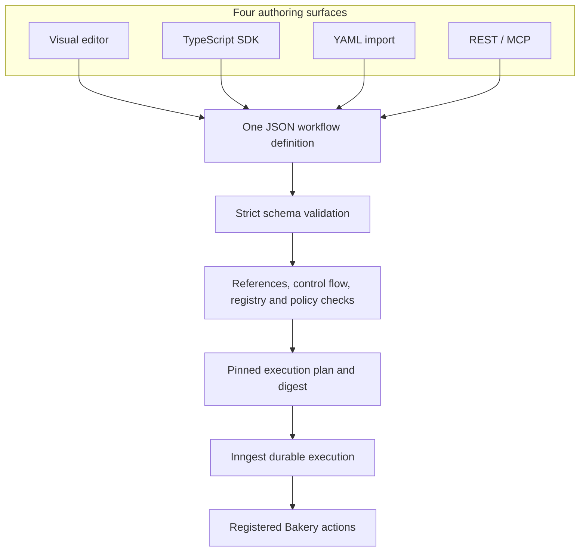
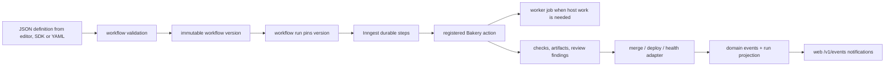
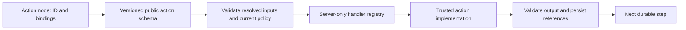
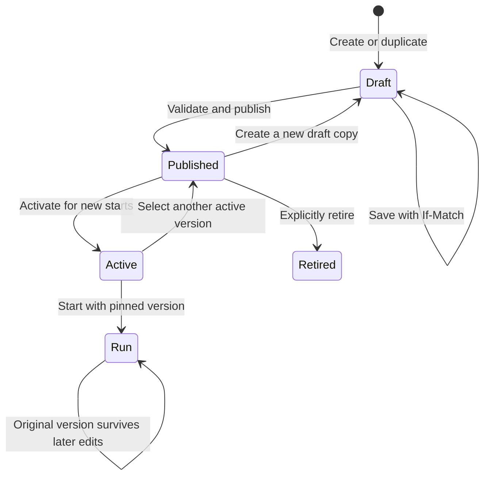
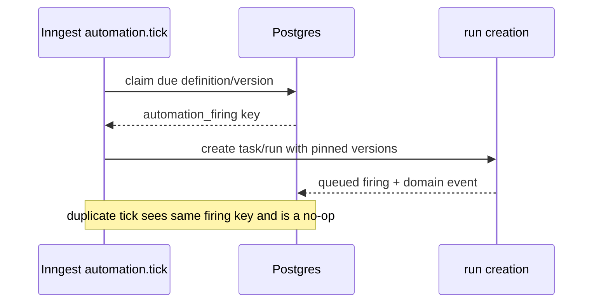
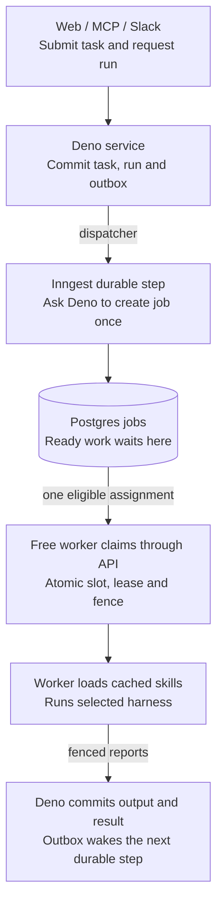
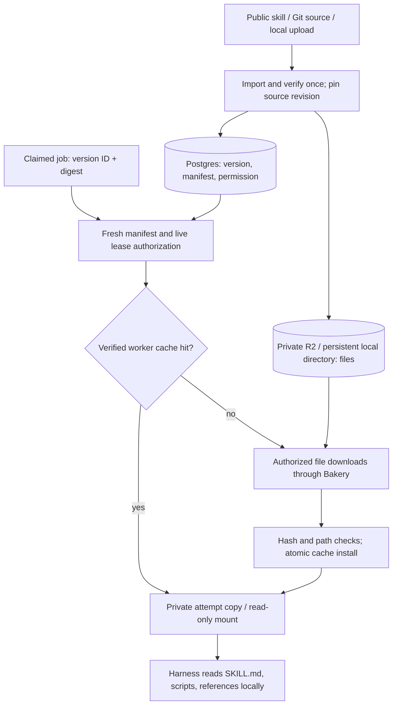
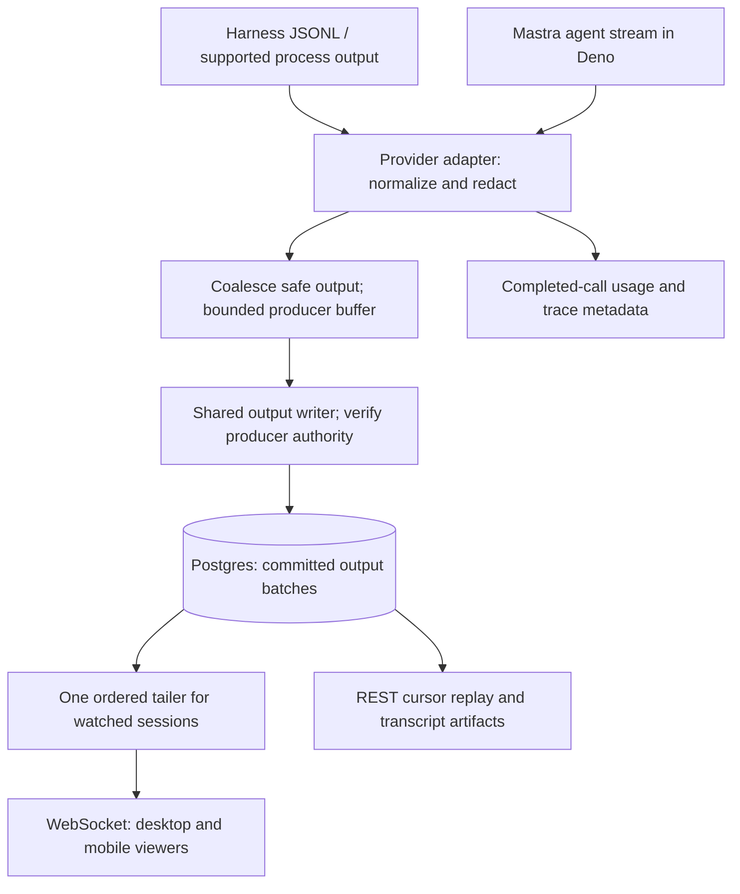

# Bakery workflows, delivery, and acceptance

Status: design direction accepted on 7 September 2026; extended on 8 September 2026 for locked Bakery workflows, organization copies and multi-repository coordination; implementation pending.
This file defines the versioned
workflow language, repository profile, scheduled execution, delivery policy,
and proving backlog. It does not implement a workflow engine or alter a
managed application repository.

The [8 September requirements](#workflow-ownership-and-multi-repository-work) below
extend the earlier single-repository examples. Multi-repository work is a task and
agent capability, available with or without a saved workflow. The structured
catalog reconciliation required by this addition is listed explicitly below.

## JSON is the contract; the editor, YAML, and SDK are authoring surfaces

Accepted direction, 7 September 2026: use one JSON-compatible workflow
definition. Make a visual editor the primary authoring surface. Keep YAML as
optional import/export, and offer a typed TypeScript builder that emits the
same definition. The catalog refinements below are accepted requirements;
their endpoints and storage changes remain unimplemented.

For the runtime walkthrough, jump to [task pickup, skill caching and live output](#workflows-section-19), then [observability](#workflows-section-20). The code below shows intended boundaries; it is not a running factory.

| Surface | Role | What crosses the server boundary |
| --- | --- | --- |
| Visual editor | Add steps, wire inputs, select skills, inspect policy | JSON definition |
| REST / MCP | Create, validate, publish, inspect, start | The same generated contracts |
| TypeScript SDK | Autocomplete, typed action inputs and output references | JSON produced locally or in the caller's CI |
| YAML | Human-readable import/export and advanced source editing | Parsed JSON through the same validator |
| JSON Schema | Describe valid document/action shapes to tools and forms | Derived schema metadata; never executable handlers |

YAML and JSON do not provide type safety on their own. TypeScript types help
the author; runtime validation protects every caller. The schema describes
the data. A registered handler supplies the code. No TypeScript-to-JavaScript
compiler, uploaded closure, or `eval` is needed in Bakery's control plane.



## Existing libraries cover pieces, with different execution semantics

| Candidate | Current evidence | Bakery conclusion |
| --- | --- | --- |
| Zod 4 | Runtime parsing, inferred TS types, native JSON Schema export. Some types/transforms cannot export. [Zod](https://zod.dev/json-schema) | Define JSON-native contracts once; derive types and schema metadata. Add semantic validation separately. |
| Inngest Workflow Kit | Controlled React editor, public action metadata, and an engine inside an Inngest function. Its repository explicitly presents it as a reference implementation. [Repository](https://github.com/inngest/workflow-kit), [components](https://www.inngest.com/docs/reference/workflow-kit/components-api) | Reuse its action/catalog/editor separation. Do not adopt its document format as an unexamined second DSL. |
| Mastra dynamic workflows | JSON graphs, registered tools/agents, schema-flow validation and some code-to-data serialization. Currently beta; breaking changes need not wait for a major release. Mapping nodes cannot sit inside loop/parallel/conditional containers. [Definition reference](https://mastra.ai/reference/workflows/dynamic-workflow-definition) | Real candidate, not a missing capability. Its semantics do not directly match Bakery's nested repair accumulator. Keep it behind an adapter experiment if evaluated further. |
| React Flow | Custom nodes, connection validation hooks, grouping, keyboard support and touch interaction. [Custom nodes](https://reactflow.dev/learn/customization/custom-nodes), [accessibility](https://reactflow.dev/learn/advanced-use/accessibility) | Use for the desktop canvas. Bakery still owns schemas, validation, persistence, permissions and execution. |

Decision: retain Inngest as the single durable scheduler and Mastra for
agent/tool execution. Use a small interpreter for Bakery's node forms, including
the bounded parallel group defined below. A schema-to-handler lookup is sufficient; a general programming language,
new scheduler, and arbitrary user-code runtime are unnecessary. The fixed
workflow proving slice still precedes a configurable interpreter.

## Ownership and source of truth

Inngest owns durable workflow execution: event triggers, step checkpoints,
waits, retries, cancellation, and execution observability. Bakery owns the
user-visible task and run records, workflow definitions and versions, jobs,
artifacts, evidence, delivery effects, and acceptance policy. A workflow step
calls a registered Bakery action; it never embeds arbitrary executable code in
YAML.

The logical model already contains the required durable records:
`workflow_definitions`, immutable `workflow_versions`, `workflow_runs`,
`run_steps`, `automation_definitions`, `automation_versions`,
`automation_firings`, `jobs`, `job_attempts`, `artifacts`, `check_runs`,
`review_cycles`, `review_findings`, `merge_entries`, `deployments`,
`external_effects`, and `domain_events`. Run provenance stores the selected
workflow version, repository profile, agent version, skill revisions,
connection identities, and policy digest. A run never follows a newly
published workflow version. Artifact handoffs resolve
`{artifactId, versionId, sha256}` once into the durable step input; retries
reuse that exact tuple and never re-read a mutable current artifact version.
Artifact-producing actions call the shared version-publication operation with
parent `If-Match` and an idempotency key before returning their `ArtifactRef`.
`artifact.publish` finalizes a workflow handoff by verifying that already-committed
publication and returning its tuple. It never performs a second pointer promotion
or publishes new bytes; the upload/publication boundary owns the parent CAS.

The operation inventory in `api-catalog.json` is the API contract input. It
already names workflow validation/version creation, run creation/control/
retry, automation version/firing management, checks, reviews, merge, deploy,
rollback, and evaluation operations. Generated input/output schemas belong in
`packages/contracts`; the implementation must not hand-write a second DTO
shape.



## Workflow DSL

JSON is the canonical data format. YAML is an optional serialization of the
same definition. The server performs strict structural and semantic validation,
normalizes the definition, and computes its digest. The normalized form is the
versioned execution input. The accepted language has six
node forms: `action`, `branch`, `repeat`, `wait`, `sequence`, and bounded `parallel`
(the top-level steps list is a sequence). Parallel groups require the coordination
contract below; the existing authoring probe does not implement them. The example
below is a single-repository delivery workflow that can be reused for one lane of
a larger coordinated task; it is not a limit on task scope.

```yaml
apiVersion: bakery.dev/v1
kind: workflow
name: software-delivery
description: Research, implement, verify, review, and deliver a repository change.
inputs:
  taskId: {type: uuid, required: true}
  repositoryId: {type: uuid, required: true}
  profileRevision: {type: integer, required: true}
  target: {type: string, required: true}
limits:
  wallClock: 24h
  maxCostUsd: 12
  maxAttempts: 24
  maxRepairCycles: 2
cancel: stop-started-actions
steps:
  - id: research
    uses: rpi.research
    with: {taskId: $input.taskId, repositoryId: $input.repositoryId}
    timeout: 30m
    retry: {maxAttempts: 2, backoff: 30s, on: [DEPENDENCY_TIMEOUT, DEPENDENCY_UNAVAILABLE]}
  - id: design
    needs: [research]
    uses: rpi.design
    with: {researchArtifact: $step.research.artifact}
    timeout: 30m
  - id: plan
    needs: [design]
    uses: rpi.plan
    with: {designArtifact: $step.design.artifact}
    timeout: 30m
  - id: implement
    needs: [plan]
    uses: harness.implement
    with: {planArtifact: $step.plan.artifact, repositoryId: $input.repositoryId}
    requires: [git, shell, web]
    timeout: 2h
    retry: {maxAttempts: 1, on: [WORKER_UNAVAILABLE]}
  - id: test
    needs: [implement]
    uses: quality.check
    with: {repositoryId: $input.repositoryId, revision: $step.implement.headSha}
    checks: [lint, typecheck, test, build, test:rails, test:e2e]
    timeout: 45m
  - id: review
    needs: [test]
    uses: review.independent
    with: {revision: $step.implement.headSha, evidence: $step.test.checkRunIds}
    limits: {maxFindings: 25, maxDuration: 30m}
  - id: repair
    needs: [review]
    repeat:
      max: 2
      seed:
        currentCandidate:
          headSha: $step.implement.headSha
          baseSha: $step.test.baseSha
          policyDigest: $step.test.policyDigest
          checksPassed: $step.test.allRequired
          blockingFindings: $step.review.blockingFindings
          reviewId: $step.review.reviewId
          findings: $step.review.findings
          checkRunIds: $step.test.checkRunIds
          failedCheckIds: $step.test.failedCheckIds
      until: $repeat.currentCandidate.blockingFindings == 0 && $repeat.currentCandidate.checksPassed == true
      steps:
        - id: repair_implement
          uses: harness.repair
          with:
            repositoryId: $input.repositoryId
            currentCandidate: $repeat.currentCandidate
            findings: $repeat.currentCandidate.findings
            failedCheckIds: $repeat.currentCandidate.failedCheckIds
          requires: [git, shell]
          timeout: 90m
        - id: repair_test
          needs: [repair_implement]
          uses: quality.check
          with: {repositoryId: $input.repositoryId, revision: $step.repair.repair_implement.headSha}
          checks: [lint, typecheck, test, build, test:rails, test:e2e]
          timeout: 45m
        - id: repair_review
          needs: [repair_test]
          uses: review.independent
          with: {revision: $step.repair.repair_implement.headSha, evidence: $step.repair.repair_test.checkRunIds}
          timeout: 30m
        - id: candidate_evidence
          needs: [repair_review]
          uses: delivery.candidate_evidence
          with:
            headSha: $step.repair.repair_implement.headSha
            baseSha: $step.repair.repair_test.baseSha
            policyDigest: $step.repair.repair_test.policyDigest
            checksPassed: $step.repair.repair_test.allRequired
            blockingFindings: $step.repair.repair_review.blockingFindings
            reviewId: $step.repair.repair_review.reviewId
            findings: $step.repair.repair_review.findings
            checkRunIds: $step.repair.repair_test.checkRunIds
            failedCheckIds: $step.repair.repair_test.failedCheckIds
      outputs:
        currentCandidate: $step.repair.candidate_evidence
  - id: merge
    needs: [repair]
    if: $step.repair.outcome == "completed" && $step.repair.currentCandidate.blockingFindings == 0 && $step.repair.currentCandidate.checksPassed == true
    uses: delivery.merge
    with: {repositoryId: $input.repositoryId, candidate: $step.repair.currentCandidate}
    effectKey: [merge, $input.repositoryId, $step.repair.currentCandidate.headSha]
    timeout: 20m
  - id: prepare
    needs: [merge]
    uses: delivery.prepare
    with: {repositoryId: $input.repositoryId, headSha: $step.merge.commitSha, profileRevision: $input.profileRevision}
    timeout: 20m
  - id: deploy_release
    needs: [prepare]
    uses: delivery.deploy
    with: {releaseId: $step.prepare.releaseId, environment: production}
    effectKey: [deploy, $input.repositoryId, $step.merge.commitSha]
    timeout: 30m
  - id: health
    needs: [deploy_release]
    uses: delivery.health
    with: {deploymentId: $step.deploy_release.deploymentId}
    retry: {maxAttempts: 3, backoff: 1m, on: [DEPENDENCY_TIMEOUT, DEPENDENCY_UNAVAILABLE]}
    timeout: 15m
```

The example is the complete default software-delivery path: RPI research,
design, and plan; implementation; deterministic checks; independent review;
two bounded repair cycles; merge; deploy; and health verification. `go` starts
the run under the repository's policy. It has no recurring human approval
steps. A question may pause the run when required information is missing; the
answer resumes the same run.

### Grammar and invariants

The normalized node contract is:

```text
Workflow = {apiVersion, kind, inputs?, limits?, agents?: {<action>: uuid}, cancel?, steps: Node[]}
Node = Action | Branch | Repeat | Wait | Sequence | Parallel
Action  = {id, uses, needs?, if?, with?, requires?, checks?, limits?, timeout?, retry?, effectKey?}
Branch  = {id, needs?, if?, branch: {when, then: Node[], else?: Node[], outputs?: {<name>: {then?: Value, else?: Value}}}}
Repeat  = {id, needs?, if?, repeat: {max: integer 1..8, seed: Seed, until: Expression, steps: Node[], outputs: {currentCandidate: Value}}}
Seed    = {currentCandidate: Value} | {steps: Node[], outputs: {currentCandidate: Value}}
Wait    = {id, needs?, if?, wait: {duration} | {event, timeout}}
Sequence = {id, needs?, if?, steps: Node[]}
Parallel = {id, needs?, if?, parallel: {maxConcurrency, join: all-required, failurePolicy: stop-dependent,
            branches: Lane[], outputs?: {<laneId>: {<name>: Value}}}}
Lane    = {id, needs?, repository, steps: Node[]}
```

A step `agentVersionId` is forbidden (`step_agent_version_forbidden`) until the
catalog gains step agent fields; agent bindings are the top-level `agents` map.

`Seed` has exactly two exclusive authoring forms, told apart by key set: the
mapping `{currentCandidate: Value}`, or the sequence
`{steps: Node[], outputs: {currentCandidate: Value}}`. Mixed, extra or missing
keys are invalid. `Value` and every `outputs` mapping are typed values: tagged
literals or references (see
[Tagged values, references and conditions](#tagged-values-references-and-conditions));
they cannot invoke an action or read a secret.

- `id` is unique within the workflow, stable after publication, and matches
  `[a-z][a-z0-9_]{1,63}`. Nested IDs are qualified by their parent path. A
  qualified ID joins parent and child IDs with `.`, and references use that
  qualified path (for example, `$step.repair.repair_test.checkRunIds`).
- `uses` resolves only to a registered action with an input/output schema,
  required capabilities, cancellation behavior, retryable fault set, and
  side-effect policy. Unknown or disabled actions fail validation.
- `needs` references earlier node IDs and forms an acyclic graph. A branch
  cannot reference an output from an unselected branch without an explicit
  optional value.
- `if`/`until` use only `==`, `!=`, `<`, `<=`, `>`, `>=`, `in`, `&&`, `||`,
  `!`, and parentheses over booleans, numbers, strings, null, and structured
  step outputs. There is no implicit type coercion, arbitrary code, shell,
  YAML interpolation, network request, or secret access in an expression.
- Comparisons require the same scalar type; ordering is only for numbers or
  strings, `in` requires a typed list on its right side, and `&&`, `||`, and
  `!` require booleans. Structured values are addressable only through typed
  fields.
- `$input.*`, `$task.*`, `$step.<qualified-id>.*`, and the current loop's
  `$repeat.currentCandidate.*`
  are typed references. Secret values are never valid expression outputs or
  serialized workflow inputs.
- Every action has a finite timeout. Every retry has a finite attempt count,
  bounded backoff, and named retryable fault codes. No unbounded retry or loop
  is valid.
- `repeat.max` is an integer from 1 through 8 and is also bounded by the
  workflow's repair-cycle policy. A repeat terminates with exactly one outcome:
  `completed`, `exhausted`, `canceled`, `failed`, or `timed_out`; `exhausted`
  cannot satisfy a delivery gate.
- `if` and `until` must evaluate to a boolean. A missing path is invalid unless
  the schema declares it optional; an optional missing value is `null`, never
  false or an empty string.
- `checks` names the registered check set for actions such as `quality.check`;
  `limits` is a typed action-local ceiling (`maxDuration`, `maxCostUsd`, and
  `maxFindings` where applicable). Unknown checks or limit fields fail
  validation.
- Top-level `checks` and `effectKey` supply the registered
  `CheckInput.checks` and `MergeInput.effectKey` or `DeployInput.effectKey`
  fields. The compiler keeps them as separate node fields (sorted `checks`,
  `{kind: effect_key, parts}`) and the normalized `with` does not hold them;
  the executor injects them into the action input at run time. Supplying
  either field in both locations is a duplicate-field validation error even
  when the values are equal.
- `wait.duration` releases compute. `wait.event` subscribes to a named,
  authorized event and has a timeout. A missing event becomes a typed timeout,
  not a permanently running step.
- Cancellation moves the run to `canceling`, sends best-effort cancellation
  to started actions, and waits for durable acknowledgments or lease expiry.
  A cancelled run cannot be reopened by a late result.
- External effects require `effectKey`; the action records pending, confirmed,
  or unknown outcome in `external_effects` and reconciles before retrying.

`repeat.until` is checked before the first iteration and after each completed
iteration. The repeat maintains `currentCandidate` as its accumulator: the
typed `repeat.seed` initializes it, and `repeat.outputs` is validated and
applied only after every nested step completes successfully. If the seed
already satisfies `until`, the repeat performs zero iterations and returns the
seed unchanged. The default condition requires both zero blocking review
findings and passing required checks, so a clean review with failed checks
enters repair using its failed-check evidence. A failed, canceled, or timed-out
iteration leaves the prior accumulator intact and returns that outcome. A repeat returns
`{iterations, currentCandidate, outcome}`, making the final accumulator
addressable without special loop syntax. `outcome` is one of `completed`,
`exhausted`, `canceled`, `failed`, or `timed_out`. For example, a missing-input branch is expressible without
introducing a second orchestration system:

```yaml
- id: clarify_if_needed
  branch:
    when: $task.status == "waiting_input"
    then:
      - id: wait_for_answer
        wait: {event: question.answered, timeout: 24h}
    else:
      - id: continue
        uses: workflow.noop
```

`workflow.noop` is a registered zero-side-effect action used only where a
branch needs an explicit completed path.

The execution key is `(run_id, qualified_step_id, iteration)`. Bakery writes a
`run_steps` row before dispatching an action. Inngest checkpoints completed
steps; a restart resumes from the last completed key. A duplicate dispatch
returns the recorded output. A workflow/config revision is never applied to an
active run.

`repeat.seed` resolves once and initializes the accumulator before `until` is
evaluated. The seed is either the mapping form or the sequence form
described in the grammar. The condition is checked before each iteration, so a
clean seed yields zero iterations and remains the valid final result. A failed
check is repair evidence even when the independent review has no findings;
`harness.repair` accepts blocking review findings, failed checks (each naming
its check run) or both, and always names the revision it repairs.
`repeat.outputs` maps the completed iteration's nested outputs to the required
accumulator type; it is never resolved from an incomplete or failed iteration.
The repeat result is always `{iterations, currentCandidate, outcome}`, even
when `iterations` is zero; no `last`/undefined convention is used. The merge
action consumes only this final accumulator after checking `outcome ==
"completed"`, current revision evidence, and the delivery policy.

### Registry and freeform work

The initial action registry is intentionally small:

```text
rpi.research, rpi.design, rpi.plan
harness.implement, harness.repair
quality.check, review.independent
integration.action
delivery.candidate_evidence, delivery.merge, delivery.prepare, delivery.deploy,
delivery.health
agent.freeform, workflow.noop
artifact.publish, memory.promote, evaluation.sample
```

`agent.freeform` is a registered built-in action for an unstructured request.
It runs one bounded agent session with a required `maxTurns`, wall-clock
timeout, cost budget, allowed tools, and output artifact. It cannot create
unregistered steps, bypass repository checks, merge, deploy, or change
permissions. If the request needs a multi-stage RPI path, the UI offers the
versioned workflow above.

The `paper` capability on `rpi.design` resolves only to the configured Paper
MCP connection and is used for Bakery's design artifact/parity work; it does
not grant access to another product's file or permit unmanaged mutations.

Every model-using action carries a pinned billing configuration in its
normalized run snapshot. The configuration is data, never executable provider
code:

```yaml
billing:
  provider: openrouter
  billingAccountId: workspace-prod
  model: provider/model-id
  billingRoute: api # api | subscription
  maxTokens: 12000
  maxUsdReservation: 1.50
  pricingMetadataSnapshot: openrouter-pricing-2026-09-07T00:00:00Z
```

`provider`, `billingAccountId`, `model`, `billingRoute`, `maxTokens`, and
`maxUsdReservation` are required for a model action. An unknown model price,
unbounded token allowance, or missing reservation ceiling blocks dispatch with
a typed billing configuration fault. A subscription route may have an
incremental-cost ceiling of `0` only when policy explicitly excludes marginal
usage; the fixed monthly subscription fee is still reported separately and is
never represented as a false zero. The OpenRouter pricing metadata snapshot is
stored with the run and must be fresh enough for policy; a stale or unavailable
snapshot blocks new reservations.

Worker terminal status is not spend evidence. A provider usage receipt is
bound to the authenticated host/session/generation/fence, the immutable
provider/model/account/route/pricing pins, and the provider call identity.
Known receipts settle both holds against the installation month in which the
reservation was created; unknown receipts persist with null cost and keep both
holds held. Usage facts and canonical replay digests are retained independently
of artifact export and workflow-history expiry.

Installation and run reservations are held atomically in one transaction,
with the installation allowance checked before the run allowance. The provider
call receives a stable `reservationId`; settlement links that ID to provider
usage, actual token counts, pricing snapshot, and the resulting artifact/run
step. Unknown provider usage remains unsettled and is reconciled by the same
reservation ID; it cannot be retried by creating a second hold. Scope budgets
are enforced by the worker/action boundary, and no action may execute arbitrary
code to bypass them.

### Common action execution and billing resolution

Every handler receives `ActionExecution {runId: uuid, stepId: uuid, action: RegisteredAction, input: ActionInput, agentVersionId: uuid|null, billing: BillingConfig|null, installationReservationId: uuid|null}`. Billing is a mandatory execution-envelope field for every registry entry with the `model` capability, not a duplicate field in each action-specific input. Non-model actions have null billing and null agentVersionId unless a separate agent is explicitly involved.

At publication/run normalization, resolve the exact immutable agent version in this order: the step's own `agentVersionId`, then `workflow.agents[actionName]`, then `repositoryProfile.config.agentBindings[actionName]`. A step-level `agentVersionId` is an explicit immutable override for that step only; the optional top-level YAML `agents` object is an allowlisted action-name-to-agent-version-UUID map with at most 17 entries. Model and billing come only from the resolved immutable agent version; no definition field carries a model, billing, credential or code override (`step_binding_override_forbidden`). Non-repository workflows must provide this map for every reachable model action. No active-version pointer or mutable provider default is read after the run starts. Missing, revoked, out-of-scope, or mismatched bindings block validation.

Run admission also freezes the registered action identity and required
capabilities. Step `requires` can add registered capabilities, never remove an
action's requirements; an explicit agent `allowedCapabilities` must contain the
resulting set. Unavailable actions, invalid requirements, insufficient agent
policy and substituted frozen registry metadata reject admission atomically.
Before enqueue, the resolved action input must satisfy its registered contract,
before server context is attached or job/lifecycle writes occur. Existing-job
enqueue readmission applies the same validation; claim retains its durable
malformed-payload disposition rather than silently skipping bad queued data.
The explicit agent capability policy is also enforced for queued legacy work
and live-attempt recovery, not only producer admission. Canonically valid but
policy-invalid queued assignments are durably rejected before leasing, so they
cannot starve later eligible work. Claim replay and pending-claim heartbeat
recovery share the same repository and agent-policy checks before rebinding;
a failed recovery leaves the live attempt and worker session unchanged.
Each claim transaction durably rejects at most 64 invalid assignments before
returning no assignment. A fresh claim continues from the remaining queued work;
replaying the previous claim does not perform another cleanup batch. Temporarily
ineligible or raced-out rows roll back their savepoints and do not consume this
disposition budget.

Model enqueue and fresh claim require the job's own held run/installation
reservation pair, exact frozen billing and agent identity, and a matching
server-owned pricing snapshot and pending, unbound provider-call intent.
Shape-correct billing or another job's reservation is insufficient; producer
admission returns `model_funding_unavailable` without a valid pair. Malformed
queued payloads still take the durable rejection path before funding checks.
Live-attempt recovery retains its existing fenced recovery rules rather than
treating an already-bound call as permission for a fresh attempt. Pricing
ingestion, live dispatch binding and authoritative receipt production remain
dependencies of the provider adapter, not capabilities established by local
accounting fixtures.

`AgentVersion.config.billing` has the exact BillingConfig schema below. Copy it into the immutable run snapshot and each ActionExecution. Repository profile allowed providers/models/billing routes and spending ceilings can only narrow it; the workflow/run limits can only narrow the ceiling further. Record the pricing metadata snapshot plus resolved version IDs/digests. There is no silent runtime billing-route fallback. Before dispatch, validate live authority, reserve against both ledgers, and attach `installationReservationId: uuid` to ActionExecution. A worker assignment carries the same typed billing and reservation ID; the worker cannot choose a different provider/model or enlarge limits. Provider usage settlement references that installation hold and its paired run hold.

Quota/outage recovery offers an explicit model/provider choice through the shared communication path. An accepted switch creates a linked continuation with a new immutable binding, current authority and budget reservation; it does not edit the active snapshot, erase unresolved usage or repeat confirmed effects. The old producer is stopped/fenced before continuation admission. Unchanged-route recovery can resume eligible work automatically from its durable boundary. [Provider isolation, probes and switch admission](16-recovery-and-failures.md) defines the policy and still-pending typed continuation/incident contracts.

The default YAML inherits these bindings from its required repository profile, so it is deployable only after onboarding has pinned agent versions for research/design/plan, implementation/repair, review and any selected evaluation action. The workflow validator checks this before publishing or queuing work. Freeform uses this same envelope rather than an untrusted independently supplied billing object.

The registry is a versioned data contract. Strict validation resolves every
`uses` value to one entry below; `input` and `output` names resolve to the
field schemas that follow. `required` means non-null and present. All omitted
fields are rejected unless marked `required: false`.

| Action | Input schema | Output schema |
| --- | --- | --- |
| `rpi.research` | `ResearchInput` | `ResearchOutput` |
| `rpi.design` | `DesignInput` | `ArtifactOutput` |
| `rpi.plan` | `PlanInput` | `ArtifactOutput` |
| `harness.implement` | `ImplementInput` | `HarnessOutput` |
| `harness.repair` | `RepairInput` | `HarnessOutput` |
| `quality.check` | `CheckInput` | `CheckOutput` |
| `review.independent` | `ReviewInput` | `ReviewOutput` |
| `integration.action` | `IntegrationActionInput` | `IntegrationActionOutput` |
| `delivery.candidate_evidence` | `CandidateEvidence` | `CandidateEvidence` |
| `delivery.prepare` | `PrepareInput` | `PrepareOutput` |
| `delivery.merge` | `MergeInput` | `MergeOutput` |
| `delivery.deploy` | `DeployInput` | `DeployOutput` |
| `delivery.health` | `HealthInput` | `HealthOutput` |
| `agent.freeform` | `FreeformInput` | `FreeformOutput` |
| `workflow.noop` | `EmptyInput` | `EmptyOutput` |
| `artifact.publish` | `ArtifactPublishInput` | `ArtifactOutput` |
| `memory.promote` | `MemoryPromoteInput` | `MemoryOutput` |
| `evaluation.sample` | `EvaluationInput` | `EvaluationOutput` |

`integration.action` uses the same expression DSL as every workflow action:
`actionId`, `actionVersion`, and `resourceId` are typed fields, while
`arguments` may contain typed `$input.*`, `$task.*`, or `$step.<qualified-id>.*`
references validated against the selected action schema. The run's authorized
connection/binding is resolved from the resource and immutable run context;
workflow data cannot supply a connection, credential, URL, actor, or effect
authority. Reads return `ActionResult`; writes return the durable
`ActionResult` after the receipt is reconciled by its stable effect identity.
The REST transport may return `ActionResult` with 200 for reads or an
`IntegrationActionReceipt` with 202 for writes. For a write, `prepared`,
`submitted`, or `uncertain` is an admission/reconciliation state, not a
completed workflow step: the step remains waiting until reconciliation proves
the provider effect and yields a safe `ActionResult`, or reaches terminal
failure. An uncertain effect is never blindly retried.

The machine-readable registry metadata is:

```json
{
  "rpi.research": {"input":"ResearchInput","output":"ResearchOutput","capabilities":["model","web"],"cancel":"cooperative","retry":{"maxAttempts":2,"backoff":"30s","faults":["DEPENDENCY_TIMEOUT","DEPENDENCY_UNAVAILABLE"]},"effectPolicy":"artifact_only"},
  "rpi.design": {"input":"DesignInput","output":"ArtifactOutput","capabilities":["model","paper"],"cancel":"cooperative","retry":{"maxAttempts":2,"backoff":"30s","faults":["DEPENDENCY_TIMEOUT"]},"effectPolicy":"artifact_only"},
  "rpi.plan": {"input":"PlanInput","output":"ArtifactOutput","capabilities":["model"],"cancel":"cooperative","retry":{"maxAttempts":2,"backoff":"30s","faults":["DEPENDENCY_TIMEOUT"]},"effectPolicy":"artifact_only"},
  "harness.implement": {"input":"ImplementInput","output":"HarnessOutput","capabilities":["git","shell","web","model"],"cancel":"cooperative_fenced","retry":{"maxAttempts":1,"backoff":"0s","faults":["WORKER_UNAVAILABLE"]},"effectPolicy":"repository_revision"},
  "harness.repair": {"input":"RepairInput","output":"HarnessOutput","capabilities":["git","shell","model"],"cancel":"cooperative_fenced","retry":{"maxAttempts":1,"backoff":"0s","faults":["WORKER_UNAVAILABLE"]},"effectPolicy":"repository_revision"},
  "quality.check": {"input":"CheckInput","output":"CheckOutput","capabilities":["git","shell","browser"],"cancel":"cooperative_fenced","retry":{"maxAttempts":2,"backoff":"30s","faults":["WORKER_UNAVAILABLE","DEPENDENCY_TIMEOUT"]},"effectPolicy":"evidence_only"},
  "review.independent": {"input":"ReviewInput","output":"ReviewOutput","capabilities":["model","reviewer"],"cancel":"cooperative","retry":{"maxAttempts":1,"backoff":"0s","faults":["REVIEWER_UNAVAILABLE"]},"effectPolicy":"review_evidence"},
  "integration.action": {"input":"IntegrationActionInput","output":"IntegrationActionOutput","capabilities":["integration"],"cancel":"cooperative_fenced","retry":{"maxAttempts":1,"backoff":"0s","faults":["DEPENDENCY_UNAVAILABLE"]},"effectPolicy":"external_effect_keyed_reconcile"},
  "delivery.candidate_evidence": {"input":"CandidateEvidence","output":"CandidateEvidence","capabilities":[],"cancel":"immediate","retry":{"maxAttempts":1,"backoff":"0s","faults":[]},"effectPolicy":"projection_only"},
  "delivery.prepare": {"input":"PrepareInput","output":"PrepareOutput","capabilities":["delivery"],"cancel":"cooperative","retry":{"maxAttempts":1,"backoff":"0s","faults":["DEPENDENCY_UNAVAILABLE"]},"effectPolicy":"external_prepare"},
  "delivery.merge": {"input":"MergeInput","output":"MergeOutput","capabilities":["delivery"],"cancel":"cooperative","retry":{"maxAttempts":1,"backoff":"0s","faults":["DEPENDENCY_UNAVAILABLE"]},"effectPolicy":"external_effect_keyed"},
  "delivery.deploy": {"input":"DeployInput","output":"DeployOutput","capabilities":["delivery"],"cancel":"cooperative","retry":{"maxAttempts":1,"backoff":"0s","faults":["DEPENDENCY_UNAVAILABLE"]},"effectPolicy":"external_effect_keyed_reconcile"},
  "delivery.health": {"input":"HealthInput","output":"HealthOutput","capabilities":["delivery"],"cancel":"cooperative","retry":{"maxAttempts":3,"backoff":"1m","faults":["DEPENDENCY_TIMEOUT","DEPENDENCY_UNAVAILABLE"]},"effectPolicy":"evidence_only"},
  "agent.freeform": {"input":"FreeformInput","output":"FreeformOutput","capabilities":["model"],"cancel":"cooperative_fenced","retry":{"maxAttempts":1,"backoff":"0s","faults":["WORKER_UNAVAILABLE"]},"effectPolicy":"artifact_only"},
  "workflow.noop": {"input":"EmptyInput","output":"EmptyOutput","capabilities":[],"cancel":"immediate","retry":{"maxAttempts":1,"backoff":"0s","faults":[]},"effectPolicy":"none"},
  "artifact.publish": {"input":"ArtifactPublishInput","output":"ArtifactOutput","capabilities":["storage"],"cancel":"cooperative","retry":{"maxAttempts":2,"backoff":"30s","faults":["DEPENDENCY_UNAVAILABLE"]},"effectPolicy":"artifact_only"},
  "memory.promote": {"input":"MemoryPromoteInput","output":"MemoryOutput","capabilities":["storage"],"cancel":"cooperative","retry":{"maxAttempts":1,"backoff":"0s","faults":["DEPENDENCY_UNAVAILABLE"]},"effectPolicy":"memory_write"},
  "evaluation.sample": {"input":"EvaluationInput","output":"EvaluationOutput","capabilities":["model","storage"],"cancel":"cooperative","retry":{"maxAttempts":1,"backoff":"0s","faults":["DEPENDENCY_UNAVAILABLE"]},"effectPolicy":"evaluation_write"}
}
```

The referenced schemas define required fields, types, nullability, and bounds:

```text
ResearchInput        = {taskId: uuid, repositoryId: uuid}
ArtifactRef          = {artifactId: uuid, versionId: uuid, sha256: string pattern=^[0-9a-f]{64}$}
ResearchOutput       = {artifact: ArtifactRef, repositoryRevision: string minLength=1}
DesignInput          = {researchArtifact: ArtifactRef}
PlanInput            = {designArtifact: ArtifactRef}
ArtifactOutput       = {artifact: ArtifactRef}
ImplementInput       = {repositoryId: uuid, planArtifact: ArtifactRef, instructions?: string minLength=1 maxLength=4000}
RepairInput          = {repositoryId: uuid, revision: string length=40, findings: Finding[] maxItems=25, failedChecks: FailedCheck[] maxItems=32}
HarnessOutput        = {headSha: string minLength=1, baseSha: string minLength=1, sessionId: uuid, checkpoint?: HarnessCheckpoint, piVersion?: string|null, codexVersion?: string|null, artifacts: ArtifactRef[], claudeCodeVersion?: string|null, model?: string|null, capabilities?: string[], events?: json[], telemetry?: json}
CheckInput           = {repositoryId: uuid, revision: string minLength=1, checks: string[] minItems=1}
CheckOutput          = {allRequired: boolean, checkRunIds: uuid[] minItems=1 maxItems=32, failedCheckIds: uuid[] maxItems=32, observations: CheckObservation[] minItems=1 maxItems=32, headSha: string minLength=1, baseSha: string minLength=1, policyDigest: string minLength=1}
CheckObservation     = {checkRunId: uuid, checkId: string minLength=1 maxLength=100, kind: enum(command|commits|title|description|merge_message), ruleKey: enum(commits.semantic|changeRequest.semanticTitle|changeRequest.description|code.magicNumbers|code.magicStrings)|null, result: enum(pending|passed|failed|unavailable|canceled), reason: enum(verified|exit_nonzero|signal|deadline|output_limit|rule_violation|description_placeholder|tool_missing|unsupported_checker|revision_unavailable|skipped|metadata_missing|metadata_too_large|rule_unbound|rule_binding_ambiguous|policy_missing|awaiting_result|canceled), exitCode: integer 0..255|null, durationMs: integer 0..86400000, outputDigest: sha256|null, evidence: ArtifactRef|null}
ReviewInput          = {repositoryId: uuid, revision: string length=40, evidence: uuid[] minItems=1 maxItems=32}
ReviewOutput         = {reviewId: uuid, sessionId: uuid, headSha: string minLength=1, baseSha: string minLength=1, policyDigest: string minLength=1, findings: Finding[] maxItems=25, blockingFindings: integer 0..25}
IntegrationActionInput  = {actionId: string minLength=1, actionVersion: integer min=1, resourceId: uuid, arguments: json}
IntegrationActionOutput = ActionResult (read or confirmed write)
IntegrationActionReceipt = transport-only write admission (HTTP 202; prepared|submitted|uncertain)
CandidateEvidence    = {headSha: string minLength=1, baseSha: string minLength=1, policyDigest: string minLength=1, checksPassed: boolean, checkRunIds: uuid[] minItems=1, failedCheckIds: uuid[], blockingFindings: integer min=0, reviewId: uuid, findings: Finding[]}
PrepareInput         = {repositoryId: uuid, headSha: string minLength=1, profileRevision: integer min=1}
PrepareOutput        = {releaseId: string minLength=1, artifactDigest: string minLength=1, environment: string minLength=1, status: literal(prepared)}
MergeInput           = {repositoryId: uuid, candidate: CandidateEvidence, effectKey: string minLength=1}
MergeOutput          = {commitSha: string minLength=1, providerEffectId: string minLength=1, status: literal(confirmed)}
DeployInput          = {releaseId: string minLength=1, environment: string minLength=1, effectKey: string minLength=1}
DeployOutput         = {deploymentId: uuid, commitSha: string minLength=1, status: enum(accepted|queued|deploying), providerEffectId: string minLength=1}
HealthInput          = {deploymentId: uuid}
HealthOutput         = {deploymentId: uuid, status: enum(healthy|degraded|failed), checkedAt: datetime, evidenceArtifact: ArtifactRef}
FreeformInput        = {prompt: string minLength=1, maxTurns: integer 1..50, timeout: duration, maxCostUsd: number 0..100, allowedTools: string[] maxItems=20}
FreeformOutput       = {sessionId: uuid, artifacts: ArtifactRef[], status: enum(completed|failed|canceled|timed_out)}
EmptyInput           = {}
EmptyOutput          = {}
ArtifactPublishInput = {artifact: ArtifactRef}
MemoryPromoteInput   = {artifact: ArtifactRef, sourceRevision: string minLength=1}
MemoryOutput         = {memoryId: uuid, status: literal(promoted)}
EvaluationInput      = {runId: uuid, sampleRate: number 0..1}
EvaluationOutput     = {evaluationId: uuid, status: enum(completed|failed), measured: boolean}
Finding              = {fingerprint: sha256 (lowercase), severity: enum(blocker|major|minor|note), blocking: boolean, path: string 1..200, line: integer 1..2147483647|null, detail: string 1..500}
FailedCheck          = {checkRunId: uuid, checkId: string 1..100, result: enum(pending|failed|unavailable|canceled), reason: CheckObservation.reason except verified, exitCode: integer 0..255|null}
DeliveryDecision     = {id: uuid, runId: uuid, ordinal: integer min=0, reviewCycleId: uuid|null, decision: enum(proceed|repair|stop), reason: enum(clean|repair_selected|policy_missing|stale_evidence|checks_unavailable|repeated_blocker|repair_cycles_exhausted|repair_time_exhausted|repair_budget_exhausted|reviewer_unavailable|review_failed), headSha: string, baseSha: string|null, policyDigest: string|null, failedChecks: FailedCheck[], blockingFingerprints: sha256[], limits: DeliveryLoopLimits, createdAt, updatedAt, version}
DeliveryLoopLimits   = {maxRepairCycles: integer 0..8, maxLoopDurationMs: integer 1..86400000, maxFindings: integer 1..25}
BillingConfig         = {provider: string minLength=1, billingAccountId: string minLength=1, model: string minLength=1, billingRoute: enum(api|subscription), maxTokens: integer 1..200000, maxUsdReservation: number 0..1000, pricingMetadataSnapshot: string minLength=1}
```

`CheckOutput.failedCheckIds` is empty when all required checks pass and
otherwise lists the check run IDs of the required observations that did not
pass, whether `failed`, `unavailable` or `canceled`; the server derives it and
`allRequired` from the fixed policy decisions and rejects a worker report that
disagrees. `CandidateEvidence.findings` may therefore
be empty for a clean independent review; a failed-check candidate remains
repairable because its failed checks provide the required repair evidence.

`RepairInput` must hold at least one finding or one failed check; the worker
and the server's admission refuse an empty repair. `findings` carries blocking
findings only, blocker first, and `failedChecks` carries only required
checks that did not pass (a `warn` or `guide` failure never drives a repair).
Together they stay under the job-input margin: a review report is capped at 25
findings and 20,000 serialized bytes, and the worker trims non-blocking detail
and drops the lowest-severity findings to fit but never drops a blocker
(`REVIEWER_FINDINGS_LIMIT` when blockers alone cannot fit).

Schema-wide bounds are finite: strings default to `maxLength=65536`, arrays
to `maxItems=1000`, durations to `1s..24h`, and numbers must be finite. Every
object uses `additionalProperties=false`; an action may narrow these bounds
but may not remove them.

`quality.check` emits one `CheckRun` per selected check with exact head/base
SHA and policy digest. For a repository profile with a fixed policy, `revision`
must be a full lowercase 40-character commit id (a ref is refused), each check
is a fixed command id selected once, and at most 32 are selected. The worker
reports observations; the server recomputes every identity and the verdict from
its admission pins before it writes the rows (see
[repository rules](22-repository-rules.md#execution-and-enforcement)).
`review.independent` judges the candidate in a fresh, distinct,
server-created agent session: the session in the report is the one the server
created for the review step, it is not an implementing session of the run, and
it has no parent and no resume reference. The reviewer's worker principal and
the implementing session and principal are recorded on the review cycle, so an
auditor can see who reviewed what; the principals are not required to differ,
and the same host may implement and review. `delivery.candidate_evidence`
is a pure projection action: it performs no external effect and makes the
repeat result shape explicit. `delivery.merge` accepts the complete candidate
object, verifies its head/base, policy digest, `checksPassed`, blocking count,
review ID, and check-run IDs, then writes a merge entry joined to the current
run, review cycle, policy digest, and accepted candidate evidence. A merge
success output is `status: confirmed` only; an unknown provider response is a
durable reconciliation wait and cannot activate `prepare`.

## Type safety has four distinct checks

**Mandatory semantic metadata:** Every Zod schema/type and every field requires a meaningful description, without exceptions. Preserve it through composition and generated contracts; reject missing descriptions. See [schema description rails](04-backend-and-errors.md).

| Check | What it proves | What it cannot prove |
| --- | --- | --- |
| TypeScript SDK | Known action arguments, output names and reference value types | Untrusted API input, dynamic installed actions, current permission |
| Zod / generated JSON Schema | Document shape, required fields, enums and finite bounds | Whether a referenced step exists or has executed |
| Semantic compiler | Dependency order, reference compatibility, branch outputs, bounded loops, registry versions and effective policy | Future model output or provider behavior |
| Action boundary | Resolved input/output schema and current authority before effects | That a syntactically valid model answer is factually correct; checks/evals cover that |

Author the public contracts in Zod's JSON-native subset in
`packages/contracts`. Infer TypeScript types with `z.input`/`z.output`, and
derive JSON Schema 2020-12 with `z.toJSONSchema`. Reject unsupported schema
constructs at registration. Do not silently convert an unrepresentable schema
to `{}`. TypeScript annotations are erased, so they cannot validate a REST
request. [TypeScript](https://www.typescriptlang.org/docs/handbook/2/basic-types.html),
[Zod inference](https://zod.dev/basics).

User-defined workflow inputs should use a bounded JSON Schema subset rather
than inventing an open-ended type system: strict objects, named properties,
required fields, arrays with item limits, enums, strings/formats, finite
numbers and booleans. The existing `type: uuid` shorthand can normalize into
that subset. Initially disallow remote `$ref`, executable refinements and
arbitrary schema composition. Native action schemas remain controlled by
registered code. A supported-type comparison can reject obvious mismatches;
runtime parsing still checks values and constraints that cannot be proven
before execution.

Compilation is a pure data transformation followed by authorized resolution:

```text
validateWorkflow(definition, authenticatedContext)
  parse bounded JSON / YAML without executing anything
  check version, node shapes and safe input-schema subset
  index stable node IDs and control-flow regions
  resolve registered action versions and IO schemas
  parse reference / condition strings into a restricted expression tree
  check dependencies, types, branch reachability and loop accumulator outputs
  resolve scoped skill / agent / integration references
  calculate worst-case steps, attempts, time and spending ceilings
  normalize defaults; produce semantic document, execution plan and diagnostics
```

The compiler rejects references to future, skipped or unselected steps unless
an explicit nullable branch output handles that case. `needs` is a dependency
constraint; sequence order remains execution order within each sequence or lane.
Parallel execution is explicit in a bounded group, with named lanes, an all-required
join and the failure/cancellation rules below. A wire cannot create an arbitrary
back-edge, implicit parallelism or an undeclared join. General map and arbitrary
subworkflow recursion remain outside this contract.

Expressions such as the repair `until` above compile into typed data nodes;
they never enter JavaScript `eval` or `Function`. Provide an explicit literal
escape in the authoring contract for strings beginning with reserved `$input`,
`$task`, `$step` or `$repeat` syntax. Literal objects must remain distinguishable
from reference/condition nodes. The tagged representation is defined in
[Tagged values, references and conditions](#tagged-values-references-and-conditions)
below and implemented as a pure library in
`packages/contracts/src/workflow-compiler`. `POST /v1/workflow-validations`
calls it and returns `compilerVersion`, `semanticDigest` and advisory
`compilerDiagnostics`; wiring it into publication and the executor remains
follow-up work. Deferred, not
implemented by that library: scoped skill, agent and integration resolution
(pipeline step above); authorization of `wait.event` names (the compiler only
checks that the event exists); resolving a lane `repository` alias to a task
repository and profile; the wider workflow input-schema subset above (the
compiler accepts scalar `uuid|string|integer|number|boolean` inputs with
optional string `enum`; an enum on any other type is `input_type_unsupported`, a duplicate member is `field_invalid`, and members sort because an enum is a set); a registry of check names; and equivalence with an SDK
emitter (see the next section), which has no package yet.

### Tagged values, references and conditions

The compiler input is one canonical JSON value (JSON text goes through a
duplicate-rejecting decoder; YAML is parsed by the caller under the strict
profile in the YAML rules). The output is diagnostics, or a semantic document,
a bounded execution plan and a sha256 semantic digest. Nothing is evaluated:
no `eval`, `Function`, dynamic import, template interpolation or runtime-built
regular expression.

**Value positions** are `with`, the seed mapping, every `outputs` mapping and
`effectKey` parts.

- A string that starts with `$` is reference syntax and must be exactly one
  reference `$<root>.<seg>(.<seg>)*` with root `input`, `task`, `step` or
  `repeat`. Any other root is `reference_root_unknown`; `$secret*`, `$secrets`,
  `$env` and `$vault` are `reference_secret_forbidden`.
- A plain string that contains a reserved token (`$input`, `$task`, `$step`,
  `$repeat`, `$secret`) anywhere else is `value_reference_ambiguous`.
- The literal escape is a single-key object `{"$literal": <any JSON>}`. Its
  content is never parsed. Any other object key that starts with `$` is
  `literal_reserved_key`. Plain strings are therefore never ambiguous.
- A value with no references collapses to one literal node, so `{$literal: X}`
  and an equal plain object share a digest.

**Condition positions** (`if`, `branch.when`, `repeat.until`) are always
expression strings. Inside an expression, quoted strings are JSON string
literals, so `"$input.x"` is a literal there.

```text
expr    = or
or      = and ("||" and)*
and     = unary ("&&" unary)*
unary   = "!" unary | cmp
cmp     = operand (("==" | "!=" | "<" | "<=" | ">" | ">=" | "in") operand)?
operand = reference | literal | list | "(" expr ")"
literal = JSON-string | JSON-number | "true" | "false" | "null"
list    = "[" (literal ("," literal)*)? "]"
```

Comparison is non-associative (`a == b == c` is a syntax error). Expression
bounds: 1024 characters (checked before tokenizing), depth 32 (checked before
each descent), 128 nodes, 32 list items. Numbers must be finite and exact.
An expression compiles to a tree of typed data nodes.

**Typing is exact, with no coercion.**

| Family | Rule |
| --- | --- |
| string | `uuid`, `format` and `enum` are string subtypes. A string is not assignable to `uuid` unless it is a literal matching the fixed uuid literal pattern. |
| number | Integer is a subset of number. |
| boolean, null | Only themselves. |
| list, object | `list<T>`; closed objects; optional field is `nullable<T>`. |
| json | Any JSON value; valid only as an assignment target. |
| `==`, `!=` | Same family; `T` against `T`, `null` or `nullable<T>` is allowed. A string literal compared with an enum-typed operand must be a member of the enum, otherwise `expression_operand_invalid`. |
| `<`, `<=`, `>`, `>=` | number or string, never nullable. The enum-literal membership rule does not apply: only `==`, `!=` and `in` check it. |
| `in` | Right side is a typed list whose item family matches the left. Literal items compared with an enum-typed left side must all be enum members. |
| `&&`, `||`, `!` | boolean operands. |
| `if`, `when`, `until` | Must be boolean. |

A missing path is `reference_field_unknown`. `pattern`, `minLength`,
`maxLength`, `minItems`, `maxItems`, `minimum` and `maximum` in an action
schema are runtime-only constraints: recorded for documentation, never
compiled and never evaluated statically (the one exception is the uuid literal
check above). Runtime parsing still checks all of them. A union of closed
objects with identical property names and types (the design `RepairInput`)
collapses to one object; the JSON-value union is `json`; any other composition
is `action_schema_unresolved`.

**Reference flow.** A step may read another only if the other completes
first (an earlier sibling of the reader or of an ancestor, its subtree, or a
prerequisite lane's exports) and every guard on the read step also guards the
reader. Guards are the node's own `if`, enclosing branch arms, and the guards
of nodes reached through `needs`, because skipping propagates only through
`needs`. The failing reason selects the diagnostic: `reference_future`,
`reference_self`, `reference_skipped_step`, `reference_unselected_branch`,
`reference_parallel_sibling`, `reference_parallel_scope` or
`reference_repeat_scope`.

A container's direct children and its exported names share one namespace.
Step references are absolute: the first segment names a top-level node, and
resolution walks segments from there. Each segment names a direct child
(descend) or an exported name of the current container (stop; the rest are
typed fields). A segment that matches nothing is `reference_step_unknown` at
the first segment and `reference_field_unknown` after it. Reading a field
through a nullable value, or an optional field, yields a nullable value; `json`
values expose no fields.

| Container | Exports | Reserved or conflicting names |
| --- | --- | --- |
| Repeat | `$step.<id>.iterations`, `.currentCandidate`, `.outcome` | `iterations` and `outcome` are reserved child IDs (`node_id_reserved`). Body and seed steps are unreadable outside the repeat, and seed steps from the body (`reference_repeat_scope`). `$repeat.currentCandidate` outside a repeat is `reference_repeat_scope`; in `seed` it means the enclosing outer repeat. |
| Branch | `$step.<id>.<name>` from `branch.outputs`; a missing arm is `null` and makes the output nullable | A name equal to a direct child ID of either arm is `output_name_conflict`. Arm steps read from outside are `reference_unselected_branch`. |
| Parallel | `$step.<id>.<laneId>.<name>` from `parallel.outputs`, keyed by lane ID | A name equal to a direct child of that lane is `output_name_conflict`; an outputs key that is not a lane ID is `parallel_lanes_invalid`. Export values may read only the keyed lane. A lane reads another lane's exports only if it lists that lane in `needs` (`reference_parallel_sibling`). Lane step subtrees are never readable from outside the lane (`reference_parallel_scope`). |

`repeat.outputs` has exactly `{currentCandidate: Value}` and its type must be
assignable to the seed's `currentCandidate` type. Seed steps are direct
children of the repeat, share its ID namespace, run once before the first
`until`, and `seed.outputs` may read them.

**Wait output types.** `wait.duration` returns `{outcome: "elapsed"}`.
`wait.event` returns `{outcome: "received" | "timed_out", event: <payload type> | null}`.
The event name must exist in the transport catalog; authorization is deferred.

**`effectKey`** is one reference or a list of parts. A part is a literal
matching `[a-z0-9_-]{1,64}` or a reference, and at least one part must be a
reference (a literal-only key is constant across runs and is
`effect_key_invalid`). It normalizes to `{kind: effect_key, parts}`, joined by
`:` at runtime. Each reference part must be a non-nullable uuid, integer or
string whose schema declares `minLength >= 1`. It is required when the
action's effect policy is keyed (`action_effect_key_required`) and supplies
the registered `effectKey` input field (the executor injects it; the compiler
does not merge it into `with`); supplying both is `action_duplicate_field`. Scoping the
key in the effect ledger is not a compiler concern.

**Limits and defaults.**

| Item | Rule |
| --- | --- |
| Definition | 100,000 bytes; JSON depth 64; 20,000 values; number token 64 characters |
| Nodes | depth 8; 200 authored; 1,000 expanded steps; 8 lanes |
| `repeat.max` | 1..8, and at most `limits.maxRepairCycles` |
| Durations | units `ms`, `s`, `m`, `h`, `d`; action `timeout`, `limits.maxDuration`, `wait.duration`, `wait.timeout`, `limits.wallClock` are 1s..24h (`duration_invalid` below, `timeout_exceeds_ceiling` above); `retry.backoff` 0s..1h |
| Defaults | action `timeout` 30m capped by `limits.maxDuration`; `retry` `{maxAttempts: 1, backoff: 0, on: []}`; `limits.wallClock` 24h; `limits.maxAttempts` 1000 |
| Retry | `maxAttempts` bounded by the registry entry; `on` is a subset of the registry faults |
| Sets | `needs`, `requires`, `checks`, `retry.on` are sorted and reject duplicates; `requires` is the sorted union with registry capabilities. Step and lane lists keep authored order. |
| Expression | length 1024, depth 32, 128 nodes, 32 list items |
| Value type | 4096 expanded nodes per author-built type (shared subtypes count per use), else `type_mismatch` at the value slot |
| Diagnostics | at most 100, then `diagnostics_truncated` |

**Worst case** is computed per expanded action `A`:
`attempts(A) = retry.maxAttempts`,
`time(A) = timeout * attempts + backoff * (attempts - 1)`,
`cost(A) = limits.maxCostUsd * attempts` (0 when undeclared). Cost has
micro-dollar precision: an action or workflow `maxCostUsd` that is not a whole
number of micro-dollars (six decimal places, exact round trip through integer
micro-units) is `action_limits_invalid` or
`limits_invalid`, so rounding never under-counts. A wait is one
step, one attempt, its duration or timeout, and no cost. A sequence or lane
sums its children; a branch takes the per-metric maximum over its arms
(a missing `else` is 0); a repeat is seed plus `max` times body; a parallel
group sums all lanes (the time sum is a conservative upper bound). Container
nodes are not steps. Steps above 1000, attempts above `limits.maxAttempts`,
time above `limits.wallClock` and cost above `limits.maxCostUsd` fail with
`expansion_steps_exceeded`, `expansion_attempts_exceeded`,
`expansion_wall_clock_exceeded` and `expansion_cost_exceeded`. Spend from
actions with no `limits.maxCostUsd` is governed by runtime budget reservation.
The default specimen's worst case is 21 attempts, 822.5 minutes and cost 0.

**Step keys.** A key joins qualified IDs with `.`, and each enclosing repeat
contributes `@<n>`: `0` for seed steps, `1..max` for iterations, for example
`repair@2.repair_test` and `outer@3.inner@1.lanes.lane_a.step`. IDs match
`[a-z][a-z0-9_]{1,63}`, so the encoding is injective. Lanes are path segments.
The full iteration path lives in `step_key`; how the `iteration` column is
populated is left to the wiring work.

**Presentation keys and the digest.** The digest is sha256 over the canonical
JSON of the semantic document (sorted object keys, array order kept, never
sorting an executable step list), which also carries `compilerVersion` and the
action registry version. Presentation keys are stripped only at three
structural levels: the workflow root (`name`, `description`, `layout`, `ui`),
node objects and lane objects (`name`, `description`, `label`, `layout`, `ui`,
`position`). They are never stripped inside value positions, `$literal`
content, `inputs`, `limits` or `agents`; there such a key is data. Numbers are
exact: `1`, `1.0` and `1e0` share a digest, while a token whose exact decimal
value differs from its double (`1.00000000000000001`) is
`definition_number_invalid`. `-0` normalizes to `0`.

**Agent bindings.** The top-level `agents` map binds a registered action to an
agent version uuid, and is part of the digest. A key that is not a registered
action is `action_unknown` at `/agents`; a non-uuid value is
`agent_binding_invalid`. A step `agentVersionId` stays forbidden. Whether the
agent version exists and is authorized is resolution work, deferred.

**Secrets.** A sensitive field has a secret word segment in its name
(`secret`, `password`, `passphrase`, `credential`, `apiKey`, `privateKey`,
`accessToken`, `refreshToken`, plural forms included) or is `writeOnly`. Names
split on camel-case boundaries and acronym runs (`XApiKey`), and the flattened
lower-case name is also searched for each word as a substring, so `DBPASSWORD`
matches; a false positive only rejects a definition. Reading one is
`reference_secret_forbidden`; binding any value to one in `with`, or declaring
a secret-named workflow input, is `input_secret_forbidden`. Sensitivity is
transitive: a read whose resulting type holds a sensitive member at any depth
(object fields, list items, nullable inner types) is
`reference_secret_forbidden`, so `$step.<id>` with no field, a read of a
container, a branch export or a lane export that contains one is rejected too.
Names the author chooses are sensitive by the same rule: an authored candidate
or object field, a branch or lane export name, and a remaining segment of a
reference the compiler cannot type (no catalog) all fail when they carry a
secret word. Without a catalog, a secret-named top-level `with` key is
`input_secret_forbidden` at `/steps/N/with`.

**Diagnostics** are `{path, code, message}`. `path` is a JSON Pointer built only
from array indexes, compiler-fixed field names, catalog-supplied names and
declared, pattern-checked IDs and names: a submitted key reaches a pointer
only when it is a compiler-fixed field name or sits at a declared-name position
(an input name matching the input pattern, a branch output name, a lane id,
or a lane export name; a branch output admits only `then` and `else`, and
repeat `outputs` and `seed.outputs` admit only `currentCandidate`). An unknown structural key,
an `agents` key and `effectKey` content stop at the nearest safe ancestor.
Every value position (`with`, repeat
candidates, branch arm and lane exports) is a slot: keys below a slot, in
`json`-typed values and `$literal` content, never enter a pointer; such a diagnostic is reported at the
nearest safe ancestor. Messages come from a fixed table and never echo
submitted values. Hostile input (non-plain objects, accessors, `__proto__`,
`constructor` and `prototype` keys, non-finite or unsafe numbers, deep nesting)
is rejected by a bounded iterative scan that copies the input into an inert
snapshot before any later pass reads it.

**Catalog.** The core compiler takes an injected catalog of action IO schemas,
transport events, the `Task` schema, `checkNames` and per-action limit fields.
`checks` on an action whose input has no `checks` field is
`action_checks_unsupported`; a limit key outside the action's list or out of
range is `action_limits_invalid`. The default catalog is built from the
contracts and has no check registry, so it validates check names by pattern
(`[a-z][a-z0-9:_-]{0,63}`) only; unknown checks fail only against a catalog
that supplies `checkNames`. It allows `maxDuration` and `maxCostUsd` on every
action and `maxFindings` on `review.independent`. An action whose schema does
not resolve is `action_schema_unresolved`, never silently `{}`.

Compilation is asynchronous (`crypto.subtle`), and a structural failure stops
before the reference and type passes.

## The TypeScript SDK builds data; registered handlers run code

Proposed SDK ergonomics, not an existing package API:

```ts
const workflow = defineWorkflow({
  name: "research-and-design",
  inputs: { taskId: uuidInput(), repositoryId: uuidInput() },
});

const research = workflow.action("research", actions.rpi.research, {
  taskId: workflow.input("taskId"),
  repositoryId: workflow.input("repositoryId"),
});

workflow.action("design", actions.rpi.design, {
  researchArtifact: research.output("artifact"),
});
// research.output("repositoryRevision") is a string, not an ArtifactRef:
// using it for researchArtifact is a compile-time error.

await bakery.workflows.validate({ definition: workflow.toJSON() });
```

The builder emits node IDs, dependencies and references. Helpers and ordinary
TypeScript loops may construct a document on the author's machine; runtime
conditions and repeats must use declarative builder nodes. Arbitrary callbacks
cannot be serialized into a resumable workflow. GUI edits can export the
resulting JSON/YAML or generated TypeScript; they cannot reconstruct the
author's original helper functions or modify their source file automatically.

A pinned registry manifest gives native actions compile-time types. A future
installed action gets those types through its versioned SDK/schema package;
without it, the caller supplies `unknown` data for server validation. Do not
claim compile-time guarantees for an action discovered only at runtime.



The registry links an action ID/version to input schema, output schema,
capability/effect metadata and a trusted handler. New workflow combinations
require no deployment. A new executable native action requires code review,
registration and deployment. Future third-party executable actions use the
plugin isolation boundary; posting a workflow never installs server code.

A bounded authoring probe, run during design, used the pinned Zod dependency. Three checks passed: typed references serialize,
runtime inputs reject wrong values/unknown fields, and JSON Schema export
preserves strictness while rejecting transforms. Type checking also verifies
wrong output paths and incompatible reference types fail. This proves a small
SDK technique, not a complete DSL, graph compiler or runtime interpreter.

## One semantic document can round-trip without preserving source formatting

JSON is the REST media type. Optional YAML import uses YAML 1.2 and a
JSON-compatible value subset. Reject duplicate keys, aliases, custom tags,
merge keys, multiple documents and non-finite/out-of-range numbers. Keep the
existing 100,000-byte definition ceiling and enforce nesting/node limits before
deep traversal. Duplicate JSON members must also be rejected at decoding,
before ordinary parsing loses them. [JSON rules](https://www.rfc-editor.org/rfc/rfc8259.html),
[YAML parser controls](https://eemeli.org/yaml/).

YAML comments and formatting are presentation data; converting to JSON does
not preserve them. Keep optional original source separately if needed, warn
before a visual edit replaces it, and promise semantic round-trip only.
Normalized defaults, sorted object keys and unchanged array order determine
the server digest. Never sort an executable step list. Canvas coordinates,
selection, zoom, labels and source formatting do not change execution identity.
[YAML processing model](https://yaml.org/spec/1.2.2/).

Keep three concepts separate: editable definition; validated execution plan
with registry/compiler version locks; and private editor layout keyed by stable
node IDs. The plan digest includes execution-affecting locks. Imports from a
newer DSL version remain intact and read-only until supported or explicitly
migrated; the GUI must not silently drop unfamiliar fields/nodes.

## Draft, publish, activate and run are separate operations



This is a lifecycle illustration: `Active` is a definition pointer, not a
second mutable status inside the immutable version. Retirement prevents new
starts under policy; it does not erase versions referenced by runs.

Use one shared draft per workflow initially, with optimistic concurrency.
Saving a structurally valid but incomplete graph retains its semantic errors;
publishing requires all errors resolved. Invalid JSON/YAML text stays in the
local editor buffer until parseable. Conflicts retain local edits and compare
the base draft ETag/version that was opened, the current server draft, and the local
draft. The latest published version is not necessarily the merge base.

Publish revalidates under current authority; an earlier validation response is
not a permission token. Amended: drafts live in their own table,
`bakery.workflow_drafts`, not in `workflow_versions`. Content columns of
`workflow_versions` stay insert-only for the app role, and the rail forbids the
trigger that could limit UPDATE to draft rows; column grants cannot tell draft
rows from published ones. The server allocates the draft revision at creation
as `max(published revision)+1` under the definition row lock; edits increment
its CAS version. Publish inserts the `workflow_versions` row with the same id
and revision, deletes the draft in the same transaction, and computes the
execution digest, so a client's `versionId` stays stable. One shared draft per
definition (`unique (organization_id, workflow_id)`). An optional client
expected digest detects stale validation (409, `validation_stale`). Publishing
does not change new-start behavior until activation succeeds with the
definition's current ETag. Disabling blocks new triggers and leaves active runs
following their existing control/cancellation policy.

### Publication decisions

- D4 locked presets: a definition whose slug starts with `preset:` is
  code-owned. `workflows.update`, draft create/save, publish, activation and a
  `workflowId` start fail `STATE_CONFLICT` (`workflow_locked`). Reads and
  validate still work. `workflows.create` rejects a `preset:` slug with 400.
- D5 validation: a static pass plus an org-scoped binding pass shared with run
  admission (`resolveAgentVersionSelections`). Issues carry JSON Pointer paths
  and never echo values. Errors: `definition_not_object`,
  `definition_too_large`, `workflow_kind_unsupported`, `steps_required`,
  `steps_too_many`, `step_not_object`, `step_id_invalid`, `step_id_duplicate`,
  `step_action_invalid`, `action_unknown`, `step_agent_version_invalid`,
  `step_binding_override_forbidden`,
  `step_requires_invalid`, `agents_not_object`, `agent_binding_action_unknown`,
  `agent_binding_id_invalid`, `workflow_structure_invalid`, plus binding codes
  (`agent_version_unavailable`, `agent_version_invalid`, `skill_binding_*`,
  policy codes). Warnings: `action_not_executable`, `model_agent_unbound`.
  A valid report adds `graph`, `requiresRepository`, `registryVersion`,
  `registryDigest`. Publish returns 422 with segment-array paths, at most 20
  issues.
- D6 `RunCreate.workflowId`: starts the definition's active published version
  and pins that exact version id on the run. Missing or cross-org is 404 with
  the same body as a random id; preset definitions `workflow_locked`; disabled
  `workflow_disabled`; no active version `workflow_not_active`.
- D6a disabled definitions: authoring (draft, validate, publish, activate)
  continues; every new start fails `workflow_disabled`; running runs are
  untouched. Re-enabling restores starts against the active pointer.

### The current catalogs need these explicit refinements

These are accepted contract changes awaiting catalog reconciliation. The
operation and entity explorers still show the existing catalog.

| Surface | Existing contract | Required refinement |
| --- | --- | --- |
| Create definition | `POST /v1/workflows` with name/slug; Admin | Keep; creation is distinct from publication |
| Validate | `POST /v1/workflow-validations` already accepts `definition: json`; Developer | report adds `graph`, `requiresRepository`, `registryVersion`, `registryDigest` when valid; adds `compilerVersion`, `semanticDigest` (null when the compiler rejects) and advisory `compilerDiagnostics`; they do not yet change `valid` or the publication digest, because stored `kind: fixed` definitions and the doc 06 specimen are not accepted by the compiler's catalog yet |
| Create version | `POST /v1/workflows/{id}/versions` accepts JSON plus caller revision/digest; Admin | creates the single shared draft; revision and digest are optional checks (`revision_not_next` 409, `digest_mismatch` 422); optional `sourceYaml` |
| Read/save draft | Versions can have `draft` status; no individual read/update routes | `GET/PATCH /v1/workflows/{id}/versions/{versionId}`; PATCH only for drafts (published id is 409), Admin, If-Match + idempotency; semantic errors still save |
| Publish | No explicit transition route | `POST /v1/workflows/{id}/versions/{versionId}/publish`; body `{}` or `{expectedDigest}`; re-validates under current authority; If-Match is the draft CAS version; Admin |
| Activate | `DefinitionUpdate` lacks `activeVersionId` | `POST /v1/workflows/{id}/activations` selects a published child version of the same workflow (else 404); Admin, If-Match is the definition version |
| Palette/schema discovery | Registry exists in this chapter only | `GET /v1/workflow-actions` and `GET /v1/workflow-actions/{actionId}/versions/{version}`; authenticated, scoped metadata, cursor lists |
| Source storage | Required `source_yaml`; definition and version models otherwise exist | Make source optional with format; retain JSON definition, compiled plan/version locks and execution digest |
| Skill/model binding | Capability bindings and action-level agent defaults exist | step-level immutable `agentVersionId` with precedence step > workflow `agents` > profile `agentBindings`; the validation report gains `stepBindings` |
| Start/inspect | `POST /v1/tasks/{id}/runs`, run/step reads and WS invalidations exist | Reuse; workflow creation, validation or publication never starts a run. Adds `RunCreate.workflowId` (D6): exactly one of `workflowVersionId`, `presetId`, `workflowId` |

JSON/YAML export can be generated from a version read; it does not need a
separate write API. REST and MCP call the same operation service. Keep cursor
pagination, organization/resource checks and existing Admin/Developer roles.
Action descriptions do not expose credentials or confer capabilities.

Validation keeps the existing `ValidationIssue {path, code, message}` with
JSON Pointer paths. The editor maps paths to node IDs, field controls and
optional YAML source positions. Expected validation failures return the
validation report; rejected publication uses `StandardError` and RFC 9457
`problemResponse` with safe issue details. Keep malformed-request, forbidden,
conflict and precondition failures distinct. No new exception hierarchy and no
raw submitted values in errors or logs.

## The editor has canvas, outline, source and execution views

Borrow the familiar add-node → configure → map inputs → validate → publish
flow. n8n documents the node panel and input/output mapping interaction;
Bakery supplies its own primitives and policy rules. [Node editing](https://docs.n8n.io/build/understand-workflows/workflow-components/work-with-nodes),
[data mapping](https://docs.n8n.io/data/data-mapping/data-mapping-ui/).

| Screen | Desktop | Mobile |
| --- | --- | --- |
| Workflow library | Bakery-provided locked workflows and organization-owned workflows; inspect/run/export/copy, with edit only on organization drafts | Same provenance and actions in rows; Create organization copy remains visible |
| Editor | Action palette, canvas/outline tabs, inspector, Save/Validate/Publish toolbar | Outline first; Add before/after; Move up/down or into a container; full-height inspector |
| Step inspector | Inputs mapped from compatible upstream outputs; skill/model; capabilities; retry/time/cost limits | Same fields, stacked; no required dragging, hover or tiny handles |
| Publish/version detail | Semantic diff, resolved bindings, validation report; separate activation | Stacked diff and requirements; persistent clear action buttons |
| Run detail | Read-only pinned graph with status overlay and selected-step timeline | Step timeline first; same evidence, waits, controls and attempt details |

```text
WorkflowEditor
  WorkflowToolbar        draft / saved / conflict / published; validate, publish
  WorkflowViewTabs       canvas | outline | source
  ActionPalette          search registered actions and compatible skills
  WorkflowCanvas         React Flow projection of the definition
  WorkflowOutline        accessible control-flow structure; equivalent edits
  StepInspector          schema forms + reference picker + pinned bindings
  ValidationPanel        error -> node -> field; warnings and policy limits
```

React Flow provides the canvas interactions, not type safety. Bakery's
connection validator checks candidate wires against the compiler's rules.
Custom nodes reuse `packages/ui` primitives and existing enterprise-shell
tokens. Source view edits JSON or YAML against the same draft; applying valid
source is one undoable change. Never run two independent canvas/source models.
[Connection hooks](https://reactflow.dev/examples/interaction/validation),
[touch support](https://reactflow.dev/examples/interaction/touch-device).

Position changes update private layout only. Reordering outline steps, changing
dependencies or moving a node between branch/repeat containers edits semantics
and revalidates affected references. Show the broken consumers before deleting
a referenced node. Duplicate nodes get new IDs. Rename display labels without
changing stable IDs. AI-assisted editing produces a reviewable draft diff through
these same operations; it does not edit an active run or a Bakery-provided source.
On a locked source, the designer offers Create organization copy and applies edits
only to the resulting draft.

All editing operations need keyboard and touch alternatives, visible focus,
text status labels, reduced motion, and 44px touch targets. Desktop/mobile
Paper pairs and Storybook states must cover empty, dirty, invalid, conflict,
publishing, forbidden, unsupported-version, offline and run-wait states.
The [Workflow studio Paper designs and local prototype](workflow-studio/README.md)
demonstrate these authoring states. Production components, server validation and
runtime execution remain unimplemented.

### Skills and models are explicit step bindings

Start with an eligible published skill from the library, then resolve its
compatible registered action and execution agent. If the skill is missing,
create and validate a skill before linking its exact revision. An advanced action
picker can filter the same compatible skill choices. A skill's
instructions/scripts are content; the action remains responsible for typed
input/output, output validation, effects and worker placement. Reuse
`capability_bindings` and the existing agent/skill registries. Show version,
digest, input/output expectations, required tools/MCP servers and missing
permissions. Incompatible skill/action pairs cannot publish; freeform work
uses the existing bounded `agent.freeform` contract.

Accepted resolution order: explicit step `agentVersionId`, then the
workflow's action binding, then the pinned repository-profile binding. Step
skill bindings likewise resolve to exact versions and digests. This refines
the existing action-level-only override contract; the catalog must gain those
step fields before the UI claims to support them. Two steps using the same
action can then select different models without cloning the action.

The model picker exposes permitted provider/model choices and cost-conscious
defaults. Changing the selection creates/selects an immutable agent config;
the published/run snapshot records the resolved provider, model, harness,
billing route and ceilings. Policy can narrow the selection, never silently
swap providers or increase spend. A skill name or model choice grants no new
integration scopes. The editor explains what is missing instead of embedding
credentials in the workflow.

## Workflow pinning must also pin execution semantics

Inngest memoizes completed step IDs; an unexecuted step still runs deployed
code. Thus a workflow digest alone cannot preserve behavior across a handler
deployment. [Inngest versioning](https://www.inngest.com/docs/learn/versioning).

Pin the compiler/runtime revision and action implementation versions alongside
the immutable workflow, skill, agent and profile references. Use one registered
interpreter per supported runtime revision, not one deployed function per user
workflow. Keep old interpreter/handler revisions available while their runs
remain resumable. Incompatible migrations require an explicit new run; no
silent replay under a newer implementation. Live revocation and security policy
still apply to pinned runs.

```text
Inngest workflow interpreter (runtime revision pinned)
  load immutable run snapshot in a durable step
  evaluate selected sequence / branch / bounded repeat
  action -> admit once -> resolve typed inputs -> authorize -> dispatch
  worker action -> job ID -> durable wait + persisted-result reconciliation
  local action -> short step.run -> validated bounded result
  duration wait -> step.sleep; event wait -> authorized correlation + timeout
  persist transition/outbox -> REST projection -> WS invalidation
```

Every nested loop needs its full iteration path in its execution key, for
example `(runId, repair.checks.test, [outerIteration, innerIteration])`.
The existing single `iteration` key is sufficient only for the current one-loop
example. Node IDs and loop paths must remain stable during engine replay;
retries of one logical action reuse its effect identity.

The DSL retry policy also needs an explicit adapter mapping. Inngest's v4
`step.run` retries inherit function configuration; arbitrary per-node YAML
retry objects are not passed through automatically. Count logical action
attempts durably, classify retryable faults, and use engine sleeps/checkpoints
for backoff. Transport replay must reuse the admitted attempt. Test this before
claiming `maxAttempts` bounds provider calls. [Step retry behavior](https://www.inngest.com/docs/reference/typescript/v4/functions/step-run).

Bound expanded nodes, loop iterations and retry/wait checkpoints against the
selected engine's limits. Keep large outputs in artifacts and return references.
The published hosted limits include 1,000 steps per function, 4MiB per step
result and 32MiB per run state; self-hosted limits must be verified against the
pinned deployment rather than assumed from a pricing tier.
[Inngest limits](https://www.inngest.com/docs/usage-limits/inngest).

## Research evidence and remaining proving work

Current evidence: the catalogs accept JSON; the YAML example and action
registry are design data; the existing repeat check covers seven accumulator
cases; the authoring probe covers three schema/type boundaries. There is no
production editor, DSL compiler, draft API or dynamic engine in this repository.

The user accepted this direction on 7 September 2026. Catalog reconciliation,
editor mocks and runtime proving work remain. The live action IO catalog still
lacks the specimen's research, plan, review, integration-output, candidate,
prepare, merge, deploy, health, artifact-publish, memory and evaluation
schemas, and its repair input differs from the documented one. The specimen
therefore compiles against the documented types above, and the live catalog
reports `action_schema_unresolved` for those actions. Implementation must still prove:

- The same graph from GUI, JSON, YAML and SDK has the same semantic digest;
  source/layout differences do not, and execution-affecting changes do, alter it.
- Type mismatches, missing/skipped references, duplicate keys, literal escapes,
  oversized inputs and unknown versions fail safely with node-addressable errors.
- Save conflicts retain both drafts; publish/activate are CAS-protected; another
  organization cannot discover or bind private actions, skills or connections.
- An old run resumes with its original action/runtime revision after deployment;
  nested loop keys do not collide; retry layers do not multiply logical attempts.
- Desktop and 320px mobile support the same authoring tasks without dragging;
  keyboard users can add, connect, move, configure, validate and publish.

Validation is not execution. A test run starts a separately budgeted run with
explicit fixture resources; it never means invoking real effects during graph
validation. Run inspection uses the pinned graph. Retrying an original failed
run keeps that graph; trying an edited workflow creates a new run, with provider
effects reconciled before any repeat mutation.

`runs.retry` (`RunRetry`) creates a new run linked to the failed one and pinned
to the same workflow version, repository profile and graph. `fromStepId` names
a step of the failed run: steps ordered before it keep their recorded outputs
and are not re-executed; that step and everything after it run again. When
`fromStepId` is omitted the retry re-executes from the first step. In both
cases confirmed external effects are never resent and uncertain ones are
reconciled before the step that owns them may run. `RunRetry` cannot change the
model, provider or harness; that is the continuation contract in
[recovery](16-recovery-and-failures.md).

## Repository onboarding profile

Onboarding creates an immutable `repository_profile` revision after inspecting
the managed repository. The profile is an input to every run and includes
runtime, package graph, commands, toolchain requirements, check policy,
delivery adapter, budgets, and review limits. A profile update creates a new
revision; active runs retain their profile revision.

[Repository rules and organization inheritance](22-repository-rules.md) extends
the profile with repository overrides for semantic commits, PR/MR titles,
description templates and magic-value checks. Run admission resolves and pins
the effective organization/profile rules and checker versions. Locked defaults
cannot be weakened; delivery rechecks current rules and PR/MR metadata, including
title/body changes with an unchanged head. The chapter owns the proposed schemas,
operations, provenance, unavailable-check behavior and continuation semantics.

The default Bakery profile is aligned to the current six-package build shape:

```yaml
profileVersion: 1
repository:
  source: github
  defaultBranch: main
  layout:
    apps: [apps/web, apps/server, apps/worker]
    packages: [packages/contracts, packages/ui, packages/config]
toolchain:
  packageManager: pnpm
  node: "22.x"
  deno: "2.x"
  browser: chromium
tasks:
  install: pnpm install --frozen-lockfile
  build: pnpm build
  lint: pnpm lint
  typecheck: pnpm typecheck
  test: pnpm test
  rails: pnpm test:rails
  e2e: pnpm test:e2e
checks:
  required: [lint, typecheck, test, build, rails, e2e]
  evidence: [headSha, baseSha, profileDigest, command, exitCode, artifacts]
delivery:
  adapter: configured-repository-deploy
  preview: configured-preview-adapter
  health:
    path: /health
    timeout: 5m
budgets:
  runWallClock: 24h
  runCostUsd: 12
  repairCycles: 2
  reviewMinutes: 30
  reviewFindings: 50
```

Onboarding records observed commands and capability failures instead of
guessing. If a repository lacks one command, the profile marks that check
unsupported and policy decides whether it blocks delivery. A web job requires
the web toolchain; Android build/emulator and iOS/Xcode capabilities remain
distinct. No incapable Linux worker or sleeping MacBook is silently substituted.

The profile's `delivery.adapter` is a registered adapter selected during
onboarding. It exposes `prepare`, `preview`, `merge`, `deploy`, `health`, and
`rollback` operations with schemas and effect-key behavior. The workflow never
embeds provider credentials or provider-specific shell commands.

The minimum delivery adapter contract is concrete and provider-neutral:

```text
prepare({repositoryId, headSha, profileRevision})
  -> {releaseId, artifactDigest, environment, status: "prepared"}
deploy({releaseId, effectKey})
  -> {deploymentId, commitSha, effectId, status: "queued"|"deploying"|"unknown"|"failed"}
status({deploymentId, effectKey})
  -> {deploymentId, observedCommitSha?, effectId?, status: "queued"|"deploying"|"healthy"|"failed"|"unknown"}
health({deploymentId})
  -> {deploymentId, status: "healthy"|"degraded"|"failed", checkedAt, evidenceArtifactId}
rollback({deploymentId, effectKey})
  -> {deploymentId, restoredCommitSha, effectId, status: "rolling_back"|"rolled_back"|"unknown"|"failed"}
```

`delivery.merge` uses the same effect-key and read-after-write rule, returning
the provider commit identity. An `unknown` deploy or rollback must call
`status` with the same effect key before another mutation; it creates one
`external_effects` reconciliation record and never blind-retries. The
`deployments` row remains the durable projection of these statuses, including
the previous deployment and health evidence. `delivery.deploy` emits a
`DeployOutput` only after the provider has accepted the deployment and supplied
both `deploymentId` and `providerEffectId`; an unknown response remains a
durable wait and cannot activate `health`. `delivery.health` polls the accepted
provider deployment until `healthy`, `degraded`, or `failed`. Only `healthy` is
a successful terminal outcome; `degraded` and `failed` terminalize the run and
invoke `rollback` with a new stable effect key. An unknown rollback remains in
reconciliation until its provider identity is confirmed.

## Schedules and event-triggered agents

There is one Inngest clock function for Bakery automations, `automation.tick`.
It runs on a fixed schedule, claims due `automation_definitions`, and creates
deduplicated `automation_firings` rows. User YAML creates data in
`automation_versions`; it never creates a new Inngest function or cron job per
user. Each firing invokes the same `runs.create` path as the web, GitHub,
webhook, or MCP intake.



An automation version stores an IANA timezone, schedule expression, trigger
event filter, workflow version, inputs, enabled state, and misfire policy.
`scheduled_at` is the canonical UTC instant and is part of the firing dedupe
key. DST behavior is deterministic: a nonexistent local time is advanced to
the next valid local instant; an ambiguous fall-back time is one occurrence
unless the schedule explicitly identifies the two UTC instants. After downtime,
`automation.tick` computes due occurrences since the last successful tick.
The default `misfire: coalesce_one` makes one queued firing for the missed
window; `misfire: skip` records the miss without running. The maximum catch-up
window is one schedule interval. For a longer outage the coordinator creates
at most one queued coalesced firing and records the remaining occurrences as
`skippedCount`; it never creates an unbounded backlog.

The overlap policy decides what happens when a new occurrence is due while a
run from an earlier firing of the same automation is still active. `skip`
records the occurrence as a `skipped` firing with no run. `queue_one` admits
at most one `queued` firing with `pending=true`; it starts when the active run
reaches a terminal state, and further occurrences that arrive while that queued
firing is waiting are recorded as `skipped`, so no automation ever holds more
than one waiting firing. Both policies keep the firing dedupe key on
`scheduled_at`, so a repeated tick cannot turn a skipped occurrence into a run.

The `automationFirings.list` safe projection exposes the scheduling outcome,
not an inferred run state:

```text
AutomationFiring = {
  id, automationVersionId, scheduledAt, triggerEventId?,
  status: queued | started | skipped | failed,
  pending: boolean, skippedCount: integer >= 0, runId?, createdAt, updatedAt,
  version
}
```

`pending=true` means the firing is durably admitted but its run has not yet
started; `skippedCount` is zero for ordinary firings and counts only occurrences
coalesced or skipped by the selected policy. These fields are explicit
projection data and are not hidden in a payload extension.

Pause, restart, or offline operation changes no schedule identity. On restart,
the durable clock and `automation_firings` state are read from Postgres; a
repeated tick cannot double-run the same scheduled occurrence. Event-triggered
automations use verified inbound events and the same source/connection/delivery
dedupe key as all other intake.

## Delivery and repair policy

After `go`, delivery proceeds automatically when profile checks and policy
limits pass, except at stages the task's selected policy makes wait. The fixed
build workflow has the stages `discuss`, `plan`, `implement` and `review`; a
task stores an `approval_policy` snapshot (default and legacy `{plan:
automatic}`, opt-in `{plan: human_approval}`) and a `planning_only` flag.
With `plan: human_approval`, `runs.create` needs an `approvalId` for the
approved plan revision, consumed once inside the admission transaction
(`approval_required` / `approval_unavailable` otherwise); `planning_only`
refuses admission (`planning_only`). A reviewer agent's pass is evidence, never
a substitute for a configured approval, and approval never overrides failed
checks. Revocation prevents undispatched runs; after consumption it fails with
`approval_consumed` and the run is stopped only through run control. Merge and
deploy approval subjects return `unsupported` until those effects exist. Other
human interaction is reserved for missing information, explicit
pause/cancel/steering, or an unreconcilable external effect. No approval step
is inserted into the YAML; stage policy lives on the task.

Each repair cycle must use a new repository revision and rerun only checks made
stale by that revision plus required dependent checks. Review findings are
deduplicated by `(review_cycle_id, fingerprint)`. A repeated blocker, exhausted
repair count, budget exhaustion, changed base revision, or stale evidence
terminates the current delivery attempt with a durable reason. It may enqueue a
new repair task; it cannot loop forever.

Merge/deploy/rollback actions use stable effect keys and provider read-after-
write verification. If the provider response is unknown, the run becomes
`unknown_external_effect`, performs a read-only reconciliation, and waits for a
confirmed identity before retrying. A health failure keeps the prior release
pointer and records the failed deployment. Bakery itself can be repaired from
the last known-good release through an independent bootstrap path that does not
depend on the broken web UI.

Memory and evaluation actions are bounded:

- `memory.promote` may promote only a sourced artifact or accepted finding,
  records repository/revision/provenance, and requires a correction path.
- `evaluation.sample` records deterministic check evidence separately from a
  model judgment. Online evaluation samples at a configured percentage of
  completed runs (default 10%) and stores evaluator version, corpus/case,
  measured result, and cost. It never gates a run using an unmeasured model
  opinion alone.
- The offline corpus runs on a fixed case set with pinned workflow/skill/profile
  versions. Report rates are `passed / attempted`, `failed / attempted`, and
  `recovered / interrupted`, with unknown/unrun kept distinct from zero.

## API and UI acceptance surfaces

The generated client exposes these existing catalog operations to the editor
and run views:

| Capability | API operations |
| --- | --- |
| Validate/publish workflow | `POST /v1/workflow-validations`; `POST /v1/workflows/{id}/versions` |
| Start/control/resume | `POST /v1/tasks/{id}/runs`; `POST /v1/runs/{id}/controls`; `POST /v1/runs/{id}/retries` |
| Inspect execution | `GET /v1/runs/{id}`; `GET /v1/runs/{id}/steps`; read-only `WS /v1/events` |
| Automations | `GET/PATCH /v1/automations/{id}`; `POST /v1/automations/{id}/versions`; `GET /v1/automations/{id}/firings` |
| Evidence/checks | `GET /v1/runs/{id}/checks`; review/finding list operations; artifact reads |
| Delivery | merge-entry list/create; deployment list/create; deployment rollback |
| Evaluation | evaluation-run list/create and result reads |

The responsive UI shows workflow graph/steps, pinned version and digest, run
state, current iteration, wait reason, retries remaining, worker capability,
check evidence, review findings, effect reconciliation, deployment health, and
the exact next action. It reads state via REST and receives notification-only
updates from `WS /v1/events`; all mutations use REST idempotency keys and
preconditions.

## Fixed coding preset

One code-owned preset, `fixed-coding@1`, lets a user run one coding task from
the web app before the general workflow studio and the planning conversation
exist. Source: `packages/contracts/src/workflow-presets.ts`.

- **Spec.** `kind: fixed`, two steps: `brief` (`task.brief`, inputs
  `$input.brief` and `$task.repositoryId`) then `implement` (`harness.implement`,
  inputs `$task.repositoryId` and `planArtifact: $step.brief.artifact.versionId`).
  The spec, its authored YAML and its lowercase SHA-256 `digest` over canonical
  JSON live in code. Default run budget is `5.00` USD.
- **Materialization.** No workflow version is seeded. `POST /v1/tasks/{id}/runs`
  with `presetId: "fixed-coding"` makes the server create, per organization, one
  `preset:fixed-coding` definition and one published version for the preset
  revision, under an advisory lock so concurrent first runs share it. Every call
  re-checks the stored digest and the digest of the stored normalized spec
  against the code digest and fails closed (`STATE_CONFLICT`,
  `preset_digest_mismatch` or `workflow_not_published`). Retried intent
  (same idempotency key) admits one task and one run.
- **Discovery.** `GET /v1/workflow-presets` (`workflowPresets.list`) is
  read-only. Given a repository it returns `ready` or `setup_required` with
  reasons in a stable order, evaluated with the admission predicates (agent
  resolver, pricing and budget checks) so the verdict cannot drift from
  admission. The 14 reasons: `repository_archived`, `application_archived`,
  `no_active_profile`, `coding_agent_unbound`, `coding_agent_disabled`,
  `coding_agent_unbilled`, `coding_agent_capability_denied`,
  `coding_agent_unpriced`, `review_agent_unavailable`,
  `repair_agent_unavailable`, `profile_effect_denied`,
  `required_check_missing`, `budget_below_reservation`,
  `budget_policy_unavailable`. The two review and repair reasons apply only to
  presets that run those steps (see
  [Independent review and bounded repair](#independent-review-and-bounded-repair)).
- **Harness session.** A worker result for `harness.implement` must name a
  server-created `agent_sessions` row of its step. Run admission inserts that
  row (`starting`, harness from the frozen agent config; migration `0069` grants
  `bakery_app` exactly the insert columns; rows stay immutable afterwards) under
  a per-step advisory lock, one per step. The claim returns `agentSessionId` by
  joining `agent_sessions` on `run_step_id` at claim time; it never travels in
  job input.
- **Brief.** The server builds the brief inputs. The worker runs `task.brief`
  for real and renders `bakery.task-brief/v1` as canonical JSON: sorted keys,
  `<`, `>`, `&`, DEL, C0 controls (except tab, LF, CR) and lone surrogates
  written as `\uXXXX`, so the media sniffer never sees a tag opener. It is
  published through the artifact byte boundary as `application/json`. Artifact
  names are unique per task, type and name, and a second version of a name needs
  a parent, so each attempt publishes `task-brief-<jobId>-<fence>.json`; a
  reclaimed attempt then publishes again instead of hitting `428
  PRECONDITION_REQUIRED`.
- **Production boundary.** No coding harness exists yet. Production
  `harness.implement` returns the honest fault
  `DETERMINISTIC_EVIDENCE_UNAVAILABLE` (501, not retryable) and the UI shows
  it. Tests and evidence runs start the worker with
  `BAKERY_WORKER_SCRIPTED_HARNESS_DIR`, accepted only when the worker
  environment is `test`; it makes `harness.implement` wait for
  `<jobId>.release` in that directory and publish a deterministic patch derived
  from the plan artifact. Nothing in a completed scripted run is production
  behavior.
- **Why `task.brief`, not `rpi.plan`.** A plan step
  must not be faked. Until plan conversations exist, so the user's
  description is the plan; `task.brief` freezes it, with the repository profile
  pin, as an immutable artifact the implement step cites. `rpi.plan` needs a
  model producer that does not exist yet. Once they do, a new preset revision can
  swap the producer.

### Run base and workspace base

A run carries two different commits, owned by different writers.

- **`Run.baseSha` is the admission pin.** It is the inspected observation's
  commit, frozen when the run is admitted and copied from the repository
  profile admission. A strict-v1 profile has no observation, so the pin is
  null by design, as it is for cloud-only runs. The pin cannot be set later:
  the `workflow_runs_observation_pin_complete` check and the observation
  foreign key tie it to the observation row, and job admission requires every
  job, run and task to agree on it.
- **`Run.workspaceBaseSha` is the workspace fact.** It is the commit the
  harness workspace actually started from, resolved by the worker
  (`git rev-parse HEAD` of the harness clone) and reported as
  `HarnessOutput.baseSha` in the attempt result. The completed step keeps that
  output unchanged, so the run read projects it. It is derived on every read,
  with no column, migration or backfill, and historical runs show it at once.
- **Projection rule.** The value is the `baseSha` of the first completed step,
  ordered by position, iteration and id, whose job action produces
  `HarnessOutput` (`harness.implement`, `harness.repair`). The first completed
  harness step decides; a repair never replaces it. A reported base that is
  not a 40 or 64 hex git SHA reads as null, never as a later step's base. A run
  with no completed harness step reads null. Skill import runs read null.
- **Per patch.** Each patch artifact keeps its own base on
  `ArtifactVersion.subjectBaseSha`. The UI shows the workspace base, then the
  admission pin, and a patch shows its own subject base.
- **Divergence.** The harness runs on the operator clone's `HEAD` and does not
  check it against a v2 observation pin, so `workspaceBaseSha` can differ from
  `baseSha`. Whether to refuse such a run or check out the pin changes the
  operator-clone execution model and is an owner decision, not part of this
  read projection.

## Independent review and bounded repair

Issue #94 (B10.03) makes review and repair real in the fixed durable workflow.
A fresh reviewer session judges each candidate, the #83 check evidence plus
structured findings drive a bounded repair, and every stop is a durable
decision, never an approval. Source: `packages/contracts/src/review-evidence.ts`
(vocabulary, limits and the pure rules), `apps/server/src/modules/delivery/`
(verification, decision, hook, gate and reads) and `apps/worker/src/reviewer.ts`.
The proofs are the four files named `implement-independent-review-and-bounded-repair-loops`
in `tests/unit`, `tests/integration`, `tests/security` and `tests/e2e`; the
operator steps to opt a worker into the reviewer are the learning
`review-agent-is-opt-in-and-needs-reviewer-capability`.

### The reviewed preset

`fixed-coding-reviewed@1` (title "Coding with independent review") sits beside
`fixed-coding@1`, which is untouched: its digest, tests and journey stay valid.
Its `kind: fixed` spec has five steps; every one carries
`repositoryId: $task.repositoryId`.

| Step | Action | Inputs beyond the repository |
| --- | --- | --- |
| `brief` | `task.brief` | `$input.brief` |
| `implement` | `harness.implement` | `planArtifact: $step.brief.artifact.versionId`, `instructions: $input.instructions` |
| `repair` | `harness.repair` | `revision: $delivery.headSha`, `findings: $delivery.blockingFindings`, `failedChecks: $delivery.failedChecks` |
| `check` | `quality.check` | `revision: $delivery.headSha`, `checks: $delivery.checkIds` |
| `review` | `review.independent` | `revision: $delivery.headSha`, `evidence: $step.check.checkRunIds` |

Admission creates `brief`, `implement`, `check` and `review` rows; the `repair`
step is on-demand and gets no row until a decision selects a repair. The spec
lists `repair` before `check` so the required checks follow the last
revision-producing step in spec order, as the rule guard requires. A workflow
only gets the loop when the review is its last step: a repair iteration is
appended after every existing step, so a step after the review would run on the
unrepaired candidate. A step id equal to `delivery_gate` is reserved. The default run budget is `12.00` USD and
the preset's minimum budget is the reservation sum of one mandatory path plus
one repair cycle (implement, review, repair, review). The profile must pin
agents for `harness.implement`, `harness.repair` and `review.independent`
(`agentBindings`), allow the effects `artifact_only`, `repository_revision`,
`evidence_only` and `review_evidence` (the cap on `allowedEffects` is five
entries), and carry a v2 fixed policy with at least one command.

### Step input resolvers

Four snapshot resolvers, pure functions of the frozen run snapshot and the
recorded step outputs, so admission and the claim-time re-derivation of a job
input always agree:

- `$delivery.headSha`: the `headSha` of the last spec step, in spec order,
  whose frozen output is `HarnessOutput` and that has recorded one. A repair that
  has run therefore supersedes the implement step it repaired. Unresolved while
  no harness step has reported.
- `$delivery.checkIds`: the ids of every fixed policy command of the pinned
  profile. The rule guard treats it as covering every bound command.
- `$delivery.failedChecks`: from the latest `quality.check` output, the
  observations that did not pass and whose check run id the output lists in
  `failedCheckIds` (required checks only), as `FailedCheck`.
- `$delivery.blockingFindings`: from the latest `review.independent` output,
  the findings of severity blocker or major (the severity decides; the stored
  `blocking` flag must be a boolean but does not choose, and each emitted
  finding carries `blocking: true`), blocker first, within the 20,000-byte
  result budget; a blocking finding is never dropped to make it fit.

### The result hook

A `review.independent` result is verified, recorded and decided inside the
worker result transaction, before the step is finalized.

1. The server derives the pins from the review job's own admitted input (head
   from the revision, base and effective policy digest from the pinned
   profile) and requires the revision to equal the run's current candidate.
2. The report is parsed strictly and verified: head, base and policy digest
   equal the pins; at most 25 findings; every fingerprint is 64 lowercase hex
   and unique; every path (1..200) and detail (1..500) is non-blank and free of
   U+0000 and lone surrogates; every line is null or 1..2147483647; every
   `blocking` flag equals its severity's rule; `blockingFindings` equals the
   recomputed count; the canonical JSON is at most 20,000 bytes.
3. Independence is checked (see below). The session in the report is the review
   step's own server-created session.
4. A refused report takes the #83 denied-answer path: the savepoint rolls back,
   one denied audit row is appended, nothing is recorded and the lease expires,
   so the job's attempt cap bounds retries. A refused report never becomes a
   decision.
5. An accepted report inserts the `review_cycles` row (ordinal is the cycle
   count; reviewer principal from the attempt's worker host; implementing
   session and principal from the producer of the current candidate) and one
   `review_findings` row per finding, then `evaluateDeliveryChecks` judges the
   required checks of the pinned policy against the head, `decideDelivery`
   decides, and a `delivery_decisions` row is inserted with the failed checks,
   blocking fingerprints and frozen limits. A `repair` decision appends the next
   iteration; a `stop` decision appends the stop gate. An audit entry
   `delivery.review.record` is written.
6. A review job that fails for good records `stop` with reason
   `reviewer_unavailable` (fault `REVIEWER_UNAVAILABLE`) or `review_failed`
   (any other fault) and no cycle. This runs only after the route decides the
   failure is terminal, so a retryable fault that is requeued records nothing.

### The decision table

`decideDelivery` is pure and total. Its nine rows run in order and the first
match wins. Only a `failed` result is repairable: a missing tool or run cannot
be repaired. A `warn` or `guide` requirement never blocks and findings below
`major` never block.

| # | Condition | Decision | Reason |
| --- | --- | --- | --- |
| 1 | No check requirement at all | stop | `policy_missing` |
| 2 | A blocking requirement is stale or missing | stop | `stale_evidence` |
| 3 | A blocking requirement is unavailable (or canceled) | stop | `checks_unavailable` |
| 4 | No blocking requirement and no blocking finding | proceed | `clean` |
| 5 | A blocking fingerprint also blocked the previous decision, or a failed check repeats with the same output digest | stop | `repeated_blocker` |
| 6 | Repairs already used reached `maxRepairCycles` | stop | `repair_cycles_exhausted` |
| 7 | Time since the first cycle reached `maxLoopDurationMs` | stop | `repair_time_exhausted` |
| 8 | The run budget headroom is below the next cycle's reservations | stop | `repair_budget_exhausted` |
| 9 | Otherwise | repair | `repair_selected` |

`reviewer_unavailable` and `review_failed` come only from a failed review job.
A clean first candidate is `proceed/clean` at ordinal 0 with zero repair rows and
the seed check rows as its delivery evidence. A review with failed required
checks and no finding is repaired from the failed checks alone.

**Fingerprint.** The worker computes the lowercase SHA-256 of the canonical JSON
of the normalized `{path, category, title}`: lowercase, whitespace collapsed,
no line number. The same issue therefore keeps its fingerprint when its line
moves. The server checks the format and uniqueness, not the worker's category or
title.

**Repeated blocker.** A fingerprint that blocked the immediately preceding
decision blocks again, or a failed check has the same check id and the same
output digest as in that decision. A check without an output digest cannot be
shown to repeat; the cycle, time and budget rows still bound the loop. A hostile
reviewer can vary a title to evade the fingerprint rule; the caps still stop it.

### Limits and their sources

| Limit | Value | Source |
| --- | --- | --- |
| `maxRepairCycles` | 2 | `REVIEW_LOOP_LIMITS`; a workflow `limits.maxRepairCycles` may lower or set it within 0..8; frozen into the run snapshot as `reviewLoop` at admission |
| `maxLoopDurationMs` | 24 h | `REVIEW_LOOP_LIMITS`; measured on the database clock from the first review cycle |
| `maxFindings` | 25 | `REVIEW_LOOP_LIMITS`; one report |
| `resultByteBudget` | 20,000 bytes | `REVIEW_LOOP_LIMITS`; serialized canonical JSON of a report, so the blocking findings plus 32 failed checks fit the 30,000-byte job-input margin even with non-ASCII text |
| Spend | run budget headroom | The run's unreserved budget against the next repair and review reservations; a step that reports no usage keeps its reservation, so the check is conservative |

The 25-finding and 20,000-byte rule is applied twice: the worker orders by
severity and shortens non-blocking details, then drops non-blocking findings from
the least severe end until the report fits (a blocker is never dropped), and the
server rejects a report that still exceeds either bound.

### Known limits

The design does not claim more than it enforces.

- A hostile reviewer can vary a finding's title or path to change its
  fingerprint and so evade the repeated-blocker stop. The cycle, time and spend
  caps still bind, so the loop still ends.
- Repair prompts carry check names, reasons, exit codes and the argv of the
  matching pinned command, not evidence text. The evidence is the check run row.
- A review job that no worker claims leaves the run `running` with no decision:
  no code enforces elapsed run time today.
- A review job that fails through lease exhaustion records no decision, because
  no result is posted for it; only a result that reports a terminal failure
  records a stop. A retryable fault that the route requeues records nothing.
- A refused review report costs one denied audit row per POST and applies
  nothing. The lease then expires, and the job's attempt cap bounds how many
  times a worker can try again.
- A candidate whose file names are not valid UTF-8, or contain U+FFFD, gets the
  non-retryable `422 REVIEWER_CHECKOUT_UNSAFE` and cannot be reviewed: Deno
  decodes a non-UTF-8 name lossily, which would let a decoy hide a symlink that
  points outside the checkout. The run stops with `review_failed`.
- The budget headroom check is conservative in two ways. The loop reads the run
  budget (limit less reserved less settled) before the review it is deciding
  settles, so that review's own reservation still counts, and no shipped adapter
  returns a usage receipt (Pi records provider telemetry with a null cost), so a
  finished step keeps its reservation until it expires. On the default 12.00
  preset with 3.00 reservations the loop therefore funds one repair although
  `maxRepairCycles` is 2: the second blocker stops with `repair_budget_exhausted`.
  This only ever stops a loop earlier. It never lets a loop run past its budget
  and never blocks a clean candidate.
- `evaluateDeliveryCandidate` ignores the run status, and no production code
  calls it until the merge consumer (#97), which adds the status. A run has no
  pull request, so the metadata checks are not part of the gate.
- A custom workflow gets the loop only when the review is its last step. One
  with a second revision-producing step between the repair and the check is still
  recognized, so the repair never becomes the candidate and the loop ends on a
  repeated blocker or the cycle cap without approving anything unchecked.
- The native test lane (`pnpm test:native`) was not run for this change: it needs
  `BAKERY_LANE_AUTHORIZED=true` and a prerequisite manifest. The change under it
  is the added `harness.repair` default definition and the shared attempt
  worktree helpers, which no native test reaches.
- Live Claude reviewer runs and live Claude, Codex and Pi repair runs are
  unproven. There are no credentials here; they stay open as G3 cases.

### Independence

Independence is about identity and lineage the server can check, not about what
a model remembers. A reviewer is independent when its session is the review
step's own server-created session, is not any implementing session of the run
(every harness step, so a repair session counts), has no parent session and no
resume reference, and the review job carries no checkpoint. The sub-reasons are
`session_unknown`, `implementer_unknown` (the run has no usable implementing
session on record), `session_is_implementer`, `session_not_review_step`,
`session_has_parent`, `session_resumed` and `job_checkpoints`; they are audit
detail, not decisions. The cycle records the reviewer and implementer principals.
They may be equal: the same host may implement and review, and the guarantee is a
fresh, distinct session.

### The stop encoding

A stop never adds a run status. The hook inserts a `delivery_gate` step already
`failed`, with `error = {code: DELIVERY_LOOP_STOPPED, reason, decisionId}`, at
`iteration` equal to the stop decision's ordinal and at the next position. The
review step that led there stays `completed`. The run roll-up fails the run and
its task because a step failed; the engine never claims the finished step. A
repair appends three rows (`repair`, `check`, `review`) at `iteration = ordinal + 1`
and positions above the run's highest, so the engine, which takes the lowest open
`(position, iteration, id)` row, runs them next.

### The delivery gate

`evaluateDeliveryCandidate(transaction, {organizationId, runId})` answers, from
stored facts only, whether the run's candidate may merge. The candidate is the
head of the last harness step that reported one. It may merge only when the
latest decision is `proceed`, judged this head, the required checks of the
policy that decision was taken under are a fresh pass for this head right now
(the rows are read again), and an approved cycle exists for this head. Blocked
reasons: `no_decision`, `decision_stop:<reason>`, `decision_repair_pending`,
`candidate_moved`, `checks_blocked`, `review_missing`.
`assertDeliveryCandidateMergeable` throws `STATE_CONFLICT` with reason
`delivery_candidate_blocked`. A review never approves by itself, and nothing in
the loop approves a candidate that has a blocking check or finding. The gate does
not read the run status (#97 adds it). Its caller is the merge consumer (#97), so
only tests call it today.

### Reads

`GET /v1/runs/{id}/reviews` (`runReviews.list`) and
`GET /v1/runs/{id}/delivery-decisions` (`runDeliveryDecisions.list`) require
`review:read`; `GET /v1/reviews/{id}/findings` (`reviewFindings.list`, `{id}` is
the cycle) requires `reviewFinding:read`. All three page by a keyset cursor
bound to the action, principal and organization; the two run lists also bind it
to the run, and the findings list binds it to the review cycle. All three answer
404 for an id outside the caller's organization. The finding `status` is derived
on read: `open` exactly when the
run's latest cycle reports the fingerprint, otherwise `resolved`.

## Dependency-ordered implementation backlog

The smallest-first implementation sequence is defined in
`15-implementation-readiness.md`: foundation, durable fixed workflow, one
harness, responsive UI, GitHub intake, controlled effects, then additional
interfaces. The eight items below are later capability acceptance groups, not
a competing implementation order; each can be scheduled after its stated
prerequisites without introducing a hidden framework or approval gate.

1. **Contracts and registry.** Define Zod node/action/input/output schemas,
   normalized digest, expression grammar, fault mapping, and registry startup
   validation. Acceptance: malformed YAML, unknown action, duplicate ID,
   cycle, missing dependency, unbounded loop/retry, secret reference, and
   invalid timeout each produce a stable Problem Details code; a valid minimal
   action normalizes to a stable digest.
2. **Version lifecycle.** Implement workflow validation, immutable version
   publish, active pointer, disable behavior, and run pinning. Acceptance:
   publish revision 1, edit/publish revision 2, prove an active revision-1 run
   keeps revision 1, and prove disabled definitions reject only new starts.
3. **Inngest execution adapter.** Map action/branch/repeat/wait to durable
   steps, persist `run_steps`, and enforce cancellation/retry/timeouts.
   Acceptance: restart after a completed step executes no duplicate action;
   wait releases compute and resumes on event; two loop iterations have distinct
   execution keys; cancellation reaches terminal state after worker loss.
4. **Worker and harness delivery.** Connect registered actions to the existing
   worker lease/fence protocol and Pi/Claude Code/Codex adapters. Acceptance:
   kill a worker after a checkpoint, let its lease expire, resume on a capable
   worker, reject the old fenced result, and produce one final artifact/effect.
5. **Repository onboarding and checks.** Create immutable profiles from the
   six-package layout, run install/build/lint/typecheck/test/rails/e2e, and
   attach exact revision evidence. Acceptance: an unsupported capability is
   reported and not assigned; stale head/base evidence blocks merge; a changed
   head reruns the affected checks. Include organization-rule inheritance,
   permitted overrides, lock enforcement, unsupported checkers and metadata-only
   PR/MR edits from the [repository rules acceptance](22-repository-rules.md#acceptance-and-mock-states).
6. **Review, bounded repair, merge/deploy/health.** Implement independent
   review, fingerprinted findings, repair ceiling, effect keys, reconciliation,
   rollback, and health. Acceptance: two repair cycles stop at the limit;
   repeated finding is deduplicated; ambiguous deploy creates one reconciliation
   item; successful merge/deploy requires provider identity and health evidence.
7. **Automation and recovery.** Implement one `automation.tick`, timezone/DST,
   misfire `coalesce_one|skip`, firing dedupe, event-trigger filtering, and restart
   recovery. Acceptance: duplicate ticks create one firing, spring-forward and
   fall-back fixtures match the documented policy, an offline period coalesces
   as configured, and a restart continues future schedule occurrences.
8. **Full acceptance and independent repair path.** Run the complete local,
   browser, MCP, worker, preview, evaluation, and recovery scenario; publish
   evidence tied to the delivered revision. Acceptance: the same test submits
   through local UI and MCP, runs a real workflow through deploy/health, kills
   one worker, restarts the stack, proves one duplicate issue is harmless,
   restores task/run/artifact/memory/schedule state, and repairs a known-bad
   Bakery release from the independent bootstrap path.

## Required proving scenarios

### Full local software-delivery run

On one machine, start persistent Postgres, the Deno server with Mastra and the
direct Inngest HTTP endpoint, self-hosted Inngest, the web app, one worker, and
preview services. Submit the same task through the web and local MCP using a
stable intake ID; the second submission is acknowledged as a duplicate. Run
the YAML above against a fixture repository. Observe research/design/plan,
implementation, checks, review, bounded repair, merge, deploy, and health
events. Inspect the preview and evidence from a 320px browser.

Kill the worker after a durable checkpoint. Verify the run is waiting for lease
recovery, the old attempt cannot publish a late result, and a replacement
capable worker resumes once. Restart the web, server, Inngest, and worker
processes. Reconnect via `WS /v1/events` from the last cursor and verify the
same task, conversation, run, artifacts, memory promotion, and automation
firing are present. Assert exactly one merge/deploy effect key and one terminal
run.

### MacBook/iOS and offline behavior

Register the spare MacBook with `ios`, Xcode, and simulator capabilities. Queue
an iOS workflow while the Mac is asleep or offline. The run remains queued with
the required capability visible; Linux cannot claim it. Wake the Mac, let it
re-register and claim the job, then prove simulator/build evidence and cleanup.
If it sleeps after a checkpoint, lease expiry and resume follow the same fenced
attempt rules. Web and Android jobs may route to an eligible Linux host, but no
job silently changes its declared capability or harness.

## Verification spikes before implementation

The contracts above define the accepted direction. Before dependent implementation,
run independent bounded checks; none of these checks is runtime or production
proof.

### Dependency compatibility slice

- Import the pinned Deno/Hono/Mastra/MCP packages, execute one agent tool,
  perform one MCP client request, and read one streamed result.
- Invoke one direct Inngest HTTP handler against the same pinned dependency
  set. A connector package is measured separately and cannot change the Deno
  boundary.

### Durable core slice

- Run one workflow action with Postgres-backed `run_steps`, restart the process,
  and prove checkpoint resume without duplicate dispatch.
- Deliver one completion event before registering its wait and prove the wait
  resumes from durable state. This slice covers Deno, Postgres, and Inngest
  state only; worker, harness, provider-write, browser, deployment, and full
  workflow behavior remain unverified.

### Separate contract and provider checks

- Generate `packages/contracts` from the catalog and prove every registry
  schema, Problem Details code, event frame, and idempotency field round-trips.
- Exercise provider adapters with a prepared release, duplicate effect key,
  unknown response, read-after-write reconciliation, health failure, and
  rollback, preserving provider identities.
- Confirm the OpenRouter pricing snapshot freshness rule and settlement usage
  link for both API and explicitly subscription-excluded routes.
- Exercise timezone/DST fixtures and one coalesced firing after a long outage,
  including `pending` and `skippedCount` projection fields.

The implementation is complete when these scenarios are runnable with exact
commands, every workflow transition has a durable owner, and an agent can add
a new registered action or repository profile without inventing execution,
version, retry, delivery, or recovery semantics.

## Execution I/O: task pickup, skills and live output

**Simple path:** submit a task → Inngest prepares a job → a free worker claims it → load pinned skills from cache → run the harness → save output batches → broadcast to viewers. Tasks are durable records. Workers pull executable jobs; browsers subscribe to output. These are separate flows.

The queue and skill paths refine existing contracts. The output-batch store and stream frames below are **new design refinements, pending catalog reconciliation and runtime checks**. The existing status socket alone cannot deliver a resumable terminal transcript.

### 1 · Submit once; a free worker pulls one job



```text
requestRun(actor, taskId, idempotencyKey)
  authorize → pin workflow/profile/skills/models → reserve budget
  transaction: run + outbox + saved response

durableAction(runId, stepKey, fullIterationPath, logicalAttempt)
  ensureJob(stableExecutionKey)             # transport retry reuses this job
  read completion → wait if absent → reread completion
  validate output → return small result / artifact references

workerSupervisor
  keep heartbeat, lease renewal and cancellation running independently
  when a slot is free: claim(new durable UUID)
    timeout: replay the same UUID          # do not accidentally claim twice
    204: jittered backoff 1 → 2 → 4 → … → 15 seconds, then new UUID
    assignment: acknowledge job.accepted → execute in that slot
```

Claim is a short transaction: lock the host to enforce capacity, recheck authorization/capabilities, select an eligible queued job with `FOR UPDATE SKIP LOCKED`, then create the attempt/lease/fence. Network and filesystem work start after commit. No lock is held while a harness runs. An indexed eligibility query and jitter are enough initially. [Postgres queue locking](https://www.postgresql.org/docs/current/sql-select.html)

Heartbeat defaults to 15 seconds; lease TTL to 45 seconds. Lease renewal is a separate request; output and heartbeat do not renew it implicitly. A wakeup is a hint: durable completion reads before/after waits and timeout reconciliation cover completion-before-subscription. Inngest checkpoints retain IDs and bounded results, never a token stream or downloaded skill directory.

### 2 · Fetch a skill revision once; reuse verified local files



```ts
// Intended worker function; helpers belong to the existing storage boundary.
async function materializeSkill(assignment: WorkerAttemptContext, ref: PinnedSkillRef) {
  // Always fresh: authenticates host + live lease/fence + pinned version.
  const manifest = await bakery.getSkillVersion(ref.versionId, assignment);
  assertManifestDigest(manifest, ref.digest);
  const key = cacheKey(assignment.organizationId, ref.versionId, ref.digest);

  return cache.withLock(key, async () => {
    // Missing entry returns false; corrupt bytes throw an integrity error.
    if (await cache.verifyComplete(key, manifest)) return cache.acquire(key);
    const temporary = await cache.createPrivateTemp(key);
    try {
      for (const file of manifest.files) {
        const bytes = await bakery.getSkillFile(ref.versionId, file.path, assignment);
        assertFileSizeAndHash(bytes, file);
        await temporary.writeSafeRegularFile(file, bytes);
      }
      await cache.installVerifiedAtomically(key, temporary, manifest);
      return cache.acquire(key);
    } finally {
      await temporary.removeIfPresent();
    }
  });
}
```

`assignment.organizationId` above is trusted worker context derived from enrollment; it is not a new field promised by the current `JobAssignment` response. `acquire` pins the cache entry until the attempt releases it. Before starting the harness, recheck the attempt is still authorized; cancellation remains active during downloads and local preparation.

| I/O | Cold revision with N files | Same revision on a warm worker |
| --- | --- | --- |
| Metadata/authority | One manifest request plus live authorization for each file request | One manifest/authorization request per skill acquisition |
| Object storage | N bounded file reads through Bakery | Zero file downloads and zero R2 reads |
| While the agent reads the skill | Local filesystem | Local filesystem; no database or network reads |
| New published revision | New version/digest cache key | Running attempts keep their pinned revision |

Cache **immutable content**, not permissions. The server may cache immutable manifests/file metadata by organization/version/digest; every request still checks current authority. Workers keep a bounded disk cache outside worktrees, namespaced by organization, protected from harness writes. Verify hashes on acquisition; reject traversal, symlinks and case-fold collisions; evict only unused entries. Concurrent downloads share a lock; failed partial downloads never become cache hits. An integrity failure stops execution with `SKILL_CONTENT_INTEGRITY_FAILED`; storage outages use bounded retry and `DEPENDENCY_UNAVAILABLE`/`DEPENDENCY_TIMEOUT`.

HTTP remains `private, no-store`; the worker cache is an explicit verified execution cache, not a browser/CDN cache. Keep the existing private download proxy for immediate authorization checks. R2 presigned URLs are bearer grants valid until expiry, so they would change revocation semantics and are unnecessary for a warm cache. [R2 presigned URLs](https://developers.cloudflare.com/r2/api/s3/presigned-urls/)

The same resolver prepares the working directory for a cloud Mastra skill step on the Deno host. Its guard uses the current run/step or coordinator turn, rather than pretending to be a worker. Importing or updating a public skill happens separately; task execution never fetches mutable upstream `latest` content.

### 3 · One output format for Mastra, Pi, Claude Code and Codex



Use the harness's actual advertised stream capability. Mastra exposes structured agent chunks through `fullStream`; native adapters normalize their own supported events. No provider is promised token-level detail it does not expose. An adapter that only emits completed items shows completed items. [Mastra streaming](https://mastra.ai/docs/guides/streaming)

```ts
// Proposed packages/contracts/output.ts: one deliberately small text envelope.
const OutputPart = z.strictObject({
  itemId: z.string().uuid().describe("Bakery message or tool item receiving this text."),
  channel: z.enum(["assistant", "stdout", "stderr", "status"])
    .describe("Presentation lane; never grants authority or marks a task complete."),
  text: z.string().max(16000)
    .describe("Redacted display text, with terminal control sequences removed."),
}).describe("One normalized display fragment; no raw provider object or tool arguments.");

const OutputBatch = z.strictObject({
  sessionId: z.string().uuid().describe("Bakery session bound to one authorized producer attempt."),
  sequence: z.string().regex(/^[1-9][0-9]*$/)
    .describe("Contiguous output-batch number within this session; PostgreSQL bigint range."),
  parts: z.array(OutputPart).min(1).max(100)
    .describe("Ordered fragments, coalesced per item/channel without changing observed order."),
}).describe("A replayable batch; encoded JSON must also fit the 32,000-byte boundary.");

type OutputBatch = z.infer<typeof OutputBatch>;
```

The shared guard additionally enforces decimal range and UTF-8 **encoded byte** limits; `.max()` alone is not a byte check. Item IDs are created once and bound to the session, never arbitrary references into another conversation. Rich tool results/images/diffs use existing scoped artifact references. This envelope is display output, not a workflow action result or a terminal-success event.

```ts
// Shape inside a guarded cloud agent step; output owns batching and the spool.
const stream = await agent.stream(messages, { abortSignal });
try {
  for await (const chunk of stream.fullStream) {
    await output.accept(mastraAdapter.normalize(chunk)); // allowlist, then redact
  }
  await output.flush(); // committed acknowledgement before finalizing the turn
} catch (error) {
  await output.markInterrupted(); // retain the last committed prefix
  throw toStandardError(error);   // safe catalog mapping; no vendor object logging
}
// Native adapters feed the same output sink from their JSONL/process streams.
```

```text
consume(adapter.stream())
  normalize → stateful redaction → coalesce adjacent text for the same item
  every 250 ms, or at a bounded flush boundary:
    split at UTF-8 boundaries; journal immutable batches with stable IDs/sequences
    send bounded request → verify authority and digest → commit → acknowledge
  finish: flush remaining output → publish final/partial transcript → fenced result
```

Worker batches use a proposed `job.output` event through the existing lease-protected `/v1/worker/attempts/{id}/events` route. Persist output bytes once in the output store; the attempt journal stores the batch reference, original request digest and saved acknowledgement **in the same transaction**. Keep its existing `localSeq` for worker protocol ordering; output `sequence` is a separate session cursor. An identical retry returns the saved acknowledgement; changed duplicates or gaps fail through the existing standard errors.

Cloud Mastra producers call the same writer in process. Allocate and persist a producer session before making the model call. Bind it to the run step or admitted conversation turn; a retry/replacement producer gets a new session and fences the old writer. Do not let replaying an Inngest HTTP invocation accidentally create a second active writer. A worker session is bound to its exact attempt/fence. Current cancellation and resource grants apply at append time.

**Starting limits, to measure:** coalesce for 250 ms; target 16 KiB of text per batch, always ≤32,000 encoded bytes; existing worker requests stay ≤256 KiB/100 events. Flush no empty batches. At 80 small deltas/second, this is roughly 4 append transactions/second per active producer rather than 80; tool boundaries or large output may increase that. Multiple viewers add network sends, not duplicate writes. Batch timing is an application target plus network/commit/tail latency, not a guaranteed end-to-end SLA.

Keep a bounded worker disk journal until server acknowledgement. An unavailable server never produces a false “saved” indicator. At the configured spool limit or lease expiry, stop/interrupt the producer and record incomplete capture; do not buffer forever. A provider may keep generating or charging while a connection stalls. Cloud producers also need a bounded recoverable spool; an unrecoverable tail is marked interrupted, never reconstructed by silently repeating a model call. Secret filtering must handle values split across chunks before bytes enter disk, database or a socket. Unknown provider fields are dropped. ANSI/OSC escape commands, clipboard controls and active markup never pass through as executable terminal content.

### 4 · Watch live; reconnect without rerunning the model

```text
<RunPage>
  useRunQuery()                         # authoritative lifecycle via REST
  useSessionOutput(sessionId, cursor)   # one socket + bounded cursor replay
  <OutputTabs>                         # assistant | terminal | activity
    <OutputViewport>                   # windowed text, not an interactive shell
    <FollowOutputButton>               # pauses when the reader scrolls up
  <RunControls>                        # authorized REST steer/cancel actions
```

Proposed `output.subscribe`, `output.batch`, `output.cursor` and `output.reset_required` frames share `/v1/events`, but use an **output cursor**, separate from the domain-event cursor. Domain events remain small status/invalidation records; tokens do not take an organization's `event_clock` lock or create Inngest events. A single server tailer reads committed batches for watched sessions and fans them out to authorized viewers. Empty subscriptions do not poll. Start with one Deno origin; no additional streaming service is needed until measured scale requires it.

Subscribe establishes a bounded live buffer and committed highwater, replays through that highwater, then emits later batches in order. Clients deduplicate `(sessionId, sequence)` and advance only through a contiguous applied prefix. A lost acknowledgement cannot duplicate displayed text. Overflow interrupts that subscription and resumes from its last applied cursor; it cannot skip a hole. On server restart, sockets reconnect and replay committed batches. A sleeping phone follows the same path.

Each connection has a bounded send queue; close a slow subscription with a recoverable reason instead of blocking the producer. The standard browser WebSocket API supplies no automatic backpressure. Retained history is paginated, and the rendered viewport is bounded. Authorization is checked on replay and delivery; revocation closes subscriptions and clears protected client content. [WebSocket backpressure](https://developer.mozilla.org/en-US/docs/Web/API/WebSocket)

The terminal view is a safe rendering of captured output, not an exposed PTY or remote-shell credential. Desktop offers split panes; mobile uses tabs and a full-width output view. Preserve scroll position; batch screen-reader announcements, never announce every token. Show Live, Reconnecting, Saved through sequence, Interrupted and Truncated states. The workflow result, not the last printed line, decides success.

### Contract additions before this can ship

| Addition | Minimum contract |
| --- | --- |
| Session producer binding | Extend `agent_sessions` with an authorized attempt or cloud execution owner, writer generation and committed output highwater. One active writer; durable fencing for replacement producers. Reusing a native harness handle does not reuse a failed Bakery stream. |
| `session_output_batches` | Organization + session FK, sequence, digest, bounded parts, server time; unique `(session_id, sequence)`. Authorize through session → task/run or conversation. No credentials, raw vendor JSON or global text search. |
| Ingest | `job.output` payload schema, shared cloud writer and atomic worker journal/output append. Exact duplicate/gap/fence rules; code generation requires descriptions on every schema/child. |
| Replay | `GET /v1/agent-sessions/{id}/output?cursor=…&limit=…`; cursor bound to actor/org/session/filter. Return bounded batches, next cursor, committed highwater and any retained-history boundary. No offset pagination. |
| WebSocket | Versioned output frame schemas, output subscription scope and cursor validation. Lifecycle frames keep their existing domain cursor. |
| Retention | Initially cap captured display text at 8 MiB per session, with a reserved truncation marker and `truncated` summary. Preserve completion/usage/evidence independently. Batch history follows the existing transient 30-day policy; pinned/required evidence follows artifact retention. |

Finish writes an immutable transcript artifact with session identity, covered sequence range, completeness and digest. Artifact content remains in Postgres and respects the 10 MiB version limit; segment encoded transcripts when framing would exceed it. Do not create an ever-growing artifact revision on every token. Expired cursors return an explicit reset/retained boundary plus authorized transcript references if available; if neither remains, show expired content. Archiving failure keeps the run finalization pending/retryable and never silently claims complete evidence. The new table, fields, frames and endpoint are not yet included in the canonical explorers.

## Observability: evidence, usage, traces and evaluations

Output is product data; telemetry explains how the system behaved. Capture both through the same execution IDs, with different retention and access. Replaying a transcript never invokes a model.

```text
runId / stepKey / logicalAttempt          durable correlation across restarts
  job.claim                              queue delay and selected host
  skill.materialize                      digest, hit/miss, bytes, duration
  agent.generate                         provider/model, first output, usage
    tool.invoke                          action ID, duration, safe outcome
  output.commit → output.deliver         batch size, lag, reconnects
  checks → review → evaluation           revision-bound evidence and scores
```

| Signal | Durable capture and use |
| --- | --- |
| User-visible output | Output batches, final/partial messages and transcript artifacts; scoped replay. Never use operational logs as the transcript store. |
| Cost and usage | Existing `usage_records` and budget ledgers; settle once per provider call using a stable dedupe identity. Preserve reported/estimated/unknown and durable `provider-authoritative` versus `worker-unverified` provenance. Unknown tokens/cost are not zero; worker-asserted measured cost stays outside authoritative known totals; subscription spend stays separate. |
| Operational metrics | Queue age, active slots, lease loss, cache hit rate, download bytes, time to first output, commit/delivery lag, retries, spool depth, dropped telemetry and failure codes. Aggregate by bounded provider/model/action/outcome labels; session/run IDs belong in traces, not metric labels. |
| Traces and logs | Instrument Deno operations and harness adapter boundaries; propagate W3C trace context and attach run/step/attempt IDs. Mastra traces cover its model/tools; CLI internals are only as visible as their adapter events. Export metadata in batches through an OpenTelemetry-compatible sink. |
| Online evaluation | Cheap deterministic checks at meaningful boundaries: valid action output, evidence freshness, policy compliance, budget and loop ceilings. Gate the workflow on required checks. |
| Model evaluation | Queue a budgeted evaluator after a completed output/tool/step; use immutable artifact/version and evaluator/model identity. Sample optional evaluations; required release checks are never sampled away. Store score, explanation, usage and failure in the existing evaluation tables. |

Keep Bakery's durable usage/evaluation records even if telemetry export fails. Exporter queues are bounded and independently retried; diagnostics must not block lease renewal or make a completed job fail. Record export loss as a metric. Start with structured rotated logs, existing ledger-derived metrics and a single optional OTLP destination; local mode may use a local collector/file sink. The trace-backend deployment remains a separate choice, not a new dependency for executing a task.

Mastra provides trace exporters, processors and usage signals; pin and prove their Deno behavior before enabling them. Apply content filtering **before** any exporter, including local storage. Default spans carry IDs, timings, counts and safe faults—not prompts, skill bodies, source code, raw tool arguments, output text, credentials or headers. Link to authorized artifact IDs when deeper inspection is needed. OpenTelemetry's GenAI conventions treat message content as sensitive and opt-in; their current development status also means attribute/version mapping must be pinned. [Mastra observability](https://mastra.ai/docs/observability/overview), [OpenTelemetry GenAI spans](https://github.com/open-telemetry/semantic-conventions-genai/blob/main/docs/gen-ai/gen-ai-spans.md)

End spans at real operation boundaries; durable waits/retries use trace links and the same run/step correlation rather than an in-memory span kept open for days. Record time to first output and completed-call totals, not a span per token. Model-assisted scores are evidence, not permission to weaken deterministic checks or auto-promote new memories/skills.

**Prove this slice:** two workers cannot claim one job; a warm skill needs no object reads; revoked access fails even on a cache hit; corrupt content never executes. Drop an output acknowledgement, send a changed duplicate, restart the server, sleep a viewer and fence a producer: ordered replay must contain no duplicate text, cross-organization bytes or invented completion. Split a secret across input chunks and exceed the spool/output caps. Disable the telemetry sink: execution and exact-once usage settlement must remain correct. These are required runtime checks, not results claimed by this documentation update.

## Multiplayer intake and comment review

[Shared conversations](07-multiplayer.md) serialize cloud coordinator turns through Inngest and a database admission constraint. This is an intake function using the existing agent registry, not another workflow engine. Explicitly sending selected comments captures the reviewed versions in the request; the coordinator invokes the existing RPI iterate/review skill under task policy. Comments alone never launch work or resolve themselves. Re-read the selected thread before applying a resolution; a new reply or competing edit causes a CAS conflict and remains visible. New artifact content is an immutable revision published against the current artifact ETag. Running code work is steered with the existing runs.control path, never by injecting multiple concurrent harness prompts.

<a id="workflow-ownership-and-multi-repository-work"></a>

## Packaged workflows and multi-repository coordination

Accepted product requirements, 8 September 2026. This section supersedes the
earlier assumptions that every executable task has one repository and that all
workflow execution is sequential. It defines behavior and required contract
deltas; it does not claim those migrations, endpoints or runtime paths exist.

### Bakery provides locked workflows; organizations own their copies

Bakery ships a versioned default collection including Research, Plan, Implement
and the established delivery/review flows. Each uses the same registered actions
and pinned skill revisions as an organization workflow. These are usable workflows,
not editable examples that every organization must maintain.

| Source | Available actions | Editing behavior |
| --- | --- | --- |
| Bakery-provided workflow | Inspect steps/skills/JSON, run an allowed version, export, Create organization copy | Definition content is locked for every organization role, including Admin. Canvas, source editor and cloud designer cannot modify it. |
| Organization workflow | Inspect/run/export, Create organization copy, edit an authorized draft | Published versions remain immutable; authorized owners edit the shared draft and publish a new version. |
| Organization copy | Same behavior as any organization workflow | Freely customizable within normal organization permissions and execution policy. It has its own identity and lifecycle. |

Use **Create organization copy** as the product label for fork/clone. Offer it
on every accessible workflow, including organization copies. The source chooser
identifies a published revision or the current parseable draft plus its ETag.
If there are unsaved edits, explicitly choose saved source or the current parseable
local draft; never silently omit them. Invalid source can be downloaded, but does
not become an executable copied definition.

The same copy form opens from the library's Copy action on desktop and phone.
Its source-version picker offers published revisions and, for organization
workflows, a saved draft. When local edits exist, it additionally requires an
explicit saved-source versus this-device-edits choice before creating the copy.

The copy operation creates a new organization-owned definition and inactive shared
draft atomically. Record source definition/version, source digest and actor as
provenance. Keep node IDs within the new definition's namespace; allocate new
definition/version identities. Copy the semantic definition and accessible exact
skill/agent requirements, and optionally private layout. Do not copy runs, effects,
history, source locks, active triggers, credentials or access grants. Resolve
repository aliases and connection requirements in the destination organization;
unresolved dependencies remain visible diagnostics and block publication. Copying
a workflow does not duplicate or edit the referenced skill library entries.

Bakery updates publish new catalog revisions. They never rewrite an existing
version, a running instance or an organization's fork. Show an optional upstream
update comparison; adopting selected changes is an explicit draft edit. Choosing
which published default to run is organization configuration, not editing the
Bakery source. The run always pins the exact selected version and bindings.

Preserve tenant ownership by installing system-managed Bakery definitions in each
organization's existing catalog. Add immutable `origin: bakery | organization`
and, for Bakery origins, a stable catalog key and release revision. Only the
Bakery catalog publisher can alter supplied definition content; organization APIs
must enforce the lock independently of UI disabled states. Organizations may
choose allowed versions/activation for their own starts. A fork changes origin to
`organization` and records lineage. Cross-organization transfer follows validated
import rules with safe source provenance; it never installs a foreign tenant FK
or copies private grants.

### Repository scope belongs to the task, not to a mandatory workflow

A parent task can involve several repositories. Reuse `tasks.parent_task_id` and
`task_dependencies` to coordinate repository-specific child tasks; these remain
one user-visible outcome. A parent can omit `repository_id`. Each code-executing
child resolves its concrete repository before dispatch. The parent stores an
explicit set of repository links rather than treating a single primary repository
as the complete scope. An application commonly links `frontend`, `backend`, `mobile`
or `shared` roles to its repositories; these are descriptive aliases, not authority.

An ordinary request such as “add saved views to the API and web app” needs no saved
workflow. The cloud coordinator discovers relevant repositories through the
authorized application catalog, role annotations, dependency manifests and task
context, explains its selection, and persists the work/dependency plan before
dispatch. It may link authorized repositories and create child work autonomously
within the request, live grants and parent budget. Ask for clarification only when
the intended target or authority cannot be resolved safely. Do not silently choose
the first repository matching an ambiguous role. A saved workflow can later be
created from this plan, but is optional throughout execution.

The initial coordination boundary is one organization and its explicitly linked
application repositories. Existing application/tenant constraints remain enforced.
Moving outside that application requires an explicit authorized application link
and scope update; naming a repository in chat is insufficient. A narrow
repository-scoped conversation never widens access to its transcript. Coordinate
broader work in an authorized application/task scope, link safe references, and
filter each child repository's artifacts and events for each viewer.

### Parallel lanes and explicit prerequisites share one execution model

The canvas represents repository work as named lanes with a repository binding,
skill/agent steps and dependencies. A bounded `parallel` group starts eligible
lanes concurrently; **In order** uses a sequence or explicit lane prerequisites.
Both saved workflows and ad hoc agent plans lower into the same durable task/job
coordination boundary. Inngest remains the sole durable scheduler; no second
in-memory queue or hidden agent-only orchestration graph is introduced.

The inspector exposes In parallel/In order, the selected lane's prerequisites
and keyboard/touch Move up/down controls for sequence order. Reordering in
In order creates real prerequisites; canvas position alone never controls
execution. Editing a draft or creating a new plan revision cannot retarget
already running jobs, which retain their admitted bindings and prerequisites.

For example: establish the backend API contract, then implement the backend and
frontend in parallel against that pinned contract, then run integration checks
against both exact candidates. A frontend child that requires the backend contract
cannot start before that artifact is committed. It need not wait for unrelated
backend implementation work. Repository discovery, data dependency and permission
are distinct questions.

| Group field | Required meaning |
| --- | --- |
| `branches` | Bounded list of named lanes. Each has a stable ID, repository alias, sequential steps and explicit prerequisite lane IDs where needed. IDs are unique within the group; dependencies must be acyclic. |
| `maxConcurrency` | Positive integer, at most the organization limit. Admission also respects actual worker capacity and the shared parent budget; available lanes can remain queued. |
| `join` | Initially `all-required`: downstream work starts only after every required lane completes and its typed outputs are available. No “first result wins” default. |
| `failurePolicy` | Initially `stop-dependent`: failed or blocked lanes stop their dependants; already admitted independent work may finish. The group cannot report success while required work is incomplete. |
| `outputs` | Explicit typed exports keyed by lane ID, including immutable artifact references and repository/candidate identities. Sibling steps cannot read mutable or unfinished lane state. |

Each lane inherits a pinned repository profile and exact skill/agent revisions;
an explicit permitted override remains visible. Every write job owns one
repository/worktree and fenced attempt. Additional repository context is mounted
read-only only when authorized. Concurrent writers never share a checkout;
same-repository merge targets use the existing merge serialization rules.

The parent reserves/settles one shared budget across child attempts; creating
children must not multiply spending ceilings or double-count usage. Safe retry
reuses completed lane outputs and resumes only eligible interrupted work. A changed
candidate invalidates dependent checks/reviews. Cancellation reaches child runs,
leases and pending effects cooperatively; confirmed effects remain recorded.
Permission revocation blocks affected work even when inputs are pinned.

Repository merges and deployments are independent effects, not a distributed
transaction. Show partial delivery explicitly and retain successful evidence.
Parent completion requires every required repository outcome and the cross-repository
acceptance checks; one green PR is insufficient. An unknown provider effect enters
reconciliation before retry or downstream dispatch. No implicit cross-repository
rollback is promised.

### Required model, operation and validation reconciliation

The current `data-model.json`, API/transport catalogs, ERDs and small prototype
validator still describe earlier subsets. Add these contracts before enabling this
functionality; generate their recursively described Zod schemas and transports
through the existing rails, rather than hand-writing parallel DTOs.

| Surface | Accepted delta |
| --- | --- |
| Workflow definitions | Immutable origin/catalog provenance and fork source fields; enforce Bakery-source locks server-side. Existing organization ownership stays non-null. |
| Workflow copies | A single idempotent copy operation using a readable source version or expected draft ETag; creates destination definition + inactive draft and returns dependency diagnostics. Publication/activation remain separate. |
| Task repository links | Add tenant-constrained `task_repositories` with task/repository FKs, role, required flag and selection provenance. Unique task/repository pair; a primary repository is only a display default. |
| Application repository roles | Add stable organization/application-scoped alias-to-repository mappings with real FKs. Support several roles per repository; multiple candidate matches require explicit resolution. |
| Task coordination | Reuse parent/child tasks and acyclic dependencies; persist a versioned plan, required children, concrete bindings and typed handoff references. Materialize children idempotently from parent + plan revision + lane key. |
| Run repository pins | Add relational run/repository/profile bindings and pinned base revisions. The old single profile field is only a single-repository compatibility projection. Each child job retains its one concrete repository. |
| Ad hoc execution | Workflow selection is optional at intake. Pin an internal coordination plan and existing child execution presets; no user-authored workflow is required. A parent coordination run may have no catalog workflow version, but must have exactly one immutable plan source. |
| Ticket routing | Add per-source, stable-provider-label-ID → repository/role rules with tenant FKs, a route-policy revision and match provenance. The single source repository field becomes a default, not an exhaustive target set. |
| Compiler | Add described parallel-group/alias contracts, cycle checks, repository scope/IO validation, finite concurrency/expansion limits and named join outputs. Unsupported compiler versions reject the construct without losing the source file. |

Required acceptance cases: an organization Admin cannot patch a Bakery source;
copying creates a new editable inactive workflow without modifying the source;
retries create one copy; a source update leaves the fork and running version pinned;
missing destination bindings block publish. For coordination, two independent
repositories overlap in execution while a third dependency waits; an ordinary chat
request can create the same plan without selecting a workflow; a cycle, missing
repository grant, ambiguous role and unsafe same-checkout write are rejected;
retry retains completed repository work; partial delivery and cancellation preserve
effects; a parent cannot finish or overspend while children remain required.

The [Paper workflow extension](workflow-studio/README.md) includes the locked
collection/copy flow, repository lanes, ad hoc coordination and ticket-role routing
on desktop and phone. [Ticket label behavior](10-tickets.md#repository-label-routing)
defines matching, readiness and re-evaluation in more detail.

<a id="friendly-ai-workflow-building"></a>

## Friendly AI workflow building

Accepted authoring direction, 8 September 2026. The AI builder helps a person
express an outcome, see a useful workflow draft and refine it without learning the
execution model first. This defines the next Paper/prototype revision; it does not
claim a working cloud designer or updated mock coverage.

### One conversation beside the work

Reuse the [shared composer](chat-composer/BEHAVIOR.md), attributed messages,
attachment/reference behavior, focus handling and draft recovery. On desktop,
AI help replaces the selected-step inspector and leaves the canvas visible; JSON
remains an optional split. On phone, a focused conversation panel preserves the
outline selection, scroll position and unsent message when returning to the steps.
The workflow draft is this conversation's work anchor. Authoring a reusable
workflow does not require creating an issue or PR; executing work still follows
the existing task and authorization contracts.

The entry prompt is **What would you like this workflow to do?** Offer at most
three contextual examples, such as “Research a new issue,” “Plan changes across
web and API,” and “Improve this workflow.” Typing remains the primary action;
examples are optional and there is no introductory questionnaire. Keep model,
harness and raw tool settings in the existing compact disclosure. Use a warm,
direct tone without exaggerated praise, decorative assistant bubbles or a large
AI feature banner.

### Help the person build, then refine

| Moment | Required behavior |
| --- | --- |
| Rough idea | Restate the intended outcome briefly and propose a small useful draft. Use known workflow/task context and visible, editable defaults. Missing nonessential settings remain marked for later instead of blocking the conversation. |
| Meaningful ambiguity | Ask one focused question with two or three relevant choices and free text. Ask only when the answer changes the outcome, trigger, repository target or permitted scope. Do not repeat facts already provided or require the person to choose internal action IDs and port types. |
| First proposal | Summarize the result in one or two sentences, show the proposed steps on the canvas as a clearly unapplied preview, and identify any assumption that matters. Offer Apply changes and continued conversation without a second confirmation dialog. |
| Iteration | Understand requests such as “Run these together,” “Explain this step,” or “Only change the frontend part.” Scope the proposal to the selected step/group when one is attached; make that context visible and removable. Preserve the rest of the draft. |
| Skill gap | Search accessible library skills first and explain the chosen skill by purpose. If no suitable skill exists, offer Create skill here with a prefilled purpose, instructions and example. Retain the workflow and conversation; keep the placeholder visibly unresolved until a compatible published skill revision is linked. A missing connection similarly provides Connect here and a return path. |
| Progress | Show factual milestones such as “Finding a matching skill” and “Checking the connections,” with Stop nearby. Group technical activity behind Details. Do not invent percentages, completion, tool results or hidden reasoning. |
| Interruption or error | Preserve the message, proposal and accepted draft. Explain the problem and the next useful action: Retry, revise the request, reconnect a named service or refresh a stale proposal. Closing the panel does not discard work or silently cancel a cloud turn. |
| Ready to continue | State what changed and what is still needed. Keep Undo beside the applied result. Offer Test workflow when ready, or one concrete repair when blocked; “Draft ready” never means execution has passed. |

Example copy, shown only after the corresponding skill lookup and proposal exist:

> **Person:** When an issue comes in, research it and make a plan.
>
> **Bakery:** I found Research and Plan in your skill library. Here's a draft that
> passes the research into the plan. Which issues should start it?
>
> **Choices:** Every new issue · Only issues with a label
>
> **Person:** Only ones labeled ready. Also include the web and API repositories.
>
> **Bakery:** The proposed workflow starts for issues labeled ready and includes
> both repositories in the research. You can review the steps beside this chat.

Repository names resolve through authorized context; ambiguous targets remain a
focused question rather than a guessed binding. If the example's issue source is
unconfigured, retain the proposed workflow and show that connection as the next
setup item. The same conversation supports later edits without restarting intake.

### Reversible edits and truthful state

The cloud designer uses the existing agent registry and shared draft operations.
Each proposal records the workflow identity, base revision, selected context and
accessible skill/connection references. Manual edits, JSON and AI all address the
same semantic document. Highlight changed nodes and offer an optional semantic or
JSON diff; do not require reading JSON to understand the proposal.

Apply one coherent proposal as one validated, undoable draft edit, without
per-node approvals. If the draft changed meanwhile, preserve both versions and
offer a refreshed proposal instead of overwriting the person's work. Invalid JSON
buffers stay intact. Bakery-provided definitions remain locked; editing starts
through Create organization copy while preserving the conversation and intent.
Separate Proposed, Applied to draft, Tested, Published and Active states using
recorded outcomes. Applying edits cannot run steps, activate webhooks, grant access
or change an existing run; the existing explicit execution/publication operations
and policies continue to own those effects.

### Required design acceptance

In the next Paper pass, pair desktop and phone states for a rough-idea start,
contextual refinement, missing-skill creation and recoverable failure. Validate
that a first-time builder can reach a two-step skill draft, explain what it does,
change one step and undo that change without inspecting JSON. Also cover one
focused clarification, an edit arriving during generation, an invalid source
buffer, a stale proposal and a stopped or disconnected cloud turn. Returning from
chat must retain the selected step and draft. Use the shared keyboard, screen-reader,
44px touch-target and reduced-motion behavior; announce meaningful state changes,
never every streamed token. These are acceptance requirements, not test results.

### Implemented output archive shape

Execution output streams are job-scoped. Readers use `/v1/output-streams/:id`,
not the proposed agent-session route. Closing a stream leaves archive publication
pending. The execution archive workflow publishes contiguous, digest-verified
JSON segments of at most 1 MiB through the Postgres artifact store. Each segment
preserves stream identity, sequence range and capture completeness. Archive state
is separate from job outcome and usage. Publication failure retains batch history
and records a bounded failure code for retry. Empty streams need no transcript.

After publication, batch history expires in 30 days. Collection affects only
archived streams or taskless streams explicitly marked `not_required`; lifecycle and usage evidence, receipts and archive references
remain. A cursor behind wholly expired history receives `reset_required` with
segment references in the authorized stream projection. Replay reads stored bytes
and never invokes a harness or model.

Taskless `repository.inspect` streams have no task-owned artifact destination.
They use `archive = not_required` with bounded reason `no_task_owned_destination`
and a 30-day batch history window. Inspection evidence remains in repository
observation records. After expiry, output readers receive `reset_required` with
no transcript reference. Reprocessing cannot extend the expiry deadline.

### Output across retry attempts

A job has one output stream per scope, and a retried job keeps writing to it.
`openOutputBinding` reuses the stream for every attempt; each new producer
raises `writer_generation`, marks the stream `interrupted` with reason
`producer-replaced` and continues the sequence. The stream UUID stays stable
across producer replacement and server restart.

- **Decision.** Keep one stream per job and scope, and attribute every batch to
  its attempt through its writer generation. A stream per attempt would break
  the stable-UUID contract and the unique key, and would need one archive and
  one stream picker per attempt.
- **Attribution invariant.** Each batch carries the `writerGeneration` that
  committed it, inside its digest. `session_output_producers` maps
  `(session, writer_generation)` to the owning attempt, and `bakery_app` can
  update only its `ended_reason`. Generations rise strictly with the sequence,
  so one attempt's output is a contiguous run of sequences.
- **Read surface.** `OutputStream.producers` lists
  `{ writerGeneration, attemptId, attemptNo }` in ascending generation, and a
  batch's `writerGeneration` names exactly one of them. It carries no worker
  host, session or lease identity. The read is bounded to the latest 64
  producers, like `segments`. A reader that sees a newer generation than its
  list reloads the stream list.
- **Fencing.** An append must use the stream's current generation, so a fenced
  stale producer cannot write, and committed batches are immutable. Attribution
  therefore cannot change after the fact.
- **Archive.** Transcript segments embed whole batches, `writerGeneration`
  included, and producer rows live as long as the stream, so attribution
  survives archive publication and history expiry.
- **UI.** When more than one attempt wrote the stream, the output log inserts
  one marker row ("Attempt N", "Output from this attempt starts here.") before
  the first line of each attempt's run; a generation missing from the list reads
  "Unlisted attempt" until the list reloads. A one-attempt stream renders
  unchanged. The downloaded text is the committed bytes and never contains a
  marker.
