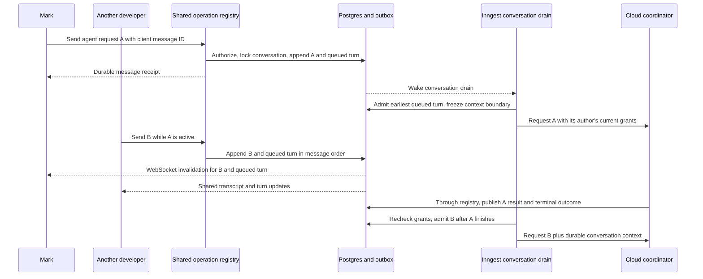
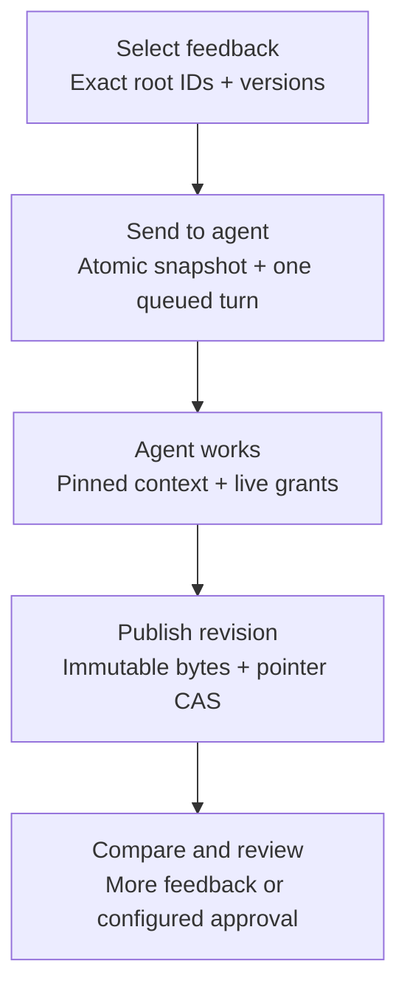

# Multiplayer chat and artifact review

Bakery conversations and artifact discussions are shared spaces. Multiple people can read, reply, ask the agent to work, and resolve feedback in the same conversation. Each person keeps a private composer draft; sending publishes an attributed message to everyone with access. The existing catalog includes `conversation_turns`, messages, comments and events. [Collaborative documents and presence](20-collaborative-documents.md) adds required human/agent CRDT editing and expiring chat/document presence; its catalog additions remain proposed.

Web, desktop, Slack and future Discord/Microsoft Teams interfaces use this same conversation application and typed operation registry. The [integration communication contract](09-integrations.md) maps each interface into those handlers and back out through authorized domain events. There is one transcript and coordinator per conversation, regardless of where a participant sends a message.

## Shared chat, one ordered agent inbox



`MessageCreate.intent` is explicit: **Ask agent** sends `agent_request`; **Discuss** sends `discussion`. Both are shared, attributed messages. Discussion does not schedule a turn. Assistant output cannot schedule another turn. A message submitted during active work appears immediately in the transcript and as **Queued for agent**. Its author can see whether it is queued, active, completed, failed or canceled.

The call stack is `web/desktop composer or verified chat adapter → shared messages.create handler → current authority/schema guards → transaction → outbox → Inngest drain → registered Mastra coordinator → shared application operations`. REST and MCP expose that same handler; provider receivers first persist a receipt and resolve the linked human. Adapters map presentation and explicit intent, while the shared coordinator owns natural-language interpretation, model choice and workflow behavior. A code change still enters the existing workflow/job/worker path. A chat turn does not start a parallel prompt inside an occupied Pi, Claude Code or Codex process; the coordinator uses `runs.control` when a request needs to steer existing work.

Message sequence is allocated while holding a short conversation row lock and committed with the message, optional queued turn and events. The unique sequence gives one order even when timestamps collide. A client UUID, scoped to conversation and authenticated author, deduplicates sends; the regular actor/operation idempotency key also applies. The same UUID with different content fails with `IDEMPOTENCY_PAYLOAD_MISMATCH`.

Inngest serializes the drain by conversation ID; a database partial unique constraint allows only one `active` or `cancel_requested` coordinator turn per conversation. Queue order comes from the triggering message sequence. The database transaction never holds a lock while a model runs. Outbox redelivery and the existing startup reconciliation wake any conversation with pending work. Inngest owns checkpoints and retries; these rows record admission and outcome rather than implementing another scheduler.

At admission, freeze `context_through_sequence`, the logical agent version and its session. Load a bounded transcript through that sequence with author IDs and message intents intact. Only the triggering message is the new request. Other queued requests are labeled pending context; the agent must not execute them ahead of their turns. Completed earlier turns are available as context. Summarization preserves attribution, pending IDs and referenced artifact versions. The requester's live grants and the agent's policy intersect on every effect; resuming a conversation never borrows an earlier participant's elevated authority.

Keep at most 50 queued turns per conversation initially; exceeding that bounded queue returns `STATE_CONFLICT` with a useful detail. A definitive failure leaves a visible failed turn and permits the next turn. An uncertain external action or unconfirmed interruption keeps the turn active/cancel-requested until reconciliation proves the outcome. Stale callbacks cannot complete a canceled turn or admit another copy. No retry silently bills a different provider.

Cancellation uses the existing operation guards, idempotency and `If-Match`. Queued turns can become canceled immediately. Active turns become cancel-requested, interrupt their owning session, and remain in the active slot until stopped or reconciled. The UI names who canceled the request. This cancels the coordinator turn; canceling a separate factory workflow uses its existing run control. Conflicting requests remain attributed in history; the coordinator asks a targeted question when their intended outcomes cannot be reconciled. Formal task questions keep the existing atomic first-answer-wins behavior and show the answerer to everyone.

## Simple access rules

| Resource or action | Rule |
|---|---|
| Repository conversation | Anyone who can read that repository can read its shared chat; operating requires the existing repository operation permission |
| General ideation before a repository exists | An organization-wide shared conversation, available to members with conversation access |
| Create conversation | Choose its boundary once; a repository must belong to its application; application ID alone never widens access |
| Join a chat | Open its authenticated link; no separate membership, invitation or per-chat role |
| Send, reply, resolve/reopen, control a turn | Permitted Developer or Admin; the actor is recorded |
| Edit/delete/restore a comment body | Its author or Admin; preserve thread tombstones and audit moderation |
| Agent tools | Requester grants intersect live repository/organization grants, agent grants and operation policy |
| Share a link | Navigation only; links never grant access or become public share tokens |

Conversation scope is immutable through PATCH. A repository conversation can produce multiple tasks for that repository. Organization conversations retain their organization boundary even after creating a task for a repository: task/artifact authorization retains that parent boundary and also checks the repository. A broad application subscription is only a query scope, never an access grant. All lists, search, comment references, snapshots and downloads use the same effective resource guard.

Slack and future chat adapters must resolve the sender through a verified linked identity and the existing channel binding. Web/desktop sessions and MCP credentials resolve through their own authentication boundary into the same trusted actor/organization context. A channel ID or display name is not permission to act as another person. Until an identity mapping is configured, channel bindings can remain notification-only. Revoke access centrally and all operation handlers, snapshot reads, live events and external exports enforce the change. Composer drafts are keyed by principal and conversation locally and are cleared on logout; one person's draft never overwrites another's.

## Threaded comments on plans, Markdown and other artifacts

Reuse the RPI plugin's block-based review model: a root discussion, flat replies, version history, resolve/reopen, and explicit **Send to agent**. Bakery's existing `artifact_comments` gains `root_id`, `resolved_at` and `deleted_at`; reply rows reference their root and original artifact version. A root owns its resolution state. Editing or deleting a reply cannot resolve the thread. New replies and edits/deletions/restores of existing replies increment the root's version, so resolving from a stale view cannot silently hide new feedback.

| Artifact | Anchor |
|---|---|
| Markdown research, plan or design document | Block index, selected text/range and surrounding source context; fenced code stays one block |
| Plain text or imported source document | Validated line range and quote in immutable bytes |
| Image | Normalized rectangle bounded by the image |
| Patch | Repository path, side, line range and matching head/base revisions |
| Any other artifact, or a general discussion | No anchor; a document-level thread |

Anchors are typed and checked against the actual immutable content. A repository Markdown file becomes a normal artifact snapshot with `sourceRepositoryId`, relative path and commit SHA in validated metadata. This makes README/design-file feedback available through the same viewer without inserting comment markup into Git. The source repository must match the artifact task's permitted scope. Artifact bytes remain in Postgres; the earlier R2/filesystem decision applies to skill bundles.

The root always retains its original version and anchor. When showing a newer revision, compute placement using a unique exact content match, using adjacent context to disambiguate duplicates. A successful move is labeled **From revision N**. Ambiguous, removed or changed content is **Outdated**, with a link to the original selection. Image content hash or patch SHA changes also make the anchor outdated. General comments remain unanchored. No fuzzy guess changes stored history. Old-version discussions stay discoverable in the artifact-wide comment list.

Comment lists are cursor-based and bounded. The default page contains roots; opening a thread pages its replies separately. Version-scoped and artifact-wide lists use the same `CommentQuery`, with root/status filters and an optional `viewVersionId` for derived placement. A page never contains an unbounded nested reply array. Open counts count unresolved roots, including threads anchored to older versions; deleted roots are excluded but their replies remain discoverable through tombstones.

Bodies are bounded to 10KiB; render sanitized Markdown and escape HTML in agent-facing exports. Treat comment bodies and referenced files as untrusted content, never as authority to reveal secrets, expand tool permissions or perform unrelated work. On an `If-Match` conflict, retain the editor's local text and show the current version for reconciliation. Do not silently merge or overwrite another person's edit. Soft deletion redacts the body on subsequent reads and retains the thread structure. It cannot retract an already-sent prompt snapshot; the UI states that when relevant.

## Send selected feedback to the agent

**Send to agent** calls `messages.create` with `intent=agent_request` and selected root IDs plus expected root versions. The server verifies the artifact task belongs to this conversation and captures the root/replies, authors, versions and original anchors atomically into immutable `comment_context`. It refuses stale, out-of-scope, deleted or oversized selections rather than silently dropping feedback. The complete context is bounded to 32KiB; choose fewer threads when necessary.

Sending adds one visible chat message and one ordered agent turn. It does not resolve the comments. The coordinator can run the existing RPI review/iterate skill, produce a new artifact revision, and reply with evidence. Before resolving a root it re-reads the thread and uses its current ETag; new human feedback stays open when the snapshot is stale. Agents may address the explicitly selected feedback under the task's existing autonomous policy. No new approval prompt is added merely because feedback came from another authorized developer. Plan approvals follow the task's selected stage policy instead: a `plan: human_approval` task waits for a human decision on the exact plan revision (approve, request changes or reject), decided by a human principal only, and a second participant's stale decision fails with a conflict.

The RPI skill adapter maps comment reads to `artifactComments.listAcrossVersions` and paged replies, replies to `artifactComments.create(rootId)`, and resolution to `artifactComments.update`. Enable these existing scoped MCP tools in the review skill's tool profile; the global default set stays at 25. Internal agents call the same guarded operations. Copying the original BB skill files alone does not provide these Bakery adapters.

Document publication also uses the artifact's ETag. Two publishers targeting the same pointer version cannot overwrite each other: one succeeds, the other retains its frozen proposal for reconciliation. Live human/agent text edits merge through the [CRDT draft](20-collaborative-documents.md), without whole-document CAS for each keystroke. Agents patch the shared draft through bounded guarded operations and freeze a version for evidence; published plans and original comment anchors remain immutable.

## Live delivery and reconnect

Use the existing authenticated WebSocket notification channel and REST/MCP writes for web/desktop and local clients. Verified chat receivers call the same write handlers after durable receipt processing. The same resulting domain events feed authorized external projections and provider delivery adapters; receipt acknowledgements are not claims of domain acceptance or agent execution. Add `conversation` to subscription and sync scopes, plus `domain_events.conversation_id` so pre-task chats can be observed. Message notifications include message sequence; comment notifications include artifact/version/root IDs and root version. They invalidate authoritative query data instead of broadcasting raw unfiltered bodies.

All authorized viewers receive the same durable message and comment changes. Clients deduplicate event IDs and message IDs, replace optimistic sends using the client UUID, and resume with their opaque scope-bound cursor. Missed retention triggers a scoped snapshot or cursor-paginated refetch. A disconnected client shows **Reconnecting** and never claims a message was saved until the API acknowledges its committed record. Server acceptance is not another person's read receipt.

Live output uses the proposed session output batches and cursor replay, where supported by the adapter; that contract still requires implementation and catalog reconciliation. Durable final/partial messages and turn state remain authoritative. Shared editing and presence use the [collaboration socket and expiring room protocol](20-collaborative-documents.md) on the same server. A list of authors means contributors, not people currently online. Show room membership and explicit activity; never infer viewing/typing merely from a retained connection. Durable unread counters remain outside this design.

## React, Storybook and Paper states

Reuse `ConversationPane`, `MessageList`, `ReplyComposer`, the artifact viewer and comment rail. Message rows show author, time, reply context and send/turn status. The composer has visible Ask agent/Discuss intent, a private draft, and an accessible pending indicator. Keep scroll position when loading older messages; new messages show a jump-to-latest control when the reader has scrolled up.

Desktop renders artifact plus comment rail; mobile uses a full-width comment sheet with the original selection linked back into the document. Reply, resolve, reopen and send controls remain keyboard-accessible, named and at least 44×44 for touch. New messages use a polite, batched live announcement; never announce each streamed token or steal focus. Stale edits preserve drafts, and revoked access removes cached protected content.

Storybook fixtures and the Bakery Paper component/state inventory must include: two named people in one chat; simultaneous queued requests; discussion-only message; failed send/retry; cancellation by a teammate; resolved thread with a new reply; old revision mapped/outdated/unanchored comments; deleted author/body; stale edit; stale root resolution; reconnect; and forbidden access. Cover rail/pane/sheet widths using the existing viewport, keyboard, copy-expansion and visual gates. Existing Paper specimens are illustrative; these new multiplayer states are specified here and still need component implementation and Paper frames.

## Plan, review and design iteration UX

The desktop review route keeps the artifact revision and conversation visible together. The left pane lists immutable revisions and the selected comparison (`current` versus `reviewed`); the center viewer renders Markdown, patch or image; the right rail contains root threads for the selected revision. A reviewer can select text, a fenced code block, a patch line range, or an image rectangle, then add a comment. A thread header shows the original author, exact revision, anchor status, and root version. The primary actions are **Reply**, **Resolve**, **Reopen**, and **Send selected to agent**. **Approve revision** is a separate workflow action and never changes comment state. **Publish revision** is a separate artifact mutation.

On mobile, the artifact opens full width with a compact revision bar. Selecting text opens the comment sheet at the bottom; selecting an image region draws a normalized rectangle and opens the same sheet. The image control also offers accessible alternative text or a whole-image anchor when a precise rectangle is unavailable. The sheet links back to the source selection, shows the root/reply count, and exposes the same four comment actions. Revision comparison is a push screen with accessible **Before** and **After** buttons for Markdown/patch and image views; swipe is optional. The user can keep the sheet open while new replies arrive; an explicit **New replies** affordance preserves reading position.

```text
Desktop:  RevisionPicker → CompareToolbar → ArtifactViewer → CommentRail
                                      ↘ ConversationPane → ReplyComposer
Mobile:   RevisionBar → ArtifactViewer → Selection → CommentSheet
                                      ↘ CompareScreen → Before / After
Shared row state: author • revision • anchor status • root version • actions
```

The iteration path is explicit: a reviewer selects an exact validated root set, sends it through `messages.create` with `intent=agent_request` and `commentRefs`, and sees **Queued for agent**. That operation snapshots the selected roots/replies and enqueues exactly one `conversation_turn` in the same transaction. The coordinator reads that snapshot, asks for clarification when needed, and calls `artifactVersions.create` to create an immutable artifact version; that operation also advances the named artifact's current pointer. The reviewer then compares the versions and may comment again, or use an optional configured approval action bound to the exact version. Approval records the reviewer, decision, and exact version. Resolving a comment records that feedback was addressed; it is not approval. Publication is the version-creation/current-pointer mutation; it is not approval or resolution.



Concurrent replies remain separate attributed messages and increment the root version. A stale edit keeps the local draft and offers **Reload current** or **Keep mine**; keeping it requires manual reconciliation and a fresh CAS before saving. If the selected anchor moved, the reviewer chooses **Use exact match**, **Keep on original revision**, or **Create linked comment**. Re-anchoring never mutates the immutable original anchor; the linked comment stores a new explicit anchor. Ambiguous matches remain outdated. Offline sends remain local **Pending send** until the server receipt arrives; retry uses the same idempotency key and client message ID. Logout or grant revocation clears protected cached bodies and turns pending mutations into **Access revoked** without claiming delivery.

The request-iteration mutation is the existing `messages.create` operation with `intent=agent_request`, an exact validated `commentRefs` set, and expected root versions. Its relevant CAS shape is:

```ts
// Target service signature shared with the platform handler example.
const message = await operations.messages.create(actor, conversationId, {
  body: request,
  clientMessageId,
  intent: "agent_request",
  commentRefs: selectedRoots.map(({ commentId, version }) => ({
    commentId,
    expectedVersion: version,
  })),
}, { idempotencyKey });
// One transaction: validate exact roots and current replies, snapshot comment_context,
// append the attributed message, enqueue exactly one conversation_turn, and write outbox.
```

`MessageCreate` and `CommentReference` are existing contracts. The operation validates the exact root set, expected versions, task/conversation scope, current grants, deletion state, and body plus context bound of 64KiB; any failed CAS rejects the whole mutation with the existing `StandardError`/Problem mapping. `StandardError` uses the repository shape, for example `{ slug: "precondition-failed", status: 412, params: {...} }`. Agent publication calls `artifactVersions.create` with the parent artifact `If-Match`; that operation creates the immutable version and advances the current pointer. Comment resolution separately calls `artifactComments.update` with the current root ETag after the agent re-reads the thread.

The interface labels author and actor on every message, comment, revision, approval, and publication. Admin/Developer grants are checked at send, admission, comment mutation, approval, and publication; a Slack adapter maps to these same operations and never supplies authority. REST performs mutations and authenticated WebSocket events invalidate queries; events contain IDs, revision numbers and root versions, while clients refetch bodies under current authorization.

Existing `CommentAnchor.image` uses normalized `{x,y,width,height}` within the image bounds; a whole-image selection uses `{x:0,y:0,width:1,height:1}`, while a general comment omits the anchor. Existing message/comment/version operations cover feedback admission, CAS, version creation and pointer advancement. Compare two authorized immutable versions in the client first; add a bounded server comparison only if file size or format requires it. Optional workflow approval needs an exact-version binding, never an approval of a drifting current pointer. Detailed comparison/iteration Paper frames, Storybook states and mobile cache behavior remain implementation work. [Shared document editing](20-collaborative-documents.md) extends these flows with CRDT drafts, relative draft-comment anchors and presence; the immutable review rules above still apply to published versions.

## Acceptance and source evidence

The design checker verifies schema/operation/ERD consistency. Runtime acceptance must use two separate authenticated browser sessions and verify concurrent sends produce distinct ordered messages with exactly one active coordinator; retries create no duplicate turn; and another actor cannot reuse a client UUID to change identity. Also test grant removal between enqueue and admission, sibling-repository references, transcript privilege carryover, worker callbacks after cancellation, and restart after commit before the outbox wakeup.

Also replay equivalent intents through web, desktop, Slack and fake future Discord/Teams adapters with the same authority. Require the same operation results and safe fault codes, one ordered transcript, no duplicate turns on retry, cross-interface question-answer arbitration and identical run-control policy. A narrower transport/connection scope still denies access. Independently submitted identical text remains separate; Bakery/bot echoes never create agent turns. These parity checks remain unrun until the shared handlers and adapters exist.

For comments, exercise root/reply pagination without missing rows, simultaneous replies and resolution, author-only edits, deleted root tombstones, stale selected feedback, changed document anchors, and competing artifact publications. Disconnect one client, publish changes from the other, reconnect and prove the eventual transcript/thread state is identical without duplicating messages. These are implementation acceptance gates, not claims of working multiplayer in the current static design map.

Prior art: the BB RPI plugin specifies a single-user plugin, so it does not itself establish multiplayer; its comment design supplies block anchors, threads, send-to-session and concrete comment re-anchoring behavior. Bakery adapts those concepts to current-auth Postgres/REST/MCP/event contracts and cursor pagination; it does not copy the plugin's offset pagination, single-user ownership assumptions or send-and-resolve shortcut.
