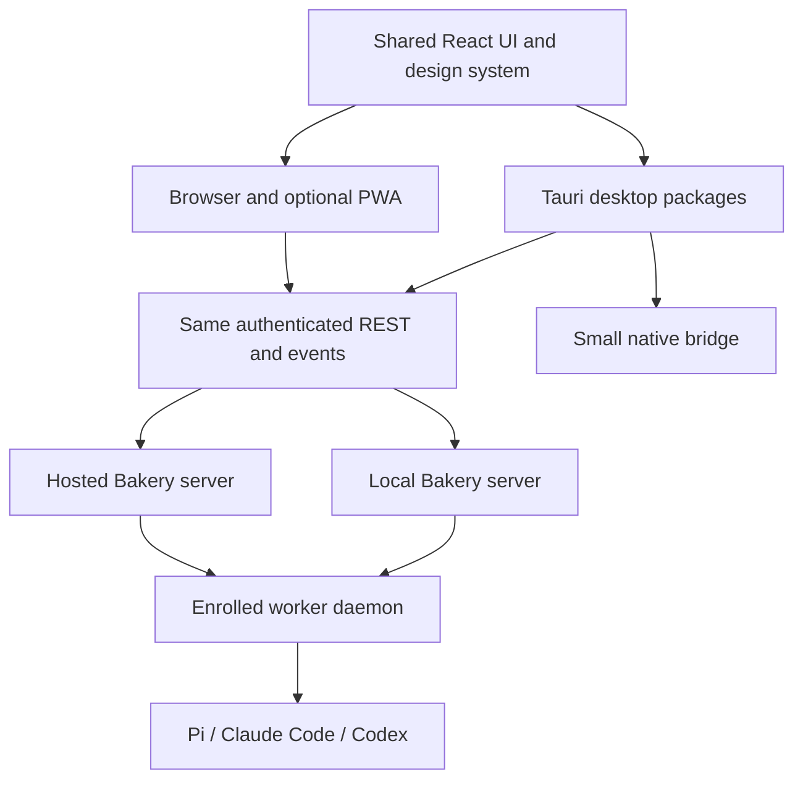

# Desktop

The desktop client has its own area: shared React UI, native packaging, authentication, local/cloud connectivity and release verification. [Plugins](11-plugins.md) covers customization and its SDK separately. No desktop package is implemented.

## One UI, browser and desktop

Tauri accepts compiled web assets and uses the operating system's webview. It is the preferred candidate for macOS, Windows and Linux, subject to a compatibility spike. Electron is the fallback if required webview behavior fails that spike. An installable PWA is also useful, especially on phones. One UI codebase still requires separate desktop packages and platform release checks. [Tauri frontend setup](https://v2.tauri.app/start/frontend/), [architecture](https://v2.tauri.app/concept/architecture/).

The desktop package owns window behavior, external links, authentication return and signed updates. It connects either to the hosted server or the separately started local stack. Closing the client does not stop work. The Deno server, Postgres, Inngest and worker remain services; packaging the UI does not bundle or replace them. Fully local operation still requires those services and any configured model connectivity. Native worker start/stop can follow later without creating a second execution protocol.

Native login uses the system browser and authorization code with PKCE. Select and register a supported loopback or app-link callback, bind it to the initiating login, and reject replay. A native auth broker holds Bakery refresh credentials in the OS secret store; provider secrets stay in the server broker. The web client retains its cookie flow. Desktop REST/event authentication needs explicit bearer support and reconnect tests; MCP's OAuth support alone does not prove desktop login. [RFC 8252](https://www.rfc-editor.org/rfc/rfc8252).

## Delivery and verification

Deliver a thin Tauri client using the existing web bundle. Prove macOS/Windows/Linux builds and login, reconnect, deep links, signing/update verification and connection to the separately running local server. Keep the same responsive design and accessibility behavior across browser and desktop.

See the [worker/local topology](05-runtime-and-protocols.md).
