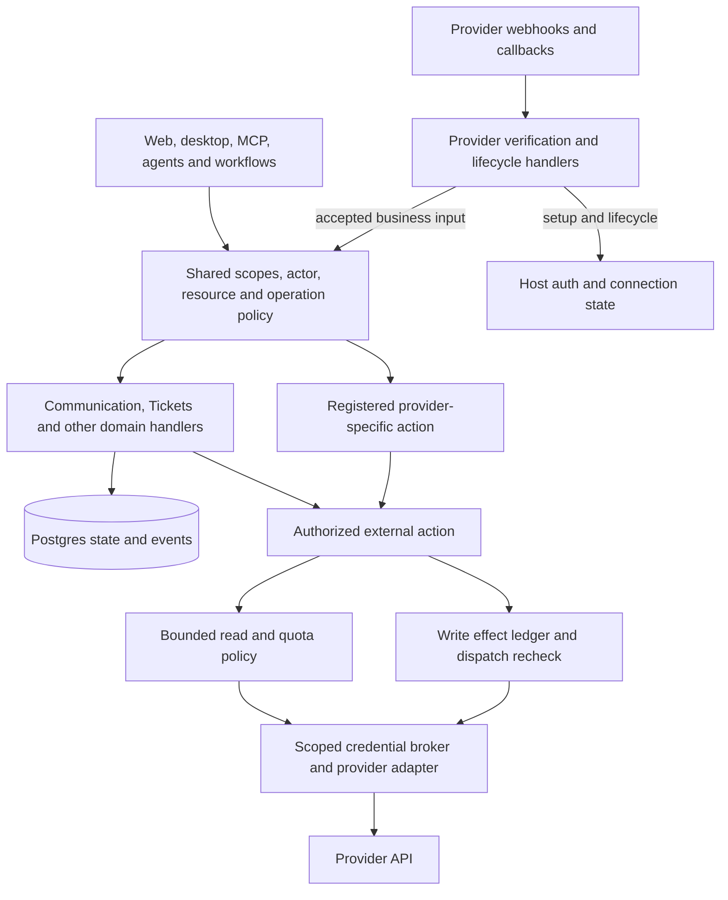
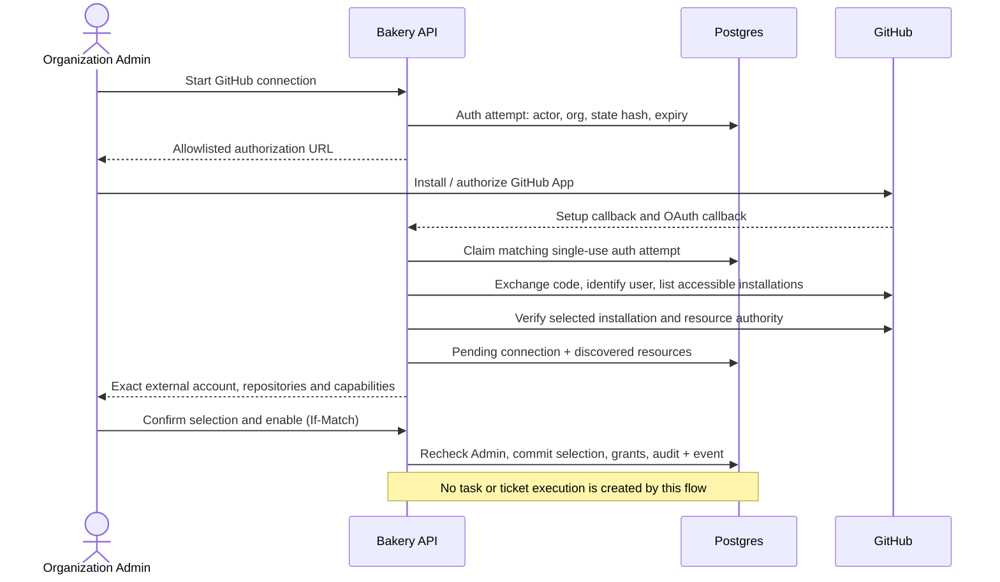
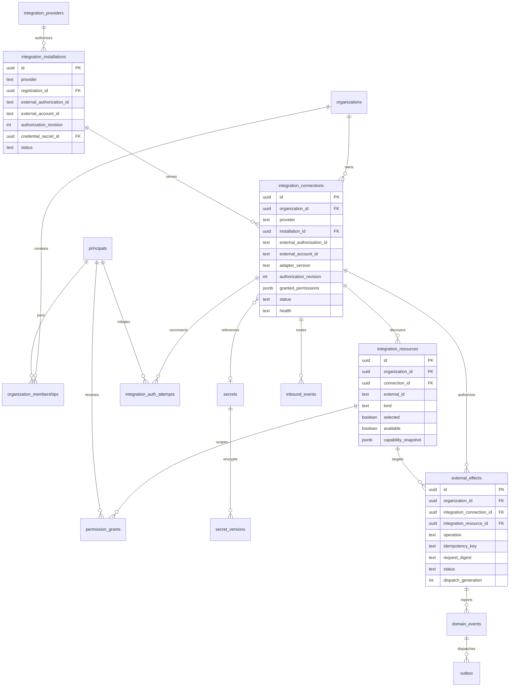
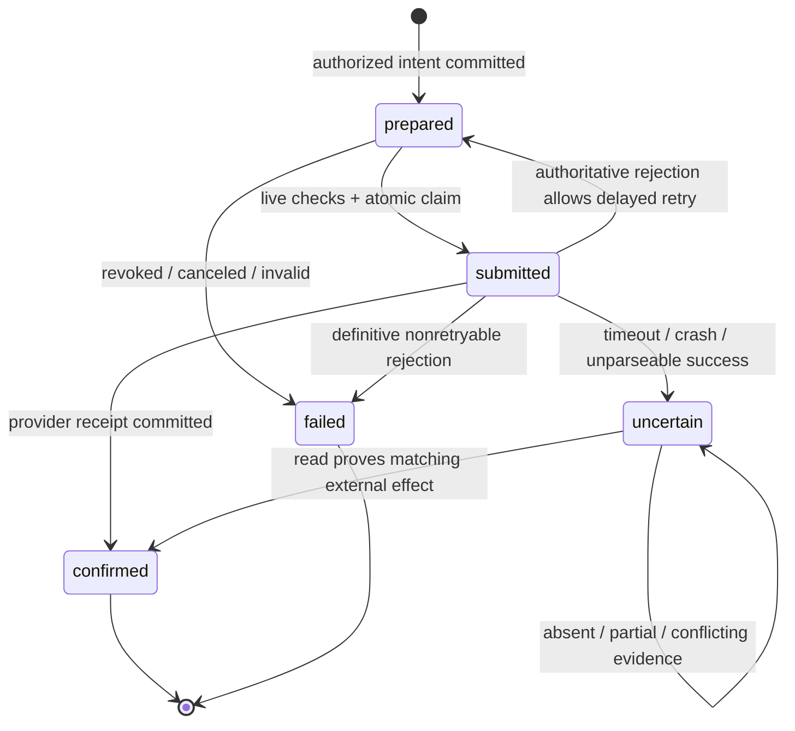
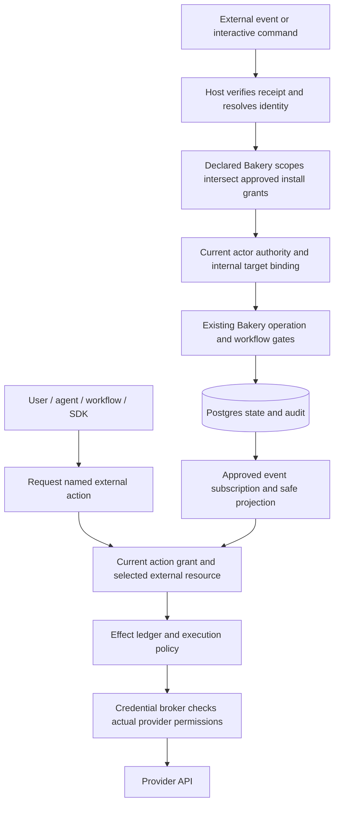
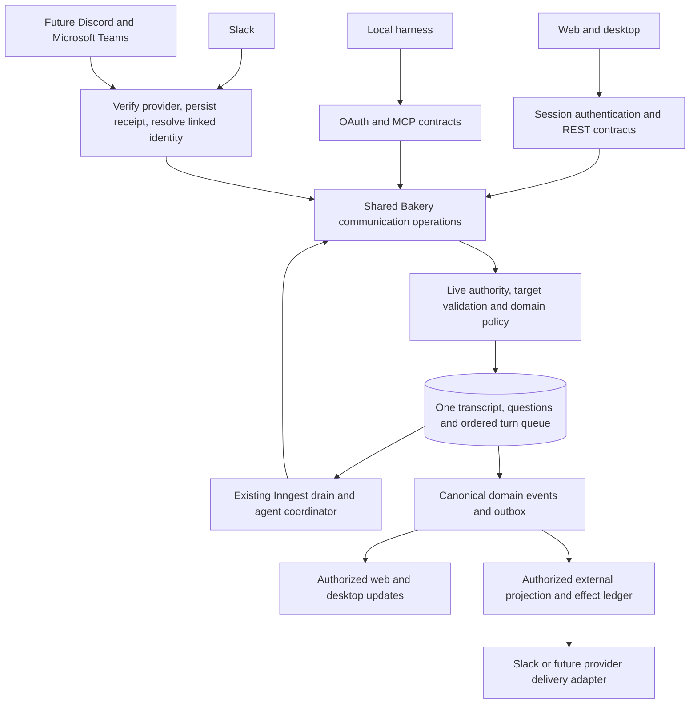

# Integrations

Integrations bind organizations to external accounts, resources, actions and events. [Tickets](10-tickets.md) owns readiness/workflows; [Plugins](11-plugins.md) owns extensions; [Desktop](08-desktop.md) owns the shell.

[Browse current integration routes](integration-mocks-v2/index.html) · [Browse retained states and components](integration-mocks/index.html).

Start with [bidirectional scopes](#integrations-section-9), [native integrations](#integrations-section-10), or [the SDK contract](#integrations-section-11).

**Decisions:** shared GitHub App/installations with repository boundaries; Admin-selected actions/resources shared with Developers; trusted label admission; Slack first, using mentions and linked-thread replies. All chat clients share Bakery logic. Live OAuth, installation and Postgres recovery remain untested; see §8 and §11.

## 1. Decisions and capability flow

| Decision | Chosen design | Reason and tradeoff |
|---|---|---|
| Runtime | Existing Deno/Hono/Inngest server, locally or on a VPS; Cloudflare edge | No separate connector service, broker or paid integration platform. |
| Authoring | Shared typed capabilities, strict schemas, registered adapters | YAML selects behavior, never executable code or arbitrary HTTP. |
| Identity | Shared installation; organization connection; selected resources; grants | Connection never authorizes all repositories or backlog execution. |
| GitHub authority | App installation for autonomous work; temporary user authorization for setup | Separate from login, MCP OAuth and model billing. |
| External writes | `external_effects`, claimed before dispatch | Retries address the same effect; uncertain writes reconcile first. |
| Credentials | Server broker; short-lived scoped installation tokens | No private keys, refresh tokens or unrestricted fetch tools for agents. |
| Extensions | Native SDK consumers first; isolated third-party workers later | Manifests never authorize tenant code inside the server. No marketplace required now. |
| Multiple users | Organization Admin configures; Developers use selected role grants | Multiple organizations/users from launch; private layouts do not change authority. |



### Shared capabilities with specialized execution

**Capability:** typed behavior. **Provider:** implementation. **Binding:** selected connection/resource/action. **Grant:** permission. Support never implies access. Reuse existing registries, host and SDK ports; communication is one family, not a universal router.

| Family | Common behavior | Provider-specific behavior stays explicit |
|---|---|---|
| Chat | Conversations, replies, question answers and progress delivery; Slack first, Discord/Teams later | Provider identity, mentions, widgets, message formatting and delivery limits |
| Tickets | Normalize ticket facts, request admission and publish progress; GitHub first, Linear/Jira later | Labels versus statuses, field mapping and source-specific readiness evidence |
| Code | Typed repository, change, check and merge operations where semantics match | A GitHub check-run annotation or provider branch rule need not have an equivalent on every provider |
| Deploy | Request deployment and inspect its actual outcome through the platform's deployment port | Provider build settings, preview URLs and rollback/recovery behavior |

Share equivalent semantics only. Declare optional features separately. Unsupported/ungranted operations fail explicitly; never switch provider, connection or credentials silently. These contracts do not add launch commitments.

**Shared gate:** verify input, resolve operation/binding, validate schema, then check current actor/organization, transport/package scopes, resource/action-version grants and domain policy. External calls also require provider permission and approved credential/request profiles. Approval, budget and concurrency checks apply per operation; reads need no automatic human gate or workflow.

```text
verified request → typed operation or bound action → shared authorization
  internal operation → domain handler → transaction and events as needed
  external read      → registered adapter + scoped credential broker
  external write     → effect intent/outbox → recheck → broker + adapter
                     → confirmed / rejected / uncertain receipt
```

Internal handlers retain transaction/idempotency rules. External reads use bounded retries; writes use the effect ledger and action-specific reconciliation. Never blindly retry uncertain non-idempotent writes or label mutations read-only. Share safe errors and audit/traces, not identical provider limits/recovery.

**Provider-specific actions:** namespaced/versioned contracts declare strict inputs/outputs, resources, permissions, effects and recovery. `integrationConnections.invoke` enforces exact grants; `ctx.bakery.call` accesses permitted domain operations; `ctx.provider.request` accesses registered requests. No invented Bakery scopes, family-wide grants or arbitrary network/secrets. Generalize only equivalent behavior.

**Dedicated lifecycle paths:** OAuth, webhook verification/challenges, installation changes and health/discovery use host auth/lifecycle handlers. Only accepted business events enter capability operations. Setup creates neither chat nor execution authority; credential exchange stays outside SDK actions.

**Storage:** contracts/versions in `packages/contracts` and manifests; supported operations/features in provider metadata; selections in `capability_bindings`; authority in `permission_grants`. Persist resolved adapter/action version and target on invocation/effect; retries cannot retarget and must recheck grants. `data-model.json`, `api-catalog.json` and `transport-schemas.json` carry the organization/binding/resource/version contract; no polymorphic authority table is introduced.

Skill requests and MCP tool names confer no connection grants.

## 2. Account setup and lifecycle

**Setup:** choose organization, authorize provider, select resources/actions, test access, enable. Configure Tickets separately; enabling never starts existing issues.



Treat setup `installation_id` as spoofable. Verify against every page of installations accessible to the connecting GitHub App user token; check app, account, installation state and selected repositories. [GitHub setup URL](https://docs.github.com/en/apps/creating-github-apps/registering-a-github-app/about-the-setup-url), [user authorization](https://docs.github.com/en/apps/creating-github-apps/authenticating-with-a-github-app/generating-a-user-access-token-for-a-github-app).

**One shared GitHub App** serves Bakery organizations. A verified installation may back several organization connections; configure app distribution for intended GitHub accounts. [GitHub app installation](https://docs.github.com/en/apps/using-github-apps/installing-your-own-github-app).

**Ownership:** host owns installation; organization owns connection. Installation I may serve A/R1 and B/R2. Proposed initial rule: exclusive active repository selections. Conflicts return unavailable without revealing the other organization. Overlapping execution policies need separate design.


**Setup authority:** current Bakery Admin plus server-verified administration of each selected GitHub repository. Browser flags and installation visibility cannot delegate app-token authority.


**Callback safety:** `integration_auth_attempts` binds organization, actor/session, provider, optional reconnect target, random state **hash**, expiry and consumed/result state. Encrypt PKCE verifier; use fixed callbacks, browser CSRF and supported PKCE S256. Distinct GitHub setup/OAuth callbacks converge in either order. The attempt returns both the authorization URL and the registered App's install page (`https://github.com/apps/<slug>/installations/new?state=<state>`), so an install started from Bakery carries the state to the Setup URL. The organization Integrations page (`/settings/organization/integrations`) opens the install page first; when setup answers `awaiting_authorization` it continues to the authorization URL on its own, and when the OAuth callback answers `awaiting_installation` it continues to the install page. Both URLs live only in that tab's session storage and are forgotten once one is used. Claim attempts atomically before code exchange; reject replay. Lost exchange response requires fresh authorization. Recheck membership before final binding.

**Secrets:** discard setup-only GitHub user tokens; persistent human delegation needs separate authorization. Store refresh tokens in `secret_versions`; serialize refresh, atomically replace rotated credentials, reconnect after unrecoverable rotation. Shared installations serialize refresh per installation (§3). OAuth client secrets and GitHub App private/webhook keys are installation-owned, never organization configuration: an Installation administrator registers the App in the product UI and Bakery stores them as installation-scoped AES-GCM `secret_versions` (see GitHub App registration). No GitHub credential is read from a deployment environment variable; the AES master key file and the public base URL are the only deployment inputs.

**State:** `pending → enabled ↔ disabled`; provider revocation gives `revoked`. Separate health: `unknown | healthy | degraded | auth_required`. Suspension blocks immediately; unsuspend revalidates without restoring disabled grants. Reconnect retains identity only for the same verified account (a same-account reinstall moves the connection to the new installation and bumps its authorization revision); account changes create a connection and leave the original unchanged. Effects retain original identity: `external_effects` references its connection and that connection's resource with NO ACTION keys.

Connections survive installer departure. Human calls require current membership; automations need separate scoped grants. Models cannot replace revoked humans with automation principals.

**Disable** blocks this connection’s dispatch/cache but retains reservations. **Archive/deselect** releases reservations transactionally; deletion retains audit/effect tombstones. Other connections/shared credentials stay active. Already-sent requests may finish. Provider-wide uninstall/revoke is a distinct operator/owner action with account-wide impact; local disconnect never claims uninstall.

## 3. Data model and invariants

**Approved logical contract, not executable DDL.** This ERD and the machine-readable catalogs define organizations and integrations together. Implementation must migrate them together rather than reviving the former connection-only shape.

[Open the integration ERD at full size](integration-erd.svg).



| Record | Fields and invariants to add or retain |
|---|---|
| `organizations`, `organization_memberships` | Shared organization foundation, not integration-specific tenancy. Unique `(organization_id, principal_id)`; role Admin/Developer and active status here, not one global human role. |
| `integration_providers` | Deployment-wide static registry projection: slug, adapter version, manifest digest, supported auth modes, config schema, action input/output JSON schemas, events and resource kinds. Never load executable code from these JSON fields. Retain versions needed by in-flight effects. |
| `integration_installations` | Host-owned provider registration, immutable external authorization/account identity, credential reference, actual provider permissions, lifecycle and authorization revision. Unique by registration and canonical installation identity; may serve many organization connections. |
| `integration_connections` | Shared `installation_id` FK plus `organization_id`, provider/app-registration identity, `external_authorization_id` (GitHub installation; moves with `installation_id` only when a same-account reinstall reconnects the connection), immutable `external_account_id`, config schema version, adapter version, selected secret ref, granted provider permissions, `authorization_revision`, status, health, last checked/success times, `next_allowed_at`, safe last-problem code, tombstone. Secrets and transport URLs are not editable through generic config. |
| `integration_auth_attempts` | Organization + initiating principal/session, provider, nullable reconnect connection, state hash, encrypted verifier ref, expiry, pending/exchanging/completed/failed state and result connection. Single-use state; short retention; callback data cannot supply organization ownership. |
| `integration_resources` | Organization + connection + installation, provider stable ID, kind (repository/team/project/channel), display name, safe URL, selected/available flags, provider capability snapshot, last discovery generation. Unique `(connection_id,kind,external_id)`. Rename updates presentation; removal blocks grants; new discovery is unselected. |
| `permission_grants` | Extend existing grants with organization, connection/resource targets, action ID/version, principal or trusted automation identity, optional expiry. No wildcard grant automatically includes newly released actions. Connection setup grants the Admin-selected fixed actions/resources to the Developer role in that organization; automations have separate explicit grants. |
| `inbound_events` | Use registered provider IDs; host receipt keyed by verified app registration + delivery identity, with separately authorized per-connection processing items, raw-body digest, event kind, bounded normalized projection, processing status and rejection reason. Preserve digest before redaction. Unbound events cannot invoke tenant operations. |
| `external_effects` | Reuse existing ledger: org/connection/resource, requesting principal, delegated run/automation, action + adapter version, canonical-input digest, immutable external account/resource identity, safe arguments or artifact reference, credential/config provenance, status, result, retry time and dispatch generation/lease. |
| `secrets`, `secret_versions`, `domain_events`, `outbox`, `audit_events` | Reuse existing storage. AES-GCM ciphertext in Postgres; master key supplied outside DB and backups. Integration events contain IDs, revisions and safe codes, not tokens or request bodies. |

Composite-FK example; requires these columns and equivalent scoped-parent constraints:

```sql
ALTER TABLE integration_connections
  ADD CONSTRAINT connection_org_identity UNIQUE (organization_id, id);

ALTER TABLE integration_resources
  ADD CONSTRAINT resource_connection_scope
  FOREIGN KEY (organization_id, connection_id)
  REFERENCES integration_connections (organization_id, id);

CREATE UNIQUE INDEX integration_resource_identity
  ON integration_resources (connection_id, kind, external_id);

CREATE UNIQUE INDEX integration_effect_request
  ON external_effects
  (organization_id, integration_connection_id, operation, idempotency_key);
```

**Isolation:** effect uniqueness includes organization/connection; digest covers action version, target, validated input and authority. Changed input/resource under one key conflicts; replay still requires current read access. Composite FKs align grants/effects/resources with organization, connection and installation. Selected GitHub repositories have partial uniqueness on `(installation_id,kind,external_id)`; disable retains, archive/deselect releases. Lifecycle changes update one installation and fan out safe revalidation; repository events reach only selected connections. Serialize quota/refresh per installation, checking connection access at use. Live authority checks and explicit organization predicates enforce isolation; browser filters never isolate tenants.

**Discovery/pagination:** only complete successful scans mark resources unavailable; partial scans/429 retain inventory. Public lists use opaque organization/connection/filter-bound keyset cursors. Provider `page`/Link stays internal; clients cannot supply provider URLs or offsets.

## 4. Webhook intake

**GitHub:** `POST /v1/webhooks/github`, app-level. A second App requires a configured opaque registration endpoint identifier, never caller-selected connection routing.

```text
githubWebhook(request)
  readBoundedRawBody()                         # streaming limit, before JSON parsing
  verifyHmac(appWebhookSecret, rawBytes)       # native Web Crypto; reject mismatch
  validateSupportedEventAndPayload()
  resolveVerifiedInstallationAndResource()    # app + installation IDs, not repo names
  transaction()
    insert inbound receipt with body digest  # compare digest on duplicate delivery ID
    append domain event + outbox once
  return 202 receipt                         # only after commit

outboxDispatcher()
  claim due row -> send Inngest event using stable outbox delivery key
  record acknowledgment; retry delivery when uncertain

processIntegrationEvent(receiptId)
  load receipt and current connection/authority
  re-fetch changed provider object when required
  normalize provider event -> Tickets / delivery / notification operation
```

**Events:** issue labels arrive as `issues.labeled`; `label` concerns definitions. Exclude PRs from issue intake; handle installation deletion/suspension and repository access changes. Headers are untrusted selectors: validate signed payload schemas and current provider state. Signatures never authorize Bakery organization claims. [Webhook validation](https://docs.github.com/en/webhooks/using-webhooks/validating-webhook-deliveries), [event catalog](https://docs.github.com/en/webhooks/webhook-events-and-payloads).

**Delivery:** stream-limit bodies to 256 KiB before parsing; return 413 and record health failure, never truncate/claim completion. Target persistence under two seconds; acknowledge within GitHub’s ten seconds. DB commit failure returns retryable 503. GitHub does not automatically redeliver: schedule state reconciliation and configured credentialed redelivery. Same ID/body returns the receipt; changed bytes fail. Unknown installations receive successful acknowledgements with bounded, expiring, non-executable receipts; no account disclosure. [Delivery practices](https://docs.github.com/en/webhooks/using-webhooks/best-practices-for-using-webhooks), [failed deliveries](https://docs.github.com/en/webhooks/using-webhooks/handling-failed-webhook-deliveries).

Lifecycle events may precede setup or arrive out of order. Setup fetches current state; quarantined payloads never become commands after connection. Reconciliation restores facts, not missing human execution authority. Tickets owns admission. [Tickets](10-tickets.md).

**Implementation note.** The receiver is a hand-written app-level route, mounted ahead of the JSON router, that passes a verified delivery to the registered `intake.github` action. It works from the cheapest check to the dearest: the signature header, the content type (415), a bounded read of the body of at most 256 KiB (413, logged as `github_webhook_body_too_large` and writing no row, because nothing about the sender is known yet), and only then the webhook secret and the HMAC over the raw bytes. A missing or malformed header, a wrong signature, an App with no registration or no webhook secret, and an unreadable secret all answer the same 401, so a caller learns nothing about which check refused it. Once the signature checks out, the receiver validates the delivery id and event name (400), parses the payload (400) and commits one receipt (202). A changed body or event name under a reused delivery id is 422 and changes nothing. A commit failure is a retryable 503. The whole delivery runs under a nine-second deadline: a body that stalls past it is a 504, and nothing is stored.

Five tables hold the state, all created by migration `0143_github_intake`, and PostgreSQL enforces only their structure; the lifecycles below live in TypeScript.

- `inbound_events` holds one receipt per registered App and delivery id: the SHA-256 digest of the raw body, the event kind and action, a bounded projection (action, installation id, repository id, number, head SHA), a status and a reason. The raw body is never stored. A receipt is `routed` when at least one route was created and `ignored` otherwise; the reason for an ignored receipt is one of `unsupported_event`, `ping`, `no_installation`, `unknown_installation`, `installation_pending`, `installation_suspended`, `installation_revoked`, `no_live_connection`, `unselected_repository`, `connection_not_enabled` or `untracked_pull_request`. Unknown, suspended and revoked installations get the same acknowledgement as any other delivery and carry no account or organization data.
- `inbound_event_routes` holds one route per connection a delivery concerns. The purpose says what the processor does: `installation_reconcile` runs the existing installation reconcile, `discovery` queues the existing repository discovery, and `fact_refresh` re-reads an issue, pull request or check run from GitHub. The status is `pending`, `processing`, `deferred`, `completed`, `ignored` or `failed`, with an `outcome_code` that says why. A route is claimed at most ten times; a rate limit waits as long as GitHub says (at most an hour), any other failure waits `30 s * 2^attempts` (at most an hour), and the claim after the tenth attempt settles it `failed`. A cron job resends `pending`, `deferred` and stale `processing` routes every minute and never a `failed` one. The processor rechecks the live installation, connection and resource before it reads from GitHub, again inside the transaction that stores the result (the rows are locked `for share`), and never trusts the payload.
- `integration_remote_facts` and `pull_requests` hold what the processor and the sweep read back. A write is accepted only when its `(provider_updated_at, observed_started_at)` pair is greater than the stored one, so a delayed or reordered delivery cannot replace newer state. A later-started read of the state already stored leaves the state, digest and version alone and moves only the read clock (`observed_started_at` and `observed_at`, or `last_observed_at` on a pull request); an equal or older read changes nothing.
- `integration_sync_checkpoints` holds the cursor of the reconciliation sweep for each selected repository and stream (`issues`, `pull_requests`, `checks`). The sweep runs every five minutes, keeps its place after every request, never marks anything closed or gone because a list did not show it, and counts pull requests that GitHub lists among issues without storing them as issues. The `issues` stream lists oldest update first and keeps an `edge` (the latest `updated_at` seen) and a page offset; whenever the edge advances it restarts at page 1, so a changed list does not skip an unedited issue, except in the offset-walk case below. The first scan lists open issues only and sets the high-water mark to 60 seconds before it began, so the next scan reaches every issue that closed during the backfill; a first scan that was blocked after it stored pages starts over when it is armed again and keeps the start of its first attempt, for the same reason. The `pull_requests` and `checks` streams rotate through the open pull requests a task registered, 25 rows per step, by a keyset cursor over the row id that wraps at the end: they cannot go by oldest observation, because a row whose read or write fails never moves its clock, so it would stay the oldest and be retried first forever. A completed scan and a provider error each rest five minutes, a refused permission blocks the checkpoint for 30 minutes, and a claimed checkpoint is leased for ten minutes; a step that fails but can still reach the database gives its claim back, so the checkpoint is due again after five minutes. Each answer is stored in a transaction that re-tests the installation, connection and repository with their rows locked, so a repository deselected or an installation suspended while the request ran leaves no fact and no progress.

Receipts expire seven days after they arrive, which is longer than GitHub's three-day redelivery window. An hourly job, `bakery-integration-intake-retention`, deletes expired receipts 500 at a time, at most 100 batches a run, with `for update skip locked`, and their routes go with them. A receipt is kept while one of its routes is still `pending`, `processing` or `deferred`, so a route is never deleted under a worker; it goes in the first run after its last route ends. Until the sweep removes a receipt its delivery id stays a duplicate; afterwards a redelivery of the same id is accepted as a new receipt.

The issue scan can miss one issue in one case, the offset walk. A page offset is kept only while a full page of 50 holds nothing later than the edge, that is at least 50 issues updated inside two consecutive seconds. During such a walk, an edit or close of a read, in-window issue made before a request with `page` greater than 1 (an edit in the gap after the page-1 request that starts the walk counts too) makes GitHub move that issue to the end, and one unread issue slides into the range already read. Each such edit hides at most one unedited issue from that scan; its next webhook or edit shows it, as does any later scan whose window (60 seconds before the high-water mark) reaches it. A burst of N issues in one second takes one request when N is 50 or fewer and `1 + ceil(N / 50)` requests when N is above 50. Steady-state sweeps never walk.

A Bakery repository is tracked for a GitHub repository when it is not archived, belongs to the same organization and connection, and its `provider_repo_id` equals either the resource's numeric GitHub id or its full name (`owner/name`). No match, or more than one match, means the repository is untracked: pull request and check events for it are stored `ignored` and no pull request is adopted.

A check run whose creating App GitHub no longer has arrives with `app: null`. It is stored as a valid fact with an unknown author (`appId` and `appSlug` both null). That author is untrusted: such runs must not be merged into one trusted App, and they must not count as independent authors of a check result, however many there are.

Fixtures stand in for GitHub in every test of this feature, so connected (live GitHub) cases are still open.

## 5. Execution and recovery

```text
REST handler / MCP tool / Mastra tool / workflow skill
  integrations.requestAction(trustedActor, connection, resource, action, input, key)
    parse registered action schema; reject extra authority fields
    load current organization membership and connection/resource grants
    resolve pinned adapter/action version; validate provider capability
    transaction: effect intent + immutable binding + domain event/outbox
    return { effectId, status: "prepared" } with HTTP 202

Inngest action worker(effectId)
  load persisted effect; verify trusted event identity against its row
  return existing receipt if confirmed
  reconcile by reads if submitted/uncertain
  otherwise recheck live grants, connection state, cancellation and budget
  obtain narrowly scoped credential; claim prepared effect via compare-and-set
  mark submitted + dispatch generation BEFORE sending external request
  providerAdapter.execute(validatedInput, boundResource)
  validate response -> transaction: confirmed receipt + event
  ambiguous outcome -> transaction: uncertain + reconciliation request
```

Keep preparation/submission transactions short; never hold one across HTTP. Disable and dispatch share revision/claim ordering: disable wins and blocks, or dispatch wins and remains visibly in flight. A lease expiring after `submitted` permits only reconciliation, even after a crash before sending.



**Retry evidence:** authoritative retryable rejection may return to `prepared` after cooldown. Transport errors or post-send 5xx remain uncertain unless rejection is proven. GitHub comments lack documented idempotency keys: retain deterministic effect marker, remote comment ID, app bot ID and target. Scan all available pages within budget; copied human markers are not proof. Reject reserved Bakery markers in user/model input. Missing/multiple matches, edited/deleted markers or incomplete scans remain uncertain. **Absence never authorizes another POST.** [Issue comments API](https://docs.github.com/en/rest/issues/comments).

Native idempotency requires original key/body within documented retention. Set-like operations need their own read/compare/write rule. Never apply blanket `retryable: true` to writes or 503s.

Inngest checkpoints are not atomic with provider state; outbox/effect records preserve delivery and ambiguity. Use queueing concurrency/throttling, not rate limits that skip work. Postgres enforces per-installation pacing across actions/discovery; per-function concurrency alone is insufficient. [Retries](https://www.inngest.com/docs/features/inngest-functions/error-retries/retries), [throttling](https://www.inngest.com/docs/guides/throttling).

## 6. REST, MCP, events and errors

**Catalog contract:** `data-model.json`, `api-catalog.json` and `transport-schemas.json` include installation, resource, grant, effect, destination, subscription, delivery and verified-identity shapes. They keep connection lifecycle status separate from health. Derive organization authority from explicit authenticated context and verified membership, never an unchecked body field; provider callbacks and webhooks derive it from a bound attempt or verified installation/resource route.

| Method and path | Operation and response | Authority / concurrency |
|---|---|---|
| `GET /v1/integration-providers` | Cursor page of deployed manifests and schemas | Authenticated organization member; no private deployment credentials |
| `POST /v1/integration-auth-attempts` | `201 {id, authorizationUrl, installationUrl, expiresAt}` | Admin; CSRF + Idempotency-Key; provider/app allowlist |
| `GET /v1/integration-auth-attempts/{id}` | Safe pending/completed/failed status | Initiating person or org Admin; no OAuth codes |
| `GET /v1/integration-auth/github/callback` | Fixed callback handling, then `303` to connection setup | Single-use state + bound session + verified provider identity; not MCP |
| `GET /v1/integration-auth/github/setup` | Record installation hint, continue verified setup | Same bound auth attempt; knowing installation ID proves nothing |
| `GET /v1/integration-auth/slack/identity-callback` | Verify the Bakery-authenticated OIDC identity-link attempt, then `303` | Bound state/nonce/session and exact workspace/user identity; separate from bot installation |
| `GET /v1/integration-installations[/{id}]` | Safe host installation identity, lifecycle and aggregate impact | Installation administrator only; no credentials or organization resource directory |
| `GET /v1/integration-connections` | Cursor page of safe connection projections | Current org member |
| `GET /v1/integration-connections/{id}` | Identity, health, scopes, counts, version | Current org member; scoped lookup hides other org records |
| `PATCH /v1/integration-connections/{id}` | Label, validated config, enabled/disabled state | Admin; If-Match + Idempotency-Key; external identity immutable |
| `POST /v1/integration-connections/{id}/checks` | `200 ConnectionCheck` probe result; `integration.health_changed` when health moves | Admin; read-only provider probes; no test comment |
| `GET /v1/integration-connections/{id}/resources` | Cursor page of discovered resource projections | Member; resources absent from grant are not actionable |
| `POST /v1/integration-connections/{id}/discoveries` | `202 {discoveryId}` | Admin; bounded scheduled discovery, same operation |
| `PATCH /v1/integration-connections/{id}/resources/{resourceId}` | Select/deselect resource | Admin; If-Match, live provider authority and revision increment |
| `GET /v1/integration-connections/{id}/capabilities` | Cursor page of effective action schemas | Member; intersection of deployed, provider and Bakery permissions |
| `GET /v1/integration-connections/{id}/grants` | Cursor page of effective scoped grants | Member; no hidden organization subjects/resources/counts |
| `POST /v1/integration-connections/{id}/grants` | Grant explicit action IDs to principal/role on resource | Admin; Idempotency-Key, same-org FK checks; never all-future-actions |
| `DELETE /v1/integration-connections/{id}/grants/{grantId}` | Revoke grant, `204` | Admin; If-Match, durable audit; historical grant retained |
| `POST /v1/integration-connections/{id}/actions` | `202 {effectId,status}` for writes; typed `200` for reads | Developer + live scoped grant; input schema selected by registered action |

The REST body for this route is `IntegrationAction` (`action` + `arguments`): the connection comes from the path, the actor and organization from the session, and the host resolves the registered action's current version and the resource named inside `arguments` under the caller's grant. `IntegrationActionInput` (`actionId`, `actionVersion`, `resourceId`, `arguments`) is the workflow-step form used by the `integration.action` node and by workers through the broker, where the version and resource are pinned in the published graph and must not be chosen at run time. `POST .../checks` runs the bounded read-only probe inline and returns the completed `ConnectionCheck`; `IntegrationCheckReceipt` is the `202` shape reserved for a future asynchronous check mode and is not returned by any cataloged operation today.
| `GET /v1/integration-connections/{id}/effects` | Cursor page of authorized effects | Member with matching resource read permission |
| `GET /v1/integration-connections/{id}/effects/{effectId}` | Receipt, safe failure or reconciliation status | Same scope; no raw provider response |
| `POST /v1/integration-connections/{id}/effects/{effectId}/reconciliations` | `202`, read-only reconciliation request | Explicit action/read grant; does not authorize a replacement write |
| `GET /v1/integration-connections/{id}/destinations` | Cursor page of safe webhook endpoint resources | Member; only authorized destination projections |
| `POST /v1/integration-connections/{id}/destinations` | `201` registered endpoint resource | Admin; Idempotency-Key; reviewed URL/DNS/egress profile and separate outbound secret reference |
| `PATCH /v1/integration-connections/{id}/destinations/{destinationId}` | Rename, disable or archive endpoint | Admin; If-Match + Idempotency-Key; URL/identity immutable; replacement creates a new resource |
| `GET /v1/integration-connections/{id}/subscriptions` | Cursor page of scoped subscription projections | Member with underlying source read access; no hidden destination/source counts |
| `POST /v1/integration-connections/{id}/subscriptions` | `201` disabled subscription | Admin; Idempotency-Key; validate event types, source resources, projection, destination and sender grants |
| `GET /v1/integration-connections/{id}/subscriptions/{subscriptionId}` | Safe selection, enabled state, version and last delivery status | Same source/resource read boundary |
| `PATCH /v1/integration-connections/{id}/subscriptions/{subscriptionId}` | Edit selection, enable/disable or archive | Admin; If-Match + Idempotency-Key; recheck effective scopes/actions and increment policy revision |
| `GET /v1/integration-connections/{id}/subscriptions/{subscriptionId}/deliveries[/{deliveryId}]` | Cursor page or one safe delivery/effect receipt | Source and destination read authority; no payload body or provider credential |
| `GET/POST /v1/integration-connections/{id}/identity-links`; `DELETE .../{linkId}` | List, start self-link proof, or revoke a verified link | Current member links self; linked principal or Admin revokes; external user ID always comes from verified provider response |
| `POST /v1/webhooks/github` | `202` durable receipt | App raw-body HMAC; provider delivery ID, no Idempotency-Key requirement |
| `POST /v1/webhooks/slack/events` | Protocol challenge or durable event acknowledgement | App HMAC + freshness; event ID/digest dedupe |
| `POST /v1/webhooks/slack/commands` | Protocol-valid command acknowledgement after accepted receipt commits | Raw form signature; command receipt identity; linked human for privileged intent |
| `POST /v1/webhooks/slack/interactions` | Protocol-valid interaction acknowledgement | Raw form signature before payload JSON; bound action/question and receipt dedupe |

Generic connection creation supports declared non-OAuth secret flows only. GitHub requires a completed auth attempt, not a posted installation ID. Until the `integration_providers` registry lands, the bundled GitHub entry has the fixed provider id `a1fbffc0-eeec-541c-b2a1-93179931917e` (UUIDv5 of `urn:bakery:integration-provider:github`); `integrationConnections.create` answers it with `409 STATE_CONFLICT` reason `auth_attempt_required` and any other provider id with `404 RESOURCE_NOT_FOUND`, writing nothing. Reconnect starts an attempt linked to the existing connection. Preserve OAuth-native framing; Bakery APIs use HTTP Problem.

Caller selects resource/action/arguments; host controls token, installation, API host, organization authority and code:

```http
POST /v1/integration-connections/conn_7/actions
Content-Type: application/json
Idempotency-Key: run-84-step-publish-status

{
  "actionId": "github.issue.comment.create",
  "actionVersion": 1,
  "resourceId": "res_9",
  "arguments": { "issueNumber": 42, "body": "Implementation is ready for review." }
}
```

Example IDs are placeholders; DTOs use UUIDs. Writes return `202 {"effectId":"…","status":"prepared"}` plus effect `Location`. Replays require current authorization. Reads enforce output/cursor bounds and forbid arbitrary URLs.

**MCP:** `bakery_integrationConnections_invoke` calls the same operation. Read/write metadata grants no authority. Authorization returns a safe connect URL and pauses work when needed; never request credentials from models. MCP tokens authorize Bakery only. Protocol/auth errors retain native envelopes; tool-domain failures contain the shared safe Problem. [Transports](02-transports-and-operations.md).

**WebSockets:** notifications only: `integration.connection_changed`, `integration.resources_changed`, `integration.grants_changed`, `integration.effect_changed`. Payloads contain scoped IDs, version, status, safe fault/correlation codes. Use cursor/snapshot recovery; invalidate `['org',orgId,'integrations',connectionId,…]` and refetch. Never expose another organization’s events/counts.

| Condition | Bakery response / durable effect treatment |
|---|---|
| Invalid ordinary DTO / missing or malformed cursor | `400 MALFORMED_REQUEST` / `INVALID_CURSOR` |
| Hidden organization or connection | `404 RESOURCE_NOT_FOUND` |
| Missing action grant | `403 SCOPE_REQUIRED` |
| Stale configuration | `412 PRECONDITION_FAILED` |
| Same key, changed request | `422 IDEMPOTENCY_PAYLOAD_MISMATCH` |
| Connection disabled/reconnect needed/unsupported capability | `409 STATE_CONFLICT` with safe enumerated reason and recovery action |
| Provider 401 | Refresh a scoped installation token once when rejection is definitive; then mark connection auth-required. Do not return a Bakery-session 401 for a provider credential failure. |
| Provider 403 | Inspect rate-limit evidence vs denied permission; do not treat every 403 as throttling. Permission loss blocks dispatch and rechecks discovery. |
| Provider 404 | Resource missing or inaccessible; safe state conflict/resource-unavailable reason, without claiming the object was deleted |
| Provider quota refusal | `429 PROVIDER_QUOTA_EXCEEDED`; record next allowed time, honor provider headers, bounded retry |
| Read outage / timeout | `503 DEPENDENCY_UNAVAILABLE` / `504 DEPENDENCY_TIMEOUT`; bounded retry |
| Unknown write result | `409 EXTERNAL_EFFECT_UNCERTAIN`; persisted effect remains reconciling, no automatic replacement |
| Unexpected exception | `500 INTERNAL`; safe correlation only, redacted internal cause |

**Errors:** throw `StandardError({slug,status,params?,cause?})` from shared guards; serialize with `problemResponse`. Follow [Standard errors](12-standard-errors.md) for RFC 9457, MCP mapping and safe diagnostics. Never return or log raw Octokit errors.

## 7. Authoring an integration

**Mandatory semantic metadata:** Every Zod schema/type and every field requires a meaningful description, without exceptions. Preserve it through composition and generated contracts; reject missing descriptions. See [schema description rails](04-backend-and-errors.md).

Add a provider folder, consume the public SDK, register explicitly. Keep DTOs/generated clients in `packages/contracts`. Ordinary TypeScript suffices; no loader, decorators or base-class framework.

```text
packages/contracts/src/v1/integrations.ts       public DTOs and action schemas
apps/server/src/modules/integrations/
  service.ts                                  authorization, lifecycle, effect requests
  store.ts                                    Postgres operations and claims
  registry.ts                                 explicit deployed providers and versions
  v1/routes.ts + handlers.ts                   thin Hono adapters
  providers/github/
    index.ts                                  manifest and action registry
    auth.ts                                   installation/OAuth setup behavior
    events.ts                                 verified event normalization
    resources.ts                              discovery and health
    comments.ts                               typed action + read-only reconciliation
    github.test.ts                            recorded synthetic provider cases
```

Use the shared route/handler/repository, validation and error boundaries. Integration service coordinates credentials, effects and provider I/O; ordinary feature handlers may call repositories directly. See [Backend rails](04-backend-and-errors.md).

**Authoring checklist:**

1. Declare stable provider ID, versioned config/auth/resource/action/event contracts. Use strict inputs and bounded outputs. Unsupported actions are absent, never successful no-ops.
2. Discover stable IDs and actual granted permissions. Trusted code fixes API hosts; custom URLs require a reviewed adapter, separate grant and DNS/IP/redirect controls.
3. Verify events before normalization; persist receipts before domain calls. Define retries, redelivery and reconciliation.
4. Implement requests, safe outputs/errors and recovery evidence. Declare read-only, native-idempotent, set-like-with-reconciliation or non-idempotent-with-reconciliation behavior.
5. Register at deployment; generate catalog/OpenAPI/schemas. Match DB manifest digest; pin versions per effect and retain until completion or explicit migration.
6. Add synthetic checks, authorized test-account acceptance and shared Storybook states. Customize fields only for real provider differences.

`ActionContext` is host-constructed, never model input:

```ts
type ActionDefinition<I, O> = {
  id: string;
  version: number;
  input: z.ZodType<I>;
  output: z.ZodType<O>;
  permissions: Readonly<Record<string, string>>;
  effect: "read" | "native-idempotent" | "reconcile";
  execute(ctx: ActionContext, input: I): Promise<O>;
  reconcile?: (ctx: ReconciliationContext) => Promise<
    { status: "confirmed"; result: O } | { status: "uncertain" }
  >;
};

const providers = { github: githubIntegration } as const;
// Adding Linear changes this registry plus its own adapter, not Hono/MCP/agent semantics.
```

**Checked specimen:** Deno 2.9.1; @octokit/core 7.0.8; @octokit/auth-app 8.3.1; Zod 4.5.4; lockfile. No retry plugins—the effect executor owns repeated writes. Credential construction stays inside the broker:

```ts
const auth = createAppAuth({ appId, privateKey });
const { token } = await auth({
  type: "installation",
  installationId: binding.installationId,
  repositoryIds: [binding.repositoryId],
  permissions: { issues: "write" },
});
const client = new Octokit({ auth: token, userAgent: "bakery-integration/1" });
```

Narrow installation tokens by stable repository IDs/permissions; send `X-GitHub-Api-Version: 2026-03-10`. The specimen checks Deno imports and synthetic HTTP, not live token issuance. [Octokit auth-app](https://github.com/octokit/auth-app.js), [Octokit core](https://github.com/octokit/core.js), [GitHub API versions](https://docs.github.com/en/rest/about-the-rest-api/api-versions).

Action excerpt; full types/validation remain in the linked specimen:

```ts
const input = commentInput.parse(rawInput);
const marker = `<!-- bakery-effect:${effectId} -->`;
const { data } = await client.request(
  "POST /repos/{owner}/{repo}/issues/{issue_number}/comments",
  {
    owner: binding.owner, repo: binding.repo,
    issue_number: input.issueNumber,
    body: `${input.body}\n\n${marker}`,
    headers: { "x-github-api-version": "2026-03-10" },
    request: { signal, redirect: "error" },
  },
);
return commentReceipt.parse({ remoteId: String(data.id) });
```

Persist stable repository ID; verify current owner/name before dispatch. Trusted code builds paths; agents cannot provide URLs, tokens or installation IDs. Cache by app/installation/repositories/permissions; revocation blocks cached tokens before provider expiry.

Thin Mastra/Inngest composition sketches; not compiled runtime:

```ts
function makeCommentTool(binding: TrustedRunBinding) {
  return createTool({
    id: "github-issue-comment-create",
    description: "Post a progress comment to the bound issue.",
    inputSchema: commentInput,
    outputSchema: actionReceipt,
    execute: (input, context) => integrations.requestAction({
      binding, // server-owned actor, organization, connection and resource
      actionId: "github.issue.comment.create",
      actionVersion: 1,
      resourceId: binding.resourceId,
      arguments: input,
      invocation: trustedInvocation(binding, context),
    }),
  });
}

const executeAction = inngest.createFunction(
  { id: "integration-action", triggers: { event: "bakery/integration.action.requested.v1" },
    retries: 3, concurrency: { limit: 1, key: "event.data.connectionId" } },
  ({ event, step }) => step.run("execute-or-reconcile", () =>
    integrations.advanceEffect(event.data.effectId)),
);
```

`trustedInvocation` uses persisted run/step/tool-call identity, never model text or fresh retry randomness. Reauthorize inside every retried step, not from a checkpoint. Resolve event connection from its effect row. Map terminal failures to `NonRetriableError`, authoritative cooldowns to `RetryAfterError`, uncertain writes to reconciliation. Mastra validates tools; Inngest owns durable invocation. [Mastra createTool](https://mastra.ai/reference/tools/create-tool), [Inngest retries](https://www.inngest.com/docs/features/inngest-functions/error-retries/retries).

Workflow/skill binding:

```yaml
steps:
  - id: publish-progress
    uses: integration.action
    with:
      binding: github-progress
      actionId: github.issue.comment.create
      actionVersion: 1
      arguments:
        issueNumber: '${{ inputs.issueNumber }}'
        body: '${{ artifacts.reviewSummary }}'
```

Compiler resolves `github-progress` to an organization connection/resource/grant and validates expression outputs. No arbitrary JavaScript, credentials or authority flags in YAML. Freeform agents use the same tool/durable effects without a workflow definition.

**Later tickets:** retain Linear organization/team/state IDs and GraphQL; Jira site/project/transition IDs and required fields. Share normalized reads, not lossy `setStatus(string)`. Integrations owns mechanics; Tickets owns state/label/workflow mapping. [Linear OAuth](https://linear.app/developers/oauth-2-0-authentication), [Jira OAuth](https://developer.atlassian.com/cloud/jira/platform/oauth-2-3lo-apps/).

## 8. UI and acceptance

```tsx
<IntegrationsPage organizationId={activeOrganization.id}>
  <ProviderCatalog />
  <ConnectionList />
  <ConnectionDetail>
    <ConnectionIdentityAndHealth />
    <ResourceAccessTable />
    <ActionGrants />
    <EventSubscriptions />
    <WebhookDestinations /> {/* generic outbound webhooks only */}
    <RecentEffects />
    <ConnectionControls />
    <ConfigureTicketsLink />
  </ConnectionDetail>
</IntegrationsPage>
```

Use approved Geist/Geist Mono, shared shadcn and standard Problem parsing. Full-page setup and detail on phone and desktop; incidental context may use an inspector; contained scrolling/labeled table rows and 44px targets. Share browser/desktop queries. Distinguish requested/granted/effective permissions; show connected only after usable identity is persisted.

**Storybook:** empty/pending/account-selection/healthy states; partial grants, removed repository, expired authorization, suspension, quota, disabled connection, uncertain effect, stale edit and concurrent access changes. Use shared schemas/mocks. The current Paper route set contains 11 paired desktop/phone families using the enterprise icon rail, including a recovery specimen for verifying, canceled, expired, wrong-account, partial, revoked, degraded, stale and resolved states. The earlier state library and four primitive sheets remain available. [Review the current routes](integration-mocks-v2/index.html) or [the retained states and handoff](integration-mocks/index.html). These are editable designs; live React components and Storybook remain unimplemented.

**Metrics:** receipt latency; oldest receipt/outbox age; health/discovery age; provider requests/quota; action duration; effect outcomes; reconciliation/intervention. Keep provider/account IDs out of metric labels; use scoped traces/audit. Log safe codes/request IDs, never objects, provider bodies or credentials. Success requires observed external state, not model claims.

| Evidence lane | Current evidence / required acceptance |
|---|---|
| Runnable adapter specimen | **Passed:** strict model input, tenant/resource/live-state grant predicate, one POST on connection loss, page-two reconciliation with bot identity, missing/duplicate/truncated proof stays uncertain, exact-byte webhook HMAC. Deno type-check included; no network/env permission for execution. |
| Dependency imports | Octokit core/auth-app and Zod pinned and type-checked on local Deno. Real GitHub token creation untested. Mastra/Inngest wrapper snippets are documentation shapes, not an integrated stack test. |
| Database/recovery | **Not run:** duplicate receipt race; inbox/outbox atomicity; two executors claiming one effect; disable-vs-dispatch ordering; crash after external acceptance; org composite-FK isolation; rotated token concurrency. |
| Provider sandbox | **Not run:** installation spoof rejection, callbacks in either order, selected-repo token narrowing, revoke/suspend/delete, label intake, renamed/transferred repo, live error classification and rate headers. |
| UI | Reader responsive checks run separately. Integration Paper designs and a responsive gallery are available. React UI, Storybook and real mobile authorization remain unimplemented. |
| Local/cloud parity | Same server/DB code, local filesystem for skill files, configured secret key and local Inngest. Webhooks use a controlled tunnel; polling is an explicit degraded mode with no invented execute authority. Cloud edge signature/body preservation remains to test. |

Run adapter checks from Bakery:

```sh
cd .rpi/tasks/integrations/examples
rtk proxy deno test --no-config --frozen --lock=deno.lock github-comment_test.ts
```

Research made no deployment, installation, comment, credential or cloud-account mutations.

## 9. Scopes, identity and export

Integrations use bound service identities or verified linked humans, never automatic Admin authority. Connection, package installation and human identity remain separate. Native/third-party calls use the same guards.

| Permission layer | Example | What it actually permits |
|---|---|---|
| Transport credential | Existing MCP scopes `bakery:read`, `bakery:operate`, `bakery:admin` | Admission to that transport and audience. These coarse scopes do not replace operation/resource checks, and an MCP token is not a GitHub or plugin-broker token. |
| Bakery operation scope | `bakery:tasks:create` | An integration may request the mapped Bakery operation within its saved target binding. It does not start work, read every task, or grant another scope. |
| External action grant | `github.issue.comment.create@1` on connection C, repository R | A permitted actor/automation may invoke exactly this versioned action using that resource. It does not permit merges. |
| Provider authorization | GitHub App `Issues: write`; Slack bot `chat:write` | The provider permits its native API operation. Bakery still checks the action grant and all platform policy. |

Provider OAuth scopes, Bakery scopes and action grants are distinct. MCP scopes stay unchanged. Central mappings define operation scopes; manifests cannot invent scopes or prefix/wildcard grants.



**Into Bakery:** declared scope ∩ approved install grant ∩ current actor ∩ internal target ∩ operation policy. **Out of Bakery:** declared action/version ∩ connection/resource grant ∩ current actor ∩ provider capability ∩ delivery/budget policy. All conditions must hold; declarations request access, never grant it.

| Bakery integration scope | Domain operation(s) | Required boundary |
|---|---|---|
| `bakery:tickets:ingest` | Ticket event normalization/import | Saved provider source only. Can update mirrored facts; cannot infer “go” from a signature. |
| `bakery:tasks:read` | Task/status queries | Only bound applications/repositories/tasks. Safe metadata; no artifact or conversation body access. |
| `bakery:tasks:create` | `tasks.create` | Create draft intake under a configured application/repository. Cannot override principal, ownership, budget, status or workflow gates. |
| `bakery:runs:start` | `runs.create` through admission | Separate opt-in scope. Requires a selected workflow version, eligible task, repository policy and budget; never skip research/plan/approval requirements. |
| `bakery:runs:control` | `runs.control` | Explicit pause/resume/cancel enum on a linked run. Cannot mark a run successful or change required checks. |
| `bakery:conversations:read` | Conversation/message queries | Only linked shared conversations. No other users' private sessions or artifacts. |
| `bakery:conversations:post` | `messages.create` | Append a labeled service message or a verified human's message. Agent-request intent also passes the turn/admission rules. |
| `bakery:questions:answer` | `questions.answer` | Verified linked human with current authority over that question; question version, expiry and first-answer rule apply. Service connectors cannot impersonate a human approval. |
| `bakery:artifacts:read` | Artifact/version reads | Explicit selected artifacts or run/repository policy. Body access is separate from metadata/status access. |
| `bakery:artifacts:comment` | `artifactComments.create` | Requires authorized parent-artifact access and immutable version/anchor. Cannot rewrite the artifact or approve a plan by posting a comment. |
| `bakery:events:subscribe` | Scoped domain-event subscriptions | Explicit event types and resources plus underlying read permissions. Safe event projections only; this is not unrestricted change-data capture. |
| `bakery:integrations:invoke` | `integrationConnections.invoke` | Also requires the exact outbound action grant and resource. Cannot enumerate or invoke every connection. |

**Roles:** organization Admin configures/grants. Current/future Developers inherit only the fixed Admin-selected action/resource set while members. Services need explicit grants, not human roles. Ticket intake, Chat participation, Status notifications and Code delivery presets expand to visible fixed lists before consent; no wildcard storage.

**SDK default deny:** secrets, grant/membership administration, worker enrollment, arbitrary SQL/shell/provider URLs and factory safety/budget changes. Problem reports/permitted draft work never grant elevated self-repair authority.

### Verified identity

Slack slash commands carry `trigger_id`; Bakery uses it only to open the confirmation or question modal for privileged commands within Slack's three-second window and never stores it beyond the request. `event_callback` payloads carry `authorizations`; Bakery requires the entry for its own configured app/installation to be present and matching the verified `team_id` before admitting the event, and ignores the other entries. Signatures prove source delivery, not human authority. Resolve stable users through `external_identity_links`, then check membership/resource ACL. Handles, email resemblance, mentions, display names and caller principal IDs prove nothing.

Slack linking uses separate Bakery-authenticated OIDC (`openid` + `profile`, no email): validate state, nonce, issuer, audience, expiry and workspace/user. Installation alone never links a person. [Slack identity linking](https://docs.slack.dev/authentication/sign-in-with-slack/).

Third-party events default to service identity. `verifiedHuman: true` or `principalId` cannot establish human authority. Linking/answers require host verification; custom identity profiles need separate review.

Example: support webhook grants may allow drafts on repository R and optional `runs:start` for W, never human answers, unrelated run controls or every artifact.

### Grant storage and revocation

Additional schema refinements; not applied migrations:

| Record | Scope-related fields and invariants |
|---|---|
| `permission_grants` | Organization, subject (principal **or** organization role, checked XOR), direction (`into_bakery` / `out_of_bakery`), canonical scope or action/version, connection, external resource where relevant, allowed internal target, expiry/revocation, granting principal and policy revision. Distinct capabilities require distinct grants; no implicit prefix inheritance. |
| `capability_bindings` | Existing immutable workflow/automation/skill ownership plus connection/resource/action assignment. Keep internal application/repository/workflow targets in validated versioned configuration and FK-backed bindings; the payload cannot substitute them. |
| `channel_links` / ticket sources | Provider-neutral workspace/channel/thread→conversation and ticket source→repository mappings. Current membership/read permissions are checked after routing; a matching channel is not sufficient authority. |
| `external_identity_links` — new | Organization, principal, provider/app-registration identity, external identity scope (Slack workspace) + immutable external user ID, verification method/time, state and revocation. Unique `(organization_id, provider_registration_id, identity_scope, external_user_id)`; principal must be a current member of that organization when used. Never persist raw proof tokens in this row. |
| `plugin_installs` | Reuse the proposed package/install/version records for third-party integration packages. A native connector uses a pinned deployment registration; its connections/grants are still scoped. Package execution permission does not authorize external accounts. |
| `integration_event_subscriptions` — new | Organization, target connection/install, explicit event types, selected source resource IDs, safe projection profile, enabled state and grant revision. Channel/endpoint destinations must match an approved resource; no arbitrary callback in an event. |
| `external_effects`, inbound receipts and audit | Record original receipt/event ID, service principal and optional verified initiating human, policy/grant revision, package/adapter digest and immutable target identity. Responses and diagnostics never include credential bytes. |

Use typed nullable FKs/checks, not unchecked `{type,id}` authority. DB constraints enforce organization/connection/resource consistency; domain guards enforce targets. The specimen predicate replaces neither.

Short-lived host bindings carry organization/install/connection, resources, actor and manifest/grant revisions. Recheck live state on every broker call. Disable/revoke blocks subscriptions and queued dispatch; submitted writes retain reconciliation rules. New package/provider capabilities never expand grants. UI shows requested/approved/effective access and denial reasons.

### Event export

Require `events:subscribe`, underlying read access and approved destination. Persist event/subscription IDs, scope revision and safe projection; recheck before dispatch. Disabled subscriptions cannot flush queued data. Default to IDs/status; bodies need separate grants. Discard stale over-broad projections; replacements get new delivery IDs with the original source event ID. Never reuse IDs for changed bytes.

**Configuration:** Admin creates an endpoint resource for generic webhook export, then a disabled subscription with explicit `eventTypes`, internal `sourceResourceIds`, `projectionId`, selected `destinationResourceId`, exact `actionId`/`actionVersion` and scoped sender principal. Slack uses its discovered channel/thread resource. Reuse `integration_resources` with kind `webhook_endpoint`; no new destination table. Fixed URLs contain no credentials, fragments or per-event substitutions; follow the outbound DNS/IP/redirect policy below. Separate outbound secret references stay host-owned. URL changes create a new resource and require new grants.

**Activation:** recheck `bakery:events:subscribe`, underlying source read access, exact destination action grant, sender authority and current connection/provider permissions. Subscription creation does not grant these. Disabling a subscription or destination blocks unsent deliveries; already-submitted effects retain reconciliation. Configuration changes increment revision, invalidate queued projections and cannot retarget existing effects. Use the same 404 isolation, 403 scope, 412 version and 422 idempotency errors as other integration operations. UI exposes source/event/projection/destination selection, effective permissions and delivery status; it never accepts a payload URL.

Subscriptions wake handlers or send signed webhooks. Resulting actions require their own grants/effects. Delivery is at-least-once: stable IDs, dedupe, bounded retry and failure records—not exactly-once. Correlation/causation and ticket-generation/effect keys prevent status echoes from starting runs.

## 10. Native integrations

**Native:** Bakery-maintained/bundled, using the same SDK/host gates. Not desktop-only or privileged. All connectors below remain planned.

| Order and native connector | External service → Bakery | Bakery → external service | Initial resource boundary |
|---|---|---|---|
| **1. `bakery.github`** | Issues, label changes, comments, installation/repository changes; separately enabled PR/review/check/push events | Issue/status comments and owned labels first; code read, branch/commit/PR/review/check/merge capabilities enabled separately | GitHub App installation + selected repositories; Tickets owns readiness/actor/workflow rules |
| **1. `bakery.webhooks`** | Signed customer-service/other-app events into an explicitly selected draft-task or workflow-admission route | Signed status/event exports to an explicitly registered HTTPS endpoint | Separate incoming/outgoing grants, secret references and routes; target application/repository/workflow fixed in saved config |
| **2. `bakery.slack`** | @Bakery mentions, linked-thread replies and linked-human questions through the shared Bakery conversation logic | Progress messages, question prompts, interaction responses and authenticated deep links | Selected workspace/channel/thread + linked Bakery conversation; users link their own identity separately |

Ship GitHub ticket intake and generic support webhooks first; Slack then reuses domain operations. PR/review/merge remain required factory features with separate grants.

**Next:** Linear/Jira; Cloudflare deployment/previews when required by a delivery workflow. SDK contracts apply; endpoint-complete designs are not claimed. Keep Paper/other MCP servers, public skills, Pi/Claude Code/Codex, model selection and OpenRouter billing in existing catalogs/adapters.

### Native permission presets

| Native feature | Bakery scopes requested | Outbound action grants |
|---|---|---|
| GitHub ticket mirror | `tickets:ingest` | None for passive receipt import; read/discovery abilities scoped to selected repository |
| GitHub ready-label execution | Add `tasks:create` + `runs:start` | Issue comment/owned-label writes only when progress sync is enabled; PR/commit/check/merge remain separately granted |
| Generic incoming support events | `tasks:create`; optional `runs:start` | None unless the saved route explicitly creates a remote issue through another granted connection |
| Generic outgoing status events | `events:subscribe` + `tasks:read` | `webhooks.event.deliver@1` to the approved endpoint |
| Slack status notifications | `events:subscribe` + `tasks:read` | `slack.message.send@1` to the selected channel/thread |
| Slack interactive participation | `conversations:post`; add `conversations:read`, `questions:answer`, `runs:control`, artifact read/comment only for enabled commands | `slack.interaction.respond@1`; proactive message delivery is a separate grant |

Table omits `bakery:`. Optional features stay off until every event/read/action grant is effective. Slack/Bakery audiences differ: default to status and authenticated links. Private question details use authorized ephemeral replies unless shared-channel disclosure was explicitly configured.

### GitHub App registration

An Installation administrator creates Bakery's GitHub App through GitHub's [manifest flow](https://docs.github.com/en/apps/sharing-github-apps/registering-a-github-app-from-a-manifest). `integrationAppRegistrations.begin` returns the manifest JSON, the registration URL (`https://github.com/settings/apps/new` or `https://github.com/organizations/<login>/settings/apps/new`, with `state`) and a one-hour state; the server keeps only the state's SHA-256 hash bound to the principal and browser session. Manifest URLs derive from the public base URL: `url` is the base, `redirect_url` is `/v1/integration-auth/github/manifest-callback`, `callback_urls` is `[/v1/integration-auth/github/callback]`, `setup_url` is `/v1/integration-auth/github/setup`, `hook_attributes` is `{url: /v1/webhooks/github, active: true}`, `setup_on_update` is true, `public` is false unless requested, `default_events` is exactly `issues`, `pull_request`, `check_run`, `check_suite` and `repository` (GitHub sends `installation` and `installation_repositories` to every App without a subscription) and `default_permissions` follow the table below without workflows. An App registered before the receiver shipped keeps the inactive hook it was created with; an administrator turns it on in the GitHub App settings. The callback claims the attempt in its own committed transaction, converts the one-time code with `POST /app-manifests/{code}/conversions` outside any transaction, then stores the App identity and the three secrets in one transaction and redirects 303 to `/settings/installation/integrations?githubAppRegistration=<outcome>`, where the outcome is `registered`, `state_rejected`, `already_registered`, `conversion_failed` or `storage_failed`. Unknown, expired, consumed or other-session state redirects `state_rejected` without a GitHub call. When GitHub created an App that Bakery could not store, the attempt keeps its App id and slug so an administrator can delete it on GitHub. A null `webhook_secret` stores the App without one.

An Installation administrator can instead register an App that already exists on github.com: `integrationAppRegistrations.put` (`PUT /v1/integration-app-registrations/github`, `Idempotency-Key` required) takes the App id, client id, client secret, private key PEM and optional webhook secret. The server parses the key (PKCS#1 or PKCS#8 RSA; anything else is 400 `MALFORMED_REQUEST` without echoing it), signs a short RS256 App JWT (`iat` 60 s back, `exp` 9 min ahead, `iss` the App id) and calls `GET /app` outside any transaction. It stores nothing unless GitHub answers with the submitted App id and client id; a refused key or a mismatch is 422 `UNPROCESSABLE` (`app_not_confirmed`), an unreachable GitHub 503. Once a registration exists, a put needs `If-Match` with its version (428 when missing, 412 when stale) and the same App id (409 `app_mismatch`); omitted secrets keep their stored version, and each supplied one becomes the next `secret_versions` revision while earlier revisions stay for audit. Every put re-proves the private key. The read model reports configured flags and active revision numbers, never a value.

### GitHub endpoint permissions

| SDK action/capability | GitHub App permission | Bakery gate |
|---|---|---|
| Repository discovery / metadata | `Metadata: read` | Connection/resource discovery authority |
| Issue read/intake | `Issues: read` | Selected source + `tickets:ingest`; starting work requires separate admission |
| `github.issue.create@1`, comment, owned-label mutation | `Issues: write` | Exact issue action grant; creating an issue does not start a run |
| Code/commit read and push-event subscription | `Contents: read` | Selected repository read/event policy |
| PR/review read and PR-event subscription | `Pull requests: read` | Selected repository/PR read policy |
| PR create/update/review submission | `Pull requests: write` | Exact PR/review action; author and reviewer roles/workflow evidence remain explicit |
| Branch/file/commit writes | `Contents: write` | Bound worktree/revision, write action, lease and branch restrictions |
| `.github/workflows/*` changes | Also `Workflows: write` | Separate opt-in CI-configuration capability; no automatic permission increase |
| Check run create/update | `Checks: write` | Only Bakery-owned check records; a connector cannot forge independent CI results |
| `github.pull_request.merge@1` | `Contents: write` | Merge queue, current base/head, required checks and exact merge grant; provider branch rules still apply |

Merge requires `Contents: write`, not only `Pull requests: write`. Keep narrower Bakery action grants despite broad provider permissions. App permission changes need installation-owner approval; connections may remain partially authorized meanwhile. [Merge API](https://docs.github.com/en/rest/pulls/pulls#merge-a-pull-request), [App permission selection](https://docs.github.com/en/apps/creating-github-apps/registering-a-github-app/choosing-permissions-for-a-github-app), [permission reference](https://docs.github.com/en/rest/authentication/permissions-required-for-github-apps), [checks](https://docs.github.com/en/rest/checks/runs).

### All clients share one communication application

**One conversation backend:** web/desktop REST, MCP and Slack/future Discord/Teams call `apps/server` handlers using `packages/contracts`. `IntegrationContext.bakery.call` exposes the scoped SDK port. No separate chat service, queue or catch-all endpoint.



Host derives actor/organization from session, OAuth or verified identity plus binding. Adapters supply content/source IDs, not authority. Recheck grants at message acceptance, turn admission, question answer and effect dispatch; transport/connection restrictions still apply.

| User intent on any interface | Shared operation and behavior |
|---|---|
| Start a new conversation | `conversations.create`, followed by the same message submission path. Persist one external-thread binding before admitting provider messages; concurrent first mentions/retries reuse the same conversation. |
| Ask the agent or discuss | `messages.create` with explicit `agent_request` or `discussion`. The same handler assigns sequence, writes the transcript and admits at most one queued turn per request. |
| Answer a question or approval gate | `questions.answer` against the bound question/version; same allowed answers, current authority, expiry and atomic first-answer rule. |
| Pause, resume or cancel factory work | `runs.control` against the linked run, with the same policy and idempotency rules. Canceling only a chat turn uses `conversationTurns.cancel`. |
| Comment on an artifact or send feedback | `artifactComments.create` with the same version/anchor/root guards; **Send to agent** uses `messages.create` and the existing versioned `commentRefs`. |

**Shared coordinator owns** language interpretation, model defaults, RPI behavior, tools and execution. Adapters normalize mentions/commands/buttons/attachments only. No provider-specific prompts or approval rules. Plain “yes” stays a message unless submitted through bound `questions.answer`; use the common question flow.

**Q4 A:** `@Bakery` starts/addresses a conversation; linked human replies use `agent_request`. Retain explicit Discuss and commands/buttons. Discard unlinked messages before storage/model use; ignore Bakery/bot echoes. Web and Slack share transcript/questions during work. Ambiguous routes require one organization/conversation.

**Submission identity:** stable per author/conversation and provider receipt/client ID. Retry deduplicates; changed input conflicts; independent identical text stays distinct. Answers use version compare-and-set. Provider acknowledgement proves receipt only; show saved/queued after domain acceptance and expose later authorization failures.

**Outbound:** canonical events/results feed web queries/live updates or authorized external projections through the effect ledger. Preserve safe fault/correlation codes; HTTP uses RFC 9457, MCP its envelope, chat text/secured links. Delivery failure neither undoes accepted messages nor implies successful send.

Equivalent authorized intent/target/state gives equivalent core behavior. Widgets/limits may differ; unsupported editors/controls get explicit text/secured-web fallback. Bakery retains the transcript; channels receive permitted projections only.

**Bindings:** `channel_links` maps organization/connection/workspace/channel/thread to one conversation. Message links retain opaque provider IDs and Bakery message/effect IDs. Slack `ts`/`thread_ts` stay strings. Never broadcast ambiguous routes across organizations. Buttons bind question ID/version/conversation and recheck the linked human.

**Chat manifest:** messages, threads, updates, commands, answers; optional history, attachments, edits/deletes and provider UI. Declare unsupported features. Saved bindings select exact grants such as `slack.message.send@1`; future adapters preserve domain/query contracts.

**Slack:** one native app; workspace installations and organization connections; bot install separate from personal linking. Retain verified `team_id`, optional `enterprise_id` and install kind. Reject unsupported organization-wide installations. [Slack OAuth installation](https://docs.slack.dev/authentication/installing-with-oauth/).

| Feature | Slack permission / host contract |
|---|---|
| Public-channel picker | Bot `channels:read`; discover public channels using cursor-based `conversations.list`, then validate bot membership and the organization channel boundary. [Slack scope](https://docs.slack.dev/reference/scopes/channels.read/). |
| Slash commands and shortcuts | Bot `commands`; configure a signed command receiver. Interactivity has its own configured, signed request URL. |
| Durable progress and thread replies | Bot `chat:write` through `chat.postMessage`, with selected channel and optional `thread_ts`. Require bot access to the destination; do not request unrestricted public-channel posting by default. |
| Direct app mentions | `app_mentions:read` and `app_mention` event subscription are required for the selected interactive mode. DM ingestion is a separate feature, not implicitly covered by mentions. |
| Ordinary replies in linked channel threads | Public-channel `message.channels` / `channels:history` for selected public channels; add `message.groups` / `groups:history` only when private-channel participation is enabled. These permissions support the selected linked-reply mode. Slack sends broader channel events, so the host filters to allowed channels and linked threads before persistence or model use. |
| Personal linking | Separate Sign in with Slack OIDC flow using `openid` and `profile`; email is unnecessary. Validate state, nonce, issuer, audience, expiry, workspace and stable user identity before linking to the authenticated Bakery member. |

Slack scope/event references; OIDC linking uses a separate flow from bot installation: [commands](https://docs.slack.dev/reference/scopes/commands/), [posting messages](https://docs.slack.dev/reference/methods/chat.postMessage/), [mentions](https://docs.slack.dev/reference/events/app_mention/), [public channel messages](https://docs.slack.dev/reference/events/message.channels/), [private channel messages](https://docs.slack.dev/reference/events/message.groups/), [Sign in with Slack](https://docs.slack.dev/authentication/sign-in-with-slack/).

**Slack HTTP:** app-level `/v1/webhooks/slack/events`, `/v1/webhooks/slack/commands`, `/v1/webhooks/slack/interactions`. Verify `X-Slack-Signature`/`X-Slack-Request-Timestamp`: HMAC-SHA256 of `v0:<timestamp>:<raw-body>` with freshness bounds. Verify bytes before decoding forms or JSON `payload`. Challenges respond without admitting work. [Slack request verification](https://docs.slack.dev/authentication/verifying-requests-from-slack/).

**Acknowledge within three seconds, after receipt commit.** Events dedupe by app registration + `event_id`; retry headers are diagnostics. Commands/interactions use verified delivery fields/raw-body digest, not assumed `event_id`. Identical receipts return prior acknowledgement; answers retain version/first-answer guards. DB failure never claims queued work. [Slack Events API](https://docs.slack.dev/apis/events-api/).

**`response_url`:** encrypted, expiring credential bound to verified interaction; never prompt/tool input. Five responses within thirty minutes. It can bypass channel-posting permissions: enforce Bakery grants and original audience. Longer jobs use normal bot posting. [Slack interaction responses](https://docs.slack.dev/interactivity/handling-user-interaction/).

Hosted callbacks use HTTPS; local mode uses a controlled tunnel. Optional future Socket Mode feeds the same receipt pipeline with app-level `connections:write` and envelope acknowledgements; not required for HTTP launch. [Socket Mode](https://docs.slack.dev/apis/events-api/using-socket-mode/).

**History:** persist accepted messages; dedupe external IDs. `conversations.replies` needs a suitable user token for public/private channel history; bot tokens cannot promise reconstruction. Show missing context; never silently escalate tokens or fabricate history. [Thread history API](https://docs.slack.dev/reference/methods/conversations.replies/).

### Generic webhook protocol

**Inbound:** `POST /v1/webhooks/external/{connectionId}` locates verification config; signature plus active binding admits processing. Proposed Bakery v1: random per-direction HMAC-SHA256 keys; `X-Bakery-Delivery-Id`, `X-Bakery-Timestamp` (Unix seconds), `X-Bakery-Key-Id`, `X-Bakery-Signature: v1=<hex>`. Sign exact `timestamp + "." + deliveryId + "." + rawBody`; first validate `[A-Za-z0-9_-]{1,128}` IDs/bounded integer timestamp. Constant-time MAC; five-minute skew; rotation overlap; durable ID/digest dedupe. Not a universal provider standard.

Example: `{ "type": "support.case.created.v1", "data": { "externalId": "case-42", "title": "Export failed" } }`. Installed schema/saved route choose target. Reject arbitrary operations, `organizationId`, `principalId`, `approved: true` and workflow overrides. Treat content as untrusted data. General typed API access requires a separate registered OAuth client and explicit SDK scopes.

**Outbound:** same envelope, separate secret, stable event/delivery ID. Retry preserves ID/body with fresh signed timestamp; receiver checks ID/digest. Bind HTTPS origin/path, never per-event URLs. Reject private/special-use IPs, validate/pin DNS, refuse redirects, bound sizes/time, redact credential diagnostics. Only local deployment config may allow a fixed loopback receiver; hosted manifests cannot.

## 11. Integration SDK

**`@bakery/integration-sdk`:** independently versioned, native-first. Specimen covers scopes, manifests, typed calls, broker and validation; checks cover native/third-party definitions. Not a published SDK or working sandbox. **Status:** `packages/integration-sdk` now exists (manifest, `defineAction`, request templates, description audit, `testing`); the server catalog gate (`apps/server/src/modules/catalog/integration-gate*.ts`) activates only deployed native integrations and fails on undeclared handlers, handler/manifest drift or undescribed Zod schemas, intersects provider and connection capabilities, authorizes exact action-version plus resource grants, and brokers requests through bound templates (no arbitrary URL, secret getter or wildcard grant). The server-side GitHub installation-token broker (`apps/server/src/modules/integrations/token-broker.ts`: per-mint key decryption, nine-minute RS256 App JWT, tokens narrowed to the selected repository ids and granted permissions, cached in memory until five minutes before expiry and dropped on every connection or resource edit) backs `integrationConnections.check`. Still deferred: brokered SDK action tokens, the durable effect ledger and recovery scheduling, untrusted plugin isolation. The specimen below stays illustrative.

```text
packages/integration-sdk/              public, runtime-portable contract
  manifest + defineIntegration         identity, SDK range, capabilities, schemas
  defineAction + event contracts       validated input/output; recovery declaration
  BakeryClient                        generated allowed operations, typed DTOs/errors
  ProviderClient                      registered request IDs; brokered credentials
  testing                             fake host/provider and permission fixtures

apps/server/modules/integrations/      trusted implementation
  host + policy + effect executor     authentication, grants, durable writes, audit
  auth profiles + credential broker   OAuth/HMAC/key lifecycle and narrowed tokens
  native providers                    GitHub, webhooks, Slack; SDK consumers

plugin worker                         future isolated third-party SDK consumer
```

Common/provider-specific actions share broker/gates (§1); setup stays in host lifecycle handlers.

SDK owns contracts/helpers, not Postgres, token storage, scheduling, exceptions or React. Reuse safe Problem DTOs with HTTP/MCP/plugin-RPC framing. UI contributions use separate plugin SDK and shared connection surfaces.

| SDK export | Contract |
|---|---|
| `defineIntegration(manifest, handlers)` | SDK major, provider/package ID and version, config/setting schema versions, auth profile, required/optional Bakery scopes, explicit action versions/events, resource kinds and provider request specifications. Host rejects undeclared handlers, missing schemas and incompatible versions. |
| `defineAction({input,output,execute,…})` | Strict schema validation, stable identity, required action/resource/provider permissions, side-effect category, bounded outputs and reconciliation strategy. Read-only cannot be declared for a mutating provider request. |
| `ctx.bakery.call(operation,input)` | Typed subset of public domain operations. Trusted host binds organization/install/actor/resource and idempotent invocation identity; rechecks live scope at the broker. |
| `ctx.provider.request(requestId,input)` | Request ID resolves a versioned method/path template and request schema. Host supplies protected path variables and allowed credential placement. No arbitrary URL, Authorization header or secret-reading method. |
| Lifecycle hooks | Connect/discover/check/reconnect/disconnect normalization; activation only after the host verifies current provider identity/grants. Required failures block activation; unsupported optional features remain visible. |
| Incoming-event handlers | Validated receipt data with immutable receipt/correlation identity. Verification uses host-owned profiles; untrusted code cannot turn a payload principal ID into authenticated authority. |
| Event subscriptions | Package manifest declares supported event types. Admin-created, organization-owned subscriptions select source resources/projection/destination; host checks underlying data-read/export scopes before delivery and before any resulting external action. Package declarations contain no tenant resource IDs and confer no delivery authority. |
| Test utilities | Synthetic requests/receipts, scope denial fixtures, deterministic effect identities and reconcilers. Test helpers never mint a production principal. |

Proposed authoring shape; helpers/schemas are exercised by specimens, not a deployed connector:

```ts
import { defineIntegration, defineAction } from "@bakery/integration-sdk";

export default defineIntegration({
  sdkVersion: 1,
  id: "bakery.github",
  version: "1.0.0",
  authenticationProfile: "github-app",
  bakery: {
    required: ["bakery:tickets:ingest"],
    optional: ["bakery:tasks:create", "bakery:runs:start",
      "bakery:tasks:read", "bakery:events:subscribe"],
  },
  actions: ["github.issue.comment.create@1"],
  subscriptions: ["tasks.updated"],
}, {
  comment: defineAction({
    input: commentInput,
    output: commentReceipt,
    execute: async (ctx, input) => commentReceipt.parse(
      await ctx.provider.request("github.comment.create", input),
    ),
  }),
});
```

`github.comment.create` binds current repository, Issues-write permission, fixed GitHub origin and marker/recovery rules. `installationClient()` stays trusted driver code, unavailable to third parties. Public handlers cannot read private keys or mint broader tokens. New providers need declared requests/approved profiles; naming `github-app` grants nothing.

Host broker binds reviewed issuer/API origin, method/path and credential placement. Parameters cannot escape origin/template. Third-party normalization/templates retain the same scope checks. Unusual signing requires a reviewed host profile; no `getSecret()` escape hatch.

**Same contract, different trust:** native drivers are reviewed server code. Untrusted/generated handlers run only after plugin isolation/egress tests pass: restricted filesystem, CPU/memory/deadline, no direct network, short-lived broker access. Deno flags/types alone do not prove containment. Public SDK exposes no host network, DB, shell, native bridge or secrets. Until then, execute bundled natives only; never import downloaded manifests as server code.

**Distribution:** reuse `plugin_packages`, immutable `plugin_versions`, `plugin_installs` and R2/filesystem digests. Validate provenance, SDK/schema/action/recovery compatibility and scope changes. Pin in-flight package/actions; enforce live revocation. New required scopes block staged activation; optional scopes stay unavailable. Updates without broader access follow organization policy. No second marketplace/installer.

**Release checks:** complete endpoint/scope/action/provider mappings; common native broker; org/resource isolation; unforgeable human identity; revocation blocks queued work/events; unknown actions fail closed; bounded request templates; recovery for every mutation; sandbox/resource/egress tests before public packages. SDK checks add six to the adapter’s six: **12 passed, 0 failed**. These prove neither live OAuth, DB recovery nor hostile-code containment.
