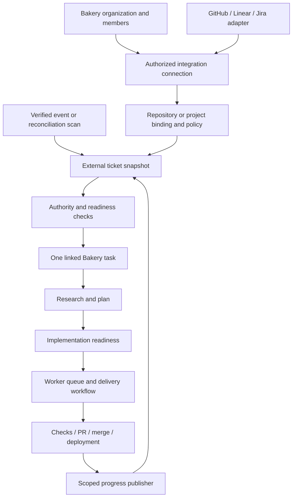
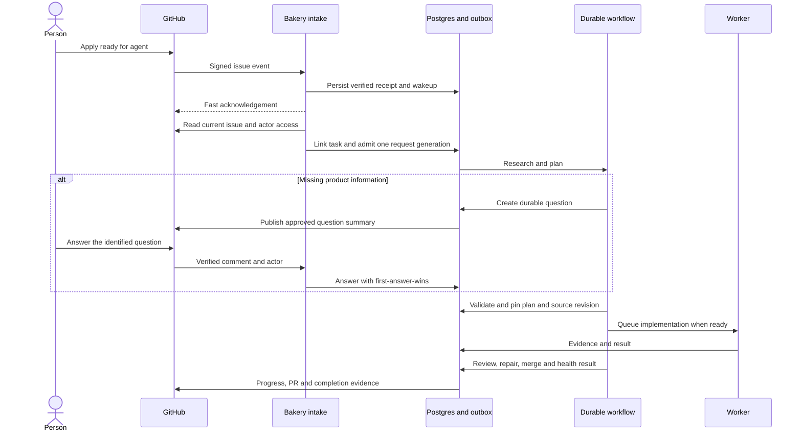
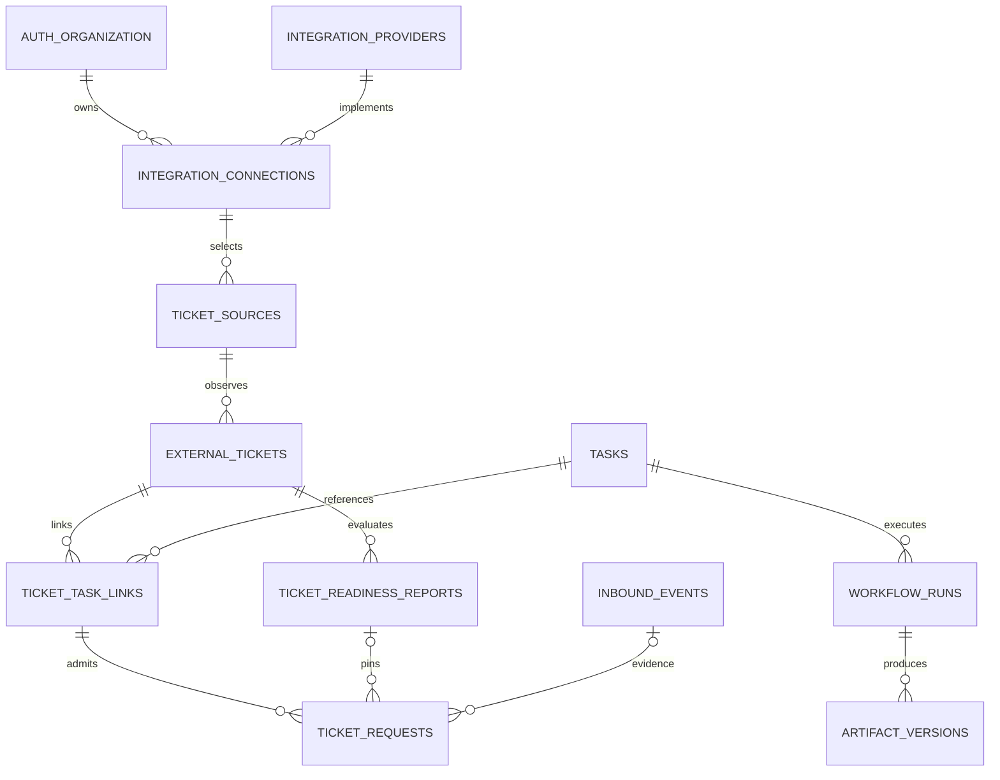

# Tickets

GitHub first; Linear and Jira adapters follow. This dedicated area covers readiness labels, planning, intake, execution links and progress. [Integrations](09-integrations.md) covers provider accounts, authentication and connection health. It does not create an internal issue tracker, install external apps or send comments. The records and operations below are included in the structured model, API catalog and transport schemas for implementation.

Bakery connects to the tracker where people already organize work. The tracker owns the ticket; Bakery owns the execution task, versioned plan, workflow, evidence and progress. Users can operate that work from either surface. A Bakery task may have no external ticket, one primary ticket, or additional explicitly linked tickets. The [work-chat flow](chat-composer/BEHAVIOR.md#a-work-anchor-for-every-chat) has a stricter intake rule: choose an open Jira issue, pull request, or merge request before sending its first message; a PR/MR can be the primary anchor without an unrelated ticket. Historical links remain after closure, and new execution requires an open anchor. Adding a second reference never launches another execution automatically.

## From connected source to delivered work



Start from an authorized [integration connection](09-integrations.md). Configure repository-role routing, request labels, an optional saved workflow, progress audience and completion policy here. Without a saved workflow, the agent coordinates the task using the same durable plan and permitted execution presets. **Preview matches** shows resolved repositories, dependencies and why work would start; existing matches require an explicit adoption action. New authorized events then follow the saved policy.

## Labels express intent; readiness establishes what can run

These are configurable defaults. Setup resolves labels to provider IDs where available, retains their display names, and detects deleted mappings. Renaming a label must not silently change its meaning. Existing teams can keep `ready for agent` exactly as written.

| Label or action | Meaning |
|---|---|
| `ready for agent` | Authorize research, planning and implementation through a saved workflow or agent-coordinated plan, within all selected repositories' policies and the shared budget |
| `ready for planning` — optional | Authorize research and a plan only; stop after publishing the plan until a start instruction arrives |
| `bakery:hold` | Prevent admission/dispatch; cooperatively pause admitted work and block further privileged effects |
| `bakery:queued`, `bakery:working`, `bakery:review`, `bakery:needs-input`, `bakery:blocked`, `bakery:done` | Bakery-owned progress projections; setting one manually never authorizes execution |
| Optional priority/type/route labels | Map through a small allowlist to queue priority, bug/feature/epic and a registered workflow; no label can select arbitrary code or credentials |
| `frontend`, `backend`, or other configured repository-role labels | Select or suggest authorized repository targets; matching several labels can require several repositories. They never authorize execution by themselves. |

`hold` takes precedence. If both request labels exist, execution intent covers planning. Removing `ready for agent` before implementation dispatch withdraws implementation authorization; an existing planning-only request may finish. During implementation, removing it requests a safe pause. Re-adding it resumes/re-evaluates the existing nonterminal task. It does not create a parallel run. An explicit cancel is available in Bakery or through an authorized command; removing a status label is not cancellation. Bakery does not consume/remove request labels itself.

The request label remaining after completion does not cause another run. Reopening a ticket alone does not rerun it. A new trusted request transition or explicit retry starts a new admission generation only after the previous task/run is terminal; revision and completion checks prevent repeatedly executing unchanged work. Hold removal requires a live authorized request and re-evaluation before resumption.

**Who may start work?** A signed webhook proves delivery authenticity, not the sender's right to spend money or invoke tools. Default to a mapped Bakery member with run permission. A source policy may explicitly delegate to allowlisted GitHub actor IDs with a verified repository role; this runs through a narrowly scoped connection principal. Never infer authority from display names, issue authorship, quoted commands, `author_association` alone or an absent/placeholder actor. The current repository-permission endpoint supports checking the acting user's role. [GitHub collaborator permissions](https://docs.github.com/en/rest/collaborators/collaborators#get-repository-permissions-for-a-user).

### Two checks, with different consequences

| Check | Required evidence | Failure behavior |
|---|---|---|
| **Eligible for Bakery** | Trusted request, enabled source, open supported ticket, allowed repository/application, no hold, no duplicate active admission, permitted saved workflow or agent-coordinated execution | Remain unadmitted with an explicit reason; never allocate a coding worker |
| **Ready to implement** | Clear outcome and testable acceptance criteria; current plan when required; repository profile/toolchain; resolved dependencies; authorized capabilities and budget; scope fits the request | Research, propose acceptance criteria, or ask one focused question; dispatch only after the missing dependency is resolved |

A title alone is usually insufficient, but a rigid issue template is not mandatory. Reuse useful content from the issue, linked requirements and prior discussion. The planning agent can fill in routine technical details. Missing product intent belongs in a question, not an invented requirement. A plan created under `ready for agent` proceeds automatically once its checks pass; `ready for planning` intentionally stops at the plan. Optional human design review is a repository workflow setting, not a universal recurring gate.

Store a versioned readiness report: pass/wait/reject checks with stable reason codes and evidence references, the source requirement digest, a dependency digest, the source policy revision, the preset pin and exact blockers. Reports are insert-only rows of `ticket_readiness_reports`, and a new one is stored only when its basis changes. The report carries no plan artifact version, chosen workflow or resolved repository set yet: the fixed coding preset is the only workflow admission runs, and a source names one repository. Deterministic checks own permissions, duplicates, dependencies and budget. A light, configurable model assists requirement assessment; its opinion cannot override a failed guard. Lack of available worker capacity means **queued**, not missing information.

<a id="repository-label-routing"></a>

### Repository labels resolve scope; they do not grant it

The route and task-repository records are pending
catalog reconciliation as specified in the [multi-repository contract](06-workflows-delivery-and-acceptance.md#workflow-ownership-and-multi-repository-work).

Application setup can annotate repositories with roles such as `frontend`,
`backend`, `mobile` and `shared`. Ticket-source setup explicitly maps provider label
IDs to those roles or concrete repository IDs. Keep the display label alongside
its stable provider ID and retain the route-policy revision. Repository metadata
tags and external issue labels are separate data connected by this mapping.

An issue labeled both `frontend` and `backend` resolves the union of matching
authorized repositories, deduplicated by repository ID. For example, `frontend`
may select `acme/web` and `backend` select `acme/api`. Preview matches shows both
targets, why each matched, required access and the saved-workflow or agent-plan
mode. One issue creates one parent Bakery task with repository-specific children,
not two unrelated admissions or duplicate progress publishers.

Labels need not encode ordering. The agent derives and records prerequisites
from the work: publish an API contract before dependent frontend changes, perform
independent implementation concurrently, and wait for required repository and
integration evidence before completion. A saved workflow may supply these
constraints. Without repository labels, the agent can resolve targets from
authorized application context and explicit issue references; it does not default
silently to the ticket's hosting repository. The source's primary repository is a
fallback hint, not the maximum task scope.

Several candidates for a role, a deleted mapping, unavailable access or a target
outside the configured application produce a visible resolution issue. Never take
the first match or discard an unmatched required target. Applying a routing label
cannot bypass the request/readiness labels, live actor grants or repository rules.

The ambiguity preview lists concrete candidates with access status on desktop
and phone. Choosing a target resolves this issue's versioned plan after validation;
it does not rewrite the saved routing rule. Editing the rule is a separate source
setting. An unavailable required target remains blocked until access or an
authorized scope revision resolves it.

Persist the resolved set and match provenance in the readiness/coordination plan.
Changes to labels or route settings re-evaluate that plan with CAS; they do not
retarget already running jobs or erase completed work. Newly discovered authorized
targets can be added within the active request's scope and budget; scope that
cannot be established pauses only affected dispatch for clarification. Removing
a required target requests a safe plan revision/pause instead of orphaning effects.
Status summaries aggregate authorized child outcomes, and `done` requires every
required repository outcome plus cross-repository acceptance checks.

## An issue through the factory



Research, plans and detailed evidence remain versioned Bakery artifacts in Postgres. Publish an approved summary plus authenticated links to the ticket. Comments on plans remain multiplayer and revision-anchored. An external comment does not expose the entire internal conversation or privately installed plugin state.

If the work is an epic, use the existing parent/child tasks and dependency DAG. Publish linked child issues when the tracker supports them and policy allows it. Every child pins its repository, acceptance criteria, inherited scope and budget. Parent authorization can cover descendants only under the configured decomposition rule; it cannot expand to an unapproved repository, integration or spending limit. Parent completion requires the required children's evidence. Tickets in other providers can link to the same task without mirroring the entire tracker into GitHub.

### Changes, steering and stopping

- An issue-body/acceptance/dependency change invalidates the previous readiness report. Before implementation it triggers re-evaluation; during execution it becomes explicit steering and a plan revision when needed. Preserve the old run snapshot. A worker receives serialized steering, never concurrent prompt injection.
- Ordinary human discussion is context. Explicit `/bakery plan`, `start`, `hold`, `resume`, `cancel` or `answer <question-id> ...` commands are parsed narrowly and require current authority. Prose inside quotes/code blocks, edited old commands and Bakery's own comments never become new commands. Natural-language steering in Bakery uses the existing shared-session coordinator.
- Every side effect rechecks current grants and admitted scope. Closing a ticket manually prevents new work and requests cancellation of nonterminal execution. It does not prove delivery succeeded. Reconcile any already-submitted external effect; it cannot be undone merely by changing a label.
- A lost webhook can delay observation of withdrawal. Re-read ticket control state at dispatch and before merge/deploy; on a provider outage, retain work/evidence but wait before such effects. There is no claim of instantaneous atomic cancellation across GitHub and Bakery.

## Progress visible in both places

Use one **Bakery-owned status comment per task/ticket link** and update it on meaningful phase changes. Store its provider comment ID. Add separate comments for an actionable question and a final result when useful; coalesce repetitive events. Do not stream token output into issue comments. GitHub supports creating and editing issue comments. [Issue comment API](https://docs.github.com/en/rest/issues/comments).

Example projection, using synthetic values:

```text
Bakery · In review
Task: BAK-42 · Plan v3 · Candidate: abc1234
Completed: research, plan, implementation, required checks
Current: independent review (attempt 1 of 3)
PR: #127 · Preview: authenticated link · Details: Bakery task link
Next: repair findings, or enter merge queue
```

Only publish fields allowed by the source's audience policy. A public ticket gets a public-safe summary; internal traces, secrets, private artifacts and unrelated organization details stay private. Source ticket visibility is checked again before posting. Links do not grant access. Human-owned title/body/assignees/milestones/labels remain human-owned unless a specific edit is requested or configured. Preserve unrelated labels with individual add/remove operations; never replace the full set with Bakery's view. [GitHub label API](https://docs.github.com/en/rest/issues/labels).

Keep **execution phase**, **tracker state** and **sync health** separate. Planning/review/deployment are run phases, not a new competing task state machine. A successful run with an unsent comment is “completed · progress sync pending.” A blocked Jira transition cannot convert successful tests into failure or hide the pending tracker update.

Define the completion policy per source: `merged`, `deployed_healthy` or `manual`. For code-only changes, merging with required evidence is a reasonable default; deployment workflows use healthy release evidence. GitHub closing keywords can close an issue when a linked PR merges into the default branch. Use them only when that matches the policy; otherwise use a non-closing reference and close through the broker after the required evidence. A closed unmerged PR is not successful completion. [Linking PRs and issues](https://docs.github.com/en/issues/tracking-your-work-with-issues/using-issues/linking-a-pull-request-to-an-issue).

## Delivery, duplication and reconciliation

Verify and persist the receipt/outbox before returning success. GitHub expects acknowledgement within ten seconds; no agent or provider round trip belongs in the request handler. Deduplicate by app/installation/delivery identity and reject a reused identity with different content. A redelivery uses the same delivery ID. [GitHub webhook practices](https://docs.github.com/en/webhooks/using-webhooks/best-practices-for-using-webhooks).

Webhooks are wakeup hints. Fetch the current remote ticket instead of applying old snapshots in delivery order. Store a requirements digest separately from timestamps and progress fields so Bakery's own updates do not invalidate plans. A periodic, quota-aware scan reconciles selected sources with overlapping update windows and durable checkpoints. GitHub does not automatically redeliver failed webhook deliveries; use delivery recovery and state reconciliation. [Failed deliveries](https://docs.github.com/en/webhooks/using-webhooks/handling-failed-webhook-deliveries).

Polling a ready label without evidence of who authorized it must not manufacture authority. Recover an already-admitted request, find a verified control event, or require the previously configured maintainer-controlled source/adoption policy. Initial backfill remains preview-first. Serialize admission by external ticket identity; use a database uniqueness constraint for one active request per linked task. Multiple deliveries, comments and scans converge on that admission. Fuzzy similarity can suggest duplicate tickets but cannot merge/close them or join private conversations automatically.

All outbound mutations use the existing `external_effects` ledger and fixed connection identity. A deterministic effect key binds link, run revision and projection kind. On an uncertain comment creation, reconcile by stored ID or a stable marker plus the app's actual author identity; a user-pasted marker is not proof. If absence cannot be established, leave the effect uncertain rather than duplicate a post. Status updates serialize per link and skip older desired revisions. Suppress self-authored control loops through recorded effect IDs and actor identity, while still reconciling genuine remote state.

Retries obey provider rate-limit/reset signals, backoff with jitter and a bounded budget. Permission loss, deleted/moved repositories, missing labels and unsupported transitions are actionable connection/source states. Revoking a connection or installation, deselecting a repository or archiving it is judged by the next recheck, which suspends the request and pauses a run that has a live attempt on a worker that can pause; history stays. Disabling a source stops automation for it (intake and poll list only enabled sources, and `ticketSources.sync` refuses it), so it leaves its requests and runs as they are: pausing a run is a manual step (`runs.control`) and no automatic run starts, because starting needs a recheck. Repairing the connection resumes pending synchronization only under live authority.

Full local mode can receive webhooks through an explicitly configured HTTPS tunnel. Without an inbound URL, use authenticated reconciliation polling and manual adoption; no cloud broker is required. Polling preserves the same authority and deduplication rules and cannot deliver instantaneous events.

## Ticket records and API contract

Reuse `integration_providers`, `integration_connections`, `inbound_events`, tasks, conversations, questions, artifacts, automations, outbox and external effects. Five relational additions cover ticket orchestration; there is no second workflow engine or general ticket database.



This is the logical view of the cataloged ticket records. Better Auth retains its provider-owned SQL tables; Bakery migrations use the configured UUID organization/member keys represented in `data-model.json` and enforce same-organization composite parents.

| Record/change | Required contract |
|---|---|
| `ticket_sources` | Organization, provider (`github`), connection, immutable provider container ID, application/repository mapping, enabled state, schema-validated policy and revision, sync checkpoint/health. One authoritative source per external container within an organization; multiple matching execution rules conflict visibly. |
| `external_tickets` | Organization, source, immutable provider ticket ID, current key/number/URL, normalized bounded snapshot, requirement digest, provider update marker, visibility and last observed time. Deduplicate on organization/provider/account/ticket identity, independent of changing URL or connection credentials. |
| `ticket_task_links` | Organization, external ticket, Bakery task, primary/reference role, bot status-comment ID and last synced run revision. Unique ticket/task pair; one primary ticket per task and one nonterminal execution owner per ticket. Other links provide context. |
| `ticket_readiness_reports` | Organization, external ticket, per-ticket sequence, verdict, the checks with reason codes and evidence, requirement and dependency digests, source policy revision, preset pin, the origin that first saw the basis and the evaluation time. Insert-only: the application role has no update or delete grant, and a report is stored only when its basis digest changes. |
| `ticket_requests` | Link, intent, generation, origin (`manual`, `adoption`, `webhook`, `poll`), authority principal and evidence, optional inbound receipt, the source policy revision, the pinned readiness report and preset, current disposition with its reason, run ref and pause mark. Origin, principal, evidence and preset are immutable admission facts; no duplicate active generation. Explicit Bakery commands use their authenticated audit/idempotency receipt. |
| Existing connections/receipts/effects | Organization ownership; app installation/container routing; provider event identifiers; effect link/request refs; reconnect/revocation and sync state. Generalize the fixed `inbound_events.source` list through the registered provider identity for later adapters. |

`ticket_requests` also carries the external ticket ID constrained to its link and an explicit admission state. A partial unique index on external ticket ID covers waiting/admitted/active/suspended requests; rejected, completed, failed and canceled generations do not hold that slot. The database stores no plan artifact version: the API returns `planArtifactVersionId` as `null` only to keep the wire shape. Admission locks that ticket and changes the task/run/request together. This makes the one-active-request rule enforceable without an index depending on another table's mutable status.

Preserve multi-organization keys and composite parent constraints at every link. Reading a linked task requires its application/repository permission as well as source access; linking never widens a conversation's audience. A provider transfer updates the route only inside an authorized source mapping; otherwise pause and ask an Admin to remap it. Normalize enough to browse, evaluate and link tickets; keep large attachments remote with authorized bounded fetches. Public input is untrusted content. A URL never authorizes an arbitrary HTTP request; fetch through the selected provider adapter and allowed resource scope.

These routes are registered in `api-catalog.json`, with request/result shapes in `transport-schemas.json`, and the work module implements all of them except the remote ticket creation. Fixtures, not live GitHub, back them, so the connected cases of the G3 gate are still open; [ticket admission operations](10-ticket-admission-operations.md) says how an operator configures a source and reads why an issue was or was not admitted, and the live G3 checks that settle those cases against a live App are in `learnings/ticket-admission-g3-live-checks.xml`. They reuse `integrationProviders.*`, `integrationConnections.*`, `tasks.*`, `questions.answer`, `runs.control` and `automations.*` guards; no second admission or sync implementation is implied.

| Operation | Proposed REST surface | Meaning |
|---|---|---|
| Configure sources | `GET/POST /v1/ticket-sources`; `GET/PATCH /v1/ticket-sources/{id}` | Source mappings and CAS policy revisions |
| Preview and sync | `POST /v1/ticket-sources/{id}/previews`; `POST /v1/ticket-sources/{id}/syncs` | Both run synchronously and answer a receipt (`completed`, or `failed` for a sync step that stopped early). Preview starts no work and records snapshots and reports for one page of up to 25 open issues; sync runs one bounded poll step (10 candidates) through the same admission code. Read results through `externalTickets.*` |
| Browse remote work | `GET /v1/external-tickets`; `GET /v1/external-tickets/{id}` | Safe scoped cache with freshness/remote link; no per-row live network fan-out |
| Assess readiness | `POST /v1/external-tickets/{id}/readiness-checks` | Synchronous deterministic evaluation, no model: records the snapshot and an insert-only report, admits nothing and answers a `completed` receipt. The report carries the source policy revision and preset pin |
| Link a task | `POST /v1/external-tickets/{id}/links` | Attach to an authorized task with conflict checks; linking alone cannot start it |
| Request work | `POST /v1/external-tickets/{id}/requests` | Plan/start intent with expected source policy revision, requirements digest and idempotency key; the caller needs `task:write` and `run:write`. It admits one request, re-evaluates the one that exists (a suspended request resumes or re-pins), or refuses with 409 `ticket_not_ready` (the failing checks as `issues`), 409 `labels_truncated` or 503 when GitHub cannot answer, and records nothing. Run control and cancel stay with `runs.control` |
| Create remote ticket | `POST /v1/ticket-sources/{id}/tickets` | Optional chat/webhook-to-ticket effect; reconcile remote identity before executing linked work |

REST mutations use existing idempotency/CAS conventions and RFC 9457 errors. MCP exposes selected ticket/source operations through the same schemas, OAuth scopes and guards; it is not a separate sync implementation. WebSockets publish scoped `ticket.observed`, `ticket.request.updated`, `ticket.sync.changed` and source-health notifications through the existing resumable event stream. Clients re-read safe state; progress writes remain REST/MCP operations.

Every Bakery list is cursor-based, including the source and ticket lists. Prefer upstream cursor APIs when available; any upstream page/offset token is adapter-private and never becomes Bakery page-number pagination. Cache traversal uses organization-scoped keysets, while sync scans use provider-appropriate checkpoints.

## Configuration, not per-repository code

Illustrative YAML; publishing must resolve names to allowed IDs, validate against the provider's capabilities, and pin the resulting policy. It cannot contain executable expressions or arbitrary network targets.

```yaml
provider: github
source: MarkTripoli/bakery
workflow: research-plan-implement-review-deliver
triggers:
  execute: {label: "ready for agent"}
  planOnly: {label: "ready for planning"}
  hold: {label: "bakery:hold"}
authority: mapped-member-or-explicit-delegation
readiness:
  acceptanceCriteria: required-before-implementation
  plan: workflow-controlled
  dependencies: resolved-before-dispatch
progress:
  comment: one-per-task
  labels: bakery-owned-only
  audience: public-safe-summary
completion: deployed_healthy
initialBackfill: preview-and-adopt
```

Add model/harness selection by referencing the existing automation/workflow presets. A ticket label never overrides a provider credential or bypasses the organization budget. Publish policy changes with a diff and impact preview; active requests keep their pinned scope while live revocation and withdrawal still take effect.

## UI and acceptance

The dedicated Tickets page shows connected sources and imported ticket references with readiness reasons, linked task, execution phase and independent sync health. Each source has trigger mapping, workflow/default model, audience, completion policy and **Preview matches**. Connection credentials and provider health remain in [Integrations](09-integrations.md). A ticket detail uses the existing task/session/plan layout; users can answer, hold, resume or open the original tracker from phone or desktop. The Work queue continues to show execution tasks. Do not add a separate sprint planner or duplicate the provider's backlog editing UI.

Before shipping GitHub intake, prove these boundary cases in provider fixtures and a connected test repository:

1. One authorized label creates one admission despite duplicate/reordered events and polling; forged payloads and untrusted actors cannot start work.
2. Planning-only produces an artifact and stops; execute intent plans and proceeds; missing acceptance intent asks a durable question with cross-channel first-answer-wins.
3. Source edits, label withdrawal, holds, manual closure and reconnect behave as specified; scope drift cannot reach merge/deploy without re-evaluation.
4. Unknown comment creation, status update throttling and revoked access retain accurate sync state without duplicate posts or execution loops.
5. A public issue cannot reveal private artifacts; organizations cannot cross-link tickets/tasks/connections; one user's private layouts remain independent.
6. Exact-head check/review evidence controls completion; a closed issue or unmerged PR alone is insufficient. Local polling and webhook/tunnel modes share the same admission rules.

Measure intake lag, time from an authorized request to dispatch, time waiting for information, readiness reversals after scope changes, progress-sync failures, retry counts and cost per completed ticket. Include rejected/blocked work in the denominator so a high apparent success rate cannot hide abandoned tickets. Keep deterministic delivery evidence separate from sampled model assessments of plan quality.

The current map validates documentation structure and responsive rendering only. Source setup, readiness, admission and the poll and webhook functions are built and backed by fixtures. Live GitHub checks, the Tickets page, remote ticket creation and multi-repository routing remain to build.
