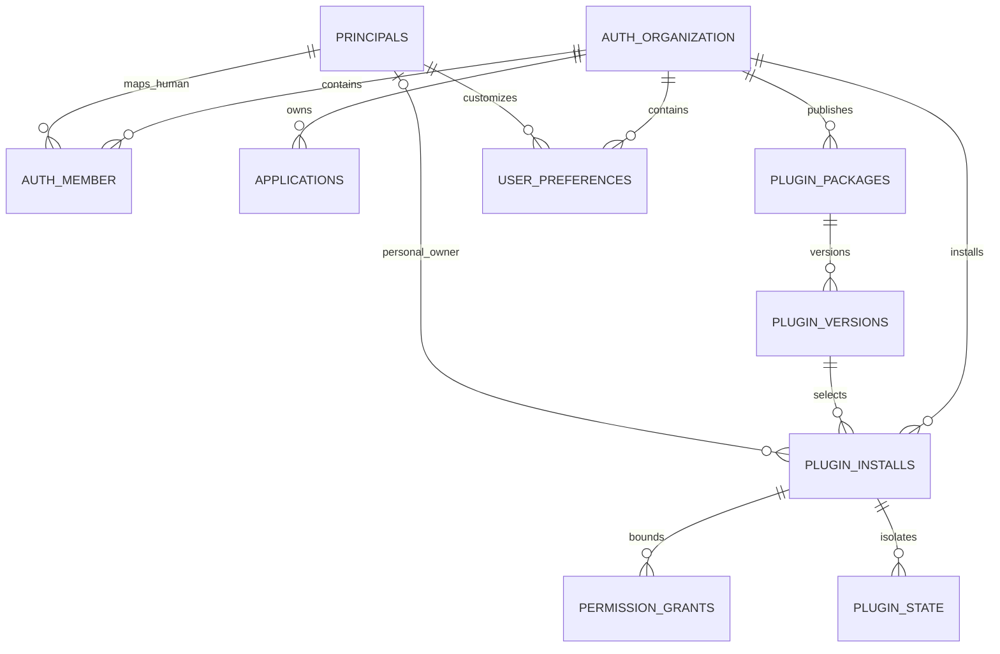
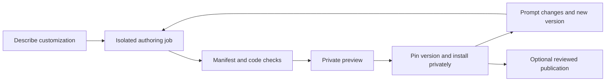

# Plugins

**Mandatory semantic metadata:** Every Zod schema/type and every field requires a meaningful description, without exceptions. Preserve it through composition and generated contracts; reject missing descriptions. See [schema description rails](04-backend-and-errors.md).

Dedicated area for personal customization, the plugin SDK, permissions, isolated execution, installation, updates and the marketplace roadmap. Desktop packaging is described in [Desktop](08-desktop.md); provider connections are managed in [Integrations](09-integrations.md).

Keep factory features as ordinary modules with a small public SDK. Establish organization ownership before backend implementation, and deliver private plugins before a public marketplace. These are proposed contracts, not a running plugin platform.

## Personal customization and hosted ownership

Two independent scopes are required:

| Scope | Owns |
|---|---|
| Organization | Shared applications, tasks, conversations, connections, budgets, workers and installed capabilities |
| Person within an organization | Private plugin installs, enabled views, panel arrangement, shortcuts and theme preferences |

A personal installation bootstraps a **Personal** organization. The initial release supports multiple organizations, invitations and multiple members, with a person able to join several organizations. Reuse Better Auth's organization/member schema and configurable roles, exposing Admin and Developer per organization. Keep installation administration and machine grants separate from organization membership. Organization creation is an authenticated, authorized operation; public signup, subscription provisioning and billing remain later work. [Better Auth organizations](https://better-auth.com/docs/plugins/organization).

A marketplace can distribute packages to separate self-hosted installations; it does not require shared SaaS hosting. The organization boundary is nevertheless useful now because Bakery may host multiple groups later. A deployment can host several organizations; it is not an organization. Existing `workspaces` continue to mean worker worktrees.

**Organization contract:** `principals.role` has been removed from the structured model; Better Auth owns organization/member rows with Admin and Developer roles per organization. Applications use organization-scoped slugs. The model, REST/MCP contract, live streams, worker enrollment, secrets, storage, cache keys, idempotency, budgets and jobs carry explicit organization context. Installation administration and shared provider installations remain separate host authority.

Every request supplies explicit organization context and the server validates it against current membership or machine grants. An active-organization preference is navigation state, not authority; one browser tab must not silently redirect another tab's writes. Children must have a constrained parent in the same organization. Unknown or unauthorized resource IDs cannot leak another organization's data through errors, counts, pagination, subscriptions or downloads.

Organization isolation and RBAC are decided only in application code: live authority checks plus explicit organization predicates in every organization-owned query are the sole isolation boundary, and PostgreSQL row-level security is not permitted. A non-owner runtime role, least-privilege grants and composite foreign keys remain required hardening, but the database adds no second authority. The `tests/rails/no-row-level-security_test.ts` rail rejects `create policy`, `enable row level security` and `force row level security` in any migration with no allowlist. A discriminator column alone is not a security boundary.

## What we take from BB

BB's source documents manifest-based plugins, UI slots, typed RPC, tools, skills, settings, background work, installation and marketplaces. The local RPI plugin demonstrates sidebar pages, session panels, composer additions and settings through its SDK. Its authoring experience is the reference: describe a need, generate against a known SDK, build, preview, install and iterate. [BB SDK](https://github.com/get-bb/bb/tree/main/packages/plugin-sdk).

BB explicitly documents full-trust plugins in its server process. Bakery's public or generated plugins require a different execution boundary. Natural-language generation produces a candidate package; it does not grant that package authority. [BB plugin configuration](https://github.com/get-bb/bb/blob/main/docs/configuration.md#plugins).

Connector packages use the dedicated `@bakery/integration-sdk` contract in [Integrations](09-integrations.md), with typed core-operation scopes, provider action grants and brokered requests. They reuse this plugin package/version/install lifecycle; connector permissions never follow automatically from a UI plugin install. Native connectors consume that same public contract.

### Proposed SDK surface

| Extension | Initial contract |
|---|---|
| UI | Pages, session/artifact panels, settings sections, commands and composer attachments; host-rendered navigation entries select isolated views |
| Personal workbench | Rearrange and hide permitted panels, save private layouts, choose theme tokens, or use a plugin page as the person's main work surface |
| Data and actions | Typed, allowlisted queries and commands through existing Bakery operations; cursor pagination and safe projections |
| Agent capabilities | Namespaced tools and pinned skills; harness/provider/model selection goes through the same catalog, defaults and budget policy |
| Background work | Declared workflow actions, webhooks and schedules admitted through the current queue and Inngest orchestration |
| State | Versioned JSON settings/state, private by default, with explicit shared scope; secrets use existing references and broker grants |

Plugins use exported tokens and a versioned subset of `@bakery/ui` inside their own bundle. The host passes theme, locale, direction and viewport information as validated data. Plugin manifests may ship bounded locale catalogs under one package-owned namespace; installation validates keys and arguments, and missing entries fall back to the required English catalog through `@bakery/i18n`. Plugins cannot replace core Bakery messages. Plugins do not depend on host DOM selectors, internal stores or undocumented component paths. SDK/UI compatibility and deprecated methods are versioned; one package should run in the browser and desktop without provider-specific code.

The SDK is a platform API, not an alternate implementation of the server. Built-in features continue to use the same operations. A second real consumer—the desktop host or first plugin—justifies each shared interface. Native shell access is excluded from the portable plugin contract; any later native extension has a separate, explicit capability and cannot silently break web/mobile support.

## Plugin data contract



This is the logical view of the plugin records represented in `data-model.json`. Auth membership maps through the Better Auth user/member IDs configured as UUIDs; uppercase names remain diagram labels rather than prescribed physical SQL names.

| Record | Minimum contract |
|---|---|
| Auth organization/member | Provider-owned identity and membership; one Personal organization at bootstrap |
| `plugin_packages` | Publisher organization, stable name, provenance, license, visibility and listing state; public discovery never exposes private settings |
| `plugin_versions` | Package/version unique, SDK range, immutable manifest and bundle digest, R2/filesystem object reference, source/build evidence; published content cannot mutate |
| `plugin_installs` | Organization, package, selected version, user/organization scope, optional personal owner, lifecycle status and state-schema version; selected version must belong to package; one package per scope/owner |
| `permission_grants` | Organization/install binding and approved resource/capability constraints; permissions intersect requested manifest, installed grants and current actor or service authority |
| `plugin_state` | Install, optional personal owner, namespace/key, schema version, bounded JSON and CAS version; shared state requires explicit organization scope |
| `user_preferences` | Organization/person unique, private layout/theme/enabled-view settings and CAS version; preference changes never grant access |

Use a validated immutable archive plus file-digest manifest for plugin bundles, reusing the R2/filesystem storage boundary and safe extraction logic. Do not put plugin source or script bytes in Postgres or masquerade the bundle as a skill. A bundle can import separately pinned skill versions. Public registry distribution is optional in local mode; a downloaded bundle can be verified and installed without a live marketplace.

Personal installs have an owner; organization installs do not. Enforce that invariant and unique keys with proper NULL handling. Private install state is visible only through its owner's authority; shared install state is an explicit choice. Public marketplace listings are separate from installation records. Private organizations can also publish public packages without making any organization data public.

### Cataloged private-plugin operations

The design API provides organization-scoped package list/get/create, immutable version list/create, install list/get/create/update, CAS state read/write, and private user-preference read/update operations. Personal install writes derive their owner from the authenticated member; organization installs require Admin authority. Creation is private and unlisted. Public publishing, marketplace ranking, payments and a general dependency solver remain later work.

## Loading and calling a plugin

```text
User opens an enabled plugin view
  host resolves org + person + install + immutable version
  verify bundle digest and SDK compatibility
  load isolated view with no Bakery cookies or native bridge
  bind a private message channel to that frame instance

Plugin requests a command
  validate message schema, size, method and request ID
  resolve server-issued instance binding; ignore caller-supplied identity
  recheck membership, install status, grants and budget
  call existing typed operation OR enqueue isolated plugin job
  return safe result / typed Problem; append scoped audit/event
```

Use an opaque-origin iframe with `sandbox="allow-scripts"` for generated/third-party UI. Because its origin is `null`, origin-string matching is insufficient: bind the expected frame's `contentWindow` to a one-time MessageChannel handshake, then accept requests only through that channel with a server-issued instance binding. Validate schemas, method allowlists, sequence/request IDs, size, rate and timeout. Reload/disable closes the channel and invalidates the binding. CSP restricts network and resource loading; forms, popups and top-level navigation stay disabled. Authenticated data passes only through the broker. The browser sandbox still needs real escape, message-spoofing and resource-exhaustion tests. [Iframe sandbox behavior](https://developer.mozilla.org/en-US/docs/Web/HTML/Reference/Elements/iframe).

Tauri capabilities constrain the native bridge, but they do not isolate arbitrary JavaScript placed in the trusted React renderer. Plugin frames and preview pages receive no Tauri privileges. [Tauri capabilities](https://v2.tauri.app/security/capabilities/).

Generated backend code runs as a bounded job in a worker container/process isolation boundary with restricted filesystem, resources and egress. It receives short-lived install-scoped broker access, not database credentials, worker enrollment credentials or provider secrets. Closing the UI does not stop a scheduled job; disabling/uninstalling the install prevents new invocations and revokes active authority. OS/process isolation and quotas must be proven before accepting untrusted shared-host code. Reuse Bakery's leases and effect reconciliation; Inngest handles durable scheduling and retries.

REST failures retain RFC 9457. Plugin JSON-RPC protocol failures use the protocol's error envelope; domain failures carry the existing sanitized Problem data. MCP tools retain MCP's native tool-result/error conventions. Plugins cannot add unauthenticated server routes or bypass those adapters.

## Prompt to installed plugin



The authoring job uses the selected compatible model/harness and existing spend limits. It loads a pinned plugin-authoring skill, SDK reference and Storybook examples; generates the manifest, view and optional jobs; checks types, permissions, dependency lock, responsive behavior and operation contracts; then exercises the actual plugin preview. Existing authorized capabilities can flow through policy. Broader access or new external effects require the relevant authorization. Merely adding UI does not reopen routine approval gates.

Updates stage a new version and run migrations in a versioned namespace or snapshot before activation. New capability requests do not inherit approval automatically. Failed activation preserves the previous usable version; rollback of code is allowed only with compatible state or a proven state restore. In-flight work pins its version and remains subject to current revocation. Uninstall first disables and retains data under policy; deletion is separate. Package signatures/provenance, revocation and dependency review are marketplace launch requirements.

## Delivery order and proof

| Slice | Deliverable | Required evidence |
|---|---|---|
| Foundation, before implementation | Organization ownership and shared API/UI boundaries in the machine-readable contracts | Cross-organization schema/transport review; core mocks unchanged |
| Private plugins | Personal layouts; import/disable/upgrade; one page, one session panel, one tool/job | Two people have independent settings; forbidden data/native calls fail; browser/desktop/phone behavior checked |
| Prompt authoring | Generate, build, preview, install and revise a plugin through chat | End-to-end task with pinned SDK/model/budget, failed-build recovery, upgrade and state restore |
| Controlled sharing | Immutable package export/import and curated catalog | Provenance, permissions, revocation, offline local install, malicious-package containment |
| Marketplace and shared SaaS | Publisher tools, discovery/review, abuse controls and optional commerce | Tenant isolation and cost quotas under hostile fixtures; operational support and moderation ready |

This is a meaningful platform feature, larger than desktop packaging. Establish ownership and extension seams now; implement the SDK against the first real plugin. Marketplace ranking, payments, a general dependency solver and unrestricted core-UI replacement can follow when the corresponding product slice is built.

## Research evidence

- [Desktop client and compatibility boundary](08-desktop.md)

No sandbox security, deployed multi-tenant isolation or SDK parity is claimed by these documents. The organization/plugin records, operations and transport shapes are now in the structured catalogs; migrations, runtime guards and executable isolation tests remain implementation work.
