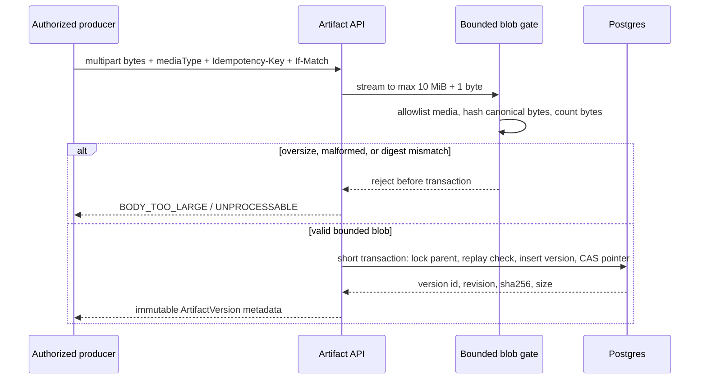

# Artifacts

Artifacts are Bakery's durable work products and evidence. They carry research, plans, designs, checks, reviews, logs, images, patches, and other bounded output between people, agents, workflows, and delivery gates. This chapter consolidates the existing data, runtime, transport, collaboration, and UI contracts. It describes the proposed design; no artifact service is implemented yet.

## A named artifact owns immutable versions

`artifacts` is the task-owned identity: one type, name, and pointer to its current version. `artifact_versions` contains immutable bytes and provenance. Updating an artifact creates another version and atomically advances `current_version_id`; it never rewrites prior evidence.



```text
artifact: "Implementation plan"
  current_version_id: version 3
  versions:
    revision 1  immutable  retained for review history
    revision 2  immutable  retained for review history
    revision 3  immutable  current
```

An artifact can exist with `current_version_id = null` before its first publication. Publishing requires `Idempotency-Key` and `If-Match` against the parent artifact. Concurrent publishers cannot overwrite each other: one advances the pointer; the other receives `PRECONDITION_FAILED` and retains its draft for reconciliation. Earlier versions remain directly addressable.

The [collaborative editing chapter](20-collaborative-documents.md) adds a linked CRDT draft with its own lifecycle. Humans and agents can edit it together; publication freezes an exact acknowledged checkpoint into an immutable artifact version. Draft keystrokes do not create artifact versions or use whole-document ETags. Approval belongs to workflow, review, check, or delivery records that reference exact published versions. No public artifact-delete operation exists. Retention may collect eligible bytes only after preserving referenced evidence, usage, and audit relationships.

## Postgres stores bounded artifact bytes

Each artifact version stores `media_type`, `content`, `size_bytes`, server-computed `sha256`, author, optional producing `run_step_id`, optional subject head/base SHAs, and validated metadata. The hard limit is 10 MiB per version. Metadata is limited to 32,000 bytes. Textual traces may be compressed internally, but API content and digest describe canonical bytes.

Repository imports copy immutable bytes into an artifact version and record validated `sourceRepositoryId`, safe relative path, and commit SHA. Bakery reads the repository through a trusted adapter and verifies scope and digest; caller-supplied metadata cannot assert provenance.

Skill and plugin bundles follow a different rule because they are directory trees containing scripts and assets. Their files/blobs use private R2 in hosted mode or an application-owned filesystem directory locally. Ordinary artifact bytes remain in Postgres in both modes. Uploads over 10 MiB are rejected; no automatic R2 fallback changes artifact storage semantics.

### Blob byte I/O is bounded and content-addressed

"Blob" means the canonical bytes in `artifact_versions.content` (`bytea`), not an implicit object-store abstraction. The v1 path accepts one complete version at a time through the supported multipart HTTP upload, rejects a body over 10 MiB (including a body that crosses the limit while streaming), and rejects a chunked or multipart manifest that names multiple general-artifact objects. A producer with a larger log must publish a bounded summary and selected window artifacts, or fail with `BODY_TOO_LARGE`. A general object-store/chunk-manifest backend is a proposed delta; it is not a hidden fallback.



The server computes `size_bytes` and `sha256` from the exact bytes it commits. Where an upload protocol supplies a digest, it is only a consistency check. The digest identifies bytes; it does not grant access or prove repository provenance. Canonical bytes are the uncompressed representation described by the API. Internal compression is allowed as a storage optimization only when reads, byte ranges, size, and digest still describe those canonical bytes.

| Blob fact | v1 rule |
|---|---|
| Storage | `artifact_versions.content` in Bakery Postgres; one row owns one immutable version |
| Size | Server-computed `size_bytes`, maximum 10 MiB per version; metadata has a 32,000-byte encoded bound |
| Identity | Server-computed lowercase SHA-256 over canonical bytes; ETag is derived from that digest |
| Type | Caller hint is validated against an allowlist and safe sniffing; unknown or active media downloads as an attachment with `nosniff` |
| Metadata | Structured, bounded, redacted metadata only; repository path/commit and run-step provenance are verified by trusted adapters |
| Replay | Same idempotency key and canonical payload returns the stored result; changed payload returns `IDEMPOTENCY_PAYLOAD_MISMATCH` |
| Physical dedupe | No cross-artifact blob table in v1. Equal SHA-256 values may be recognized for diagnostics, but each published version keeps its own authorization, retention, and audit identity |

Reads never place arbitrary bytes into a workflow payload or model prompt. An authorized caller receives a whole body or one valid byte range through the content operation; the API rechecks task scope, current grants, expiry, and digest before returning bytes. The viewer can render only approved safe media. For large or sensitive content it returns an authenticated artifact reference and bounded extraction instead of a public object URL. This follows MCP's resource model, where hosts choose what to include in model context and servers must validate resource URIs and permissions. [MCP resources](https://modelcontextprotocol.io/specification/2026-07-28/server/resources)

The blob gate must release temporary buffers on rejection, abort an incomplete write, and never log body bytes, authorization headers, lease tokens, or caller-supplied filenames. Security scanning, HTML sanitization, content-disposition, range handling, and tenant authorization remain mandatory at the API/viewer boundary. Backup and restore copy Postgres bytes and verify every digest; private skill/plugin objects follow their separate R2/local inventory and are never inferred from an ordinary artifact's storage mode.

## Artifact IDs carry work between durable steps

Workflow payloads contain `{artifactId, versionId, sha256}` references and bounded summaries, never artifact bytes. Resolve the current version once when admitting a step and persist that reference with its inputs. Retries read the pinned version; they never resolve `current_version_id` again. Every consumer reauthorizes the reference and verifies its digest. Sending a live draft to an agent first freezes a published revision; CRDT history and presence never enter model context. Bounded agent edits reference a draft checkpoint and expected target text separately.

```text
task intake
  coordinator creates research artifact
    rpi.research returns { artifact: ArtifactRef, repositoryRevision }
      rpi.design reads researchArtifact and returns design ArtifactRef
        rpi.plan reads designArtifact and returns plan ArtifactRef
          implementation reads planArtifact
            worker uploads logs, patch, image, and check artifacts
              reviewer reads exact revision evidence
                delivery and health records retain evidence version references
                  memory.promote reads an accepted artifact revision
```

`artifact.publish` verifies a committed publication and finalizes its workflow handoff; the shared upload/version operation already enforced parent `If-Match`. It does not promote a pointer a second time. Agent and harness adapters return `artifacts: ArtifactRef[]` in `HarnessOutput` and `FreeformOutput`. Check, review, deployment, health, evaluation, and memory records reference exact versions where their evidence must not drift. A later current version never changes evidence already attached to a run or decision.

## Workers publish through the active lease and fence

Workers upload through `POST /v1/worker/attempts/{attemptId}/artifacts`. The shared ingestion operation authenticates the worker, verifies attempt ownership, lease token, fence, task scope, size, media type, digest, and optional repository provenance before committing the version and `artifact.version_created` event.

```text
worker.artifacts
  authenticate worker principal
  verify current organization, worker and task authority
  read bounded bytes and compute SHA-256 outside a transaction
  validate media type, digest and repository provenance
  short transaction
    lock job/attempt; check identical committed replay first
    recheck current lease, fence, authority and parent If-Match
    create or reuse named artifact
    insert immutable version
    compare-and-swap current_version_id
    append audit, domain event, and outbox row
  return ArtifactVersion metadata
```

A stale worker cannot publish after lease loss. A repeated idempotency key with identical input returns the stored result; changed input returns `IDEMPOTENCY_PAYLOAD_MISMATCH`. Checkpoints store durable `ArtifactRef` tuples so another worker can resume without trusting a previous process or worktree path.

## REST and MCP call the same artifact operations

| Need | Operation | Contract |
|---|---|---|
| List task artifacts | `artifacts.list` | `GET /v1/artifacts?taskId=...`; opaque cursor, default 25, maximum 100 |
| Read artifact metadata | `artifacts.get` | Current pointer and safe metadata; no implicit content body |
| Create named artifact | `artifacts.create` | Task, type, and name; idempotent mutation |
| List versions | `artifactVersions.list` | Cursor-paginated immutable metadata |
| Publish version | `artifactVersions.create` | Multipart bytes, `Idempotency-Key`, and artifact `If-Match` |
| Read bytes | `artifactVersions.content` | Authorized binary response; `200` whole content, `206` valid single byte range, `416` unsatisfiable range |
| Pin or unpin | `artifacts.update` | Admin-only `PATCH /v1/artifacts/{id}` with `{pinned: boolean}` and `If-Match` |
| Publish worker evidence | `worker.artifacts` | Worker-authenticated lease/fence path; no MCP exposure |
| Review | `artifactComments.list/create/update/listAcrossVersions` | Cursor-paginated version-pinned discussions |

Content reads return an ETag derived from SHA-256, `Accept-Ranges: bytes`, and exact `Content-Length`. A partial response includes `Content-Range`; unsatisfiable ranges include `Content-Range: bytes */<size>`. Multiple ranges are unsupported and rejected before reading. `If-Range` mismatch returns the full representation. Approved image/text types render through the safe viewer; active or unknown media downloads with `Content-Disposition: attachment` and `X-Content-Type-Options: nosniff`. Purged bytes return `410 ARTIFACT_CONTENT_EXPIRED`; version metadata remains readable.

Each human operation has a corresponding OAuth-protected MCP tool through the shared typed operation registry. `bakery://artifact-versions/{versionId}` exposes immutable content as an MCP resource. MCP may carry base64 content only up to 1 MiB; larger allowed versions use the authenticated REST content endpoint. The default MCP tool set contains artifact list/get/version-list/content reads; mutation and comment tools are enabled only for scoped agents that need them.

`artifact.created`, `artifact.version_created`, `artifact.comment_created`, and `artifact.comment_updated` WebSocket events contain safe IDs, versions, and invalidation data rather than artifact or comment bodies. Clients refetch authorized state after notification. All artifact, version, and comment collections use cursor-based keyset pagination.

## Comments remain pinned to reviewed bytes

These rules describe published-version comments. [Draft comments](20-collaborative-documents.md) use separate draft-target records with relative positions, a quote and a checkpoint; publication can explicitly map them to version-pinned threads without rewriting the source discussion.

Root comments and flat replies belong to one immutable artifact version. Markdown, text, image, and patch roots use typed anchors validated against the stored bytes. General comments omit an anchor. When a newer version is viewed, Bakery derives placement by unique exact matching; ambiguous or changed content is marked `outdated`. It never rewrites the original version or anchor.

Comment bodies are limited to 10 KiB and rendered as sanitized Markdown. Lists page roots and replies separately. Edits, deletion, restoration, resolution, and reopening require `If-Match`; any reply change increments the root version so stale resolution cannot hide new feedback. Soft deletion preserves thread structure while redacting the body from reads and agent context.

**Send to agent** calls `messages.create` with `intent=agent_request`, selected root IDs, and expected root versions. The server captures a maximum 32 KiB immutable `comment_context` after verifying the conversation, task, versions, current grants, deletion state, and expected versions. Sending does not resolve comments. An agent publishes a new artifact version, records evidence, then resolves addressed roots against their latest ETags.

## Task scope controls every read and export

Artifacts inherit their task's organization, application, repository, and conversation boundary. There is no separate document ACL. Admins and permitted Developers can use the artifact operations allowed by their live resource grants; workers need their narrow attempt lease; integrations need explicit `bakery:artifacts:read` or `bakery:artifacts:comment` scope plus the underlying resource grant.

Every request rechecks current authority. Revocation blocks metadata, content, comments, MCP resources, event replay, and external projections. Slack or another provider receives an authenticated Bakery link or an explicitly authorized bounded projection, never artifact bytes merely because a channel is connected.

Artifact and comment content is untrusted. It cannot grant tools, reveal secrets, widen repository scope, or instruct a provider adapter outside the operation policy. HTML and SVG are not sanitized and never run in the application origin: a preview serves the stored bytes only from the separate preview origin under a Content-Security-Policy sandbox with default-src none, an opaque origin with no script, network access or Bakery cookie, so there is nothing active left to strip. Sanitizing would add a bypass surface without adding isolation. Raw provider errors, model credentials, request headers, stack traces, and secret-bearing tool output never enter public artifact metadata or error responses.

## Private previews render on a separate origin

HTML, SVG, images and text versions can be previewed as they render, without trusting their bytes. The preview is for one immutable version. Running-application previews (worker ports, HMR proxy) are a separate workspace feature and are not covered here.

1. `artifactPreviews.create` (`POST /v1/artifact-versions/{id}/preview-grants`) requires the same read authority as the version content and returns a one-use grant: 32 random bytes, base64url, valid 30 seconds, plus the absolute `exchangeUrl` on the preview origin and the application path of the revision. Only the grant's sha256 is stored. The operation is not idempotency-replayed, so the secret is never kept in a replayable body; an audit record names the grant id only.
2. The browser posts the grant to `exchangeUrl` as a form body from a user-submitted `<form method="post" target="_blank" rel="noopener noreferrer">`. It never appears in a URL. One statement consumes an unexpired, unrevoked, unconsumed grant and opens a session; the response is a 303 to `/artifact-preview/view/{sessionId}` with an HttpOnly, host-only, `SameSite=Lax` cookie scoped by `Path` to that view path and a five minute `Max-Age`. The cookie is `__Secure-bakery_artifact_preview` on https (a `__Host-` cookie would force `Path=/` and let one preview overwrite another) and `bakery_artifact_preview` on loopback http.
3. The view re-checks, on every request, that the session is live, that the grant is not revoked, that the grantor still has read authority, and that the version is not a tombstone (410). Media outside the previewable set answers 415. It never reads a Bakery cookie or authorization header.
4. Responses carry `Content-Security-Policy: sandbox; default-src 'none'; img-src data:; style-src 'unsafe-inline'`, `X-Content-Type-Options: nosniff`, `Cross-Origin-Resource-Policy: same-origin`, `Cross-Origin-Opener-Policy: same-origin`, `Referrer-Policy: no-referrer`, `Cache-Control: no-store` and `Link: <revision URL>; rel="canonical"`. The preview host sends no CORS headers.
5. `artifactPreviews.revoke` (`DELETE /v1/artifact-preview-grants/{id}`) by the grant's principal or an organization administrator ends the grant and its sessions at once. Losing read authority or the bytes ends a preview without a call.
6. `BAKERY_ARTIFACT_PREVIEW_ORIGIN` names the preview origin. It is deployment configuration, not a credential. Startup rejects an origin that shares a hostname with the public origin or a trusted origin. Unset, every preview operation fails closed (`409 STATE_CONFLICT`, reason `preview_origin_not_configured`) and `artifactPreviews.availability` reports `available: false`, so the page hides the action.
7. The same server listener serves both hosts and dispatches by `Host`. The preview host exposes only `POST /artifact-preview/exchange` and `GET /artifact-preview/view/{sessionId}`; the application host exposes neither. A same-site subdomain such as `preview.example.test` beside `example.test` is the production shape; the local stack uses distinct loopback hosts.
8. Request logging and monitoring never capture `/artifact-preview/*` bodies or cookies, and the grant and cookie secret never enter traces, events or audit records.

## Desktop and mobile use one viewer contract

Task detail lists artifacts; `/tasks/:taskId/artifacts/:artifactId` opens the selected artifact and revision. REST remains authoritative for published resources, while WebSocket events invalidate cached queries. The page subscribes to its task scope: `artifact.version_created`, `artifact.updated`, `artifact.comment_created` and `artifact.comment_updated` re-read the artifact, version list and comment queries; a dropped socket shows a reconnecting notice, and a viewed revision that is no longer the newest shows a stale notice linking to the newest revision while the `?version=` and `?comment=` deep links stay bound to their immutable revision.

The viewer renders inline only within a preview bound: 1 MiB for text and 10 MiB for images. The page does not fetch an over-bound version, and the client cancels a stream that crosses the bound, so oversized content shows a too-large state with the verified download instead. The [shared editor and presence primitives](20-collaborative-documents.md) add a live-draft surface with its own synchronization, save state and frozen-publication preview.

```tsx
<ArtifactPage>
  <ArtifactHeader>       // name, type, revision, author, digest
  <VersionPicker>       // cursor-paginated immutable revisions
  <ArtifactViewer>      // markdown, text, image, patch, log, safe download
  <EvidenceContext>     // task, run step, repository head/base
  <CommentSurface>      // desktop rail or mobile full-width sheet
```

Desktop places comments beside the viewer. Mobile uses a full-width sheet and links each discussion back to its selection. Both retain version selection, stale-anchor labels, download, reply, resolve/reopen, and send-to-agent actions. Controls remain keyboard named and at least 44 by 44 CSS pixels on touch surfaces.

The UI must cover loading, empty, ready, expired-content tombstones with retained provenance, unsupported-media download, bounded-log truncation, stale, reconnecting, forbidden, missing version, digest failure, publish conflict, outdated anchor, deleted comment, and failed mutation states. Unsaved editor text survives conflicts and reconnects. User-authored content stays in its source language unless the user invokes an explicit translation action.

Dedicated desktop/mobile Paper frames and matching Storybook stories for this viewer remain uncreated. Existing plan/comment specimens establish shell and responsive patterns, not complete artifact-screen coverage.

## Retention preserves decisions before reclaiming bytes

Default retention is 30 days for transient output and 180 days for evidence, measured from publication. The trusted publisher assigns `artifact_versions.retention_class` and `expires_at`; submitted metadata cannot choose its own policy. Admin pin/unpin updates `artifacts.pinned_at` and `pinned_by` together through a versioned operation. Pinning suspends collection without rewriting expiry. Unpinning warns when content is already eligible.

Collection requires all of: expiry passed, task terminal, parent unpinned, and no protected reference. Active runs protect pinned inputs; retained checks, reviews, deployments, decisions and memories protect referenced versions. Pin changes, new evidence references and collection lock the same artifact then version rows; collection rechecks under that lock. A transaction clears only `content`, sets `purged_at`, and records policy and audit facts. The parent/current pointer, digest, size, authorship, version identity and comments survive as a tombstone. Content is otherwise immutable; only the narrow maintenance operation can clear it. Metadata removal is outside the initial policy.

The protected-reference matrix below is canonical. Inspect every declared artifact-version FK and typed pinned reference in run inputs/outputs; a new reference kind must declare its collection behavior before it can be written.

| Reference | Protects bytes | After collection |
|---|---|---|
| Inputs/outputs of active runs and steps | Yes, including pinned references inside validated snapshots | Never collected while active |
| Active collaborative draft base version | Yes; frozen draft checkpoints referenced by proposals/discussion have their own retention pins | Close/archive and retire references explicitly before collection |
| Retained check, review, decision, deployment, health, evaluation or memory evidence | Yes, until the referencing evidence is explicitly retired under its own policy | Provenance remains; expiry alone does not retire evidence |
| Unresolved version-pinned discussion | Yes | Must be resolved or deliberately retired first |
| Audit/usage facts, resolved or deleted comments | No additional byte pin | IDs, digest, authorship and thread structure remain |
| Current pointer on a terminal task | No additional byte pin | Viewer opens an explicit expired-content tombstone |

The 30/180-day periods are minimum retention windows, not promises that referenced evidence will disappear at that age. Foreign keys are never broken to reclaim bytes. Missing or unknown reference classifications block collection.

Storage pressure never bypasses these protections. Initial host defaults warn at 75% disk use and pause new artifact writes at 90%, while preserving reads and maintenance. Operators can lower thresholds. Rejected writes return retryable `DEPENDENCY_UNAVAILABLE` with a bounded retry hint; they do not pretend an upload succeeded. The UI shows capacity, retained/pinned usage, and the action needed. Automatic collection remains disabled until concurrency, pinning and restore acceptance checks pass.

## Restore includes engine state, objects and keys

Postgres backup includes committed collaborative checkpoints, update tails and mutation receipts. Referenced checkpoint bytes have their own CRDT state bound and retention policy; they are not ordinary artifact uploads. Restore drops ephemeral presence and requires participants to reauthorize and rejoin.

Use one simple quiesced backup for the personal installation: block intake and new dispatch, drain bounded in-flight writes, then stop all writers including schedulers and Inngest. A drain timeout aborts the backup rather than labeling an inconsistent snapshot successful. Capture Postgres, the pinned engine's durable stores, and the immutable skill/plugin object inventory while publication and collection remain paused. Filesystem bytes travel with the backup; an R2 manifest records exact keys and digests and protects those objects from cleanup. A backup is complete only after every referenced object is present and hash-verified in an off-host recovery copy. Resume writers after the manifest is committed.

Only the installation operator can create or restore a whole-installation backup; an organization Admin cannot export other organizations. Encrypt backups. Store the recovery key separately from backup data, with an installation-operator recovery copy; manifests name required key versions without containing key material. Restore first into an isolated instance with effect dispatch and schedules disabled. Check schema/runtime versions, encryption-key availability, all object hashes, artifact digests and references. Advance the worker credential/fence generation before reconnecting hosts. Reconcile provider effects before enabling delivery. Inngest wakeups can be redelivered with their stable event identity because the receiving operation re-reads the durable run/job/firing state. Every Slack/GitHub/webhook mutation, including a notification, must reference the existing `external_effects` identity: confirmed effects are not resent; prepared effects recheck live authority before first dispatch; submitted/uncertain effects reconcile before any retry; failed terminal effects remain failed. Missing effect identity blocks dispatch for operator repair. Restoring a notification never creates a fresh effect key.

Initial objectives: daily off-host backups, **RPO 24 hours**, **RTO 60 minutes**, seven daily and four weekly copies. These are acceptance targets, not measured guarantees. A monthly isolated restore must time recovery, verify pinned evidence and decrypt a sentinel secret, reject a wrong/missing key, and prove no external action fired. Record the result and last successful backup in system health. Large installations can replace the pause with coordinated online snapshots once downtime or restore measurements justify it.

The backup may predate successful provider actions. Keep dispatch blocked for the missing-history interval until effect identities and receipts are reconstructed or resolved by the operator, as defined in [Failures & recovery](16-recovery-and-failures.md). An older pending row is not proof that its action never happened.

## Acceptance proves integrity, concurrency, and recovery

Artifact implementation is complete only when runnable checks prove:

1. Server-computed digest and byte count match uploaded content; oversized or malformed input fails safely.
2. Concurrent publication preserves old versions, advances one current pointer, and returns one conflict without losing the other draft.
3. Cursor traversal returns each artifact, version, root, and reply once under documented live-list behavior.
4. An expired or fenced worker cannot publish; identical retry returns one version.
5. Exact repository revision and run-step provenance survive restart and are required by check, review, merge, deployment, and memory consumers.
6. Two authenticated users can comment concurrently, reconnect, and converge without silent anchor migration or lost replies.
7. Revocation blocks REST, MCP, WebSocket replay, content download, and external projection immediately.
8. Pin or reference creation racing collection preserves bytes; eligible content becomes one audited tombstone; unpin never silently deletes immediately.
9. Full and partial downloads obey length/range semantics and safe media handling; expired content returns 410 without losing metadata.
10. Isolated restore recovers Postgres, engine state, objects and keys within the stated objectives; fences stale workers and emits no duplicate provider effects.

Current repository checks validate schema/catalog consistency and responsive rendering only. They do not prove database transactions, uploads, worker fencing, authorization, retention, or recovery at runtime.
