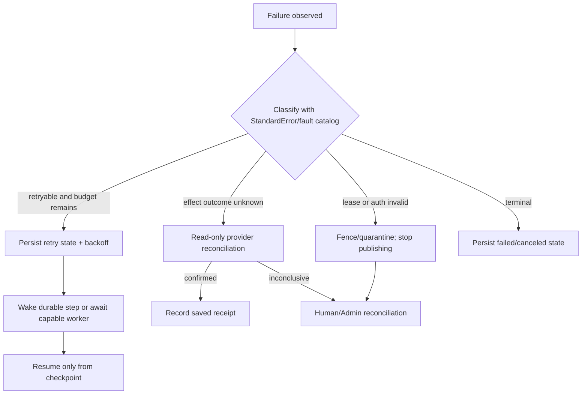
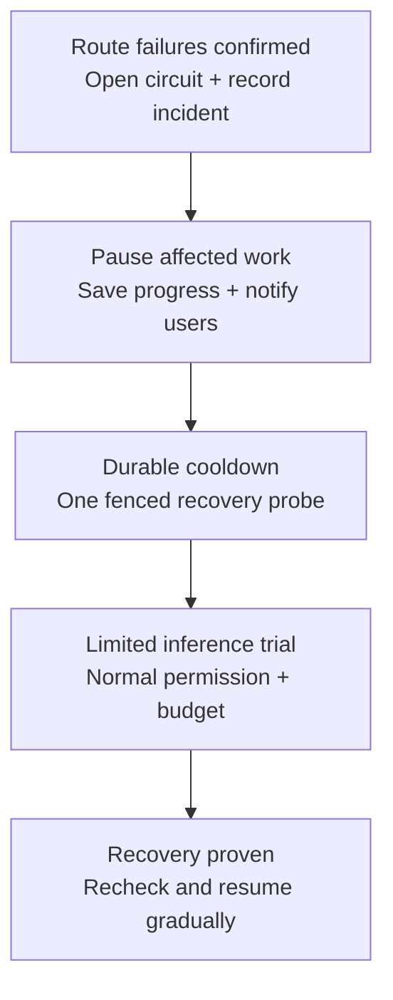
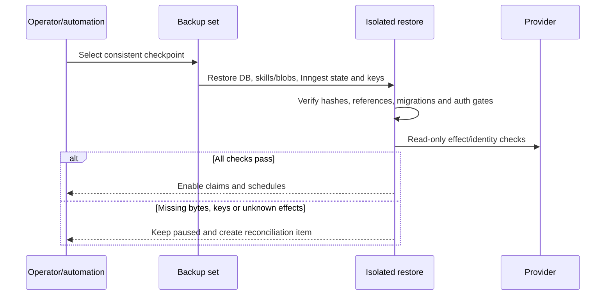

# Recovery and failures

Status: design proposal. This chapter defines how Bakery reports, retries and recovers failures across the control service, Inngest, workers, harnesses, storage and providers. It reuses the fault registry and RFC 9457 mapping in [Standard errors](12-standard-errors.md); it does not introduce another exception hierarchy or claim runtime proof.

## Operating rules

1. Postgres is the authority for task, run, job, attempt, lease, event, artifact, effect and reconciliation state. Inngest retries and wakes durable steps, but never makes a shell command or provider write exactly once.
2. Every failure has a durable state, a stable Problem code where it crosses a boundary, a correlation ID, and a next action. Logs may contain redacted diagnostics; user detail never contains credentials, prompts, source, SQL or provider bodies.
3. Retry only a classified retryable fault (`DEPENDENCY_UNAVAILABLE`, `DEPENDENCY_TIMEOUT`, `WORKER_UNAVAILABLE`, `REVIEWER_UNAVAILABLE` or `RATE_LIMITED`) and only while the run, attempt, wall-clock and cost budgets permit. Although the catalog marks `PROVIDER_QUOTA_EXCEEDED` retryable, runtime scheduling waits for a known reset or an explicit user-selected authorized route; it is never a blind retry. Use durable `next_retry_at` plus bounded exponential backoff and jitter.
4. Cancellation is an authoritative Bakery transition and a best-effort process signal. A late result cannot reopen a canceled run. Lease loss fences publication before any replacement attempt starts; no shutdown or network grace permits a mutation after the lease expires.
5. An effect submitted before a timeout is recorded as `external_effects.status=uncertain` until read-only reconciliation by its stable effect key and provider identity. The system never “retries just once” to manufacture exactly-once behavior.



The client receives actual resource states through REST and the existing `/v1/events` notification stream. Friendly labels map to the wire model: workflow runs use `waiting_capacity` for unavailable workers, `paused` for operator/system pause, `blocked` for a policy/dependency stop needing intervention, `waiting_input` for a question, and `canceling` before `canceled`; jobs use `queued`, `leased`, `running`, `awaiting_reconciliation`, `completed`, `failed` or `canceled`; job attempts use `lost` or `quarantined`; external effects use `uncertain`. A notification is an invalidation/cursor hint; the client refetches authoritative state. A sleeping mobile browser uses `/v1/sync` and cursor replay after wake.

During a control-service or database outage, the UI shows **Connection unavailable** and its last confirmed state. It cannot claim a new persisted `paused` transition until a server transaction succeeds. Pending local input stays visibly unsaved; failure facts are reconciled when storage returns.

## Failure taxonomy and handling

| Failure | Detector | Safe automatic action | User status and notification | Retry, cancel, reconcile or escalate |
|---|---|---|---|---|
| Control service or worker process crash | Supervisor exit status plus missed heartbeat/lease sweep | Stop new claims; restart the supervisor; preserve spool, checkpoint and worktree quarantine | Host `offline`, attempt `lost`, workflow `waiting_capacity` when replacement capacity is needed; notify when a run needs attention | Reconcile local processes and worktrees, then resume from a matching checkpoint under a new fence; otherwise create a new attempt |
| Network loss or timeout | HTTP timeout, connection reset, or repeated failed heartbeat | Bound request retries; stop new claims; keep a bounded local journal and active process only while its lease remains valid | Workflow `waiting_capacity` or `paused`, with retry time; no false “saved” output | Replay immutable unacknowledged events; if a provider call may have landed, set the effect `uncertain` and reconcile |
| Postgres unavailable or transaction rollback | Connection/transaction error and health check | Do not acknowledge writes; pause dispatch and claims; preserve local evidence | Workflow `paused`; request surfaces `DEPENDENCY_UNAVAILABLE`/`DEPENDENCY_TIMEOUT` with retry guidance | Retry safe reads/writes after backoff; an outbox or result without commit is not accepted; escalate after budget exhaustion |
| Inngest unavailable, duplicate invoke, or lost wake | HTTP invoke failure, durable run inspection, or outbox lag | Keep the Bakery row/outbox; deduplicate by stable run/job key; continue only from persisted state | Run remains `queued`; show engine lag rather than failure if the job is intact | Dispatcher retries event publication; re-read job state before materializing; reconcile orphaned outbox entries |
| Provider/model quota | Verified quota rejection mapped to `PROVIDER_QUOTA_EXCEEDED` | Checkpoint affected work; keep unrelated routes running; stop wasteful retries | `waiting_capacity` for a known reset, otherwise `blocked`; send **Switch model/provider**, **Keep waiting**, **Reconnect/top up**, or **Cancel** choices as applicable | Resume after capacity returns or an authorized switch; label unknown usage/reset times honestly |
| Bakery budget cap | Atomic run/installation reservation refusal: `BUDGET_CAP_EXCEEDED` | Stop new spend under that cap; preserve evidence and existing holds | `blocked`; show exhausted budget scope and **Review budget**, eligible cheaper routes, **Keep waiting**, **Cancel** | A model switch still needs a valid reservation; it cannot bypass the cap. Budget changes need the existing Admin/policy authority |
| AI provider/API outage | Repeated classified 5xx, transport failures or timeouts; status-feed corroboration where available | Open the affected route's circuit; checkpoint and pause dependent work; bound probes and resource use | Provider incident banner + one actionable alarm; `waiting_capacity` while automatic recovery is eligible, otherwise `blocked` | One durable probe per affected route, gradual recovery, or explicit model/provider switch; do not restart or fail the whole factory |
| Invalid, incomplete or unsafe harness output | Adapter schema/size/exit validation, required artifact/evidence check | Reject publication; retain only a bounded redacted diagnostic artifact; terminate the attempt if unsafe | `failed` with `VALIDATION_FAILED` or the registered action fault and evidence link | A bounded repair may rerun from the last checkpoint; repeated bad output escalates to review, never marks success |
| Lease expiry, stale worker or fence mismatch | Server-side lease/fence check on every mutation | Return `LEASE_EXPIRED`/`LEASE_FENCED`; stop and quarantine the old process/worktree; release no evidence as current | Attempt `lost` or `quarantined`; workflow `waiting_capacity` while a replacement is eligible; notify only if recovery is blocked | New attempt gets a new fence; duplicate committed event may replay its saved acknowledgement; unseen stale output is discarded |
| Unknown external effect (push, merge, deploy, integration write) | Connection failure after submission, missing receipt, or provider ambiguity | Set `external_effects.status=uncertain`; freeze that effect key; block duplicate mutation; keep before/after evidence | Workflow `paused` or `blocked` with provider/action identity and a clear operator action | Use existing `integrationEffects.reconcile` where applicable, or the provider's equivalent read-only lookup; record confirmed receipt, or require Admin decision if inconclusive |
| Session, grant or worker credential revoked | Auth check, membership/installation state, or credential generation mismatch | Reject new work; close affected subscriptions; fence active attempts where authorization no longer holds | Workflow `blocked` with `AUTH_REQUIRED`, `AUTH_FORBIDDEN` or `AUTH_EXPIRED`; show which grant/host is revoked | Re-authenticate or re-pair through the existing enrollment flow; never revive an old bearer credential |
| Skill/blob missing, corrupt, traversal or hash mismatch | Manifest/file authorization and SHA-256 verification before materialization | Do not execute; delete only the incomplete temporary tree; retain the immutable version/tombstone | Missing/transient fetch is workflow `waiting_capacity` with `DEPENDENCY_UNAVAILABLE`; hash/traversal failure is workflow `blocked` and `SKILL_CONTENT_INTEGRITY_FAILED` | Retry missing/transient fetch within budget; a hash/traversal mismatch is terminal for that pinned version, quarantine it and escalate to its owner |
| Backup, restore or storage corruption | Restore hash check, missing referenced object, or failed volume check | Keep admission paused; restore into isolation; do not run effects against a partial restore | Workflow `paused` with measured checkpoint and missing reference counts | Verify Postgres, skills/files and Inngest persistence together; enable work only after all references and keys pass |
| Deployment or self-repair failure | Health check, migration gate, or canary timeout | Retain prior known-good release; stop new delivery effects; use independent bootstrap path | Workflow `paused` or `blocked`; notify Admin with release and health correlation | Roll back to the known-good release only after read-only checks; repair in a fenced attempt; never let a model weaken gates |

The worker and server treat `SIGTERM` as a drain request: stop claims, checkpoint or cancel within the remaining valid lease, flush unacknowledged journal entries for a bounded period without extending the lease, and exit. A forced kill is equivalent to a crash. A process cannot prove remotely that it died, so an expired worktree remains quarantined until the coordinator or host supervisor reconciles it.

## Quota notifications offer a real choice

Send an actionable Bakery notification when a quota or budget stop affects work. Web, desktop and Slack use the same question/answer and authorized-operation path; future chat adapters inherit it. No LLM call is needed to detect the failure, compose the message or handle the choice.

```text
Illustrative notification — values come from current evidence:
“Codex subscription usage is exhausted. Three tasks are waiting.
Pi via OpenRouter is configured for these tasks. Review its selected
model, available credits and estimated cost before continuing.”

[Switch model/provider]  [Keep waiting]  [Cancel]
```

The switch sheet lists **model, provider, harness, billing route, capability fit, estimated incremental cost, and usage evidence with its timestamp**. Claim “usage left” only when an authorized provider/harness report supports it; otherwise say **Usage unknown**. A successful health probe does not establish remaining credits or subscription capacity. Hide inaccessible accounts; a different model using the same exhausted account may offer no relief. Show the proposed scope: this task or an explicitly selected set of affected tasks. Do not silently change future defaults.

On selection, recheck current actor/organization, repository permissions, configured model and harness compatibility, data-sharing policy, fresh pricing and both budget ledgers. A Developer may select an already permitted route; expanding provider grants or budget ceilings follows the existing Admin policy. The prompt authorizes only the displayed selection. A Slack button carries a signed/opaque choice reference, never trusted billing or authorization fields.

**Switching is a continuation, not mutation of an old snapshot.** Preserve the original run/attempt, artifacts, effect keys and usage records. Stop/fence its active producer, reconcile uncertain effects, and create a linked continuation with a newly pinned agent/model/provider/harness/billing binding and fresh budget reservation. Reuse only completed evidence still valid for that continuation. A new provider starts a fresh session from the bounded handoff, not an incompatible native transcript. Unknown usage from a timed-out call remains reserved/reconcilable; switching never erases that liability. Retry delivery of the same switch choice cannot create two continuations or reservations.

The shared question records one authoritative answer. The continuation admission also checks run state and the incident generation: if recovery already resumed the original run, or another user canceled/switched it, the stale choice commits nothing and displays the current state. Recovery automatically withdraws an obsolete switch question. **Keep waiting** preserves eligibility for automatic recovery within the remaining policy limits; an operator pause or cancellation is never undone by a health signal.

## Provider outages stay isolated

Use the circuit-breaker pattern: normal calls when closed, fail fast while open, then a limited recovery trial before normal traffic returns. This prevents requests to a failing dependency from occupying all capacity. Retry and circuit breaking serve different purposes. [Circuit-breaker pattern](https://learn.microsoft.com/en-us/azure/architecture/patterns/circuit-breaker)

### Detect the narrowest affected route

A route identifies the configured provider endpoint/region, model, harness path and credential binding, scoped to the organization. Record bounded safe error/latency evidence and deduplicate observations. Start with that route; one worker's broken network, one expired credential, a 429 rate limit, a quota refusal or a malformed prompt must not declare an entire AI company down. Provider status pages corroborate incidents but neither prove account/model availability nor authorize recovery.

Proposed initial policy: three consecutive transport/timeouts or qualifying 5xx within 60 seconds opens that route's circuit. A trusted explicit unavailability signal can open it sooner. Classifiers exclude authentication, validation, quota and ordinary throttling errors. Label local evidence **Cannot reach this route** or **Suspected outage**; use **Provider-reported outage** only with corroboration. Broader installation-wide route blocks require independent evidence; organization alarms never reveal another organization's accounts or tasks.

### Pause work without consuming the factory

- Stop admission of affected model calls and jobs; preserve queued tasks, committed checkpoints, artifacts, output cursors and usage. Healthy providers, deterministic tests, repository browsing, intake, comments and other independent workflow branches continue.
- If the cloud coordinator's model is unavailable, accept and queue chat input with **Waiting for provider**. Deterministic switch/cancel/status controls still work; do not promise an immediate agent reply.
- Bound network concurrency, deadlines, streaming idle time and queue capacity per route. An open circuit returns the existing safe `DEPENDENCY_UNAVAILABLE` fault promptly; it does not hold a database transaction, HTTP request, worker slot or Inngest execution slot while waiting. Provider health does not fail Bakery's own readiness probe.
- For an in-flight harness, retain acknowledged output and attempt a safe checkpoint under its valid lease. If it cannot stop/resume safely, fence/quarantine it and use the last committed handoff; do not declare a partial answer complete. Native harness retries must obey the same route budget rather than amplify supervisor retries.
- Do not automatically mark timed-out tool/provider effects failed or release unknown usage holds. Those remain subject to effect and billing reconciliation even after the API returns. Wall-clock/attempt/spend limits remain in force; an expired run becomes blocked for an explicit continuation decision.

### Poll once, recover gradually

Store route state, incident generation, evidence watermark and `nextProbeAt` in Postgres. Inngest owns the durable wake/sleep; the existing maintenance scan can recover a missed wake. Use one short leased probe per route across all control processes/hosts, with a generation/fence check when saving its result. No per-task polling loops, new monitoring service or browser-dependent timer is needed. Durable `step.sleepUntil` releases execution between wakes. [Inngest durable sleep](https://www.inngest.com/docs/reference/typescript/v4/functions/step-sleep-until)

Start probes after 30 seconds; double on failure to a five-minute ceiling with jitter. Honor a provider's later `Retry-After`. Use a ten-second deadline for a documented non-generative health read, plus a bounded probe allowance independent of waiting-task execution. Stop probes when the route is revoked/disabled, the incident is superseded, or no active monitoring/waiting work remains. Repeated failure updates the existing incident and schedules its next check.

Prefer a documented safe health check on the configured endpoint. A green status page or `/models` response is only reachability evidence. To prove the required inference path, admit one already-authorized queued request as the half-open trial under its normal action deadline and reservation. Never make unbudgeted synthetic generation calls or repeat a tool effect as a probe. Persist a successful trial's normal result once; do not execute it again after recovery. If no suitable trial exists, show **Reachable; inference unverified** and defer proof to the next authorized request.

Subscription or harness-only routes use their authorized adapter on an eligible worker for the trial. Do not substitute a paid API route for Codex subscription execution. If that worker is unavailable, report missing worker capacity rather than declaring the provider down.

Two successful consecutive inference trials close the circuit; reopen on failure. Release eligible waiting work gradually up to the configured route concurrency, not all at once. At admission recheck cancellation, operator pause, grants, model binding, budget, revision evidence and unresolved effects. Claim/continuation arbitration admits only one producer even when a health wake races a user switch. Resume from the durable boundary with the original binding, unless an explicit switch already won. Inngest retries reuse saved steps, but external work still needs Bakery's idempotency/effect rules. [Inngest retry boundaries](https://www.inngest.com/docs/guides/error-handling)



Failed probes loop through the durable cooldown. The **Switch model/provider** action can start an authorized continuation while that route remains down. It never bypasses budget, effect or session-handoff checks.

### One alarm, useful updates, one recovery notice

The “fire alarm” is one durable incident per affected route/generation, projected to authorized impacted users and the configured Admin notification destinations. It shows severity, affected tasks, first/last failure, last/next probe and **Switch model/provider**, **Keep waiting**, **Cancel** or **View incident**. High-impact outages get a prominent banner and the configured urgent notification policy; a single transient error stays in task status.

Deduplicate by incident/recipient/destination. Notify on opening, material scope/severity change and recovery; an acknowledged unchanged outage does not emit another message on every poll. If a configured escalation deadline passes, send one escalation for that level. Recovery withdraws stale choices and reports resumed, switched and still-blocked counts. Phone and desktop expose the same actions; chat providers link to the same scoped incident.

Notification delivery uses the existing outbox/effect path, independent of the failed AI provider. If Slack is also down, the incident remains in Bakery's durable inbox/banner and outbound delivery retries within its own limits; it does not recursively generate alarm storms. Outbound messages require configured destinations and grants. Record route availability, time paused, probe count/latency/cost, notification delivery lag, switches and resume success without prompts, credentials or raw provider errors in telemetry.

## Recovery and reconciliation flows

### Worker restart

```text
start under systemd/launchd
  -> load credential and registration generation from host secret storage
  -> authenticate heartbeat; if revoked, stop and show pairing required
  -> list local sessions, child processes, worktrees and bounded spool
  -> compare each identity with current Bakery attempt/fence/checkpoint
  -> kill/quarantine unknown or stale processes
  -> replay unacknowledged immutable events with unchanged IDs after the server's contiguous ack prefix; request checkpoint for gaps
  -> claim new work after health and capacity are accepted
```

The worker never treats an old assignment on disk as permission. A checkpoint must match host identity, attempt/fence, worktree revision and harness session where available. Resuming a harness does not authorize repeating an uncertain provider effect.

### Machine readiness, enrollment races and re-pair

`worker_hosts.credential_generation` gates machine authority the way `current_fence` gates attempts. Every machine report — heartbeat check, `worker.reportInventory`, provider-auth report — carries the host generation and expected inventory revision; a report from a superseded generation, an expired check or a mismatched inventory revision is rejected before any state change and can never restore readiness. Check freshness (generation = current credential generation, inventory revision = current, `expires_at > now`) is required to plan new claims; a fresh failed `credential_isolation` (or other non-capability) check blocks all claims, a fresh failed `capability:<cap>` check blocks that capability only, and missing checks leave readiness `checking`. A host whose required checks cannot be restored in the same organization transaction remains blocked; there is no automatic host fallback across organizations or platforms.

Enrollment consumption, Admin cancel and `workerEnrollments.replace` run in one locked transaction per enrollment: exactly one of registration, cancel or replacement wins, losing writers observe the final state without a second usable token, and a consumed enrollment is `STATE_CONFLICT` with no identity leak. An expired predecessor is never reissued a token; it stays an expired audit record. Admin re-pair (`workers.repairEnrollment`) rotates the credential generation atomically against the exact revoked host and expected generation: the new generation starts paused/checking, the old generation is permanently revoked, and reports bound to it are discarded. Terminal `workers.revoke` invalidates the credential generation and desired mode (`revoked`) even when the host is offline — that cleanup is recorded as unconfirmed, never assumed complete.

Provider-auth completion follows the same generation discipline: a completion report from the wrong binding, a stale attempt generation or a non-active attempt returns `AUTH_FORBIDDEN`/`STATE_CONFLICT`; replay of the identical report returns its saved acknowledgment, and identity binding happens once inside one organization transaction.

### Event, output and effect recovery

Worker events retain `(attempt_id, local_seq, event_type, payload_digest)`. An identical committed duplicate returns its original `WorkerAck`, including the saved contiguous highwater, even if the lease later expires. A changed duplicate is `IDEMPOTENCY_PAYLOAD_MISMATCH`; an unseen event with stale proof is `LEASE_FENCED`; a gap is `EXPECTED_SEQUENCE`. Output batches follow the same journal transaction and bounded spool rules in [Workflows and delivery](06-workflows-delivery-and-acceptance.md).

The effect ledger records an immutable effect key, operation/version, target identity, authorization revision, before evidence, provider receipt or unknown state, and reconciliation attempts. Reconciliation is read-only until the provider identity is confirmed. Absence from one list endpoint is not proof that a write did not happen; use the provider's supported lookup/read-after-write contract and retain the query evidence.

A live effect pins its run-step budget reservation against budget **recovery**. Live means `submitted` or `uncertain` (the write may have reached the provider), or `prepared` while its reservation is unexpired; a `prepared` effect on an expired reservation never pins, because claim fails it before any send: with `budget_reservation_expired` while the reservation is still held, or with an earlier admission code once recovery has released it (`job_terminal`, since a release needs failed-job evidence, else `budget_reservation_not_held`). The expired-release and provider-receipt candidate queries skip a reservation a live effect pins, and `releaseWorkflowAction` and the receipt reconcile path refuse with `STATE_CONFLICT external_effect_in_flight`, so money never moves under a write that may have reached the provider. The worker's own terminal result is not refused: it settles its usage as usual, because an effect that stays uncertain (truncated pages, a copied marker, a revoked grant) must never make a job's result unresolvable. Read-only reconciliation keeps checking an uncertain effect; one it can never prove keeps pinning recovery (not the job's result) until an Admin decision records its outcome, which the operator surface for consumer wiring provides.

Budget admission binds each model action to a server-owned pricing snapshot and
provider-call intent. Worker-reported cost is not provider authority: a known
receipt settles only when a trusted provider receipt matches the immutable call
intent, billing identity and usage fact, and the durable usage provenance is
`provider-authoritative`. Legacy worker-known rows migrate as
`worker-unverified` and remain outside authoritative totals until an exact
receipt-driven reconciliation promotes them. An unknown worker result keeps
both holds; the scheduled reconciliation owner may settle it only from that
provider receipt. Reading that original unknown receipt by its canonical digest
preserves its original timestamp, measurement and worker-unverified provenance
after reconciliation; the reconciled digest identifies the authoritative measurement.

Release after a pre-dispatch rejection requires a persisted server-owned
evidence ID bound to the exact failed job/version, reservation, effect identity
and `workers.claim.assignment_payload_rejected` audit with outcome `denied` and
the same version. The claim transaction creates that proof only for its own
action/agent/run/step intent, with no attempt ever created and a pending,
unbound provider call. A prior lost attempt, a bound call, a foreign reservation,
expiration or terminal workflow status is not release authority.

Proof creation and release lock the job and its exact intent before reservation
or provider-call state; provider binding takes the same intent lock and requires
it still be held. Evidence is immutable, so replay reads it without requesting
update privileges and validates its full identity before touching either
account. PostgreSQL owns structural foreign keys and uniqueness; TypeScript owns
state, positive-version, effect and digest validation. Recovery handles each
candidate in its own transaction and counts successes only after commit.
Live pricing ingestion, dispatch binding and authoritative-receipt writes still
require the provider adapter; local fixtures do not establish paid-execution
authority.

### Backup and self-repair

The recovery set is the Bakery Postgres backup, complete filesystem or R2 skill bytes, Inngest engine persistence, deployment configuration and the key material required to decrypt secrets. A database-only restore is incomplete when a row references skill/blob bytes. Restore into an isolated environment, verify every referenced digest and secret-key availability, run read-only health checks, then resume scheduling and imports in order:



Self-repair is bounded and revisioned: choose a known-good release, run health checks, and record the repair attempt. It may repair a failed service, replay a safe outbox item or rebuild an unreferenced cache. It may not rotate credentials, broaden scopes, repeat an unknown provider effect, delete referenced evidence or mark a run complete without the normal gates. RPO/RTO, backup cadence, retention and restore duration remain measurements required by the readiness gate.

A backup can predate successful provider writes. Fence every pre-restore producer and hold dispatch for the entire interval from the backup cutoff to the outage. Reconstruct missing effect identities/receipts from provider evidence before releasing affected jobs. If that evidence is unavailable, leave those actions blocked for operator reconciliation; restoring an older database cannot prove that its apparent pending action is safe to repeat. The RPO permits data loss, not silent duplicate merges, deployments or messages.

## Contract and proving deltas

The live catalog already models `workers.enroll`, `worker.register`, `worker.heartbeat`, `worker.claim`, lease/fence event/result routes, `workers.update` statuses (`online`, `offline`, `draining`, `revoked`), `integrationEffects.reconcile` at `POST /v1/integration-connections/{id}/effects/{effectId}/reconciliations`, and the shared StandardError registry. The following recovery details are design deltas and are not yet generated into the catalogs:

| Delta | Current contract | Required before implementation claims completion |
|---|---|---|
| Recovery projection | Existing run/job projections carry workflow and attempt states; no dedicated recovery projection | Decide whether existing run/job projections plus audit/effect reads are enough; otherwise add a scoped read/resolve operation and Problem-safe projection with recursive descriptions |
| Provider health and incident | No route-health/probe/incident contract yet | Add scoped route state, incident generation, evidence, leased probe ownership/expiry, next probe time and notification dedupe. Reuse Postgres, Inngest and existing outbox; no new service |
| Model/provider switch | `runs.control` only supports pause/resume/cancel/interrupt; `RunRetry` has no model override | Register a typed continuation/choice contract with exact source run/step, incident generation, proposed binding, budget check and atomic single-winner admission. Preserve old snapshots and lineage; never smuggle billing overrides through `reason` or arbitrary JSON answers |
| Credential rotation | `workers.update` can revoke/status-change a host; generation is exposed in `WorkerHost` | Reconciled in the catalogs as part of issue 59: `workers.repairEnrollment` issues an exact-host, expected-generation re-pair token and `workers.revoke` performs terminal revocation with generation fencing; refresh the ERDs when hand-editing this model |
| Daemon diagnostics and maintenance | Heartbeat returns task commands/acks, not typed check/inventory or host-maintenance reports | [Machines](21-machines.md) specifies bounded checks, separate maintenance assignments/receipts, idle waiting, self-update recovery and safe provider-binding health; `worker.reportInventory` and the new `worker_inventory_replays` ledger are reconciled in the issue-59 catalogs, while maintenance operation contracts remain to reconcile before implementing the new screens |
| Failure events | Worker/domain event keys cover execution lifecycle; recovery notification names are not complete | Reconcile event names/payloads in `transport-schemas.json` before code generation; do not invent ad hoc UI-only events |
| Backup proof | Readiness marks recovery unrun | Run isolated restore, reference/hash verification, key availability and no-external-replay checks with measured RPO/RTO |

Required runtime checks remain unrun: crash during a transaction and during an Inngest wait; worker kill after checkpoint; duplicate/out-of-order events; lease expiry and stale fence; cancellation while offline; quota/budget exhaustion; corrupt skill/blob; provider timeout after acceptance; credential revocation during download; backup restore; and last-known-good self-repair. Passing the documentation/catalog checks is not evidence for these behaviors.

Provider acceptance adds: one route down while another and Bakery remain available; scoped quota/auth failures do not open a global circuit; one probe survives duplicate wakes and coordinator restart; a stale probe cannot close a newer incident; no hot retry loop or occupied waiting slot; no probe spend outside policy; status-page recovery alone cannot release inference work; gradual recovery preserves checkpoints; revoked/canceled/operator-paused work stays stopped; unknown usage/effects survive a switch; concurrent recovery/switch/cancel admits one outcome; stale/duplicate chat choices cannot charge twice; unavailable Slack leaves a visible durable alarm. These are design requirements, not live outage tests already run.
