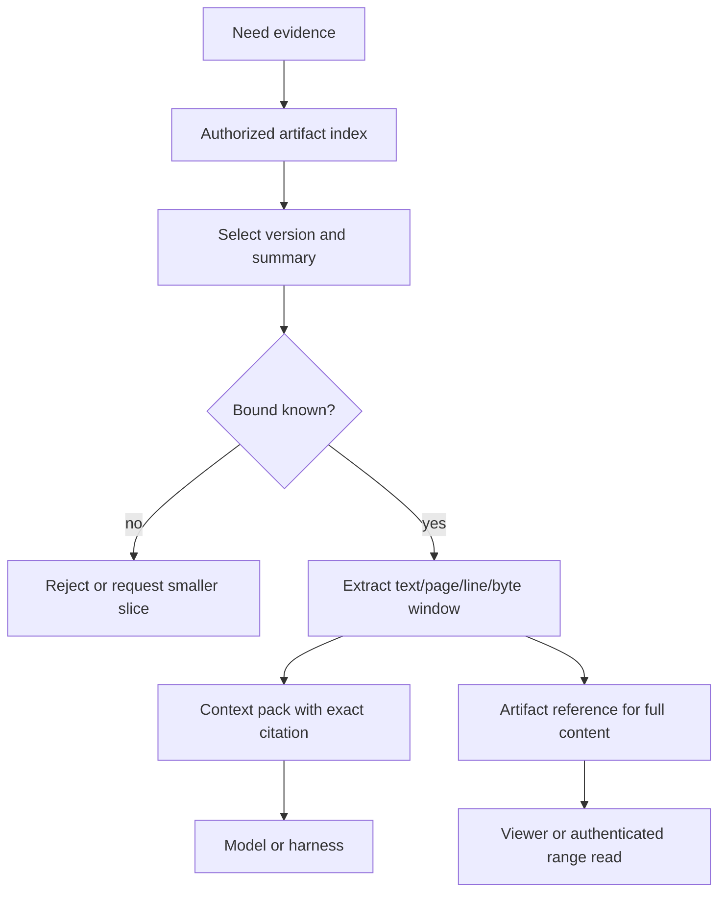
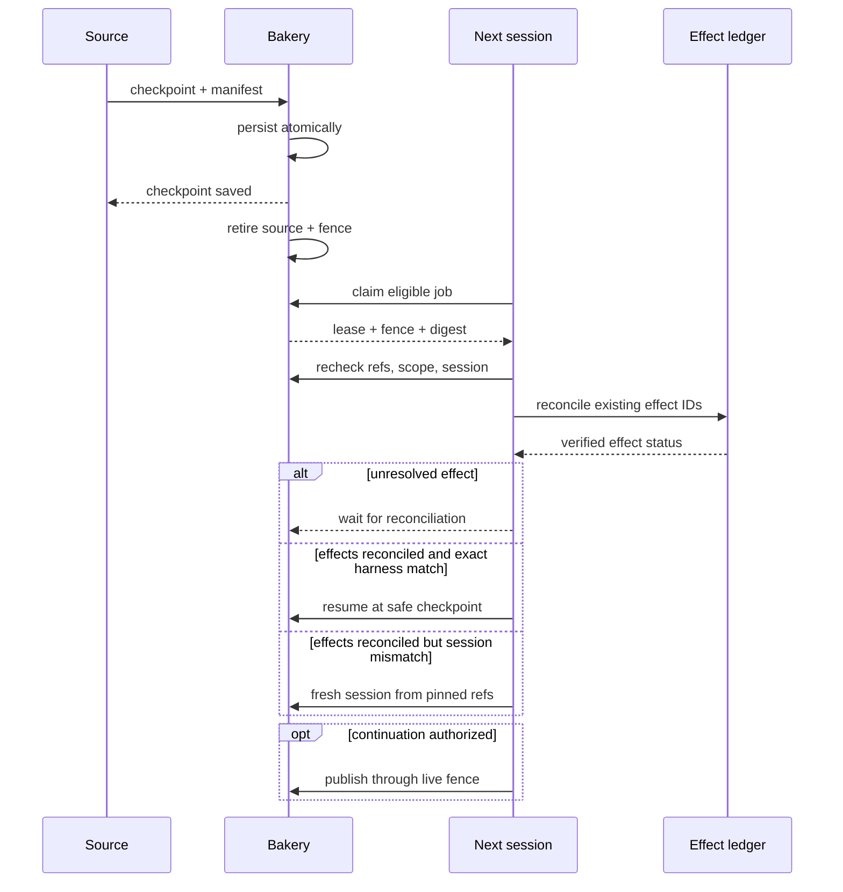

# Context engineering and session handoffs

Status: proposed design-map extension on 7 September 2026; implementation and
catalog registration are pending. This chapter defines how Bakery keeps useful
context inside a model and harness budget, carries artifact evidence between
sessions, and resumes interrupted work. It does not claim that a harness,
provider, or model currently implements these contracts.

## Context is a measured budget envelope

Bakery does not put the whole conversation, repository, skill directory, tool
catalog, or artifact store into every prompt. A run resolves a budget envelope
from the selected provider/model, harness, agent version, workflow policy, and
current capability grants. The envelope records the model-reported limit and
what Bakery has actually measured, estimated from bounded metadata, or cannot
yet know. Unknown input is a blocking condition for an unbounded read; it is
never silently counted as zero.

```json
{
  "modelContextTokens": 128000,
  "counts": {
    "conversation": { "state": "measured", "tokens": 6800 },
    "instructions": { "state": "measured", "tokens": 2100 },
    "toolSchemas": { "state": "estimated", "tokens": 3200 },
    "artifactSlices": { "state": "measured", "tokens": 10400 },
    "harnessOverhead": { "state": "unknown", "tokens": null }
  },
  "reserved": {
    "output": 12000,
    "toolResults": 16000,
    "compaction": 10000
  },
  "decision": "bound-more-before-dispatch"
}
```

`available = modelLimit - measuredOrEstimatedInput - reservedOutput -
reservedToolResults - reservedCompaction - configuredSafetyMargin`. Bakery
must reserve space for tool results and a safe compaction boundary before it
admits a new slice. A tool result is budgeted before dispatch where its bound is
known, and is truncated or stored as an artifact when it exceeds that bound.
The model or harness may reject a request earlier; this envelope is an
admission policy, not a guarantee of successful inference.

The "smart zone" is the configured operating band in which there is enough
headroom for the next response, bounded tool results, and compaction. It is
derived per model and harness from measured usage and failure telemetry. There
is no universal fixed percentage, and Bakery makes no claim that a request is
always smart merely because it fits a nominal context window. A near-limit
request becomes `needs_bounding`, asks for a narrower slice or a summary, and
can pause for user input when the required evidence cannot be bounded safely.

Tool and skill schemas use the same diet. The initial context contains only the
tools allowed for this step, short descriptions, input/output limits, and
operation IDs. Full skill files, references, and rarely used tool details are
discovered by index and fetched on demand. A schema is not an authorization
grant: every invocation rechecks the live resource grant and attempt fence.
Private skill/plugin bytes remain in their configured R2 or local filesystem
store; only bounded, authorized extracts enter context.

## Retrieve indexes, then bounded evidence

An artifact reference is the unit of continuity. Retrieval first lists the
authorized artifact/version metadata and summaries, then selects bounded
windows. Every excerpt carries the exact version, SHA-256, and location needed
to cite it. `current_version_id` is resolved once when admitting a step; a
retry uses the pinned version. MCP resources are compatible with this pattern:
the current specification leaves context inclusion application-driven and
supports pagination, resource annotations, and binary resources, while
requiring URI validation and permission checks. Bakery therefore passes a
resource URI or authenticated range request to the host and does not inject
base64 blobs into a model prompt. [MCP resources](https://modelcontextprotocol.io/specification/2026-07-28/server/resources)



Selection rules by media type:

| Input | Context projection | Full-content behavior |
|---|---|---|
| Markdown, text, patch | Heading/section index, bounded lines or byte ranges, surrounding context, digest | Viewer or authenticated range read; comments retain original version and anchor |
| Large log | Error windows, first/last bounded lines, time/sequence index, truncation marker | Publish bounded windows and summary artifacts; v1 rejects one general blob over 10 MiB |
| Image | Dimensions, media metadata, thumbnail or selected crop, optional explicit vision input | Keep original as an artifact; never convert the whole file to prompt base64 |
| PDF | Page count/metadata, extracted text for selected pages, selected page image when needed | Keep original; cite page and byte range, fetch only authorized ranges |
| Unknown/binary | Safe metadata and an artifact reference | Download/view only after authorization; no model bytes by default |

Extraction is a derivation, not a new source of truth. A derived summary,
thumbnail, OCR result, or page-text artifact records its source artifact
version, source SHA-256, extractor identity/version, and bounded output size.
If extraction fails or is stale, Bakery marks that fact and asks for another
bounded projection rather than presenting an unverified summary as original
content. User-authored text remains in its source language unless translation
is explicitly requested.

The context pack is intentionally small and replaceable:

```text
contextPack
  goal and required output
  resolved model/harness + budget envelope
  minimum conversation cutoff and selected messages
  allowed tools: id, short description, limits, grant hint
  artifact refs: artifactId, versionId, sha256, summary, citation slices
  repository: repositoryId, commitSha, safe paths only
  unresolved questions and decisions
```

The pack is a view over durable records, not a second transcript. Raw tool
arguments, credentials, session files, headers, hidden reasoning, and provider
errors are excluded. A context citation is immutable enough to reproduce:
`{artifactId, versionId, sha256, mediaType, location, extractorVersion?}`.

Admission may batch small metadata reads. Bounded immutable extracts can be
cached for the current session by `(organization, version, digest, range,
extractorVersion)`, avoiding repeated byte reads while preserving exact
citations. The cache never stores authorization decisions: every retrieval
rechecks live grants and expiry. This design adds no Redis requirement; the
existing application cache or worker-local cache may hold bounded extracts.

## Session continuity has two explicit modes

Bakery separates a fresh session from an exact harness resume. A fresh session
starts a new process/session with a durable goal, decisions, pinned artifact
references, repository revision, and next action. It may use a different
harness only after normal capability and authorization resolution. An exact
harness resume is allowed only when the harness session identity, pinned
agent/workflow/harness versions, host, worktree/repository revision, checkpoint
digest, and required capabilities all match the manifest. A provider's ability to accept a
`resume` flag is evidence of an adapter feature, not proof that the whole Bakery
run is resumable.

Exact resume must not replay historical content that is no longer authorized.
If a grant narrows, an artifact is revoked, or the native session cannot prove
its historical context scope, Bakery abandons exact resume and starts a fresh
session from currently authorized refs. Tool-call authorization alone cannot
erase already loaded native context, so the fresh-session boundary is required.

The existing `agent_sessions` row remains the identity for a cloud or worker
harness segment. Its `resume_ref` is an opaque, encrypted or redacted adapter
reference when sensitive; `workflow_runs.snapshot` remains the immutable run
configuration; `run_steps.input/output` contain refs and small summaries.

### Worker handoff manifest (proposed)

The following is a worker-specific bounded handoff shape. It is an extension
and is not yet in `transport-schemas.json` or `api-catalog.json`. Cloud
conversation generation remains represented by server-owned
`conversation_turns.context_through_sequence` and the `agent_sessions` row;
it does not require copying a worker transcript into a new session.

```json
{
  "manifestVersion": 1,
  "mode": "fresh_session",
  "taskId": "uuid",
  "runId": "uuid",
  "runStepId": "uuid",
  "sourceSessionId": "uuid",
  "agentVersionId": "uuid",
  "workflowVersionId": "uuid",
  "harness": "codex",
  "harnessVersion": "pinned-version",
  "repository": {
    "repositoryId": "uuid",
    "commitSha": "40-hex",
    "baseSha": "40-hex",
    "worktreeId": "opaque-id",
    "workspaceManifest": { "artifactId": "uuid", "versionId": "uuid", "sha256": "64-hex" },
    "uncommittedPatch": { "artifactId": "uuid", "versionId": "uuid", "sha256": "64-hex" },
    "binaryChanges": [{ "artifactId": "uuid", "versionId": "uuid", "sha256": "64-hex" }],
    "captureStatus": "complete"
  },
  "goal": "Complete the bounded implementation step and publish evidence.",
  "decisions": ["Use the pinned plan revision.", "Do not repeat uncertain effects."],
  "context": {
    "conversationId": "uuid",
    "throughConversationSequence": "42",
    "artifactRefs": [{ "artifactId": "uuid", "versionId": "uuid", "sha256": "64-hex" }],
    "packDigest": "64-hex"
  },
  "tests": [{ "command": "deno test ...", "result": "passed", "evidenceVersionId": "uuid" }],
  "pendingEffects": [{ "effectId": "uuid", "state": "uncertain" }],
  "nextAction": "Reconcile the effect ledger before any provider retry.",
  "checkpoint": { "sequence": "19", "digest": "64-hex", "safeBoundary": true },
  "grants": { "scopeDigest": "64-hex", "recheckOnResume": true }
}
```

The implementation shape must preserve descriptions recursively. This
illustrative Zod sketch is deliberately uncataloged; every field and composed
schema carries its purpose so generated metadata cannot lose provenance or
security meaning:

```ts
const ArtifactRef = z.strictObject({
  artifactId: z.string().uuid().describe("Stable task-owned artifact identity."),
  versionId: z.string().uuid().describe("Immutable artifact version pinned for this handoff."),
  sha256: z.string().regex(/^[0-9a-f]{64}$/).describe("Server-computed digest of canonical artifact bytes.")
}).describe("Authorized immutable artifact reference; it never embeds artifact bytes.");

const Sequence = z.string().max(19).regex(/^(0|[1-9][0-9]*)$/)
  .refine(value => value.length < 19 || value <= "9223372036854775807")
  .describe("Canonical nonnegative decimal sequence bounded to a signed Postgres bigint.");

const HandoffManifest = z.strictObject({
  manifestVersion: z.literal(1).describe("Version of this bounded handoff format."),
  mode: z.enum(["fresh_session", "exact_harness_resume"]).describe("Whether to start a new process or resume a matching adapter session."),
  taskId: z.string().uuid().describe("Tenant-scoped task being continued."),
  runId: z.string().uuid().describe("Durable workflow run being continued."),
  runStepId: z.string().uuid().describe("Durable workflow step whose checkpoint produced this manifest."),
  sourceSessionId: z.string().uuid().describe("Session that created the manifest."),
  agentVersionId: z.string().uuid().describe("Pinned agent instructions and tool policy identity."),
  workflowVersionId: z.string().uuid().describe("Pinned workflow definition identity for this run."),
  harness: z.enum(["pi", "claude_code", "codex"]).describe("Harness adapter expected by the source session."),
  harnessVersion: z.string().max(200).describe("Pinned harness or adapter version required for exact resume."),
  repository: z.strictObject({
    repositoryId: z.string().uuid().describe("Repository identity authorized for this task."),
    commitSha: z.string().regex(/^[0-9a-f]{40}$/).describe("Exact source commit represented by the checkpoint."),
    baseSha: z.string().regex(/^[0-9a-f]{40}$/).describe("Base commit used for diff and evidence comparison."),
    worktreeId: z.string().max(200).describe("Disposable worker worktree identity; a path is not ownership proof."),
    workspaceManifest: ArtifactRef.describe("Immutable manifest of tracked, untracked, and binary workspace changes."),
    uncommittedPatch: ArtifactRef.nullable().describe("Immutable patch artifact, or null when the worktree is clean."),
    binaryChanges: z.array(ArtifactRef).max(100).describe("Immutable artifact references for binary changes that a text patch cannot capture."),
    captureStatus: z.enum(["complete", "paused"]).describe("Whether workspace capture completed or continuation is paused to preserve changes.")
  }).describe("Repository and workspace state required to resume safely."),
  goal: z.string().max(4000).describe("Bounded next-step goal written for the receiving session."),
  decisions: z.array(z.string().max(1000).describe("One bounded accepted decision that constrains continuation.")).max(32).describe("Bounded accepted decisions that constrain continuation."),
  context: z.strictObject({
    conversationId: z.string().uuid().describe("Server-owned conversation whose generation is cut off below."),
    throughConversationSequence: Sequence.describe("Public decimal-string conversation sequence included by the context cutoff."),
    artifactRefs: z.array(ArtifactRef).max(100).describe("Exact artifact versions available to retrieve as context."),
    packDigest: z.string().regex(/^[0-9a-f]{64}$/).describe("Digest of the bounded context pack selection.")
  }).describe("Reproducible context selection; it is not a raw transcript."),
  tests: z.array(z.strictObject({
    command: z.string().max(1000).describe("Redacted command used for the recorded check."),
    result: z.enum(["passed", "failed", "skipped", "unknown"]).describe("Observed result of that check."),
    evidenceVersionId: z.string().uuid().describe("Exact artifact version identifier containing check evidence.").nullable().describe("Exact artifact version containing check evidence, or null if none was published.")
  }).describe("One bounded test result with provenance.")).max(64).describe("Recent checks relevant to the next action."),
  pendingEffects: z.array(z.strictObject({
    effectId: z.string().uuid().describe("Existing external effect identity used for reconciliation."),
    state: z.enum(["prepared", "submitted", "uncertain", "confirmed", "failed"]).describe("Wire effect state; uncertain outcomes require reconciliation before work continues.")
  }).describe("One effect ledger reference requiring policy-aware reconciliation.")).max(64).describe("External effects that must be reconciled before retry."),
  nextAction: z.string().max(2000).describe("Single bounded action after handoff validation."),
  checkpoint: z.strictObject({
    sequence: Sequence.describe("Public decimal-string last contiguous durable event sequence."),
    digest: z.string().regex(/^[0-9a-f]{64}$/).describe("Digest of checkpoint state and referenced inputs."),
    safeBoundary: z.boolean().describe("Server-computed indication that resuming cannot repeat a non-replay-safe operation.")
  }).describe("Durable continuation point, not an assertion that a process survived."),
  grants: z.strictObject({
    scopeDigest: z.string().regex(/^[0-9a-f]{64}$/).describe("Digest of the source scope snapshot for comparison only."),
    recheckOnResume: z.literal(true).describe("Requires fresh authorization before reads, tools, or effects.")
  }).describe("Non-authoritative grant comparison metadata.")
}).describe("Bounded, versioned handoff manifest with exact evidence and safe-resume conditions.");
```

`safeBoundary` is server-owned and recomputed from the durable event journal,
attempt fence, and external-effect state. A worker or model may report a
candidate boundary, but that claim is ignored until Bakery validates it and
persists the authoritative value.

Normative field meanings:

| Field | Description |
|---|---|
| `manifestVersion`, `mode` | Versioned format and explicit `fresh_session` or `exact_harness_resume` behavior |
| `taskId`, `runId`, `runStepId`, session/version IDs | Tenant-scoped durable identities, including workflow, agent, and pinned harness versions; consumers reauthorize them |
| `repository` | Repository identity, exact commit/base, disposable worktree identity, bounded workspace-change manifest, patch, binary blobs, and capture status |
| `goal`, `decisions`, `nextAction` | Bounded operator-readable continuity; these are instructions for the next step, never grants |
| `context` | Server-owned conversation generation/cutoff, exact artifact refs, and digest of the bounded context pack |
| `tests` | Command/result and exact evidence version; environment details are bounded and redacted |
| `pendingEffects` | Existing `external_effects` identities and state; no effect is inferred from prose |
| `checkpoint` | Public decimal-string sequence and digest; `safeBoundary` is server-validated and false while a non-replay-safe operation is in flight |
| `grants` | Scope snapshot for comparison only; the target obtains fresh grants before reads or effects |

The manifest has its own target 32 KiB inline bound, separate from the
artifact metadata bound of 32,000 encoded bytes. Long decisions, test logs,
patches, and context slices are artifact references. It never contains a raw
transcript dump, secrets, model credentials, lease tokens, request headers,
unredacted provider output, or hidden reasoning. If a manifest cannot fit after
replacing content with references, handoff fails with `BODY_TOO_LARGE` and
the handoff remains pending until an operator resolves it. Use the existing
fault key; there is no new handoff-specific fault key.

The patch is not a complete workspace capture. Before a worker handoff, the
source must publish a bounded workspace-change manifest covering tracked and
untracked paths plus immutable blobs for binary changes. If capture cannot
finish before the fence changes, the server marks capture incomplete, quarantines
the worktree and blocks continuation. A stale source cannot publish that change itself. The target must
not start from a patch-only claim that could lose untracked or binary changes.

Each workspace entry names a safe relative path, add/modify/delete kind, file
mode, prior/new digest and an immutable content reference where needed.
Untracked text also needs captured bytes; listing its filename is insufficient.
Exclude caches, sockets and credentials. Rehydrate required secrets through the
broker, never through a patch or handoff artifact. A single file above the
artifact limit blocks portable capture instead of silently splitting around it.

## Handoff and interruption protocol

The source persists the manifest and its digest before reporting interruption.
There is no standalone lease-release endpoint in v1: normal completion or
cancellation commits the terminal transition, while silence lets lease expiry
advance the fence. A heartbeat proves liveness only. The source must stop work
when its lease expires; Bakery rejects its later events, artifacts, and result
with `LEASE_FENCED`, even if the local process is still running.

Crash recovery uses the existing lost-attempt/retry policy. A proactive handoff
needs a typed coordinator transition to retire the source attempt, advance its
fence and admit continuation atomically. That transition is a proposed protocol
refinement; do not overload success or cancellation, or deliberately miss
heartbeats to simulate it. A terminal job never becomes claimable again.

The manifest is a handoff record, not the authority for run state. On conflict,
the server's durable run-step, attempt/fence, artifact, conversation, and
external-effect rows win; a model or worker cannot make a state true by placing
it in the manifest.

Before any new agent work starts, the target obtains a new lease/fence, checks
server durable state, rechecks current membership and grants, verifies all
artifact digests and the repository commit. The trusted coordinator reconciles
pending effects through their provider-specific read path, reusing
`integrationEffects.reconcile` for integration actions with the required authority. An unresolved
effect leaves the target waiting for reconciliation; it cannot begin a fresh
or resumed model turn. Only after that gate chooses exact resume or fresh start
may the target execute. Handoff applies only to an eligible nonterminal run;
completed or canceled runs cannot be auto-claimed as continuation. A stale
source may clean up locally but cannot publish a result under the new fence.



Interruption correctness is an invariant, not a best-effort prompt:

1. Persist checkpoint and manifest before acknowledging a process exit. A
   crash before that point leaves the attempt resumable only through its last
   durable checkpoint.
2. Fence the old attempt before the new attempt publishes. Duplicate event
   sequence and idempotency keys replay the saved acknowledgement; changed
   payloads fail with `IDEMPOTENCY_PAYLOAD_MISMATCH`.
3. A confirmed external effect is never resent. A prepared effect rechecks
   live authority; an uncertain submission is reconciled read-only by its
   existing effect identity before any retry; a terminal failure remains
   failed.
4. If the worktree, commit, adapter session, or checkpoint does not match,
   discard or quarantine the local process and use a fresh session. A fresh
   session does not authorize repeating an uncertain effect.
5. Cancellation and completion use committed ordering: the first valid
   terminal transition wins. A cancel committed first rejects a late success;
   a success committed first remains terminal and a later cancel cannot reopen
   it. Lease loss still rejects all later writes from the old fence. The old
   process may terminate or quarantine its worktree, but cannot publish after
   expiry.

Cloud and worker resumability have different evidence boundaries:

| Execution surface | Durable continuation | Resume limit |
|---|---|---|
| Cloud/Inngest step | Inngest step result/checkpoint plus Bakery run-step state and artifact refs | Re-execution starts at the last successful step; Bakery still owns semantic admission, grants, and effects |
| Worker harness | Bakery checkpoint/manifest plus optional host-local adapter session and disposable worktree | Local session files may disappear; exact resume is conditional, otherwise a fresh process uses the manifest |
| Browser or MCP client | Conversation sequence, artifact refs, and REST snapshot cursor | Client reconnect never implies harness continuation; it rereads authorized durable state |

Inngest documents persisted step state and retry from the last successful step,
which supports the cloud boundary. Bakery still keeps the run/attempt ledger
authoritative because durable workflow retries do not make shell, Git, or
provider effects idempotent by themselves. [Inngest durable execution](https://www.inngest.com/docs/learn/how-functions-are-executed)

## Memory promotes evidence, never policy

Workload memory is a scoped, versioned projection of accepted evidence. A
promotion must name the source artifact version, repository scope, author or
run, conflict-scan result, and expiry/review policy. It creates a new
`memory_revisions` row and advances `memory_entries.current_revision_id` only
through the normal compare-and-swap path. Confidence is model judgment, not
proof. Conflicting or weakly sourced material remains proposed or is rejected.

Memory may improve future retrieval of summaries, decisions, and recurring
failure patterns. It does not auto-rewrite tool permissions, workflow policy,
agent instructions, grants, retention, or effect rules. Policy changes require
an explicit versioned configuration change and its own review/evidence path.

## Proposed catalog and runtime work

The existing catalog has `sessions.get`, `sessions.steer`, `agent_sessions.resume_ref`,
`conversation_turns.context_through_sequence`, and artifact content reads. The
following extension names are deliberately uncataloged: context budget
resolution/measurement, context-pack extraction, handoff manifest create/get,
exact-resume eligibility, interruption acknowledgment, and effect-ledger
reconciliation. Add their typed schemas and descriptions before exposing REST,
MCP, or UI controls. Do not infer an implementation from this chapter.

Acceptance must prove at least:

1. A model/harness envelope records measured, estimated, and unknown counts;
   unknown unbounded content cannot enter a dispatch; reserved output/tool/
   compaction headroom survives retries. The pure allocation specimen in
   [platform examples](19-platform-examples.md) is a sizing check, not a
   tokenizer, quality, or live-harness guarantee.
2. Index-first retrieval returns bounded text, log, image, and PDF projections
   with exact version/digest/location citations and no base64 model payload.
3. A manifest round-trip distinguishes fresh from exact resume and rejects a
   host, harness version, commit, checkpoint, capability, or digest mismatch.
4. An interrupted worker writes one durable checkpoint, fences the old process,
   and cannot publish a late success; a new worker can resume or restart from a
   fresh manifest.
5. Confirmed, prepared, uncertain, and failed external effects reconcile by
   one existing identity without duplicate provider mutations.
6. Memory promotion preserves source artifact, scope, revision history, and
   conflicts and cannot alter policy or grants implicitly.

Context quality evaluation uses a fixed, bounded corpus and records constraint
recall (required goal and decisions present), stale-citation rate (no citation
resolves to an unpinned or superseded version), repeated-tool-loop count,
failed-test omission rate, and unsupported-claim rate. These measures compare
context policies; they do not prove general model quality. Compaction has a
configured maximum count and wall-clock/token budget. When the limit is
reached, Bakery saves the bounded state and escalates or waits for input; it
does not compact indefinitely.

These are runtime acceptance targets, not current repository proof. Catalog
registration and runtime implementation remain pending.

## Sources

- These SDK pages are implementation inspiration only; they do not authorize a
  new SDK dependency or change Bakery's existing harness/runtime choice.
- [MCP resources specification](https://modelcontextprotocol.io/specification/2026-07-28/server/resources) — application-driven context inclusion, resource pagination/annotations, binary-resource encoding, URI validation, and permission checks.
- [OpenAI Agents SDK sessions](https://openai.github.io/openai-agents-js/guides/sessions/) — session persistence, custom session backends, interrupted run availability, and compaction support.
- [OpenAI Agents SDK handoffs](https://openai.github.io/openai-agents-js/guides/handoffs/) — handoff input handling and authorization timing; Bakery's durable manifest adds repository, checkpoint, and effect evidence around that model.
- [Inngest durable execution](https://www.inngest.com/docs/learn/how-functions-are-executed) — persisted step state, memoized successful steps, and resume from the last failed boundary.
- [Cloudflare R2 upload objects](https://developers.cloudflare.com/r2/objects/upload-objects/) — multipart upload is resumable for large objects; Bakery keeps that as a future explicit object-store choice while v1 rejects general artifacts over 10 MiB.
