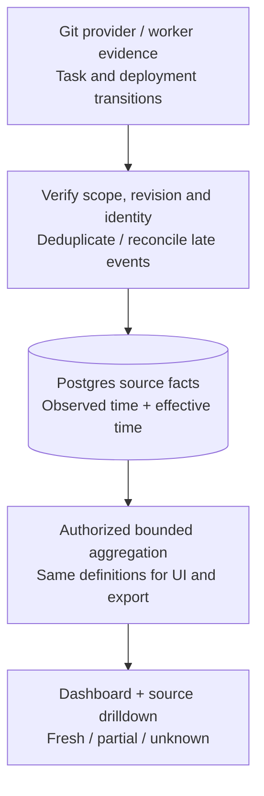

# Development metrics

Measure delivery, waiting and quality alongside cost. Show LOC and PR counts, with their definitions and source freshness. These are application/repository metrics; no individual developer or model leaderboard is implied.

## What each number means

All time windows are half-open UTC intervals `[from, to)`, rendered in the viewer's timezone. Every card names its cohort, unit, sample count, missing-data count, measurement revision and last successful sync. An empty duration sample is **unknown**, not zero hours.

| Metric | Definition and source |
| --- | --- |
| Repository LOC | Physical lines in tracked text files at an exact commit. Report source/tests/docs separately; exclude binary, vendored, lock and generated files using the pinned repository profile. Record counter/version and exclusions. This is a snapshot, not lines written this month. |
| Changed lines | Added/deleted lines in each PR's frozen final diff, with exact base/head SHAs. Show additions, deletions and net separately. Sum once per distinct merged PR in the window; do not sum every intermediate commit or repair attempt. |
| PRs opened / merged | Distinct provider PR identities with `openedAt` / `mergedAt` in the window. A reopened PR does not become a new PR. Confirm merges with provider state, never a worker's exit code. |
| Open / closed without merge | Open backlog **as of the selected cutoff**, and distinct final closes without merge in the window. Keep separate from merged throughput. Historical backlog needs reconstructed lifecycle facts; a current snapshot cannot answer past state. |
| Merge rate | For the cohort first opened in the window: merged by cutoff / all opened in that cohort. Display still-open members; recent cohorts are incomplete. Do not divide this month's merges by this month's opens. |
| Task lead time | First accepted task request → the configured task delivery milestone (verified PR, healthy deployment, or published artifact). Name that milestone; compare only like task types. Draft discussion time may be shown separately. |
| Average development time | First implementation job start → delivery milestone, for tasks completed in the window. Show mean, median, p90, sample count and current unfinished age. Includes waits; it is not a claim about human effort. |
| Queue / review / human wait | Sum explicit non-overlapping lifecycle intervals of each category. Show blocked and unfinished intervals separately. A missing timestamp stays missing. |
| Active execution time | Union of active task intervals for elapsed time; sum of attempt runtimes for compute time. Parallel agents make those different numbers. Do not add overlapping spans and call the result elapsed time. |
| PR turnaround | `mergedAt − openedAt` for PRs merged in the window; separate first-ready-for-review → first substantive review and approval → merge when provider history exists. |
| Quality and recovery | Required-check first-pass rate, repair rounds per delivered candidate, recurring findings, failed deployments, rollback/recovery time, escaped defects linked to a delivered change. Report explicit numerators/denominators. |
| Cost per delivered task | Settled known usage plus unknown-measurement count. Keep failed/canceled work cost visible; subscription/host allocations follow their separately named policy. |

PR diff totals are descriptive: generated-file policy, squashes, reverts and overlapping PRs can change totals. They are not a unique count of code authored or a quality score. Git's `--numstat` exposes machine-readable additions/deletions and marks binary counts with `-`; binary files remain “not line-counted.” Use `-z` when collecting filenames. [Git diff](https://git-scm.com/docs/git-diff)

GitHub's PR-files endpoint is capped at 3,000 files. Traverse its provider pagination inside the adapter, record incomplete coverage, and use a bounded checkout/diff job when complete statistics require it. Bakery's public pagination stays cursor-based. Never silently show capped results as full-repository data. [GitHub PR files](https://docs.github.com/en/rest/pulls/pulls#list-pull-requests-files)

## Where the facts come from



Reuse signed integration receipts, repository/PR records, run/attempt timestamps, check/review evidence, deployments and usage ledgers. Webhooks trigger reconciliation; an out-of-order `closed` event cannot overwrite a provider-confirmed merged PR. Stable identity includes provider + repository + provider PR ID, not a display URL. Track effective provider time and observed import time separately. Recompute affected intervals when late evidence arrives; do not mutate history silently without a freshness revision.

Initial aggregation uses indexed Postgres queries for authorized repositories and bounded time windows. Read source facts once per request, aggregate on the server, return bounded series plus cursor-paginated drilldowns. No per-token metric writes, separate warehouse or agent-generated SQL. Add daily rollups only after measurement shows a need; version/rebuild them when a metric definition changes. Authorization precedes aggregation and cache access. A cache must include organization, authorized resource set, query, definition revision and data watermark; membership changes invalidate it.

Proposed limits: default 30 days, maximum 366 days, maximum 1,000 chart points. Longer analysis is an explicitly budgeted report, not an unbounded interactive query. The existing `/v1/metrics` route is reused; its unrestricted metric string becomes an allowlisted metric key with repository/application filters, cohort, provenance and completeness fields. The present catalog does **not** yet define these dimensions.

## A concrete example

```text
June completed PR cohort:
  A opened May 31 12:00 UTC, merged June 1 12:00 UTC: 24 hours
  B opened June 1 12:00 UTC, merged June 4 12:00 UTC: 72 hours
  C opened June 5, still open
  A webhook delivered twice

Merged in June: 2, not 3
Mean PR turnaround: (24 + 72) / 2 = 48 hours
Still-open backlog: includes C; C is excluded from completed-duration averages
June-opened cohort merge rate: 1 / 2, not 2 / 2
```

The [runnable platform specimen](19-platform-examples.md) uses these UTC timestamps, deduplicates identities, and reports unknown durations/line counts separately.

DORA change lead time measures commit → production deployment, so it must not be mislabeled as Bakery's task or PR time. Production delivery metrics also cover deployment frequency, failed-deployment recovery time, change fail rate and deployment rework rate. Keep these per application/service and do not claim DORA coverage until deployment/incident evidence exists. [DORA metric definitions](https://dora.dev/guides/dora-metrics/)

## Dashboard and drilldown

```text
<DevelopmentMetricsPage>
  <RepositoryAndPeriodFilters>       organization-scoped; selected timezone
  <FreshnessNotice>                  last sync, coverage, unavailable sources
  <DeliverySummary>                  merged / unmerged / completed / unfinished
  <DurationBreakdown>                queue / implementation / review / blocked
  <ChangeVolumeAndQuality>           LOC next to checks, repairs and incidents
  <SourceRows>                       cursor list of exact PR/task/evidence IDs
```

Desktop uses a summary row, time-series charts and a drilldown table. Mobile stacks the same cards, exposes filter controls in a sheet, and presents the same source rows as a list. Charts have text/table equivalents; status uses text as well as color. Every duration card opens the contributing sample, not a generic analytics screen. Show stale/partial/empty/forbidden/loading states; a disconnected integration never becomes “0 PRs.” Refreshing statistics does not trigger a coding job except an explicitly requested missing-LOC evidence job.

## Contract work before implementation

| Gap in current model | Required refinement |
| --- | --- |
| PR timestamps/statistics | Add provider identity, effective lifecycle timestamps, observed sync watermark, final base/head diff evidence, line/file coverage and provenance. Retain sufficient transitions for reopen/history queries. |
| Task milestones and intervals | Persist typed admitted/start/wait/review/delivered transitions outside short-lived notification retention. Pin the completion policy; do not infer all history from current `tasks.status`. |
| LOC evidence | A bounded artifact containing commit, counter/profile version, exclusions, categories and completeness; never a repository file dump. |
| Query/result | Registered metric keys, authorized dimensions, UTC window, revision/watermark, units, sample/missing counts and cursor drilldown. Use described shared schemas; REST/MCP agree. |
| Quality rates | Pin eligible cohorts, distinct candidate/release identities and explicit incident links; distinguish canceled checks from failures. |

Acceptance: duplicates and reordered webhooks do not inflate counts; cross-month/reopened PRs use the right cohort; unknown/binary/truncated data stays labeled; overlap does not inflate elapsed time; cross-organization facts never contribute; changing exclusions creates a new measurement revision. The present design checks and pure examples do not prove provider synchronization or production aggregation.
