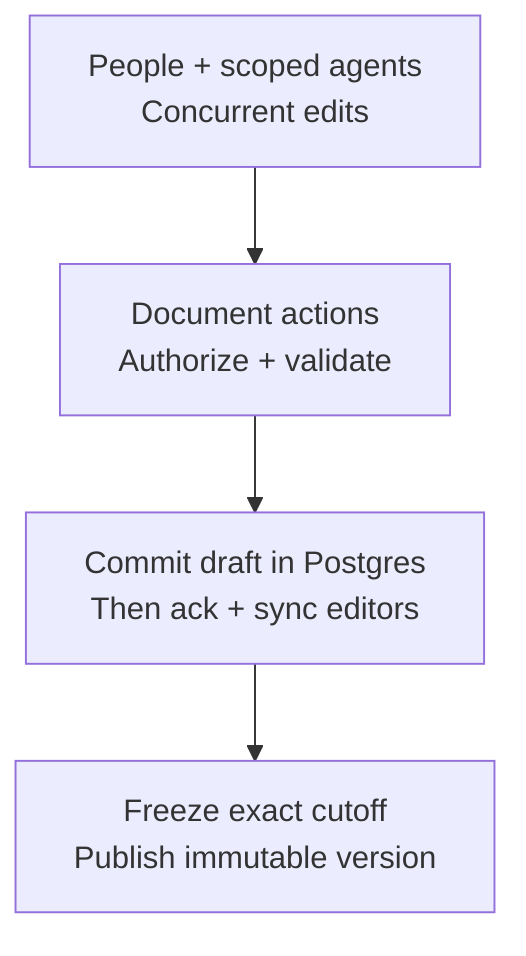

# Collaborative documents and presence

**Direction: Loro is the preferred CRDT.** People and agents edit the same plan concurrently; immutable artifact versions remain the inputs for review, workflows and approval. Presence shows who joined a chat/document and expires without activity. Use full snapshots and a corrected, pinned editor binding. Services, schemas and product screens remain to build.

## Live draft, frozen evidence

| State | Ownership and behavior |
| --- | --- |
| Collaborative draft | One active draft per task-owned artifact, with an epoch, initial artifact version, Loro document and server commit sequence. Permitted humans and agents edit together. |
| Published artifact version | Immutable Markdown/text bytes, digest and provenance, including draft ID/epoch/cutoff. Existing artifact size, retention, CAS and authorization rules apply. |
| Approval / agent input | References the exact published version. Later draft edits never change an approval or the instructions of an admitted workflow step. |
| Presence | Ephemeral room membership, activity and cursor hints. Not artifact content, audit evidence, attention tracking or proof someone read a message. |

Start with `LoroDoc.getText("body")` and a Markdown editor/preview. Research pins `loro-crdt@1.16.0` and `loro-codemirror@0.3.3`; the published binding needs fixes for mount-time edit loss and reentrant undo/redo. Carry a reviewed package patch or consume a verified upstream release before shipping. ProseMirror/Tiptap is another binding path, not a tested substitute here. [Editor options](https://loro.dev/docs/examples)

Keep one text representation; competing Markdown and rich-text structures can drift. Loro version vectors identify missing operations; frontiers identify a history cutoff, including deletions. Neither is a Bakery commit receipt or approval. Store server sequence, checkpoint, frontiers and canonical text digest together. [Loro versioning](https://loro.dev/docs/advanced/version_deep_dive)



## What simultaneous edits mean

Edits to different sections merge without a whole-document ETag conflict. Inserts/deletes at the same location also converge, but two incompatible rewrites can produce an awkward combined sentence. Show actor activity and changed ranges; let participants reconcile intent through comments or an agent question. CRDT convergence cannot decide which product decision is correct.

Humans edit through the Loro editor binding. Agents use a bounded `drafts.edit` action: read an authorized checkpoint/slice, then submit draft ID, epoch, source checkpoint, stable cursor range, expected text/digest and replacement. Under serialized admission, resolve the range and verify the current target. Disjoint edits may proceed; changed/deleted/ambiguous targets return `PRECONDITION_FAILED` for a fresh read. Never run `body = staleWholePlan`. The JS text API uses UTF-16 offsets; declare units and reject positions splitting a surrogate pair or unsupported selection boundary.

Agent REST/MCP tools call that same action; worker agents additionally prove their active attempt/fence. No raw binary CRDT document, complete update history or cursor stream goes into model context. Direct local harnesses retain their own scoped human/machine principal. Loro PeerIDs and transaction origins are synchronization metadata, not identity: the server records who submitted each accepted update. Do not present a client-supplied origin as authenticated character authorship.

Local undo tracks that editor's transactions rather than another person's latest change. Large restructures become a bounded proposal with a comparison; they are not an unattended full-text replacement while others edit. The original snapshot and failed proposal remain available for reconciliation.

## Persist once, then acknowledge

The document service lives in the Deno server. Postgres stores draft checkpoints and accepted binary updates; R2/local bundle storage remains unchanged. Inngest handles coarse maintenance and workflow work, not individual keystrokes. A hot document can stay in bounded server memory while participants are connected.

```text
acceptDocumentUpdate(actor, draftId, epoch, mutationId, bytes)
  authenticate and authorize current task/document write access
  enforce frame, rate, document and queue limits
  serialize admission for this draft
  import into a candidate; reject pending dependencies; validate the body Text root
  short Postgres transaction
    lock draft; recheck authority, epoch and expected server highwater
    replay identical mutation receipt, or reject changed payload
    append update + authenticated submitter + next commit sequence + receipt
  after commit: adopt candidate, acknowledge and notify connected peers
```

No network wait or expensive decoding holds a database transaction. If another server changed the highwater, discard the candidate, reload the committed tail and retry admission within a bounded limit. The transaction determines order for durable acknowledgments; Loro determines text convergence. A failed write cannot broadcast an accepted edit. On crash after commit but before notification, reconnect/sync recovers the committed update. Same mutation ID and digest replays the stored receipt after current authorization; changed bytes produce `IDEMPOTENCY_PAYLOAD_MISMATCH`.

`doc.import(bytes)` returns an import status; a successful call may still leave missing dependencies pending. Reject that candidate and request synchronization before acknowledging a saved edit. Permit one plain-text `body` root: no formatting attributes, extra shared roots or unbounded metadata. Decode/import untrusted updates away from the request loop with enforced CPU/memory limits. A WASM trap discards the worker/candidate and reloads committed state. Checksums detect corruption, not authority or malicious peers. Isolation, schema validation and hostile-input bounds remain runtime gates. [Import status](https://loro.dev/docs/concepts/import_status)

**Isolated import worker budgets (decided on #270).** Every Loro import, edit and slice runs in a short-lived worker with no permissions (systemd unit by default; a fixed launcher with `prlimit` and V8 caps where systemd is absent). Its time is metered in two parts: start-up from spawn to the worker's `READY` (`DRAFT_LIMITS.workerStartupMs`, 5 s; no client bytes have been read yet, so a slow host's cold start is not charged to the client) and work from `READY` to exit (`DRAFT_LIMITS.workerRuntimeMs`, 2 s, sized from measured worst-case bounded work with headroom). Running past start-up or work ends the worker with a typed timeout (`DEPENDENCY_TIMEOUT`, 504). systemd's `RuntimeMaxSec` and the fixed launcher's `prlimit --cpu` (4 s) are backstops above both, so the typed timeout fires first. Both launchers use the same budgets. At most `DRAFT_LIMITS.maxConcurrentWorkers` (4) workers run at once, process-wide (#243), so worst-case draft memory is that times the per-worker bound; when the pool is full a write is refused at once with `DEPENDENCY_UNAVAILABLE` (retryable) instead of queueing without bound.

Proposed initial limits: 1 MiB UTF-8 live document; 64 KiB decoded update; bounded sync chunks; 16 MiB total serialized draft/checkpoint state per epoch; 100 queued mutations per draft; 250 ms edit coalescing and per-principal rate limits. Bulk paste uses the same limits. Smaller editor limits do not change the existing 10 MiB artifact-version ceiling. Slow peers resynchronize instead of growing unbounded socket buffers. Rejections preserve the local draft with **Not saved**; they never pretend an optimistic edit was committed.

Checkpoint a **full Loro snapshot** plus exact server highwater/frontiers. Remove redundant database update rows only after checkpoint verification, preserving mutation receipts for the advertised retry window. The full snapshot retains CRDT history; SQL-tail compaction does not truncate it. **No shallow snapshots initially:** the pinned release reproduced a multi-head restore failure. At the epoch cap, stop new edits, freeze a bounded version and coordinate an explicit new epoch; old/offline edits remain proposals for reconciliation. Retain referenced old checkpoints. [Persistence](https://loro.dev/docs/tutorial/persistence), [shallow-snapshot issue](https://github.com/loro-dev/loro/issues/1095)

An active draft pins its base and any frozen checkpoints referenced by pending proposals, agent work or discussion. Close/archive a draft explicitly before collecting it; publication alone does not erase unsent or later edits. Define checkpoint/update/receipt retention together before enabling collection. Backups include committed draft state and update tails; ephemeral presence is discarded on restore.

## Publish a cutoff while editing continues

Flush the publisher's local updates and obtain a server barrier/checkpoint at `(draftId, epoch, committedSequence)`. The UI previews that frozen content. It includes server-acknowledged edits through the cutoff; another participant's unsent local edits are not included. Publication uses its checkpoint ID and digest plus the artifact's existing `If-Match` and idempotency key. Serialize the frozen text outside the transaction, then atomically verify scope/provenance, insert the immutable version and advance the artifact pointer through the existing publication service.

New edits after the cutoff remain in the live draft and are labeled **Changes since revision N**; they are not smuggled into the review. Another publisher changing the artifact pointer still causes the normal CAS conflict. If an external import/direct upload has advanced the artifact while the draft was open, show the diverged base and require an explicit reconciliation; never reset a live draft from a replacement blob.

**Send draft to agent** freezes a bounded artifact revision, then uses that exact reference in turn/workflow admission. Approval names a published revision. Loro frontiers include deletions; the earlier Yjs insertion-clock limitation does not apply. `forkAt(frontiers)` materializes a retained cutoff without checking out the live editing document. Server sequence, checkpoint and canonical content digest still define the durable review boundary.

## Comments on a moving document

Keep published-version comments and original anchors unchanged. Draft discussions use separate records with the same moderation, reply, resolution and CAS guards. Store epoch, encoded Loro start/end cursors, encoding/coordinate version, selected quote and creation checkpoint. Resolve with `getCursorPos`; missing history or deleted/ambiguous selections become **Outdated** and stay discoverable. Cursors can move to surviving neighbors: verify the quote/range before agent edits. Stable positions do not prove semantic equivalence. [Loro cursors](https://loro.dev/docs/tutorial/cursor)

Do not put comment bodies or resolution flags inside the freely editable Loro text state: that would let an ordinary document edit bypass author/moderation rules. At publication, an explicitly projected draft thread becomes a version-pinned comment with source-thread/root-version provenance; retain the original draft thread and mapping. Send-to-agent captures exact roots/replies/checkpoints under CAS and the existing context bounds. Moving text or publishing a version never silently resolves feedback.

## WebSockets, REST and MCP

Reuse the Deno host, authentication, resource guards and reconnect conventions. Keep `/v1/events` as the existing read-only domain/output notification channel. Add one **lazy `/v1/collaboration` WebSocket per connected client**, multiplexing its currently open document and chat rooms. This avoids treating CRDT binary writes as ordinary domain invalidation events or replacing the existing cursor protocol.

| Proposed surface | Purpose |
| --- | --- |
| `POST /v1/artifacts/{id}/drafts` | Open/reuse the authorized active text draft idempotently; binary artifacts cannot enter this action |
| `GET /v1/drafts/{id}` and checkpoint/slice reads | Safe metadata, current epoch/highwater, bounded text and exact checkpoint references |
| `POST /v1/drafts/{id}/edits` | Bounded guarded agent edits; same action exposed through scoped MCP, not a raw CRDT tool |
| `POST /v1/drafts/{id}/publications` | Freeze/publish an exact checkpoint through the shared artifact-version service |
| Draft comment actions | Cursor-paginated threads/replies with typed relative anchors and ordinary moderation/CAS |
| `WS /v1/collaboration` | Authenticated `join`, `leave`, `sync`, `update`, durable `ack`, `resync_required`, `presence` and safe `problem` frames |

These names are **proposed additions**, not entries already present in the catalogs. Describe every Zod schema/child and generate REST/MCP metadata from them. Binary frames have a bounded typed header binding draft, epoch, mutation ID and declared byte length; validate the actual length. Loro peer counters/frontiers, opaque event cursors and Bakery decimal-string commit sequences are different things and never interchangeable.

The socket upgrade checks the normal secure session, Origin and allowed audience. Join and every write check current room/resource authority; worker/agent calls also use their existing scope/fence boundary. Read-only members may observe a document and advertise their own presence, but cannot send edits. Register draft mutations under the existing operate permission plus task write access. Integration read/comment grants never imply draft editing: third-party draft writes require an explicit new capability and connection scope before exposure.

Revocation ejects affected rooms, rejects unsent mutations and clears protected client caches. Reconnect reauthorizes before exchanging version vectors/full checkpoints, then submits only permitted unsaved changes with stable IDs. After a rejected optimistic update, rebuild from authorized server state and retain the permitted local text as a separate unmerged proposal; never rebroadcast rejected CRDT state. Revocation still clears protected data. Old-epoch changes require explicit reconciliation.

One server owns active rooms initially. Database CAS protects committed state if processes overlap; before enabling multiple collaboration-serving instances, add tested owner routing or fan-out for room membership/updates. Do not claim cross-process presence from disconnected in-memory maps. No Redis, hosted collaboration service or peer-to-peer access path is needed for the initial single-machine/full-stack deployment.

## Presence is scoped and expires

Join a `conversation`, `artifactVersion` or `draft` room explicitly when its surface is open. Reading an immutable version and editing the current draft are different locations. The server verifies read access and assigns the participant identity from the authenticated user or live agent session. Users may have several tabs/devices; aggregate avatars by principal with per-session details rather than counting each tab as a person.

Presence uses the collaboration socket and a Loro `EphemeralStore` adapter, separately from persistent document content. Bakery assigns authenticated identities, validates keys/values and applies server receipt-time expiry; it does not relay arbitrary client keys, identities or timestamps as trusted presence. The editor binding supplies cursor rendering. [Ephemeral Store](https://loro.dev/docs/tutorial/ephemeral)

Proposed timing: heartbeat every 10 seconds, expiry after 30 seconds without a valid update. Remove on leave, socket close, logout or revocation; TTL handles sleeping phones and broken connections. Bound each presence update to 2 KiB, coalesce cursors to at most five updates/second per participant, and drop superseded updates under backpressure. Presence has no Postgres update log or durable replay. After reconnect/server restart, clients join again and receive the current authorized participant snapshot.

Allowed hints: room, active/background/idle state, typing flag, cursor/selection relative positions and the latest server receipt time. Display name/avatar/agent label come from trusted identities; clients cannot impersonate another participant or mark someone else online. Strip document text, clipboard contents, prompts, credentials and arbitrary URLs. A retained WebSocket alone means connected, not viewing, typing or attentive. A Slack message/webhook is activity, not evidence that its sender is currently viewing the Bakery chat.

Agents appear as **Agent · editing**, **Agent · reading** or **Agent · paused** only while the server can tie activity to a live scoped session/action; expire it when the session/lease is lost. Presence grants no lock, authority, approval or read receipt. Durable audit records and server acknowledgments remain separate from these best-effort hints.

## Phone and desktop use the same primitives

```text
<DocumentWorkspace>
  <PresenceGroup>          humans + labeled agents; names, not color alone
  <DraftVersionBar>        live draft / frozen revision / changes since cutoff
  <CollaborativeEditor>   shared text, remote selections, local undo
  <SaveStatus>             local changes / syncing / saved / offline / rejected
  <CommentSurface>         desktop rail; phone sheet with selection backlink
  <PublishOrSendAction>    exact checkpoint preview + conflict handling

<ConversationHeader>
  <PresenceGroup>          this chat only; contributors listed separately
  <TypingSummary>          expiring hint; each composer stays private
```

Desktop shows named remote cursors and a presence group beside the document/chat title. Phone shows a compact avatar stack and an accessible participant sheet with the same room/activity details. Do not force-follow another editor, steal focus, move the reader's scroll position or announce every cursor update. Use a polite batched announcement for joins/leaves and save/reconnect status. Selection color is backed by labels; respect contrast, reduced motion, keyboard navigation and touch targets.

Paper and Storybook need paired phone/desktop states for two humans plus an agent editing, same-range disagreement, someone viewing an old revision, local-only/offline changes, reconnect, expired presence, scope revocation, duplicate tabs, unsaved publication, changed base, deleted comment anchor and document size limit. Existing comment mocks do not prove these editor states; new frames and live component implementation remain work to do.

## Where else CRDTs fit

| Surface | Direction |
| --- | --- |
| Plans, research, review drafts, Markdown design briefs | Shared Loro text now required; published evidence stays immutable |
| Shared checklist or workflow/canvas draft | Candidate for a typed shared structure when that editor is added; graph/schema validation still gates publish/activate |
| Paper or another external design file | Respect that provider's own collaboration model; presence in Bakery does not prove a user is editing in Paper |
| Chat transcript / individual composer | Ordered attributed messages and private drafts stay as designed; presence/typing does not make a composer's text shared |
| Binary images, PDFs, logs, patches, approvals, leases, budgets | Immutable versions or normal guarded transactions; no byte-level CRDT or permission merge |

## Catalog deltas and proving gates

Proposed records: `artifact_drafts` (task/artifact scope, epoch, base version, current checkpoint reference, Loro frontiers/encoding version, commit highwater, status), `artifact_draft_checkpoints` (immutable binary state/hash and exact draft/epoch/highwater), `artifact_draft_updates` (epoch/sequence, mutation receipt/digest, authenticated submitter, binary update), and draft-target comment threads with relative anchors and checkpoint provenance. Checkpoint history remains addressable while referenced. Its 16 MiB state cap is separate from the 10 MiB published artifact cap. Existing idempotency storage can retain compact receipts after update-tail compaction. Add immutable artifact provenance back to its source checkpoint. Presence remains ephemeral.

Reconcile these records, typed actions/frames, strict limits, resource scopes, retention/backup references and standard-error mappings into the canonical catalogs before code generation. This chapter does not invent a second error hierarchy. Reuse `PRECONDITION_FAILED`, `STATE_CONFLICT`, `BODY_TOO_LARGE`, `RATE_LIMITED`, `AUTH_FORBIDDEN` and dependency faults with the existing HTTP/MCP mappings; collaboration resync is a protocol outcome, not a claim that changes were saved.

Loro core and browser probes, run during design, recorded feasibility and known release defects. The browser build needed explicit WASM loading and a research-only binding patch. An earlier Yjs baseline served as comparison evidence, not the selected implementation.

Runtime acceptance must additionally prove two authenticated people plus a worker agent, malicious/oversized updates, stale agent patches, transaction/ack/broadcast crashes, compaction with offline clients, epoch rollover, revocation, immutable publication races, draft-comment mapping, bounded memory/queues, restart and presence expiry across real phone/desktop sessions. Passing the specimen does not prove any of those server, transport, editor or security behaviors.

## Loro feasibility and adoption

**Preferred: Loro 1.16.0.** Core Deno checks passed; corrected CodeMirror probes passed at phone/desktop widths with two users and a simulated agent. Seven core checks include one reproduced shallow-snapshot defect. The original editor binding drops a first edit; it also needs deferred undo/redo. Keep a reviewed patch or use a verified fixed release. Full snapshots only; shallow history stays disabled.

```ts
// Loro library calls only; Bakery authorization and publication surround this.
const cutoff = live.frontiers();
const frozen = live.forkAt(cutoff);
try {
  const text = frozen.getText("body").toString();
  const bytes = new TextEncoder().encode(text);
  // Shared publication stores bytes + digest + checkpoint + server sequence.
  // Approval references the resulting immutable artifact version.
} finally {
  frozen.free();
}
```

The measured probe JS/WASM totals about 1.21 MB gzip; lazy-load the editor. This is asset size, not a phone startup benchmark. React/Vite, Safari/iOS, IME, accessibility and the authenticated durable server remain acceptance work. The editor and server must use compatible pinned Loro encodings; there is no runtime selector that mixes Yjs and Loro document bytes.
