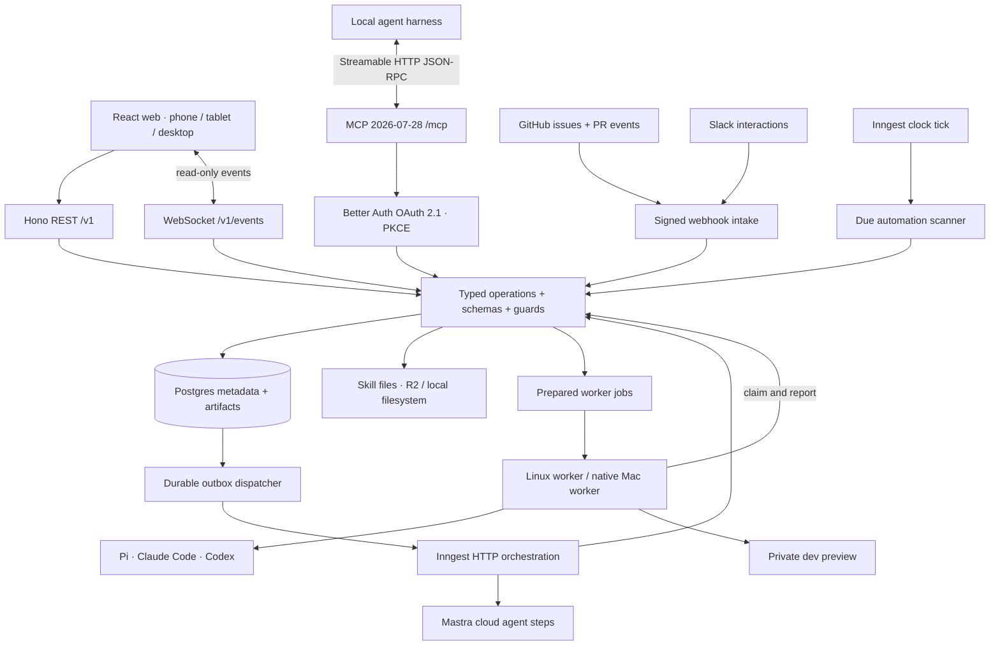
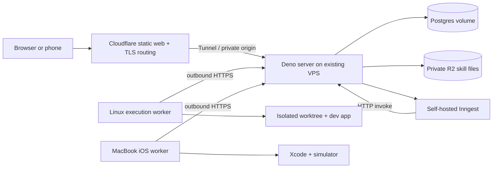

# Bakery technical design

System design records for Bakery: the data model, transport contracts, runtime,
workflows, integrations and UI design system. Chapters describe the intended
design; each one marks which parts are implemented and which remain proposed.
Isolated compatibility checks are reported in
[Implementation readiness](15-implementation-readiness.md).

**Mandatory semantic metadata:** every Zod schema/type and every field requires
a meaningful description, without exceptions. See
[schema description rails](04-backend-and-errors.md).

## Index

### Chapters

| # | Chapter | Covers |
|---|---|---|
| 01 | [Data model and invariants](01-data-model.md) | Tables, ownership, integrity rules ([structured inventory](data-model.json), [ER diagrams](erd/README.md)) |
| 02 | [Transports and operations](02-transports-and-operations.md) | REST, WebSocket, MCP and worker contracts ([operation inventory](api-catalog.json), [schema shapes](transport-schemas.json)) |
| 03 | [Frontend and design system](03-frontend-and-design-system.md) | React, Storybook and design rails |
| 04 | [Backend and errors](04-backend-and-errors.md) | Backend rails, settings, account protection |
| 05 | [Runtime and protocols](05-runtime-and-protocols.md) | Runtime placement, harnesses, local/cloud topology, cost |
| 06 | [Workflows, delivery and acceptance](06-workflows-delivery-and-acceptance.md) | Workflow definitions, compiler, delivery, evaluation |
| 07 | [Multiplayer](07-multiplayer.md) | Review and iteration UX |
| 08 | [Desktop](08-desktop.md) | Shared desktop UI, packaging, releases |
| 09 | [Integrations](09-integrations.md) | GitHub App, provider adapters, scopes, SDK |
| 10 | [Tickets](10-tickets.md) | Readiness labels, planning, task links, progress |
| 11 | [Plugins](11-plugins.md) | Plugin SDK, isolation, installs, marketplace |
| 12 | [Standard errors](12-standard-errors.md) | RFC 9457 problems, MCP tool failures |
| 13 | [Internationalization](13-internationalization.md) | Translation contract for every surface |
| 14 | [Artifacts](14-artifacts.md) | Evidence, versioning, storage, access, retention |
| 15 | [Implementation readiness](15-implementation-readiness.md) | Compatibility checks and open gates |
| 16 | [Recovery and failures](16-recovery-and-failures.md) | Failure classification and recovery |
| 17 | [Context and handoffs](17-context-and-handoffs.md) | Context assembly between steps |
| 18 | [Development metrics](18-development-metrics.md) | Delivery metrics |
| 19 | [Platform examples](19-platform-examples.md) | Target call shapes for platform services |
| 20 | [Collaborative documents](20-collaborative-documents.md) | Loro-based concurrent editing and presence |
| 21 | [Machines](21-machines.md) | Organization-owned hosts, onboarding, readiness |
| 22 | [Repository rules](22-repository-rules.md) | Commit/PR conventions, templates, magic-value checks |
| 23 | [Skills and evaluations](23-skills-and-evaluations.md) | Skill authoring and evaluation |
| 24 | [Mentions and notifications](24-mentions-and-notifications.md) | Mentions, inbox, delivery |

### Product, design and CI

- [Product brief](PRODUCT.md) and [design system](DESIGN.md)
- [CI evidence storage](ci-evidence-storage.md)
- [UI baselines](ui-baselines/README.md): golden screenshots and catalogs used by the visual-parity lanes
- [Contract migrations](contract-migrations/): compatibility records checked by CI

### Design references

Paper-exported mocks used as visual references and, where noted, as inputs to
the `packages/ui` reference renderers:

- [Authentication](auth-mocks/AUTH-FLOWS.md), [enterprise shell](enterprise-mocks/UI-CONTRACT.md), [settings](settings-mocks/SETTINGS.md), [entitlements](entitlements-mocks/ENTITLEMENTS.md), [artifacts](artifacts-mocks/MOCK-BRIEF.md)
- [Worker readiness](worker-readiness/), [worker dark theme](worker-dark-mocks/)
- [Chat composer](chat-composer/BEHAVIOR.md), [notifications](notification-mocks/), [repository rules](repository-rules-mocks/)
- [Integrations](integration-mocks-v2/index.html) ([earlier states](integration-mocks/UI-CONTRACT.md)), [workflow studio prototype](workflow-studio/README.md)

## Overview

**Platform addition:** [Desktop](08-desktop.md) covers the shared desktop UI; [Plugins](11-plugins.md) covers private plugin authoring, SDK and marketplace roadmap; [Internationalization](13-internationalization.md) defines one translation contract for every first-party and extension surface; [Artifacts](14-artifacts.md) consolidates durable evidence, versioning, workflow handoffs, collaboration, storage, access, and retention. The canonical [design system](DESIGN.md) defines equal light and dark themes, responsive behavior, accessibility and reusable product patterns for Paper, Storybook, web and desktop. The platform direction includes multiple organizations and members from the initial release; Personal is the setup default. The structured model and operation catalogs include those organization, integration, ticket and plugin contracts. The approved enterprise mocks remain the core design.

**Integration addition:** [Integrations](09-integrations.md) covers GitHub App setup, organization routing and provider adapters. [Tickets](10-tickets.md) covers readiness labels, planning, ticket/task links and progress, and [Ticket admission operations](10-ticket-admission-operations.md) covers how an administrator configures a ticket source and an operator reads why an issue was or was not admitted. Multiple organizations and members are supported initially; Personal is a setup default. The app-level GitHub webhook and ticket schema/API additions supersede the earlier intake sketch and are included in the structured catalog.

## One backend, several clients

[Repository rules](22-repository-rules.md) defines configurable semantic commits,
PR/MR titles, merge-description templates and magic-value checks. Organization
defaults flow to current and future repositories; locked requirements and allowed
repository overrides have explicit provenance. The chapter links the responsive
Paper mocks and owns the proposed model/API additions and delivery acceptance.

[Machines](21-machines.md) defines organization-owned hosts, user stories, the proposed version-pinned `npx` installer, vertical onboarding with live status, readiness checks, harness/provider management and safe remote maintenance. It owns the machine-specific model/API/event deltas; these additions still require reconciliation into the structured catalogs before generation. The approved Paper screens are the visual reference, not runtime proof.

[Collaborative documents and presence](20-collaborative-documents.md) defines concurrent human/agent editing with Loro, immutable publication and expiring chat/document presence. It supersedes the former comment-only scope. A lazy collaboration WebSocket joins the existing Deno operation/auth boundary; its draft records and transport contracts are proposed catalog additions. Postgres stores committed drafts; presence stays in memory. The diagram below shows the existing resource/event paths.

The execution map now has dedicated [failure and recovery](16-recovery-and-failures.md), [context and handoff](17-context-and-handoffs.md), [development metrics](18-development-metrics.md), and [platform code](19-platform-examples.md) chapters. [Artifacts](14-artifacts.md) covers bounded blob I/O; [Multiplayer](07-multiplayer.md) covers review/iteration UX; [Workers](05-runtime-and-protocols.md) covers daemon enrollment and lifecycle. Proposed contract refinements and runnable pure examples are labeled separately from implemented services.

The [workflow direction](06-workflows-delivery-and-acceptance.md) is accepted: canonical JSON, a visual editor, optional YAML and a typed TypeScript SDK, with Inngest owning durable execution. The chapter lists the remaining contract, editor and runtime work.

**Installation settings are persisted in Postgres.** Registration and organization-creation policy update without restarting Bakery. The server enforces settings alongside permissions. [Backend rails](04-backend-and-errors.md) defines settings enforcement, bootstrap behavior, and implementation checks.



All communication from web, desktop, Slack and future Discord/Microsoft Teams interfaces shares one Bakery transcript, question lifecycle, command policy and coordinator. Adapters translate authenticated input and authorized output; they do not implement separate agent or workflow behavior. See the [shared communication contract](09-integrations.md).

All domain operations live in `apps/server`. Hono, WebSocket, MCP, webhook and Inngest adapters call those operations rather than reimplementing business rules. Postgres is the durable business record. Inngest owns workflow scheduling/checkpoints/retries/waits; its execution history is not copied into a competing custom engine. Bakery records the semantic run/step/job state needed by the product.

## Chosen repository and runtime shape

```text
bakery/
├── apps/
│   ├── web/          React + Vite + TanStack Router/Query
│   ├── server/       Deno + Hono + Better Auth + Mastra + Inngest HTTP
│   └── worker/       Deno supervisor; native coding harness subprocesses
├── packages/
│   ├── contracts/    v1 schemas, faults, events, generated API/MCP types
│   ├── i18n/         locale resolution, typed message keys, shared catalogs
│   ├── ui/           semantic React components, Tailwind tokens, Storybook
│   └── config/       shared TypeScript/lint/quality configuration
├── assets/brand/     approved logo and favicon (already present)
├── .agents/skills/   project-specific skills; shared workflows installed globally
├── infra/           local compose, host service examples, backup scripts
├── tests/           boundary/recovery fixtures and responsive acceptance
├── pnpm-workspace.yaml
└── turbo.json
```

Use pnpm/Turborepo for workspace coordination and frontend tooling. Deno remains the server and worker runtime. Node-based build tools and separately installed harness executables do not redefine the server runtime. Use direct Deno-compatible Inngest HTTP handling; do not force the Node-oriented Mastra/Inngest connector into the design.

The dependency rule is `web -> ui + contracts`, `server -> contracts`, `worker -> contracts`. Shared config is development-only. Within server: `v1/routes -> v1/handlers -> service/guards -> store + provider ports`; cross-module imports use explicit public exports. Ordinary functions implement business operations. Interfaces are limited to real interchangeable boundaries: harnesses, Git provider, deployment target, secrets, storage transactions and skill file storage (R2/filesystem).

| Module | Owns | Does not own |
|---|---|---|
| projects | Applications, repositories, immutable profiles, onboarding | Git hosting account credentials |
| work | Conversations, tasks, dependencies, questions, user steering | Harness process lifetime |
| workflows | Definitions/versions, run snapshots, registered actions, automation config | A second durable scheduler |
| catalog | Skills, MCP definitions/connections, integration bindings | Arbitrary unsigned code execution from configuration |
| execution | Jobs, host capacity, attempts, leases, workspaces, previews | Model billing or GitHub merge truth |
| delivery | Checks, reviews, merge coordination, deployment evidence and effects | Treating an agent's claim as CI evidence |
| knowledge | Artifacts, comments, repository memory, replay corpus | Git-tracked runtime journals |
| platform | Auth, typed faults, Postgres, events/outbox, audit, usage, budgets | Repository-specific feature behavior |

## Recommended deployment



Cloudflare is the edge, not a Deno host. Put the small Deno server, database and self-hosted orchestration on the initial VPS; a worker may share that machine under a separate OS identity and isolated job containers. Add remote workers without moving business state. Keep the control service's credentials, database socket and container-control interfaces inaccessible to job processes. A root compromise of a shared host remains outside the isolation guarantee; hardware separation is an available later deployment change.

Local mode runs the same Deno server, UI, actual self-hosted Inngest, Postgres, and worker on one machine with persistent volumes and an application-owned directory for skill files. Durable local/VPS mode includes persistent Redis and a separate engine-owned Postgres database for Inngest; this is an engine dependency, not a second Bakery job queue. Mac hosts run Xcode natively. Remote-host and provider credentials are configuration, not prerequisites for local task/skill/MCP operation.

Proposed commands (to implement, not commands already shipped): `pnpm setup:local`, `pnpm dev`, `pnpm local:start`, `pnpm local:stop`, `pnpm local:backup`, `pnpm local:restore -- <backup>`, `pnpm worker -- enroll`. Setup validates pinned runtimes, creates local secrets without printing them, starts durable services, runs checksum migrations, bootstraps the first Admin interactively through local CLI, and prints local URLs. Stop does not delete volumes. A deployment/update command backs up and verifies migrations before switching the service release; destructive schema changes require expand/contract releases, not reverse migrations.

All paginated API, MCP and UI collections use opaque cursor continuation backed by indexed keyset queries. Page-number and offset pagination are excluded; chapter 02 owns the shared contract.

All human-facing platform copy resolves through `@bakery/i18n`. Web, desktop, notifications, email, chat adapters, integrations, and plugins share typed namespaced keys and ICU-style arguments. Durable domain state and events keep stable codes and source data; presentation resolves locale per person or recipient. English is the complete fallback, and responsive rails include a long pseudo-locale and RTL locale.

## Call flows

### 1. Discuss, then go

```text
TaskComposer.submit
  api.messages.create -> schema + identity + repository guard
    conversationService.append -> transaction(message, event, outbox)
    Mastra coordinator -> clarification or artifact draft
  user selects Start / says go through authorized channel
    runs.create -> resolve published workflow + repo profile + skills + grants
      transaction(task queued, run snapshot, budget account, outbox)
      Inngest delivery function -> stable run ID
        execute registered steps -> create worker job -> wait for result
```

A system import/discovery/automation can create a maintenance task under Bakery with no target repository. Code execution must have a repository and profile. An epic decomposes into child tasks and explicit acyclic dependencies; each executable child gets its own run and evidence.

### 2. Execute a skill without losing completion

```text
Inngest step.run(runId/nodeKey/iteration)
  operations.ensureJob -> UNIQUE(step,action), pinned input refs
  read job's persisted terminal result
  while not terminal and run permits continuation
    wait for job event with bounded timeout
    re-read authoritative job result
  return typed result refs
```

A completion event is a wakeup hint. The persistent job result is authoritative. The bounded re-read handles completion that raced ahead of wait registration or an event lost during handoff. This is not a busy loop: checkpointed waits release compute and use a proposed 60-second fallback. Retry budgets bound repeated engine invocations.

### 3. Question and cross-device answer

```text
agent needs missing information
  questions.create -> durable open question + event + channel notification
  run waits; worker checkpoints and releases slot when possible
phone / Slack / local MCP answers
  questions.answer -> identify actor -> validate response -> CAS(open -> answered)
  first answer commits; identical replay acknowledges; competing answer conflicts
  outbox wakes run; last persisted answer also checked after timeout/restart
```

The question is a data dependency, not a recurring approval gate. A different device or client may answer the same question. Extra feedback becomes a message, preserving the answered record.

### 4. Verify, review, repair, merge and deploy

```text
worker completion(head SHA, artifacts)
  checkRunner -> real required tests/build/rails on this head + base + policy
  reviewAgent -> fresh session -> structured findings + artifact
  if findings: repair step -> new head -> invalidate affected checks/review
  if clean: mergeEntries.create -> serialize repository/target
    re-read provider head/base/checks -> effect.prepare -> merge(expected head)
    reconcile provider -> exact merged SHA -> deployment.create
      deploy immutable build -> health checks -> mark healthy
      failure -> restore previous known-good release -> record rollback outcome
```

A reviewer finding no issues is not a replacement for tests. Repair loops stop on a defined attempt/cost/time limit or repeated unchanged finding; blocked work stays visible rather than looping forever. Native GitHub merge queue is optional; Bakery's serialized coordinator works without assuming organization-plan access. GitHub tokens that can write/merge and deployment credentials stay in the trusted broker; coding harnesses submit changes and requested effects.

### 5. Credentials and public capabilities

```text
Admin imports skill(source ref)
  importer fetches allowed origin -> checks archive paths, license, size, digest
  write immutable skill files to R2 (cloud) or filesystem (local)
  verify hashes -> commit revision + manifest + file metadata in Postgres
Admin binds skill + MCP connection + permitted tool set to a profile
run kickoff pins content + discovered schema digest
worker claim resolves host (Paper desktop is host-local)
  fetch pinned manifest/files through Bakery -> verify hashes -> materialize directory
  tool broker rechecks current grant, connection status, credential version
  invokes approved tool with injected credential -> redacts result -> artifact/event
```

No mutable upstream URL is executed as a skill. Imported text does not grant itself tools. Paper is required in Bakery's design process and represented as a host-local MCP dependency for automated design tasks. If its desktop host is offline, the task waits for that capability; it is not silently rerouted to cloud loopback.

Backend errors use shared `StandardError`, throwing guards, status/problem constants and one catalog-aware mapper. [Standard errors](12-standard-errors.md) defines RFC 9457 responses, MCP tool failures and safe diagnostics.

## Identity and authority

The [account-protection plan](04-backend-and-errors.md#account-protection-totp-backup-codes-and-passkeys)
includes Better Auth authenticator-app TOTP, backup codes and optional passkeys,
with enrollment/recovery/settings flows, generated provider migrations, server-side
assurance guards and release tests. The [approved Authentication designs](auth-mocks/AUTH-FLOWS.md)
cover phone/desktop and both themes; provider support is documented, runtime acceptance is unrun.

Choose Better Auth with invite-only email/password sessions for a full local path with no external identity-provider dependency. GitHub sign-in can be enabled with a configured account; do not require email delivery merely to bootstrap a personal installation. Use Secure HttpOnly same-origin cookies in production, session rotation/revocation, explicit Origin/CSRF checks and validated public origins. Local non-TLS cookies are restricted to loopback development mode.

Within each organization, Admin manages membership, repository profiles, connections, secrets and publication of workflow/agent/skill versions. Developer operates that organization’s permitted repositories: creates tasks, starts/steers/resumes/cancels work, reads evidence, and requests delivery under existing policy. Developers cannot bypass the server's check/review requirements. Machine principals have narrowly granted operations rather than inheriting human Admin by default. Read authorization covers parent application and repository scope, including live events and artifact downloads. Revocation is checked again at each privileged effect and invalidates active streams.

Bakery targets the released **MCP 2026-07-28** specification and official TypeScript SDK v2. `/mcp` requires OAuth 2.1 access tokens through Better Auth, including in local mode. The client signs in using authorization code + PKCE; tokens carry resource-bound scopes and are checked against live Admin/Developer permissions. The transport and OAuth sequence below are specified in chapter 02; compatibility work verifies this selected version rather than silently choosing an older profile. [MCP release announcement](https://blog.modelcontextprotocol.io/posts/2026-07-28/)

Worker enrollment uses a one-use short-lived token generated by Admin. The worker creates its long-lived random credential locally, transmits it once over TLS in the enrollment request, and the server stores only its hash; normal calls use Authorization bearer with worker principal + allowed host identity. Registration atomically checks the requested capability set against the enrollment allowlist before consuming its token; only Admin can expand that set. Rotation reenrolls the same host/principal and revokes the old generation. Keep credential files outside workspaces with owner-only permissions. Use HTTPS beyond loopback. Harness/model logins remain separate, particularly the user's subscription-authenticated Codex installation.

Secrets are AES-GCM ciphertext in Postgres with encryption keys loaded from service environment/OS secret files. A trusted tool adapter injects the value; resource APIs expose metadata only. Write-only inputs and one-use tokens do not go into tracing, event payloads, prompts, browser caches or replayable plain JSON responses. Where an API must replay a secret-bearing one-time response, encrypt that replay body with a short expiry. Arbitrary-shell harnesses can inspect their own process environment: do not promise secrecy for credentials injected directly into those processes; restrict those to short-lived workspace scopes, with privileged effects brokered.

Preview content is untrusted application code. Serve it on a separate preview origin without Bakery API cookies. `previews.access` gives a one-use grant posted to that origin, which exchanges it for its own short-lived HttpOnly access cookie. Validate upstream port and workspace identity, authenticate HMR/WebSocket upgrades, expire when the preview ends, and never proxy arbitrary user-entered targets.

## Spending and measurement

The $200 monthly target is an admission policy, not a claim that unmeasured infrastructure is free. Keep one installation budget account per UTC month and one account per run. Before metered work, lock installation then run accounts, reserve the maximum permitted charge against both, and record the pinned provider/model/billing route and pricing snapshot. Repeated dispatch uses the same reservation key. Settlement links to the original hold and period, including late provider reports. A run without a trustworthy upper bound waits with an explicit budget reason.

Pi uses the configured OpenRouter API route. Codex keeps subscription authentication and does not fall back to API billing. Claude Code's configured billing route must be explicit at enrollment. A zero incremental reservation for a subscription is allowed only when that exclusion is explicit; the fixed monthly subscription still appears separately in total cost. Usage reports distinguish known cost, unknown measurements, reserved commitments and settled charges. Unknown is never rendered as zero.

Only installation administrators can inspect global budget totals or fixed host costs. Organization members see their authorized run usage; an installation-cap block reports the reason without exposing other organizations’ spending.

At personal scale the initial allocation is a **planning envelope**, not provider pricing: up to $60 infrastructure/backups, up to $100 metered model/evaluation usage, and $40 headroom within the $200 incremental target. Actual existing subscription fees are shown alongside that subtotal; if the target is configured as all-inclusive, admission subtracts those fixed fees first. Tighten these envelopes from live invoices and measured work before enabling unattended expensive runs. Cloudflare serves static assets and routes HTTPS; long-running Deno/agent execution is on owned workers or the VPS. No $99 Inngest plan is assumed.

## Source reuse and evidence

| Source | Reuse | Adaptation |
|---|---|---|
| Alidade Deno/Hono modules | Versioned routes/handlers/DTOs, stores, throwing guards | Bakery domain and Better Auth replace DID/signature-specific identity |
| Alidade shared contracts | Versioned schemas, RFC9457 failures, constants, generated-doc/check rails | Shared API/MCP/worker/event contracts, stable uppercase fault code |
| Alidade UI | Semantic component boundaries, colocated stories, worst-case specimens, responsive/a11y checks | React DOM + Vite + shadcn/Tailwind instead of Expo/Tamagui |
| Alidade Paper | Foundations, Components, Sheet/Pane/Rail, States & Flows, parity ledger | Bakery palette, screen model and approved mascot |
| BB RPI bundle | Research/design/plan/implement phases and fresh context from artifact manifests | Replace BB runtime calls with registered Bakery actions; Postgres artifacts; no mandatory human gates after go |

Detailed evidence is in the linked frontend/backend/runtime chapters, including observed source commits. Current Paper design was inspected read-only before creating a separate Bakery file. No existing Alidade code, design or cloud account was changed.

Runtime versions, actual monthly bills, worker authentication setup, and external service behavior still need the explicitly listed compatibility tests. This is an implementable design package, not a claim that the proposed stack or its UI checks have already passed.
