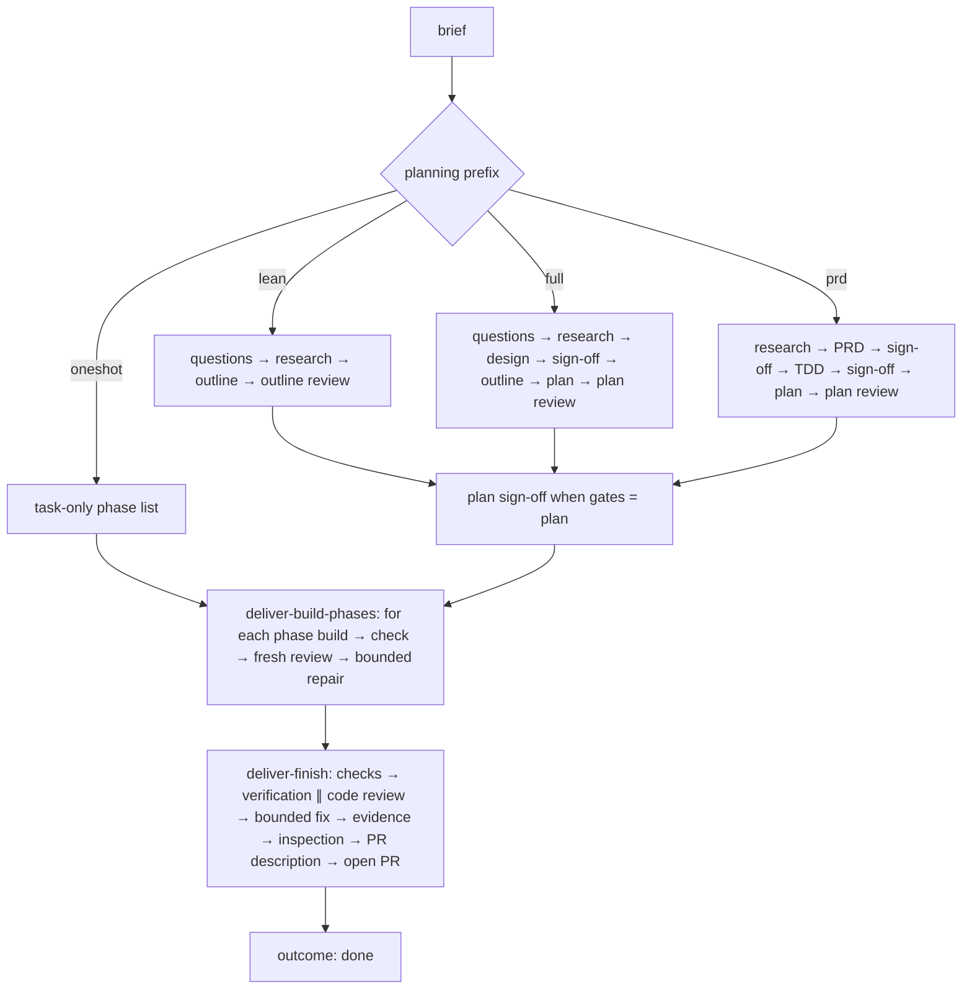

> Companion of [chapter 25, One engine](../25-one-engine.md). Where this document and [owner-decisions.md](owner-decisions.md) differ, the owner decisions win.

# Deliver as a workflow: artifact and context handoffs

Status: design proposal for the product owner, 14 November 2026. Read against `origin/main` at `d11fb5205`. Companion to the workflow editor spec (`workflow-editor/UX-SPEC.md` in this scratchpad); gap numbers G1 to G17 refer to that spec, new gaps here are A1 to A18.

**Design rule from the product owner.** Bakery provides durable infrastructure and building blocks; people build their own factories from them. So Deliver is a **template**, made only from the public primitives every customer gets (actions, artifact kinds and validators, loops, gates, agents, skills, called workflows), with no private engine path; a customer can rebuild it from JSON or fork it. Artifact kinds, validators and templates are customer-defined data; Deliver's kinds ship as defaults through the same mechanism. Anything Deliver needs that a customer could not author is listed as a platform gap. Kernel and extension-point design belongs to a separate architect; this document covers artifacts, context and the Deliver mapping, and names the extension points it depends on.

Nothing here is implemented. Claims about the current engine cite `origin/main` paths and lines. Claims about `/deliver` cite files under `~/.claude/skills/` (`deliver/SKILL.md`, `deliver/contract.mjs`, `deliver/references/*`, and each phase skill's `SKILL.md` and template); `CONVENTIONS.md` is the skills collection's `shared/CONVENTIONS.md`, read from a local copy. "`06…md`" abbreviates `docs/technical-design/06-workflows-delivery-and-acceptance.md`.

---

## 0. The answer in one paragraph

Hand off between steps with **pinned, validated artifacts plus one run-level brief and decisions record, never with transcripts**. Every step is a fresh, bounded agent session (or a deterministic action) whose input is a list of named slots, each an `ArtifactRef {artifactId, versionId, sha256}` of a declared **artifact kind**. The worker mounts those artifacts read-only beside the worktree and gives the agent a small generated index (summary, digest, size, headings) instead of pasting them into the prompt. Each kind has a template and a declarative, deterministic validator that runs when the artifact is published; the validator also extracts a few typed **facts** (a plan's phase list, a review's verdict and blocking count, a verification's status) that the engine is allowed to branch and loop on. That one bridge, judgment in documents and control flow on validated facts, is what turns `/deliver` from an LLM orchestrator obeying a contract script into a workflow the engine runs: the orchestrator's job disappears into the definition, `contract.mjs`'s checks become kind validators and engine invariants, `task.md`'s Status and Decisions become a run outcome and an append-only decisions ledger, and reviewer isolation becomes a rule the compiler and the result hook enforce. Most of the plumbing exists (immutable artifact versions, pinned refs, bounded repeat, parallel lanes, fresh-session review with a decision table, approvals, per-step agent bindings). The missing pieces are small and specific: named multi-artifact inputs, artifact kinds with validators and facts, a bounded `forEach` over plan phases, an approval step, review checkpoints, named run outcomes, a decisions ledger, longer human waits, and a `call` node. Deliver itself is only a template built from those parts, with no private engine path (section 5.7 audits it), so organizations get exactly what Deliver uses: fork the template, or build their own from the generic agent step, their own artifact kinds and validators, and their own skills, inside the same bounds.

---

## 1. What `/deliver` does today, reduced to mechanisms

`/deliver` is an LLM orchestrator: "Own decisions, delegation, verification and durable records; builders and reviewers execute" (`deliver/SKILL.md:14`), held honest by a 730-line contract script. Stripped of prose, it has eleven mechanisms. Section 5 maps each to an engine equivalent.

| # | Mechanism | Where | What it actually guarantees |
| --- | --- | --- | --- |
| M1 | **Task directory as the only memory.** `task.md` (request verbatim, `## Delivery brief`, `## Status`, `## Decisions`), plus an append-only `index.json` of immutable artifact iterations `artifacts/<kind>/<variant>/NNNN.md` with SHA-256 and `supersedes`. | `references/task_setup.md:7-9`; `references/task-artifacts.mjs:9-30, 45-61, 296-321` | "Artifacts and git carry memory between sessions, not the conversation" (shared `CONVENTIONS.md:115`). Every artifact has a `summary` that "downstream sessions read instead of the full file" (every template's frontmatter). Read budget per phase: `task.md`, primary artifacts in full, others by `summary` only (`CONVENTIONS.md:117`). |
| M2 | **Workflow sizes.** `oneshot`, `bugfix`, `lean`, `full`, `prd`, `epic`, `program`, chosen once with a recorded reason; resized after research; an oversized PR becomes an epic. | `task_setup.md:11-27` | Plan depth scales with risk. Chains: `create-design-discussion/references/execution_dag.md:3`. |
| M3 | **Fixed chain of phase skills**, each reading named upstream artifacts and writing one artifact kind from its own template. | the 17 phase skills | Each phase has one job and a template; `create-research` "does not read ticket.md, design artifacts, plans" beyond its questions (`create-research/SKILL.md` Input section). |
| M4 | **Per-plan-phase build, fresh review, repair.** Builder implements one phase and commits; a fresh read-only reviewer gets `task.md`, the phase, acceptance criteria and `<phase-base>..HEAD`, "never the builder's transcript or your summary"; `changes` sends findings back; builder answers `fixed` or `disputed: <evidence>`. | `deliver/SKILL.md:36-45` | Independence by fresh context, plus a reviewer that runs checks itself and judges only evidence. |
| M5 | **Review rounds and blocker ledger.** `review-next` computes next round, previous record and previous blocking ids per (type, checkpoint); rounds are contiguous and never reset; only a valid approval closes a blocking episode; round 2+ judges only earlier blockers, dispositions and regressions in `git diff <previous reviewed_commit>..HEAD`. | `contract.mjs:516-580`; `agent-implementation-reviewer/SKILL.md` Findings | A bounded, evidence-driven loop where progress means fewer blockers (`contract.mjs:536`). |
| M6 | **Deterministic record checks.** `review` validates frontmatter keys, `status` vs blocking findings, a `## Checks` table with exit codes, `Evidence:` lines on blockers, `reviewed_commit == HEAD`, unchanged source revision, contiguous round. Native final records (`verification`, `code-review`) have their own table and verdict rules. | `contract.mjs:452-540`; `task-artifacts.mjs:160-228` | An agent cannot approve while a check failed, claim approval with blockers, or review a stale commit. |
| M7 | **Human gates as dated Decisions lines.** `gates=plan` stops `needs-human` after design/PRD/TDD/plan; resume only with the owner's dated approval in `## Decisions`. Limits and extensions are also Decisions lines: `review-round-limit: N`, `repair-extension +N`, `accepted-limit`. | `deliver/SKILL.md:20, 30`; `contract.mjs:42-53` | Human authority is durable, dated and machine-readable. |
| M8 | **Model roles.** Strongest model for orchestration and every review; economy for builders; record the observed reviewer model or `unobserved`. | `deliver/SKILL.md:74-76`; `references/model_enforcement.md` | Reviewer is stronger than builder; claims about models are honest. |
| M9 | **Named stop conditions.** Exactly one of `done`, `needs-human: <question>`, `blocked: <prerequisite>; unblock check: <command>`, `no-progress: <evidence>`, written to `## Status`. | `deliver/SKILL.md:63-72`; `references/deliver_answer.md` | A run never ends ambiguously; every stop says what unblocks it. |
| M10 | **Evidence receipts.** Frozen evidence policy (surfaces, expectations, repair cap), baseline before mutation, final capture, hash and hosted-byte readback seal, inspection, bounded evidence repair. | `contract.mjs:133-395`; `record-evidence`, `iterate-evidence` | Behavior proof is bound to the exact revision and cannot be edited after sealing. |
| M11 | **PR publication gate.** Publish only when status lists nothing missing but the hosted PR description; describe-pr writes the body from verification, review and evidence, then reads it back. | `deliver/SKILL.md:55-57`; `publication-proof-policy.mjs:3-19` | No PR without current verification, clean review and sealed evidence for the tested head. |

What the orchestrator itself contributes, beyond those mechanisms, is mostly sequencing and bookkeeping: choosing the next phase from `contract.mjs status`, assigning rounds, passing the right files to the right worker. That is exactly the part a workflow engine does deterministically. The parts that are real judgment (sizing, writing a plan, reviewing code, deciding whether a dispute holds) stay with agents in both designs.


## 2. What the engine has, real versus documented

Doc 06 describes more than `origin/main` runs. The design below builds on what is real and names the rest as gaps.

### 2.1 Two executors

| | Flat runs (presets, flat documents) | Compiled plan runs (`apiVersion` documents with container nodes) |
| --- | --- | --- |
| How chosen | `extractFixedWorkflowSteps` (`apps/server/src/modules/work/run-steps.ts:62-73, 358-366`) | Same function throws `WorkflowNotExecutableError`; admission calls `resolvePlanAdmission`, which recompiles the stored definition (`run-command.ts:1016-1041`; `plan-run-admission.ts:51-66`) |
| Engine | Lowest open row by position (`workflow-adapter/bakery-postgres-store.ts:538-569`) | Interpreter revision 2, `nextPlanStep` (`plan-state.ts:221-233`; `workflow-interpreter/revisions.ts:25-34`) |
| Node forms | Steps only | `action`, `sequence`, `branch`, `repeat`, `wait` (duration only), `parallel` (one repository alias) (`plan-admission.ts:122-147`) |
| `$delivery.*` | Resolved (`packages/persistence/src/repository-admission.ts:379-438`) | **Not passed**: `askPlan` gives the interpreter only inputs and task (`bakery-postgres-store.ts:840-844`), so a `$delivery` read fails `delivery_unresolved` (`workflow-interpreter/interpret.ts:211-214`) |
| Review loop, decisions, independence | Yes, when the spec matches the loop shape (`review-evidence.ts:277-301`); decisions and the independence check run in the result hook (`delivery/finalize-review.ts:195-225`) | **No**: a plan run freezes no `reviewLoop` (`run-command.ts:1043-1053`), so no delivery decisions and no independence check |
| Who uses it | `fixed-coding`, `fixed-coding-reviewed` (`packages/contracts/src/workflow-presets.ts:168-302`) | Organization workflows published with container nodes |

So today the review-and-repair loop lives only in the flat executor and the control flow only in the plan executor. Deliver needs both in one run. Issue #62 ("Reuse agent review and bounded repair in configurable workflows") is exactly this join.

### 2.2 What is real

| Capability | Status on `origin/main` | Evidence |
| --- | --- | --- |
| Immutable artifact versions, `If-Match`, idempotent lease-fenced worker publication, digest, 10 MiB cap, 32,000-byte metadata | Real | `0026_artifacts.sql:1-89`; `knowledge/persistence.ts:222-375`; `catalog-literals.ts:636-640` |
| `ArtifactRef {artifactId, versionId, sha256}` contract | Real as a type; live action inputs pass a bare `versionId` uuid | `contracts.ts:814-832`; `transport-schemas.ts:7805-7810, 8035-8043`; `workflow-presets.ts:106-114` |
| Step input frozen once per job, reused by retries | Real | `jobs.input` insert `on conflict do nothing` (`bakery-postgres-store.ts:1746-1782`); plan jobs built from the recorded dispatch (`repository-admission.ts:624-633`) |
| Artifact kinds, templates, validators | **Absent.** Nine-value `artifact_type`; upload checks only media type and scalar fields; nothing checks content against type | `contracts.json:41892-41905`; `bytes.ts:113-176`; `event-journal.ts:610-652` |
| Multi-artifact or named inputs | **Absent** on actions. One precedent: coordination-plan lanes declare named artifact outputs and pin `{artifactId, artifactVersionId, sha256}` for dependants, but the pinned refs never reach a job input | `coordination-plan.ts:13-87`; `coordination-admission.ts:38-59, 157-195` |
| The worker reading an artifact | **Absent.** The prompt names the plan by id; the worker client has no read method | `claude-harness.ts:1309-1324`; `repository-admission.ts:567-574` |
| Compiler: six node forms, repeat ≤ 8, 8 lanes, depth 8, 1,000 expanded steps, all durations ≤ 24 h | Real | `workflow-compiler/limits.ts:6-50`; `passes/shape.ts:84-91` |
| `forEach` / map | **Absent** (`node_kind_invalid`) | contracts research Q1; doc 06 line 719-720 |
| Sub-workflow / `call` | **Absent** | same |
| Executable actions in a run | Two tables decide admissibility, not one. **Worker actions** (`coordinator.turn`, `repository.inspect`, `rpi.design`, `harness.implement`, `harness.repair`, `quality.check`, `review.independent`, `agent.freeform`, `mcp.discover`, `secret.identity.read`, `task.brief`) are admitted from `transport.workerActions`. **Runtime-implemented actions** (`workflowRuntimeImplementedActions`: the seven worker actions above it shares, plus `rpi.plan` and `workflow.noop` which no worker runs, and `secret.identity.read`, which is in both tables because it is a plan action (#400)) are admitted from registry metadata instead. `rpi.research`, `delivery.*`, `artifact.publish` and any name in neither table still fail `workflow_action_unavailable`. Of the admissible ones, `agent.freeform` and `rpi.design` have no built-in worker implementation: no worker code names them, so they run only where an operator configured a native action executable (`apps/worker/src/executor.ts:478-500, 2107-2112`) | `transport-schemas.ts:26165-26270`; `persistence/src/action-admission.ts:80-116`; `contracts/src/implemented-actions.ts:543` |
| Per-step agent binding | Real: step `agentVersionId`, workflow `agents` map, profile bindings | `passes/shape.ts:517-542, 1390-1417` |
| Per-step skills | **Absent** on nodes (G13); materialized skills are ignored by the Claude, Codex and Pi edit paths | `shape.ts:72-83`; `claude-harness.ts:1696, 1710-1714` |
| Fresh-session reviewer | Real on the worker for every `review.independent` (detached read-only worktree, no checkpoints, read-only tools, writes fail the job); server independence check only in flat review-loop runs | `reviewer.ts:551-555, 590-646, 713-737, 763-771`; `delivery/independence.ts:95-123` |
| Reviewer sees requirements | **No.** Diff (≤ 120,000 bytes), `--stat`, rule keys and unreadable check-run ids only | `reviewer.ts:118-129, 449-504` |
| Decision table, fingerprints, repair caps | Real; decisions are scoped per **run** (every repair in the run counts, any fingerprint repeated from the previous decision stops) | `delivery/repair-loop.ts:380-518`; `delivery/review-store.ts:325-336` |
| Approvals | Real for plan revisions (consumed at run admission) and for a reviewed candidate (`run_stage`, read by `evaluateDeliveryCandidate`, which nothing outside the delivery module calls); 7-day TTL; no approval inside a run | `conversation/approvals.ts:37-70, 156-236, 528-553, 791-884`; `work/stage-admission.ts:90-117`; `delivery/candidate.ts:247-306` |
| Questions | Real for conversation turns only; `waiting_input` exists as a run status but no code writes it | `conversation/questions.ts:178-250`; `run-command.ts:224-235` |
| Named run outcome | **Absent.** Status only; a plan failure code goes to audit; a stopped loop is a pre-failed `delivery_gate` step | `bakery-postgres-store.ts:763-817, 891-903`; `delivery/append-iteration.ts:95-127` |
| Run wall clock | Compile-time worst case only (≤ 24 h); not enforced at run time; action `timeoutMs` travels in the dispatch but the server does not read it | `passes/bounds.ts:203-205`; `interpret.ts:72`; server research Q6 |
| Session bounds on the worker | Wall clock only (1 s to 1 h, default 2 min); no turn, token, cost or context limit | `apps/worker/src/config.ts:141-157` |
| Repository continuity | One operator clone per harness; commits stay local; checks and reviews use detached worktrees from that clone; no branch or push | `main.ts:235-266`; `harness-common.ts:603-621, 1046-1084`; `attempt-worktree.ts:262-291` |
| Built-in workflows and copies | Two locked presets (`preset:` slugs); "Make a copy" is web-only and copies `{id, uses}` without `with` | `work/workflow-presets.ts:158-230`; `apps/web/src/pages/library/copy-workflow.ts:60-73` |


## 3. Context principles

### 3.1 The rules

1. **A step is one fresh, bounded session.** One step, one agent session (or one deterministic action), created by the server for that step, with a wall-clock limit, a turn limit and a spend reservation. A session never outlives its step. A retry of the same step may resume its own native session only under the exact-resume rules of doc 17 (`17-context-and-handoffs.md:132-153`); a different step never resumes another step's session.
2. **A step sees only what it declares.** The complete input of a model step is:
   - the **run brief** (`bakery.task-brief/v1`, already produced by `task.brief`, `apps/worker/src/task-brief.ts:105-130`);
   - the **decisions record** as of the step's admission (section 4.6);
   - its **named input slots**, each a pinned `ArtifactRef` of a declared kind, or a bounded list of them (section 4.3);
   - its **skills**, pinned versions only (the agent's bindings plus any the step adds, G13);
   - the **repository profile** revision pinned on the run;
   - the **repository at a pinned commit**, read-only unless the action's effect policy is `repository_revision`.

   That list is resolved once at step admission and frozen into `run_steps.input`; retries reuse it (`06-workflows-delivery-and-acceptance.md:88-90`, `14-artifacts.md:73`). Nothing else reaches the session: no earlier conversation, no other step's output stream, no "current" artifact pointer.
3. **Transcripts are never handed on implicitly.** A step's output stream is archived as a transcript for people and audits (`06-workflows-delivery-and-acceptance.md:2524-2538`), but it is not an artifact kind any step can declare as an input by default, and a reviewer step cannot declare it at all (rule 4). What a later step needs from an earlier one must be in an artifact the earlier step was required to write.
4. **Reviewer isolation is enforced by the engine, not by prompt.** A step whose role is `reviewer` (every `review.independent`, and any generic agent step marked `role: reviewer`):
   - runs in a server-created session with no parent, no resume reference and no checkpoint. The worker already refuses checkpoints for every `review.independent` (`apps/worker/src/reviewer.ts:551-555`); the server's independence check (`delivery/independence.ts:95-123`) runs only in flat review-loop runs today (`finalize-review.ts:195-196`) and must run for every reviewer step;
   - gets the repository read-only at the candidate commit, in its own detached worktree, and is failed if it writes (already true: `reviewer.ts:590-646, 763-771`);
   - may declare only kinds with `readableBy: any` as inputs. Any kind's author sets that property; among Deliver's defaults that means brief, decisions, research, design, plan (whole or one phase), PRD/TDD, its own previous review records, repair dispositions and check results, and excludes `bakery.implementation-receipt`, `bakery.transcript` and any other kind with `readableBy: writers` (section 4.1). The compiler rejects such a wire (`review_input_forbidden`, new) and the server re-checks at admission, so an edited or imported definition cannot smuggle one in.

   This is `/deliver`'s rule ("never the builder's transcript or your summary", `deliver/SKILL.md:37`) turned into a type rule.
5. **Every artifact a step writes is validated before the step completes.** The artifact must match its kind's template and validator (section 4.1). An invalid artifact fails the attempt with a typed fault and a diagnostic the next attempt receives; it never becomes a step output. This is where `contract.mjs`'s record checks move.
6. **Control flow reads facts, not prose.** `if`, `until` and branch conditions may read validated **facts** extracted from artifacts (a review's `status` and `blocking` count, a plan's phase list, a verification's `status`), plus existing typed outputs. They never read free text. Judgment stays in documents; the engine acts only on what a deterministic validator extracted.
7. **Status lives in the run, not in a file.** There is no `## Status` to keep in sync: the run's status, current step, and (new) named outcome are the record (section 5.4).

### 3.2 Size budgets

Three bounds, each enforced at a known point. No bound is ever met by silent truncation.

| Bound | Default | Enforced | When exceeded |
| --- | --- | --- | --- |
| **Per artifact kind** `maxBytes` | brief 32 KiB; research questions 16 KiB; research 192 KiB; design discussion, outline, PRD, TDD 128 KiB; plan 160 KiB; phase review record 48 KiB; verification 96 KiB; code review 96 KiB; evidence receipt 64 KiB; PR description 48 KiB; hard ceiling 10 MiB per version (`packages/contracts/src/catalog-literals.ts:636`) | At publication, by the kind validator | The attempt fails with `artifact_too_large` and the producing agent gets one retry with the instruction to move detail into a second artifact of kind `appendix` or to tighten. A second failure stops the run `blocked: artifact_too_large`. |
| **Per artifact `summary`** | required, 1 to 1,200 characters, in frontmatter | At publication | Same as above, `artifact_summary_missing`. The summary is what every consumer sees inline; `/deliver` templates already require it ("Downstream sessions read this instead of the full file"). |
| **Per step inline context** | 24,000 tokens, estimated as bytes/3.5 rounded up, or measured when the model envelope exists (doc 17, `17-context-and-handoffs.md:9-60`) | At step admission | The run stops `blocked: context_budget_exceeded`, naming the slots and their sizes. Never truncated. |

What counts toward the inline budget: the prompt preamble, the brief, the decisions record, every input's index entry (kind, summary, digest, size, heading list), and the full text only of inputs the step marks `inline: true`. Everything else is a mounted file the agent opens on demand, by heading, the way `/deliver` phases read "others by summary, then by heading" (`create-design-discussion/SKILL.md` step 3). A step that marks a 160 KiB plan `inline: true` therefore fails validation (worst case from the kind's `maxBytes`) before it ever runs.

When an input is too large to be useful even as a file (a 400 KiB research artifact cannot exist, because research is capped at 192 KiB), the fix belongs upstream: the producing kind's cap forces the producer to split. That is the same pressure `/deliver` puts on authors through templates, made mechanical.

Session bounds the worker does not enforce today and must: only wall-clock exists (`BAKERY_<NAME>_HARNESS_TIME_LIMIT_MS`, 1 s to 1 h, default 2 min, `apps/worker/src/config.ts:141-157`); there is no turn, token, cost or compaction limit in any adapter (worker research, `claude-harness.ts:1423-1447`, `codex-harness.ts:363-383`, `pi-harness.ts:1623-1633`). Gap A12.

### 3.3 Why this beats one long session with compaction

| Concern | One long orchestrator session (today's `/deliver` at its worst) | Fresh bounded steps over pinned artifacts |
| --- | --- | --- |
| Reproducibility | What a phase knew depends on what survived compaction. | A step's whole input is a digest list in `run_steps.input`; rerunning it with the same refs is the same question. |
| Retry and recovery | A crash loses in-context state; resume depends on the harness. | A retry reuses the pinned tuple (`06…md:88-90`); a lost worker loses one step, not the run. |
| Reviewer independence | Convention: "don't show the reviewer your summary". | A type rule plus a server-created session; impossible to violate by accident. |
| Quality | Long contexts degrade: re-reading, contradicting earlier artifacts, dropping constraints. `/deliver` itself tells agents to persist state and hand off when that happens (`CONVENTIONS.md:117`). | Each step starts in the "smart zone" with only what it needs. |
| Cost | Every turn re-reads a growing transcript. | Each step pays for its inputs once. |
| Model choice | One model for the whole session. | Each step binds its own agent version: strong for review, economy for building (section 5.6). |
| Audit | "Why did it do that?" needs the transcript. | Every decision cites an artifact version and a validator verdict; the transcript is still archived for people. |
| Parallelism | Serial by nature. | Read-only reviewers run side by side (verification and code review in one parallel group). |

Compaction is still allowed inside one step's session, bounded by doc 17's maximum count (`17-context-and-handoffs.md:449-453`); it is never the mechanism that carries work between steps.


## 4. Artifact model

### 4.1 Artifact kinds

An **artifact kind** is a versioned, customer-definable catalog entry that says what a document of that kind must look like and what the engine may read from it. Organizations write kinds as data; Bakery publishes Deliver's kinds as defaults through the same definition API, and nothing in the engine refers to a default kind by name. It reuses the existing `artifact_type` family (`research | plan | design | check | review | log | image | patch | other`, transport schema `ArtifactCreate`, `packages/contracts/generated/transport-schemas.ts:1007-1021`) as a coarse bucket for retention and the viewer, and adds the precise kind beside it.

```ts
// Proposed, packages/contracts/src/artifact-kinds.ts. Data, not code.
ArtifactKind = {
  key: "bakery.plan",            // [a-z][a-z0-9.-]{2,63}; "bakery." is reserved for Global kinds
  version: 1,                     // immutable once published; workflows pin key@version
  family: "plan",                 // existing artifact_type value
  format: "markdown" | "json",
  template: string,               // Markdown skeleton or example JSON, mounted for the producer
  validator: ValidatorSpec,       // declarative rules from a closed library (below)
  facts: FactSpec,                // typed fields the validator extracts; JSON-schema subset, <= 4 KiB
  maxBytes: integer,              // <= 10 MiB, usually far less (section 3.2)
  readableBy: "any" | "writers",  // "writers": writer-private; a reviewer step may never declare it
  retention: "evidence" | "transient",
}
```

**Customers write validators; the platform supplies the rule types they compose.** A kind's validator is a list of rules, each an instance of one rule type with parameters. The rule types are platform building blocks: deterministic, bounded and safe to run server-side on untrusted bytes. A rule that no type can express is a platform gap (A17, the extension point the kernel design owns), not something Deliver gets privately. The starting rule types are exactly what `contract.mjs` and `task-artifacts.mjs` already do by hand:

| Rule type | Parameters | `/deliver` precedent |
| --- | --- | --- |
| `frontmatter` | required keys; enums; named patterns only (`sha40`, `sha64`, `uuid`, `isoDate`, `positiveInt`, `kebab`) | `task-artifacts.mjs:229-249`; `contract.mjs:466` (required review keys) |
| `summary` | key name, 1..N characters | every template's `summary` |
| `headings` | ordered required headings; a repeated heading pattern such as `## Phase {n}: {title}` with min/max count; required sub-headings per repetition | `contract.mjs:582-596` (`phaseSections`) |
| `section` | under heading H: non-empty, or checkbox list with at least N items, or table with required columns and per-column enums, or `### <id> blocking\|follow-up <title>` entries each needing an `Evidence:` line | `contract.mjs:100-106, 490-508` |
| `cross` | fixed relations: `status=approve ⇒ blocking=0`; `status=changes ⇒ blocking≥1`; `status∈{approve,passed,clean} ⇒ no nonzero exit in Checks`; `status=passed ⇒ every required verdict=pass`; EARS form for listed bullets | `contract.mjs:509-513`; `task-artifacts.mjs:160-228`; `create-prd/SKILL.md` EARS rule |
| `json` | JSON Schema subset: strict objects, enums, bounded strings and arrays (the same subset doc 06 allows for workflow inputs, `06…md:689-697`) | evidence policy and seal records in `contract.mjs:133-158` |

What the validator deliberately does **not** do: run code from the kind, fetch URLs, read the repository, evaluate arbitrary regular expressions, or judge quality. Checks that need the repository (do the plan's `**File**` paths exist at the base commit, does every phase have a runnable command) stay with the reviewer agent or with `quality.check`; checks that need judgment stay with agents.

**Facts are the bridge to control flow.** The validator extracts a small typed object, stores it in `artifact_versions.metadata.facts` (inside the existing 32,000-byte metadata bound, `catalog-literals.ts:638`), computed by the server and never accepted from the producer. A step's typed output then carries `facts.<slot>`, and `if`/`until`/`forEach` may read it.

**Findings convention.** A kind may declare a fact named `findings` of the platform `Finding` type (`{fingerprint, severity, blocking, path, line, detail}`, `transport-schemas.ts:8263-8315`) plus a `status` fact. When a reviewer-role step's output kind declares them, the step's findings feed the same decision table `review.independent` feeds (A6). That is how a verification report, a security review or any organization's own review kind takes part in the repair loop without the engine knowing the kind.

#### Default kinds shipped with the Deliver template

| Kind | Format | Template (from) | Validator highlights | Facts | Readable by |
| --- | --- | --- | --- | --- | --- |
| `bakery.brief` | json | exists: `bakery.task-brief/v1` (`task-brief.ts:105-130`) | strict schema; add `acceptanceCriteria[]` (≤ 32), `uiSurfaces[]`, `outOfScope[]` | `acceptanceCount` | any |
| `bakery.decisions` | json | new (section 4.6) | rendered by the server, never by an agent | `count` | any |
| `bakery.research-questions` | md | `create-research-questions/references/research_questions_template.md` | headings Research Goal, Questions (2..12 numbered, each ending in a role tag), Key Context Pointers, Research Boundaries | `questionCount` | any |
| `bakery.research` | md | `create-research/references/research_template.md` | Summary, Detailed Findings, Code References, Open Questions; `### Known limits` present | `openQuestions` | any |
| `bakery.design-discussion` | md | `create-design-discussion/references/design_discussion_template.md` | Current State, Desired End State, Design Questions, Resolved Design Questions, Execution DAG, Human Review | `openDesignQuestions` | any |
| `bakery.structure-outline` | md | `create-structure-outline/references/structure_outline_template.md` | 1..12 `## Phase {n}: {title}`, each with Validation / Automated Verification checkboxes | `phases[]` (same shape as plan) | any |
| `bakery.prd` | md | `create-prd/references/prd_template.md` | Problem to Solve, Success Measures, Solution Details bullets in EARS form, Out of Scope | `behaviors` | any |
| `bakery.tdd` | md | `create-tdd/references/tdd_template.md` | System Design, Program Design, Engineering Work Breakdown table, Execution DAG | `workItems` | any |
| `bakery.plan` | md | `create-plan/references/plan_template.md` | Desired End State; 1..12 `## Phase {n}: {title}`, each with Goal, Required Edits, Success Criteria with ≥ 1 Automated Verification checkbox, `human-gated:` line; Human Review | `phaseCount`; `phases[]: {id, title, humanGated, checks[≤16], acceptance[≤16]}`; `adoptedDecisions` | any |
| `bakery.review-record` | md + json facts | `agent-implementation-reviewer/references/review_record_template.md` | `checkpoint`, `reviewed_commit` (sha40), `status` approve\|changes; Checks table with Exit column (optional at `plan`); blocking findings need `Evidence:`; status/blocking cross rules; Earlier findings section when round ≥ 2 | `status`, `blocking`, `blockingIds[]`, `checksFailed` | any |
| `bakery.verification` | md | `verify-implementation/references/verification_template.md` | Items table columns Id, Expected, Observed, Verdict, Required; verdict enum; `passed ⇒ all required pass`; C-items with nonzero exit cannot pass (`contract.mjs:498-500`) | `status`, `failed`, `untestedRequired` | any |
| `bakery.code-review` | md | `review-code/references/code_review_template.md` | Critical and Required Findings `### CR-…` with `evidence or reproduction:`; Verdict decision matches status (`task-artifacts.mjs:161-166`) | `status`, `blocking` | any |
| `bakery.repair-receipt` | md | `fix-code-review/references/code_review_fixes_template.md` | each prior blocking id answered `fixed` or `disputed: <evidence>` | `fixed`, `disputed` | any |
| `bakery.implementation-receipt` | md | `implement-plan/references/implementation_template.md` | Files Changed, Verification, Deviations | `phase` | **writers** |
| `bakery.evidence-policy` | json | `contract.mjs:133-158` | surfaces with unique id, kind, behavior, target, expectation; `new` needs exemption; append-only amendments | `surfaces` | any |
| `bakery.evidence-receipt` | json | `record-evidence/references/evidence_template.md` | one result per policy surface; captures as ArtifactRefs (or hosted URL plus sha256); revision equals the candidate head | `status`, `untested` | any |
| `bakery.evidence-inspection` | md | `iterate-evidence/references/evidence_iteration_template.md` (reduced) | findings `IE-…` with observed and expected; `passed ⇒ no findings` (`contract.mjs:341-342`) | `status`, `findings` | any |
| `bakery.pr-description` | md | `describe-pr/references/pr_description_template.md` | Purpose, Special things to note, Evidence, Change outline, Human Review; also the repository's own `changeRequest.description` rule (doc 22, line 44) | none | any |
| `bakery.transcript` | json segments | exists: output archive (`06…md:2524-2538`) | engine-written only | none | **writers**, never an input by default |

The `/deliver` templates are the starting templates, minus everything about task directories, `index.json` and `contract.mjs` commands, which the engine now owns. These are defaults, not a fixed list: an organization can use them as they are, copy and edit one into its own namespace, extend one, or replace one with a kind of its own; the Deliver template accepts any kind whose facts match what a step reads.

### 4.2 Versioning and pinned references

- **Storage is unchanged.** `artifacts` is the named identity, `artifact_versions` the immutable bytes with server-computed `sha256`, publication uses `If-Match` on the parent and an idempotency key (`14-artifacts.md:5-20`; migration `0026_artifacts.sql`).
- **The handoff tuple is unchanged**: `ArtifactRef {artifactId, versionId, sha256}` (`packages/contracts/src/contracts.ts:814-832`), resolved once at step admission and reused by retries (`06…md:88-90`).
- **Fix one weakness first.** Three live action inputs take a bare `versionId` uuid instead of the tuple: `DesignInput.researchArtifact`, `PlanInput.designArtifact`, `ImplementInput.planArtifact` (`transport-schemas.ts:7805-7810, 8035-8043, 8046+`; the fixed preset passes `$step.brief.artifact.versionId`, `workflow-presets.ts:106-114`). A bare id drops the digest the consumer is meant to verify. Doc 06 already specifies `ArtifactRef` for these (`06…md:587-590`), and the compiler's own test notes the specimen fails against the live catalog because of it (contracts research: `tests/unit/implement-the-bounded-workflow-compiler-and-typed-expression-grammar_test.ts:2519-2541`).
- **Kind is static, checked twice.** An output slot declares its kind; an input slot declares the kinds it accepts. The compiler checks `ArtifactRef<bakery.plan>` against `ArtifactRef<bakery.plan | bakery.structure-outline>` at definition time; admission re-checks the version's validated `metadata.kind` before dispatch. The wire tuple does not grow.
- **Logical documents across revisions.** An output slot may say `as: plan`. All steps writing `as: plan` in one run publish successive versions of one artifact named `run/<runId>/plan`, each with `If-Match` on the version that step's own inputs pinned. That gives `/deliver`'s "immutable successor" rule for `iterate-plan` (`task-artifacts.mjs:96-103`) and makes a lost update impossible: a writer whose input is stale gets `PRECONDITION_FAILED` instead of overwriting. Without `as`, each step slot gets its own artifact.
- **Retries** publish under the same name with the attempt's idempotency key; only the version returned to the successful attempt becomes the step output. (Today `task.brief` avoids versions by naming each attempt's file `task-brief-<jobId>-<fence>.json`, `06…md:1592-1597`; with the slot model that workaround is unnecessary.)

### 4.3 Named, multi-artifact inputs

Today every action input carries at most one artifact, and `ImplementInput` adds only a 4,000-character `instructions` string (contracts research; `transport-schemas.ts:8046+`). `agent.freeform` takes no artifact at all and declares no output kind (`FreeformInput`, `transport-schemas.ts:8214-8262`).

**Smallest change: one node field, one envelope field, one registry property.**

- **Node field `inputs`** on every action whose registry capabilities include `model`: a map of 1..12 slot names to a value. A value is one `ArtifactRef` reference, a list of up to 8, or a typed fact value up to 4 KiB (for example one phase object from a plan's facts). It is compiled like `checks` and `effectKey`: kept as its own node field and injected by the executor (`06…md:337-343`), here into a new `ActionExecution.context` envelope field rather than into each action's own input schema, the same way billing travels (`06…md:472`).
- **Node field `outputs`** (new on model actions): `{<slot>: {kind: <key@version>, as?: <name>, required?: bool}}`, at most 6. The step's typed output becomes `{artifacts: {<slot>: ArtifactRef}, facts: {<slot>: <FactSpec>}}` plus the action's own output fields.
- **Registry property `contextSlots`** per platform action: how many slots it needs, whether extra slots are open, and its `role` (`writer`, `reviewer`, `recorder`). Requirements are stated by fact shape, never by default kind name: `harness.implement` needs at least one slot whose kind has a `phases` fact or a phase value; `review.independent` is `reviewer`; `agent.freeform` is open and takes its role from the step. A customer's own plan kind therefore works wherever `bakery.plan` does.
- **Compiler checks**: kind compatibility, the reviewer rule (section 3.1 rule 4, `review_input_forbidden`), inline budget worst case from each kind's `maxBytes` (`context_budget_exceeded`), at most 12 slots and 24 referenced artifacts per step.

`$run.decisions` becomes a new reference root resolving to the decisions snapshot for the step (section 4.6). The brief stays `$step.brief.artifact`.

### 4.4 How a session receives its artifacts

Today the session receives none of them. The implement prompt names the plan artifact by id and never fetches it: "Implement the task pinned by plan artifact <versionId> inside the current repository working tree…" (`apps/worker/src/claude-harness.ts:1309-1324`, identical in Codex and Pi), followed by the server-rendered `instructions` text: title, description and the approved plan's steps, cut at 4,000 characters with `[truncated]` (`packages/contracts/src/workflow-presets.ts:141-166`). The worker client has no artifact read method at all (worker research, `client.ts:1145-1859`). The reviewer gets the diff (cut at 120,000 bytes), a `--stat`, rule keys and check-run ids it "cannot read", and nothing about requirements (`apps/worker/src/reviewer.ts:118-129, 449-504`).

| Option | How | Verdict |
| --- | --- | --- |
| A. Inline in the prompt | Concatenate artifact text into the prompt | Simple, but it is exactly the 4,000-character truncation problem at a larger size. No selective reading; the budget is spent before the agent starts. Fine only for the brief, the decisions and summaries. |
| B. Files inside the worktree | Write inputs under the checkout | The agent can edit or commit them, they pollute the diff the reviewer reads, and `/deliver` spends real effort keeping its task root out of code commits and out of the source fingerprint (`task-artifacts.mjs:400-428`). Rejected. |
| C. **Read-only context directory beside the worktree, plus a generated index in the prompt** | Worker fetches each pinned version, verifies its digest, writes it to a read-only directory outside the checkout; the prompt carries the brief, decisions and an index (kind, summary, digest, size, headings, path) | **Recommended.** It is the skill-materialization pattern the worker already has (`skill-cache.ts:948-1024`: per-attempt copies outside every worktree; doc 06 "Fetch a skill revision once", lines 2062-2120). Agents read what they need by heading, as `/deliver` phases do. |
| D. MCP resources | Expose `bakery://artifact-versions/{versionId}` (already specified, `14-artifacts.md:128`) to the harness | Good later as an extra channel for interactive reads. Not the primary path: each harness's MCP support differs, and Claude reviewer runs with `--strict-mcp-config` (`reviewer.ts:722`). |

Layout for option C:

```text
<attempt>/context/                 read-only to the agent, outside the worktree
  CONTEXT.md                       generated: goal, output contract, brief, decisions, input index
  inputs/<slot>.md | .json         exact bytes, digest-verified on fetch
  inputs/<slot>/<n>.md             list slots
  templates/<output-slot>.md       template of each declared output kind
  skills/<name>/...                pinned skills (today's materialization root)
<attempt>/outputs/                 the only writable place besides the worktree
  <output-slot>.md | .json
<worktree>/                        repository at the pinned commit (read-only for readers)
```

The prompt is `CONTEXT.md`, bounded by the step's inline budget. Environment variables `BAKERY_CONTEXT_DIR` and `BAKERY_OUTPUT_DIR` point at the two directories. Read-only is enforced per adapter the way the reviewer already denies its config directory (`reviewer.ts:713-730`): Claude `--add-dir` plus `--disallowedTools Edit(<context>/**),Write(<context>/**)`; Codex `--sandbox workspace-write` with the worktree and `outputs/` as the only writable roots; the native sandbox by read-only bind mount (`executor.ts:819-841`). After the session the worker publishes each declared output through the existing lease-fenced route (`/v1/worker/attempts/{id}/artifacts`, `client.ts:1550-1699`) with `kind` in metadata; the server validates it in the publication transaction and fails the attempt on a validator error.

Skills: the same change makes skills real for edit runs. Today the Claude, Codex and Pi edit paths drop `preparedSkills` entirely (`claude-harness.ts:1696, 1710-1714`; `codex-harness.ts:517, 531-535`; `pi-harness.ts:1949, 1967-1974`). Listing them in `CONTEXT.md` with their paths is the minimum; native skill loading per harness can follow.

**Compatibility option for the existing skills.** The `/deliver` phase skills read `task.md` and select artifacts through `index.json`. The worker could render the context directory as a read-only synthetic task directory (`task.md` from brief and decisions, `artifacts/<kind>/<variant>/0001.md`, a matching `index.json`) so those skills run nearly unchanged. Recommended only as a migration aid while the phase skills are ported; the Deliver template itself uses the plain layout above, the same contract organizations write skills against.

### 4.5 How repository state passes between steps

What exists: each coding harness runs in one operator-configured clone (`apps/worker/src/main.ts:235, 251, 266`; `config.ts:139-145`), one edit run at a time. `baseSha` is the clone's HEAD at start, which must be clean; nothing checks out the run's pinned base or fetches (`claude-harness.ts:1293`; `harness-common.ts:603-621`). On success the worker commits on whatever HEAD the clone has and keeps the commit local (`harness-common.ts:1046-1084`); there is no branch, push or fetch anywhere in the worker. Repair requires the clone's HEAD to equal its `revision` input (`harness-common.ts:1315-1328`). Checks and reviews create detached worktrees at the candidate from the same clone (`attempt-worktree.ts:262-291`). `$delivery.headSha` is the head of the last harness step (`packages/persistence/src/repository-admission.ts:207-245`). Doc 06 already flags that the workspace base can differ from the admitted `Run.baseSha` and leaves that to the owner (`06…md:1640-1644`).

So continuity works today only because every step of a run lands on one host's one clone. The design keeps that model and makes it explicit and checkable:

1. **One linear candidate per repository per run.** The candidate head is `$delivery.headSha`. A writer step must start at exactly that commit (the first writer at `Run.baseSha`); admission refuses a writer whose `revision` input is not the current candidate (`candidate_moved`). Two writers on one repository cannot run in parallel (G6's validation rule). A writer is any step allowed to write to that repository or workspace, whatever its action type.
2. **Writers check out, not inherit.** A writer's worktree is created at its pinned `revision` (a per-attempt worktree like checks and reviews use, `attempt-worktree.ts:262-291`), not "whatever HEAD the clone has". That closes the `workspaceBaseSha` divergence.
3. **Readers get a detached worktree at an exact commit**, as today. A phase reviewer also gets `phaseBase`, the candidate head when that phase's iteration started, so it reviews `phaseBase..head` (`/deliver`'s `<phase-base>..HEAD`, `deliver/SKILL.md:37`), and a round-2 reviewer gets the previous reviewed commit.
4. **Host affinity until commits travel.** The run records the host that holds its candidate; writer, check and review jobs for that run are only claimable by that host. When multi-host runs are needed, the writer pushes its commit to a hidden ref `refs/bakery/runs/<runId>/<stepKey>` on the repository remote and later steps fetch it; the patch artifact the worker already publishes (`harness-common.ts:1132-1142`) stays as evidence, not as transport, because replaying patches does not reproduce commit identities. Opening the pull request pushes the run branch anyway.
5. **Every step output names its commits**: writers `{baseSha, headSha}` (exists in `HarnessOutput`), readers the `revision` they examined (exists in `ReviewOutput.headSha` and check rows). Artifacts that make claims about code carry `subject_head_sha` (exists on `artifact_versions`, `01-data-model.md:1562-1584`).
6. **Task artifacts never enter commits.** They live in Bakery, so `/deliver`'s rules about excluding the task root from commits and from the source fingerprint (`task-artifacts.mjs:418-428`) have nothing to protect.

### 4.6 Human decisions and approvals

What exists is better than the editor spec's G1 suggests. Approvals are rows in `bakery.questions` with `kind = 'approval'`, a subject (`plan_revision | run_stage | merge | deploy`), a `subject_digest`, an audience, `expires_at`, and a first-decision compare-and-swap with `approve | request_changes | reject` (`apps/server/src/modules/conversation/approvals.ts:37-70, 528-553`). `request_changes` requires a comment and queues it to the task's agent as a new request (`approvals.ts:676-693`). Tasks carry a stage policy `{plan, review}`, each `automatic | human_approval` (`apps/server/src/modules/work/stage-policy.ts:13-22`): a plan approval is consumed at run admission (`work/stage-admission.ts:90-117`; `approvals.ts:791-884`), and a review-stage approval is requested when a delivery decision is `proceed` and read by the merge gate (`delivery/finalize-review.ts:381-404`; `delivery/candidate.ts:247-306`), which nothing outside the delivery module calls yet, so the run does not pause for it. Approval requests expire after 7 days (`approvals.ts:156-236`). Plan revisions are structured, digest-bound JSON (`apps/server/src/modules/conversation/plan-revisions.ts:30-45`) and the approved one is frozen into the brief (`TaskBrief.approvedPlan`, `transport-schemas.ts:8807-8810`).

What is missing is an approval **inside** a workflow, and a single record later steps can read. The design:

- **`human.approval` action** (G1, gap A5). Input: `subject` (one or more `ArtifactRef`s), `audience` (role or principals), `timeout` (up to 7 days, A9). It creates an approval row with `subject_type = 'artifact_version'` and the subject digest, then waits durably (releasing compute, like `wait.event`). Output: `{decision: approved | changes_requested | rejected | expired, note, decisionId}`. The existing `approvals.decide` completes it; no new decision path.
- **Decisions ledger** (gap A8): an append-only `run_decisions` table: `{runId, seq, kind, subject {stepKey?, artifactRef?}, value (typed per kind), note ≤ 4 KiB, decidedBy, decidedAt, source {approvalId | questionId}}`. Kinds:

  | Kind | Written by | Replaces in `/deliver` |
  | --- | --- | --- |
  | `approval` | `approvals.decide` on a workflow approval | dated approval line in `## Decisions` (`deliver/SKILL.md:30`) |
  | `answer` | `questions.answer` | answered `needs-human` question |
  | `limit` | new `runs.decide` (Admin or task owner) | `review-round-limit: N`, `repair-extension +N` (`contract.mjs:42-53`) |
  | `accept` | `runs.decide` | `accepted-limit`, accepting an untested surface |
  | `note` | `runs.decide` | any other owner decision with a reason |

  Rows come only from authenticated human operations, never from an agent.
- **How later steps read it.** Every model step gets `$run.decisions`: a `bakery.decisions` snapshot artifact rendered by the server at the step's admission, pinned by `decisionsThrough = <seq>` in `run_steps.input`, so a retry sees the same decisions. Agents read it as text. The engine reads only typed values: an approval step's `decision` output for branching, and `limit` rows for loop budgets (next point).
- **Limits as soft and hard caps.** `repeat.max` in the definition stays the hard cap (1..8, counted in the compile-time worst case, `bounds.ts:123-146`). A new optional `repeat.allow` (1..`max`) is the soft cap the run starts with, and a `limit` decision may raise the run's allowance for that loop, never above `max`. That is `review-round-limit: N` and `repair-extension +N` with a ceiling the compiler already counted. Today `limits.maxRepairCycles` caps every `repeat.max` in the workflow (`repeat_exceeds_policy`, `bounds.ts:140-146, 186-195`) and is also the decision table's cycle cap; with `allow` it can stay a workflow-wide hard ceiling.

### 4.7 Customer-defined artifact kinds (the general case)

- Kinds are customer-definable from the first slice, through the same API that publishes Deliver's defaults. They live in the library beside skills, with the same scopes (Global, Organization, My) and lifecycle (draft, publish immutable version, copy) as doc 23 defines for skills (`23-skills-and-evaluations.md:9-21`).
- An organization kind is `org.<slug>.<name>`; `bakery.*` is only the namespace of the defaults Bakery publishes, with no extra powers. "Make a copy" on a default gives an editable organization kind.
- A kind is data: template, validator rules composed from the platform rule types, fact schema, size cap, readability. No code, no network, no free-form regex. New rule types are added to the platform (A17), and then every customer gets them.
- A workflow version pins `kind@version` and its digest, like skill versions; publishing a new kind version never changes a published workflow.
- An organization kind may extend a Bakery kind (`extends: bakery.plan@1`): it adds required sections or facts but cannot remove the base kind's rules, so a step that accepts `bakery.plan` also accepts the extension.
- Kernel evidence records are not kinds and cannot be impersonated: check runs, review cycles and findings, delivery decisions, the decisions ledger and transcripts are records every workflow, Deliver included, uses the same way. A kind can carry findings into a decision through the findings convention, but it cannot write a check result or a decision.


## 5. The Deliver template

### 5.1 Shape

Deliver ships as **four templates**, `deliver-oneshot`, `deliver-lean`, `deliver-full` and `deliver-prd`, published as Bakery-provided workflows (read-only source, forkable with Make a copy) and built only from public primitives (audit in 5.7). They differ only in their planning prefix. They share two called workflows, `deliver-build-phases` and `deliver-finish`, through the `call` node (G14). Until `call` exists, the compiler-inlined form is simply pasted into each variant; the engine sees the same plan either way, because G14's `call` is defined as inlining.

Why four workflows and not one with a `size` input: a branch on size would make every variant's worst case the sum of the largest arms, the editor would draw all four prefixes at once, and the run view would show three skipped paths on every run. Picking the variant is the sizing decision `/deliver` makes once and records (`task_setup.md:13`); in Bakery it is choosing which workflow to start, recorded on the run. `epic` and `program` are not workflows of this kind: they create child tasks through the existing coordination plans and run one Deliver per child.



### 5.2 `deliver-full`, in the definition grammar

Constructs marked `# NEW` do not exist yet; each names its gap. Everything else is the current grammar (`06…md:265-281`; `workflow-compiler/passes/shape.ts:72-91`). Inline `prompt` text is abbreviated. The template uses only what a customer can author: every document step is `agent.freeform` with a skill and a declared output kind, not the registry-only `rpi.*` actions (section 2.2), which the template does not need. What it assumes that is not true of plan runs today is that `$delivery.*` and the review loop work inside compiled plans (A10, #62).

```yaml
apiVersion: bakery.dev/v1
kind: workflow
name: deliver-full
description: Research, design, plan, build each phase with a fresh review, verify, review, record evidence and open a pull request.
inputs:
  brief: {type: TaskBrief, required: true}
  gates: {type: string, enum: [plan, none], required: true}
limits:
  wallClock: 4d                  # NEW A9: active time; ceiling is 24h today (limits.ts:34); human waits excluded
  maxCostUsd: 60
  maxRepairCycles: 5             # hard ceiling for every repeat.max (bounds.ts:186-195)
artifactKinds:                   # NEW A2: pinned kind versions, part of the digest
  - bakery.research-questions@1
  - bakery.research@1
  - bakery.design-discussion@1
  - bakery.structure-outline@1
  - bakery.plan@1
  - bakery.review-record@1
agents:                          # model roles (M8): strong reviewers, economy writers and builders
  review.independent: 00000000-0000-4000-8000-0000000000a1   # "Senior reviewer"
  harness.implement:  00000000-0000-4000-8000-0000000000b1   # "Economy builder"
  harness.repair:     00000000-0000-4000-8000-0000000000b1
  agent.freeform:     00000000-0000-4000-8000-0000000000c1   # writers of documents
steps:
  - id: brief
    uses: task.brief
    with: {brief: $input.brief, repositoryId: $task.repositoryId}

  - id: questions
    uses: agent.freeform
    skills: [00000000-…]                                  # NEW G13: create-research-questions@v
    inputs: {brief: $step.brief.artifact}                 # NEW A1
    outputs: {questions: {kind: bakery.research-questions@1}}   # NEW A1/A2
    with: {prompt: "Draft neutral research questions.", maxTurns: 30, timeout: 20m, maxCostUsd: 2, allowedTools: [read, grep, glob]}

  - id: research
    uses: agent.freeform
    skills: [00000000-…]                                  # create-research@v
    inputs: {questions: $step.questions.artifacts.questions}   # research never sees the brief (M3)
    outputs: {research: {kind: bakery.research@1}}
    with: {prompt: "Answer the research questions with citations.", maxTurns: 60, timeout: 45m, maxCostUsd: 5, allowedTools: [read, grep, glob]}

  - id: design
    uses: agent.freeform
    skills: [00000000-…]                                  # create-design-discussion@v
    inputs: {brief: $step.brief.artifact, research: $step.research.artifacts.research}
    outputs: {design: {kind: bakery.design-discussion@1, as: design}}
    with: {prompt: "Write the design discussion.", maxTurns: 40, timeout: 30m, maxCostUsd: 4, allowedTools: [read, grep, glob]}

  - id: design_signoff                                    # gate (M7); shape in 5.3
    call: {workflow: bakery/deliver-signoff-design@1, with: {design: $step.design.artifacts.design, gates: $input.gates}}   # NEW G14

  - id: outline
    uses: agent.freeform
    skills: [00000000-…]                                  # create-structure-outline@v
    inputs: {brief: $step.brief.artifact, design: $step.design_signoff.design, decisions: $run.decisions}   # NEW $run root, A8
    outputs: {outline: {kind: bakery.structure-outline@1, as: outline}}
    with: {prompt: "Write the phased structure outline.", maxTurns: 40, timeout: 30m, maxCostUsd: 3, allowedTools: [read, grep, glob]}

  - id: plan
    uses: agent.freeform
    skills: [00000000-…]                                  # create-plan@v
    inputs: {brief: $step.brief.artifact, outline: $step.outline.artifacts.outline, design: $step.design_signoff.design}
    outputs: {plan: {kind: bakery.plan@1, as: plan}}
    with: {prompt: "Write the phased implementation plan.", maxTurns: 50, timeout: 45m, maxCostUsd: 5, allowedTools: [read, grep, glob]}

  - id: plan_review                                       # fresh read-only plan reviewer (checkpoint plan)
    repeat:
      max: 4
      allow: 2                                            # NEW A8: soft cap; a `limit` decision may raise it to max
      seed:
        steps:
          - id: first
            uses: agent.freeform
            role: reviewer                                # NEW A4: engine-enforced isolation
            checkpoint: plan                              # NEW A6
            skills: [00000000-…]                          # agent-implementation-reviewer@v
            inputs: {brief: $step.brief.artifact, plan: $step.plan.artifacts.plan, decisions: $run.decisions}
            outputs: {review: {kind: bakery.review-record@1}}
            with: {prompt: "Review the plan against the brief.", maxTurns: 40, timeout: 30m, maxCostUsd: 4, allowedTools: [read, grep, glob]}
        outputs:
          currentCandidate: {plan: $step.plan.artifacts.plan, review: $step.plan_review.first.artifacts.review, blocking: $step.plan_review.first.facts.review.blocking}
      until: $repeat.currentCandidate.blocking == 0
      steps:
        - id: revise
          uses: agent.freeform
          skills: [00000000-…]                            # iterate-plan@v
          inputs: {plan: $repeat.currentCandidate.plan, review: $repeat.currentCandidate.review, decisions: $run.decisions}
          outputs: {plan: {kind: bakery.plan@1, as: plan}}   # next version of the same document
          with: {prompt: "Revise the plan for the blocking findings.", maxTurns: 40, timeout: 30m, maxCostUsd: 4, allowedTools: [read, grep, glob]}
        - id: again
          uses: agent.freeform
          role: reviewer
          checkpoint: plan
          inputs: {brief: $step.brief.artifact, plan: $step.plan_review.revise.artifacts.plan, previous: $repeat.currentCandidate.review, decisions: $run.decisions}
          outputs: {review: {kind: bakery.review-record@1}}
          with: {prompt: "Re-review: judge earlier blockers and the changes only.", maxTurns: 40, timeout: 30m, maxCostUsd: 4, allowedTools: [read, grep, glob]}
      outputs:
        currentCandidate: {plan: $step.plan_review.revise.artifacts.plan, review: $step.plan_review.again.artifacts.review, blocking: $step.plan_review.again.facts.review.blocking}

  - id: plan_stop
    branch:
      when: $step.plan_review.outcome != "completed"
      then:
        - id: stop
          uses: workflow.stop                             # NEW A7
          with: {outcome: needs_human, reason: plan_review_limit_reached}

  - id: plan_signoff
    call: {workflow: bakery/deliver-signoff-plan@1, with: {plan: $step.plan_review.currentCandidate.plan, gates: $input.gates}}

  - id: build
    call:
      workflow: bakery/deliver-build-phases@1
      with: {brief: $step.brief.artifact, plan: $step.plan_signoff.plan}

  - id: finish
    call:
      workflow: bakery/deliver-finish@1
      with: {brief: $step.brief.artifact, plan: $step.plan_signoff.plan}
```

`deliver-build-phases`, the per-plan-phase loop (M4, M5):

```yaml
inputs:
  brief: {type: ArtifactRef, kind: bakery.brief@1, required: true}          # NEW A1: artifact-typed inputs
  plan:  {type: ArtifactRef, kind: [bakery.plan@1, bakery.structure-outline@1], required: true}
outputs:                                                                     # NEW G14: workflow outputs
  phasesCompleted: $step.phases.iterations
steps:
  - id: phases
    forEach:                                       # NEW A3: bounded, sequential
      items: {artifact: $input.plan, fact: phases} # the validated phase list of that exact plan version
      max: 12
      as: phase                                    # $each.phase is typed by the kind's fact schema
      steps:
        - id: build
          uses: harness.implement
          inputs: {brief: $input.brief, plan: $input.plan, phase: $each.phase, decisions: $run.decisions}
          outputs: {receipt: {kind: bakery.implementation-receipt@1}}       # writers-only kind
          with: {repositoryId: $task.repositoryId}                          # revision = current candidate (4.5)
        - id: check
          uses: quality.check
          with: {repositoryId: $task.repositoryId, revision: $delivery.headSha, checks: $delivery.checkIds}
        - id: review
          uses: review.independent
          checkpoint: $each.phase.id                                        # NEW A6: rounds per phase
          inputs: {brief: $input.brief, plan: $input.plan, phase: $each.phase, decisions: $run.decisions}
          # build.receipt is not allowed here: review_input_forbidden (A4)
          with: {repositoryId: $task.repositoryId, revision: $delivery.headSha, evidence: $step.phases.check.checkRunIds}
        - id: fix
          repeat:
            max: 5
            allow: 3                                      # NEW A8: soft cap
            seed:
              currentCandidate: $step.phases.review.decision    # NEW A10: {decision, reason} the result hook recorded
            until: $repeat.currentCandidate.decision != "repair"   # the decision table stays the only judge (#62)
            steps:
              - id: repair
                uses: harness.repair
                inputs: {plan: $input.plan, phase: $each.phase, previous: $step.phases.review.artifacts.record}   # NEW A6: the review's own record
                outputs: {dispositions: {kind: bakery.repair-receipt@1}}
                with: {repositoryId: $task.repositoryId, revision: $delivery.headSha, findings: $delivery.blockingFindings, failedChecks: $delivery.failedChecks}
              - id: recheck
                uses: quality.check
                with: {repositoryId: $task.repositoryId, revision: $delivery.headSha, checks: $delivery.checkIds}
              - id: rereview
                uses: review.independent
                checkpoint: $each.phase.id
                inputs: {brief: $input.brief, plan: $input.plan, phase: $each.phase, dispositions: $step.phases.fix.repair.artifacts.dispositions}
                with: {repositoryId: $task.repositoryId, revision: $delivery.headSha, evidence: $step.phases.fix.recheck.checkRunIds}
            outputs:
              currentCandidate: $step.phases.fix.rereview.decision
        - id: phase_stop
          branch:
            when: $step.phases.fix.currentCandidate.decision != "proceed"
            then:
              - id: stop
                uses: workflow.stop                       # NEW A7
                with: {outcome: from_decision, reason: $step.phases.fix.currentCandidate.reason}   # fixed table in 5.4
```

`deliver-finish` (M10, M11, final checks):

```yaml
inputs:
  brief: {type: ArtifactRef, kind: bakery.brief@1, required: true}
  plan:  {type: ArtifactRef, kind: [bakery.plan@1, bakery.structure-outline@1], required: true}
steps:
  - id: final_checks
    uses: quality.check
    with: {repositoryId: $task.repositoryId, revision: $delivery.headSha, checks: $delivery.checkIds}
  - id: final_review
    parallel:                                        # two fresh read-only reviewers side by side
      maxConcurrency: 2
      join: all-required
      failurePolicy: stop-dependent
      branches:
        - id: verify
          repository: primary
          steps:
            - id: verification
              uses: agent.freeform
              role: reviewer
              checkpoint: final
              skills: [00000000-…]                   # verify-implementation@v
              inputs: {brief: $input.brief, plan: $input.plan, decisions: $run.decisions}
              outputs: {verification: {kind: bakery.verification@1}}
              with: {prompt: "Re-run every check and acceptance item; record observed output.", maxTurns: 50, timeout: 60m, maxCostUsd: 6, allowedTools: [read, grep, glob, shell]}
        - id: code
          repository: primary
          steps:
            - id: code_review
              uses: review.independent
              checkpoint: final
              inputs: {brief: $input.brief, plan: $input.plan}
              with: {repositoryId: $task.repositoryId, revision: $delivery.headSha, evidence: $step.final_checks.checkRunIds}
      outputs:
        verify: {status: $step.final_review.verify.verification.facts.verification.status}
        code: {blocking: $step.final_review.code.code_review.blockingFindings}
  - id: final_fix                                    # fix-code-review loop, same shape as phases.fix, max 3;
    repeat: {…}                                      # failed verification items enter the repair as blocking findings
  - id: evidence_policy
    uses: agent.freeform
    skills: [00000000-…]                             # record-evidence@v, policy mode
    inputs: {brief: $input.brief, plan: $input.plan}
    outputs: {policy: {kind: bakery.evidence-policy@1, as: evidence_policy}}
  - id: evidence
    uses: agent.freeform
    role: recorder                                   # NEW A4: read-only repo, may run the app
    inputs: {brief: $input.brief, policy: $step.evidence_policy.artifacts.policy}
    outputs: {receipt: {kind: bakery.evidence-receipt@1}}
    with: {prompt: "Record each policy surface at the candidate head.", maxTurns: 60, timeout: 90m, maxCostUsd: 6, allowedTools: [read, shell, browser]}
  - id: inspect
    uses: agent.freeform
    role: reviewer
    inputs: {policy: $step.evidence_policy.artifacts.policy, receipt: $step.evidence.artifacts.receipt}
    outputs: {inspection: {kind: bakery.evidence-inspection@1}}
  - id: evidence_fix                                 # bounded evidence repair (M10), max 2, same shape
    repeat: {…}
  - id: describe
    uses: agent.freeform
    skills: [00000000-…]                             # describe-pr@v
    inputs: {brief: $input.brief, verification: …, code_review: …, evidence: $step.evidence.artifacts.receipt}
    outputs: {description: {kind: bakery.pr-description@1}}
  - id: open_pr
    uses: delivery.pull_request                      # NEW G4
    with: {repositoryId: $task.repositoryId, revision: $delivery.headSha, description: $step.describe.artifacts.description, draft: false}
    effectKey: [pr, $task.id, $delivery.headSha]
  - id: done
    uses: workflow.stop
    with: {outcome: done}
```

The baseline evidence capture (`/record-evidence --baseline`, before any mutation) is one more recorder step at the start of `deliver-build-phases`, reading the repository at `Run.baseSha`; it is omitted above for length.


### 5.2a The other variants

The planning prefixes differ; `deliver-build-phases` and `deliver-finish` are shared unchanged.

- **`deliver-oneshot`** (`/deliver` "task-only phase, no plan document"): `brief` → one `agent.freeform` writer step that turns the brief's acceptance criteria into a `bakery.plan@1` with one phase → a branch that stops `needs_human` ("larger than a one-shot; start deliver-lean") when the plan's `phaseCount` fact is above 1, the deterministic form of `/deliver`'s "size again; an oversized change changes workflow" → sign-off only if `gates: plan` → `deliver-build-phases` → `deliver-finish`. Keeping a one-phase plan instead of special-casing "no plan" means the build loop, the reviewer's inputs and the phase checkpoint are the same in every variant.
- **`deliver-lean`** ("research, structure outline"): `brief` → `questions` → `research` → `outline` (`bakery.structure-outline@1`, which has the same `phases` fact as a plan) → outline review loop → sign-off → `deliver-build-phases` with the outline as `plan` → `deliver-finish`.
- **`deliver-prd`** ("PRD, TDD, plan"): `brief` → `research` → `prd` (one-pass draft, D13) → sign-off → `tdd` → sign-off → `plan` → plan review loop → sign-off → `deliver-build-phases` → `deliver-finish`. PRD and TDD reviews use the same reviewer-role step with `checkpoint: prd` and `checkpoint: tdd`.
- **`bugfix`** is not one of the four, but shows how an organization would add a variant: a copy of `deliver-oneshot` whose prefix is a `reproduce` writer step producing an organization kind `org.acme.reproduction@1` (facts: `reproduced: true|false`) and a branch that stops `needs_human` when `reproduced` is false.

### 5.3 Gates

`deliver-signoff-design` and `deliver-signoff-plan` are the same small workflow, one per document kind because the revise step's skill and output kind are fixed in the definition:

```yaml
inputs:
  plan:  {type: ArtifactRef, kind: bakery.plan@1, required: true}
  gates: {type: string, enum: [plan, none], required: true}
outputs:
  plan: $step.gate.plan
steps:
  - id: gate
    branch:
      when: $input.gates == "plan"
      then:
        - id: approve
          repeat:
            max: 3
            seed:
              steps:
                - id: ask
                  uses: human.approval                    # NEW G1 / A5
                  with: {subject: [$input.plan], audience: task_owner, timeout: 7d}
              outputs: {currentCandidate: {plan: $input.plan, decision: $step.gate.approve.ask.decision, note: $step.gate.approve.ask.note}}
            until: $repeat.currentCandidate.decision != "changes_requested"
            steps:
              - id: revise
                uses: agent.freeform
                skills: [00000000-…]                      # iterate-plan@v
                inputs: {plan: $repeat.currentCandidate.plan, request: $repeat.currentCandidate.note, decisions: $run.decisions}
                outputs: {plan: {kind: bakery.plan@1, as: plan}}
                with: {prompt: "Revise the plan for the requested changes.", maxTurns: 40, timeout: 30m, maxCostUsd: 4, allowedTools: [read, grep, glob]}
              - id: ask
                uses: human.approval
                with: {subject: [$step.gate.approve.revise.artifacts.plan], audience: task_owner, timeout: 7d}
            outputs: {currentCandidate: {plan: $step.gate.approve.revise.artifacts.plan, decision: $step.gate.approve.ask.decision, note: $step.gate.approve.ask.note}}
        - id: refused
          branch:
            when: $step.gate.approve.currentCandidate.decision != "approved"
            then:
              - id: stop
                uses: workflow.stop
                with: {outcome: needs_human, reason: plan_not_approved}
    outputs:
      plan: {then: $step.gate.approve.currentCandidate.plan, else: $input.plan}
```

With `gates: none` the branch takes the empty arm and the plan passes through. Approval decisions land in the decisions ledger, so the builder of every later phase sees "plan approved by X on date, with note" in `$run.decisions`.

An approval that `request_changes` loops back through a revision and a fresh approval request, at most three times; a `reject` or an expired request stops the run `needs_human`. That is the 7-day human wait the 24-hour cap forbids today (A9).

The existing task-level stage policy keeps working beside this: the fixed presets still use `approval_policy` (`stage-policy.ts:13-22`). For workflow runs, the gate is in the definition and visible on the diagram, which is what the editor spec's "Wait for approval" card needs.

### 5.4 Named stop outcomes

A run ends with exactly one **outcome**, stored on the run beside its status (gap A7). The vocabulary is `/deliver`'s, extended by what the engine already distinguishes:

| Outcome | Detail | Produced by | `/deliver` |
| --- | --- | --- | --- |
| `done` | PR URL, head SHA | `workflow.stop {outcome: done}` after `open_pr` | `done` |
| `needs_human` | question or approval id; or `limit_reached` with the loop and counts | rejected/expired approval; decision reasons `repair_cycles_exhausted`, `repair_time_exhausted`; a dispute the next reviewer kept blocking (A6) | `needs-human: <question>` |
| `blocked` | prerequisite; unblock check | decision reasons `policy_missing`, `checks_unavailable`, `stale_evidence`, `reviewer_unavailable`; `context_budget_exceeded`; `artifact_too_large`; missing binding; worker capability unavailable | `blocked: <prerequisite>; unblock check: <command>` |
| `no_progress` | the repeated blocker fingerprints or check digests | decision reason `repeated_blocker`; a repair that produced no new commit (`06…md:1500`) | `no-progress: <evidence>` |
| `failed` | fault code | unrecoverable system fault | (none) |
| `canceled` | who | run control | (none) |

Mapping the existing decision reasons (`packages/contracts/src/review-evidence.ts:49-99`) to outcomes is a fixed table in code, not something a workflow author writes. An exhausted loop is not terminal at first: when a loop has used its soft allowance (`repeat.allow`) but not its hard `max`, the engine opens a `limit` decision and the run waits (`waiting_input`, up to the 7-day human-wait ceiling). If the owner allows more rounds the same loop continues; if the owner declines, or the hard `max` is reached, the loop ends `exhausted` and the run ends `needs_human: limit_reached`. That is `/deliver`'s "owner records `repair-extension +N`, then `/deliver <task-dir>` continues", without a second session.

### 5.5 What the engine enforces and what stays judgment

| Engine-enforced (deterministic) | Agent judgment |
| --- | --- |
| Which steps run, in what order, how many times (definition, `forEach` and `repeat` caps) | Choosing the workflow size at intake (`/deliver` sizing); the run records the choice |
| Each step's inputs: exactly the declared, pinned refs; nothing else | What research to do; what the design and plan say |
| Artifact shape: kind validators at publication; facts extracted by the server | Whether a plan is good: the plan reviewer's verdict |
| Reviewer isolation: input rule, fresh session, read-only worktree, writes fail the job | Whether code is correct: reviewer findings and severities |
| Review rounds per checkpoint, assigned by the server (no agent-supplied `round`) | Whether a `disputed: <evidence>` answer holds: the next reviewer decides |
| Decision table: proceed, repair, stop (`review-evidence.ts:49-99`; doc 06 lines 1743-1765) | Whether a phase meets its acceptance criteria (reviewer); which checks are relevant (verifier) |
| Required checks run by `quality.check` from the pinned profile; failed checks block regardless of review | What evidence to capture and whether the recording shows the behavior (recorder, inspector) |
| Candidate currency: every review, verification and evidence must name the current head; a moved candidate invalidates it | PR prose |
| Approvals bound to the exact artifact digest; decisions only from authenticated humans | |
| Budgets: time, cost, attempts, context, artifact sizes | |
| Named outcome on every stop | |

### 5.6 `/deliver` mechanism to engine equivalent

| `/deliver` | Engine equivalent | Exists? |
| --- | --- | --- |
| `task.md` request and `## Delivery brief` | `task.brief` → `bakery.brief` artifact, every step's `brief` slot | Brief exists (`task-brief.ts:105-130`); acceptance criteria fields are new |
| `## Status` | run status + named outcome (5.4) | Status yes; outcome no (A7) |
| `## Decisions` dated lines | decisions ledger, rendered as `$run.decisions` (4.6) | Approvals and questions yes; ledger no (A8) |
| `index.json`, immutable iterations, `supersedes` | `artifacts` / `artifact_versions` with `If-Match`; `as:` slots for successors | Yes (`14-artifacts.md:5-20`) |
| `summary` read-instead-of-file | required `summary` in every kind, shown in `CONTEXT.md` | No (A2) |
| `contract.mjs review` record checks | kind validator for `bakery.review-record`; `review.independent` result hook already verifies pins, shape and blocking count (`06…md:1709-1741`) | Hook yes; kinds no |
| `review-next` (round, previous record, previous blockers, limit) | server-assigned round per `(run, checkpoint)`; `previous` and `dispositions` input slots; soft/hard caps | Round per run yes (`review_cycles.ordinal`); per checkpoint no (A6) |
| `phase-complete` (Progress line bound to approval, plan digest and commit) | `forEach` iteration completed with an approving cycle for that checkpoint and head; the plan file is never rewritten | No `forEach` (A3) |
| `status` (what is still missing for publication) | delivery gate extended with verification, evidence and description currency (`candidate.ts:286-306`) | Gate yes for checks, review, approval; extension A11 |
| `revision` (HEAD + tracked diff fingerprint) | `headSha` of the committed candidate; writers must leave a clean commit (`harness-common.ts:1046-1084`) | Yes |
| `policy`, `seal`, `inspect` (evidence) | evidence policy, receipt and inspection kinds; artifact digests computed by the store | Kinds no (A2); hosted-URL readback A13 |
| `repair-begin` / `repair-complete` | `repeat` iteration accounting; "each repair cycle must use a new repository revision" (`06…md:1500`) | Repeat yes in grammar; cycle check partly |
| `review-round-limit: N`, `repair-extension +N`, `accepted-limit` | `limit` and `accept` decisions within `repeat.max` | No (A8) |
| Blocking definition (unmet criterion, wrong behavior, security, data loss, broken check) | severities `blocker \| major` block (`review-evidence.ts:13-30`); reviewer prompt defines them | Yes |
| Progress = fewer blockers (`contract.mjs:536`) | `repeated_blocker` stops when any blocking fingerprint of the previous decision repeats (`delivery/repair-loop.ts:483-500`) | Stricter than `/deliver`: owner decision D6 |
| Strongest model for review, economy for builders | step `agentVersionId`, workflow `agents` map, profile bindings (`06…md:472-474`) | Yes; reviewer model recorded on the cycle |
| Orchestrator on the strongest model | none: the engine is the orchestrator | — |
| `needs-human`, `blocked`, `no-progress`, `done` | named outcomes (5.4) | No (A7) |
| Fresh-session handoff fallback | not needed; every step is already a fresh session | — |


### 5.7 Template audit: no private engine paths

Every construct in the Deliver template must be something a customer can write in the editor or in JSON. Each "no" below is a platform gap, closed for everyone, never a Deliver-only shortcut.

| Template construct | Public primitive it uses | A customer can author it today? | Gap |
| --- | --- | --- | --- |
| Freeze the brief | `task.brief` action | Yes | brief fields (A8) |
| Research questions, research, design, outline, plan, revisions, PR description | `agent.freeform` + skill + named `inputs` + declared `outputs` | No: no `inputs`/`outputs`/`skills` on nodes, no harness implementation for `agent.freeform` | A1, G13, A18 |
| Deliver's document kinds | kind definition API, rule types, facts | No: kinds do not exist | A2, A17 |
| Plan review, verification, evidence inspection | `agent.freeform` with `role: reviewer`; kinds with `readableBy` | No | A4 |
| Phase and final code review | `review.independent` with `checkpoint` and `inputs` | Partly: the action runs, but in a compiled workflow it gets no decision, no independence check and no requirements | A10, A6 |
| Build and repair | `harness.implement`, `harness.repair` with named inputs | Partly: the actions run; they cannot take a plan's content or a phase | A1, A14 |
| Checks | `quality.check` | Yes | none |
| For each plan phase | `forEach` | No | A3 |
| Repair and review loops | `repeat` driven by the decision table; `repeat.allow` | Partly: `repeat` exists; the decision does not reach it in compiled plans; no soft cap | A10, A8 |
| Final verification beside code review | `parallel`, one repository alias | Yes | none |
| Sign-offs with request changes | `human.approval`, decisions ledger, `$run.decisions` | No | A5, A8 |
| Waiting days for a person | human-wait timeouts outside `wallClock` | No: 24 h ceiling | A9 |
| Shared build and finish parts | `call` + workflow `outputs` | No | A15 (G14) |
| Evidence and its readback | `agent.freeform` recorder, evidence kinds, `evidence.verify_hosted` | No | A4, A2, A13 |
| Open the pull request behind a gate | `delivery.pull_request` with declared evidence | No | G4, A11 |
| Named endings | `workflow.stop`, run `outcome` | No | A7 |
| Model roles | workflow `agents` map, step `agentVersionId` | Yes | none |
| Isolation and context rules | runtime rules that apply to every step by role and kind | n/a: platform behavior, the same for all workflows | A1, A4 |

What Deliver must not use, even though it would be quicker: kind-specific code in the engine (a gate that knows `bakery.verification`), platform actions that only it can configure (`rpi.*` with Bakery-only skills baked in), recognition of a special spec shape (today's flat review loop is enabled by matching the preset's step shape, `review-evidence.ts:277-301`), or limits that a fork could not also set. Today's two presets are locked `preset:` definitions on the flat executor (`work/workflow-presets.ts:158-230`); Deliver replaces nothing there and goes through the compiled path an organization's own workflow uses.

## 6. Gaps against the current engine and contracts

Each gap names what is missing on `origin/main`, the smallest change that closes it, and the issue it belongs to. Priority order: what blocks Deliver from running as a workflow at all comes first.

| # | Gap | Today | Smallest change | Issue |
| --- | --- | --- | --- | --- |
| **A10** | **Review loop and `$delivery` in compiled plans** | Flat runs have the loop, decisions and independence check; compiled plan runs have control flow but no `$delivery` (`bakery-postgres-store.ts:840-844` → `delivery_unresolved`) and freeze no `reviewLoop` (`run-command.ts:1043-1053`). | Pass delivery facts to `nextPlanStep` (the same resolver the flat path uses, `repository-admission.ts:379-438`); freeze `reviewLoop` for plan runs that contain `review.independent`; run `finalizeReview` and `assertIndependentReviewer` for every review step; replace "append iteration rows" with the plan's own `repeat`: in a plan run, `review.independent`'s output carries the `{decision, reason}` the hook just recorded, and the repeat loops while it is `repair`. The decision table stays the only judge, which is #62's first acceptance criterion. | #62 (E03), #37 |
| **A1** | **Named multi-artifact inputs and declared outputs; the worker actually reading artifacts** | One artifact per input, three of them a bare `versionId` (`transport-schemas.ts:7805-7810, 8035-8043`); `agent.freeform` declares no output; the worker cannot read an artifact and the implement prompt carries the plan only as an id plus 4,000 characters of instructions (`claude-harness.ts:1309-1324`; `workflow-presets.ts:141-166`). | Node fields `inputs` (≤ 12 slots) and `outputs` (≤ 6, with kind), injected through a new `ActionExecution.context` envelope; registry `contextSlots` per action; `ArtifactRef` in place of bare ids; a lease-fenced worker read route for pinned versions; the context directory and `CONTEXT.md` (section 4.4); `agent.freeform` gets a real implementation on the Claude, Codex and Pi adapters (read-only worktree for readers, writable for writers). The Deliver template needs no `rpi.*` action: "Research", "Design" and "Plan" are skills on `agent.freeform` steps (A18). | #30, #14, #62, #70 |
| **A2** | **Artifact kinds, validators, facts** | Nine coarse types; no content validation anywhere (`bytes.ts:113-176`; `event-journal.ts:610-652`). | A kind definition API open to organizations from the start (section 4.1, 4.7): template, validator rules composed from platform rule types, fact schema, size cap, `readableBy`; validation inside `publishArtifact` (`knowledge/persistence.ts:222-375`) when the publishing step declared a kind; facts in `metadata.facts`; the findings convention; `artifactKinds` pinned in the workflow digest. Deliver's kinds are published through this same API as defaults; no engine code names them. | new issue under the #66/#74 library work; #14 |
| **A4** | **Transcript and reviewer isolation as an engine rule** | Worker-side reviewer isolation is real (`reviewer.ts:551-555, 590-646, 763-771`); the server check runs only in flat review-loop runs; nothing stops a definition from wiring any artifact into a reviewer, and no artifact can be marked writer-private. | Step `role` (`writer`, `reviewer`, `recorder`) from the registry, settable on `agent.freeform`; kinds carry `readableBy`; compiler diagnostic `review_input_forbidden`, re-checked at admission; every reviewer-role step runs on the reviewer path (detached read-only worktree, no checkpoints, server-created session, independence check); transcripts never resolvable as inputs. | #62 |
| **A6** | **Review rounds per checkpoint and a blocker ledger** | Decisions, repair counts, the repeated-blocker rule and the 24-hour loop clock are per **run** (`review-store.ts:325-336, 441-460`; `repair-loop.ts:483-510`), so phase 2's loop inherits phase 1's repairs and clock. The reviewer sees no requirements (`reviewer.ts:449-504`), publishes no record artifact, and has no notion of earlier blockers or dispositions. | Add `checkpoint` to `review_cycles` and `delivery_decisions`; scope ordinal, prior decisions, cycle count and loop clock to `(run, checkpoint)`; `review.independent` accepts `inputs` (brief, plan, phase, previous record, dispositions) and publishes its report as a `bakery.review-record` artifact; a repair answers each prior blocker `fixed` or `disputed` in a `bakery.repair-receipt`; a dispute the next reviewer keeps blocking stops `needs_human` (new reason `dispute_upheld`); any reviewer-role step whose output kind declares the `findings` and `status` facts (section 4.1) feeds the same decision as `review.independent`, so Deliver's verification report and code review, or an organization's security review, share one decision without kind-specific engine code. | #37, #62 |
| **A3** | **Map over plan phases** | No `forEach`; `repeat` cannot iterate a list (expressions have no arithmetic, and every `repeat.max` is capped by `maxRepairCycles`, `bounds.ts:123-146`). | `forEach: {items: {artifact: <ref>, fact: <list fact>} \| <typed list ref>, max: 1..12, as: <name>, steps}`, sequential only; `$each.<name>` reference root; step keys reuse the repeat `@n` encoding (`06…md:895-900`); worst case = `max` × body; returns `{iterations, outcome}` like `repeat`. Interpreter revision 3. Parallel `forEach` is a later, separate decision. | #30 |
| **A5** | **Approval step** (G1) | Approvals exist only as run-admission preconditions and a merge-gate read; event waits are refused at admission (`plan-admission.ts:122-147`). | `human.approval` action as in section 4.6: creates an approval row with `subject_type = 'artifact_version'` and digest, waits durably, completes from the existing `approvals.decide`; output `{decision, note, decisionId}`. Same pattern for `human.question` later. | #60, #57, #67 (slice 10) |
| **A8** | **Run brief and decisions record** | The brief exists (`task-brief.ts:105-130`) but has no acceptance criteria; decisions are scattered over approvals, questions and audit rows; limits cannot be raised mid-run. | `run_decisions` ledger (section 4.6); `$run.decisions` reference root rendered as a pinned snapshot per step; `repeat.allow` soft cap raised by `limit` decisions up to `max`; brief gains `acceptanceCriteria[]`, `uiSurfaces[]`, `outOfScope[]`. | #60, #61 |
| **A9** | **24-hour caps** | Every duration, including `limits.wallClock`, is ≤ 24 h at compile time (`limits.ts:34`; `bounds.ts:203-205`); nothing enforces run wall clock at run time; the action timeout is not read by the server; the review loop clock is 24 h from the run's first cycle. A plan approval over a weekend cannot even be expressed (G5). | Human waits (`human.approval`, questions, `limit` decisions) take a `timeout` up to 7 days (the approvals TTL already is 7 days) and do **not** count toward `wallClock`; `wallClock` measures active time with a ceiling of 7 days; action timeouts stay ≤ 24 h; enforce action timeouts and active wall clock at run time; the loop clock is per checkpoint (A6). | #30, #60 |
| **A7** | **Named run outcomes** | Status only; plan failure codes go to audit; a stopped loop is a pre-failed `delivery_gate` step (`append-iteration.ts:95-127`). | `workflow_runs.outcome` (`done \| needs_human \| blocked \| no_progress \| failed \| canceled`) and bounded `outcome_detail`; a fixed mapping from decision reasons (section 5.4); a `workflow.stop` action that ends the run with a stated outcome; `waiting_input` actually written while a human wait is open. | #57, #66 |
| **A14** | **Repository continuity** | One operator clone; commits local; writer starts at whatever HEAD the clone has (`harness-common.ts:603-621`); `workspaceBaseSha` may differ from `Run.baseSha` (`06…md:1640-1644`). | Writers get a per-attempt worktree at the pinned candidate (like checks, `attempt-worktree.ts:262-291`); admission refuses a writer whose base is not the current candidate; run-level host affinity; hidden run refs pushed only when multi-host is needed. | #30, owner decision in doc 06 |
| **A12** | **Session and context bounds** | Wall clock only (`config.ts:141-157`); no turns, tokens, cost or context budget; `maxTurns` exists only on `FreeformInput`. | Per-step `maxTurns`, `maxCostUsd`, inline context budget on every model action (as `agent.freeform` has); adapters pass turn limits where the CLI supports them and stop on the reservation otherwise; admission computes the inline budget and refuses with `context_budget_exceeded`. | #14, #70 |
| **A15** | **Sub-workflows** (G14) | Absent. | `call` node inlined by the compiler, plus workflow-level `outputs`, two levels deep, as the editor spec proposes. Deliver uses it to share `deliver-build-phases` and `deliver-finish` across four variants. | #67 (slice 14), #35 |
| **A11** | **Publication gate** | `evaluateDeliveryCandidate` checks decision, checks, review and stage approval for the head, and nothing calls it outside its module (`candidate.ts:286-306`). | Keep the gate generic and let the workflow declare its own evidence: the PR and merge actions take `evidence: ArtifactRef[]` plus fact conditions (for Deliver: verification `status == passed`, evidence `status == passed`), and refuse any evidence whose `subject_head_sha` is not the candidate head. The engine enforces currency and the stated conditions; it never hard-codes which kinds count. Call the gate from those actions. | #40, #57 |
| G4 | **Open a pull request** | No PR action. | `delivery.pull_request {repositoryId, revision, description: ArtifactRef<bakery.pr-description>, draft}` with an effect key; pushes the run branch, creates or updates the PR, reads the body back and checks its digest (`/deliver`'s publication readback). | #40, #4 |
| **A13** | **Evidence media** | Artifacts are Postgres bytes capped at 10 MiB; a UI recording often exceeds that; `/deliver` hosts captures on GitHub and verifies bytes by readback (`contract.mjs:221-252`). | Evidence receipts may reference an external hosted capture by URL and sha256; a deterministic `evidence.verify_hosted` step fetches and compares bytes, as `contract.mjs` does. Revisit object storage only on measured need, per doc 01. | #57, #78 |
| **A17** | **Validator rule types are an extension point** | No validators exist (A2). | Ship the starting rule types in section 4.1; adding a rule type is a platform change every customer then gets. Whether customers may also supply their own validator code (sandboxed, like a check) is for the kernel and extension-point design; until then, a rule no type can express is enforced by a reviewer step or `quality.check`. | kernel design; beside A2 |
| **A18** | **Skills declare the step they make** | Skills ride on agent versions; nodes have no `skills` field (G13); the picker's "Research / Design / Plan" map to platform `rpi.*` actions, two of which cannot run (section 2.2). | A skill version may declare its step shape: `role`, expected input slots (by fact shape) and output kinds. The picker inserts an `agent.freeform` step from it (editor spec section 13), so Bakery's Research, Design and Plan steps are default skills, not platform actions, and a customer's own phase skill is equal to them. Depends on G13 and G17. | #74, #67 |
| **A16** | **Copying a built-in keeps its meaning** | "Make a copy" is web-only and copies `{id, uses}` without `with` (`copy-workflow.ts:60-73`). | The server-side idempotent copy of B07.05 (semantic definition, pinned kinds, skills, agents and called versions). | #35, #66 |

What is deliberately **not** a gap: exact harness resume across steps. Doc 17's exact resume (#33) stays a retry optimization inside one step; a new step always starts fresh.


## 7. "Or allow others to do whatever they want"

The same parts the Deliver template uses are the parts an organization builds with. Nothing in Deliver is privileged except that Bakery publishes it, and section 5.7 checks that construct by construct.

### 7.1 Three ways in

1. **Fork the template.** "Make a copy" on `deliver-full` gives an organization draft with the same steps, kinds, skills and called workflows pinned, once copying is the server-side semantic copy (A16); the shipped web copy (`934e55ff5`, #380) keeps only each step's `id` and `uses`. Typical edits: drop the design step, add a security review lane to the final parallel group, raise the plan-review cap, swap the reviewer agent, attach the organization's own coding-standards skill to every review, require two approvers on the plan.
2. **Build from scratch** with the generic agent step (`agent.freeform` with `inputs`, `outputs`, `skills`, `role`), the deterministic actions (`quality.check`, `review.independent`, `human.approval`, `delivery.pull_request`), and flow (`branch`, `repeat`, `forEach`, `parallel`, `wait`, `call`). A three-step "triage an issue: research, write a proposal, ask a person" workflow needs no Bakery kind beyond `bakery.brief` and `bakery.research`.
3. **Define their own kinds** for their own documents: an RFC, a threat model, a migration runbook, a QA test plan. Each kind is a template plus validator parameters plus facts; once published it can be an output of any agent step and an input of any later one, and its facts can drive a branch ("if the threat model's `highRisks` is more than 0, ask the security lead").

### 7.2 The limits that keep it safe and deterministic

| Freedom | Bound | Enforced by |
| --- | --- | --- |
| Any number of steps and loops | 200 authored nodes, 1,000 expanded steps, depth 8, `repeat.max` ≤ 8, `forEach.max` ≤ 12, `parallel` ≤ 8 lanes (`limits.ts:16-28`) | compiler |
| Any agent instructions | Instructions are content; tools, capabilities and effects come from the registered action and the agent version (`06…md:1204-1215`); `agent.freeform` "cannot create unregistered steps, bypass repository checks, merge, deploy, or change permissions" (`06…md:417-421`) | registry, admission |
| Any artifact kind | Validator rules composed from the platform rule types (A17); no code, no network, no free regex; size ≤ 10 MiB and the kind's own cap; facts ≤ 4 KiB | kind publication, validator |
| Any inputs to a step | ≤ 12 slots, ≤ 24 refs, kind-compatible, inline budget fits; reviewers never get writer-private kinds | compiler, admission |
| Any reviewer setup | `review.independent` always runs in a fresh server-created session with a read-only checkout, and (after A10) its decision table runs in every workflow and cannot be overridden (#62 acceptance: "workflow edits cannot manufacture review success") | worker reviewer path, result hook, decision table |
| Any agent choice | Pinned agent versions; policy can narrow provider, model and spend, never widen (`06…md:509`) | admission |
| Any approval design | Approvals bound to exact artifact digests; decisions only from authenticated humans in the audience | approvals service |
| Any custom checks | Checks are the repository profile's fixed commands, not workflow text (`06…md:648-654`) | `quality.check`, profile |
| Merge, deploy, PR | Only through keyed delivery actions with effect reconciliation | effect ledger |
| Changing a running workflow | Never: runs pin the version, kinds, skills and agents (`06…md:1232-1244`) | run snapshot |
| Time and money | `limits.wallClock`, `maxCostUsd`, per-step budgets, run reservation | compiler worst case, budget ledger |

Two rules are worth stating plainly because they are what make "do whatever they want" safe rather than loose:

- **Control flow can only read validated facts and typed action outputs.** An organization can make a loop run until "the threat model has no high risks", but only if `highRisks` is a fact its kind's validator extracts. No branch ever reads free text or asks a model "is this done?".
- **Kernel evidence records are shared, not redefinable.** Check runs, review cycles and findings, delivery decisions and the decisions ledger are the same records for every workflow, Deliver included. A custom kind can feed findings into a decision through the findings convention; it cannot write a check result, a decision or an approval.

## 8. Editor implications (brief, for the designer)

- **"Works from" becomes a list.** Each step shows its input slots by name: "Plan · from Write a plan", "Phase · the current phase", "Decisions · this run". The editor fills them automatically from the nearest compatible output (by kind), exactly as the spec does for one input today; a select per slot changes it. A reviewer step shows a fixed line: "Never sees the builder's notes or output", and the select never offers writer-private outputs.
- **Steps get an "Outputs" row.** One line per declared output: "Plan (Bakery plan) · next version of 'plan'". For `agent.freeform` it is editable: add an output, pick a kind from the library. The card line can say "Writes a plan".
- **Kinds in the library.** Library gets an "Artifact kinds" tab beside Workflows, Agents and Skills, with the same Global / Organization / My scopes, template preview, validator rules in plain words ("must have 1 to 12 phases, each with at least one check"), and "Used by".
- **The prepared loops grow by one.** Besides "Fix until it passes", Deliver needs "Review until approved" (writer then fresh reviewer, until the review has no blocking findings) and "Approve or revise" (approval, then revise on request changes). Both are prepared shapes like the spec's loop, not general loop editing. "For each phase of the plan" is a new flow block whose items picker only offers list facts of earlier outputs.
- **Run view: an artifact viewer per step.** In run mode the step panel lists the step's inputs (exact versions, with digest and "summary") and outputs (with validator result: "Valid plan, 4 phases" or the validator's problems). "Open" goes to the existing artifact page at that revision (`/tasks/:taskId/artifacts/:artifactId?version=`, `14-artifacts.md:165`). A reviewer step shows its verdict, round and checkpoint ("Phase 2 review, round 2 of 5: approved").
- **Run banner for every human wait**: approvals, `limit` decisions after an exhausted loop ("Plan review stopped after 4 rounds. Allow 2 more, or stop?"), and questions.
- **Outcome on the run header**: Done, Needs you, Blocked (with the unblock step), No progress (with the repeating finding).


## 9. Build slices, in dependency order

Each slice is shippable alone, keeps the fixed presets working, and ends with something a run can do that it could not before.

| # | Slice | Closes | Depends on | Issue |
| --- | --- | --- | --- | --- |
| 1 | **Worker reads pinned artifacts.** Lease-fenced read route for a pinned version; worker fetches and digest-verifies into `<attempt>/context/inputs/`; `CONTEXT.md` with brief and input index; implement prompt points at it instead of the 4,000-character instructions. Presets keep working: their single plan input becomes slot `plan`. | half of A1 | none | #14, #30 |
| 2 | **`ArtifactRef` everywhere, `inputs`, `outputs` and `skills` node fields, `contextSlots`.** Compiler and interpreter carry named slots and step skills; `agent.freeform` runs on the harness adapters and declares outputs; worker publishes declared outputs from `<attempt>/outputs/`. Kinds are names only at this point. | rest of A1, G13 | 1 | #30, #62, #74 |
| 3 | **Review loop inside compiled plans.** `$delivery` resolved for plan runs; `reviewLoop` frozen; result hook and independence check for every `review.independent`; the plan's `repeat` drives repair. A compiled copy of `fixed-coding-reviewed` makes the same decisions as the preset (#62's first acceptance criterion). | A10 | 2 | #62, #37 |
| 4 | **Checkpoints and requirement-aware review.** `checkpoint` on cycles and decisions, per-checkpoint rounds, counts and clock; reviewer gets brief, plan and phase slots; review record artifact; repair receipt with `fixed` / `disputed`. | A6 | 3 | #37, #62, #57 |
| 5 | **Artifact kinds as customer data.** Kind definition API for organization and Bakery namespaces alike, starting rule types, facts, the findings convention, validation at publication, `artifactKinds` pinned; Deliver's kinds published through it as defaults. | A2, A17 | 2 | new, beside #66 / #74 |
| 6 | **Roles and the reviewer input rule.** `role` on steps, `readableBy` on kinds, `review_input_forbidden`, reviewer-role `agent.freeform` on the read-only reviewer path. | A4 | 4, 5 | #62 |
| 7 | **`forEach` over plan phases.** Compiler node, `$each`, interpreter revision 3, step keys, worst case. | A3 | 5 | #30 |
| 8 | **Approval step and decisions ledger.** `human.approval`, `run_decisions`, `$run.decisions`, `repeat.allow` and `limit` decisions; `waiting_input` written during human waits. | A5, A8 | 2 | #60, #57, #67 |
| 9 | **Time caps.** Human waits excluded from active wall clock; 7-day human-wait ceiling; run-time enforcement of action timeouts and active wall clock. | A9 | 8 | #30, #60 |
| 10 | **Named outcomes.** `outcome` and `outcome_detail` on runs, decision-reason mapping, `workflow.stop`, run header. | A7 | 3, 8 | #57, #66 |
| 11 | **`call` and workflow outputs.** Compiler inlining, two levels. | A15 / G14 | 2 | #67, #35 |
| 12 | **PR, publication gate, evidence.** `delivery.pull_request`, extended gate, evidence kinds and hosted readback. | G4, A11, A13 | 5, 10 | #40, #57, #4 |
| 13 | **Ship the Deliver templates.** Publish `deliver-oneshot`, `-lean`, `-full`, `-prd` and the shared called workflows as Bakery-provided, forkable workflows; publish the phase skills (ported to the context contract) and default kinds; server-side semantic copy. Acceptance: the 5.7 audit holds, and an organization that pastes the template's JSON into a new workflow gets the same semantic digest and the same run behavior. | A16, A18 | 1–12 | #35, #66, #60, #74 |
| 14 | **Kinds in the library UI.** "Artifact kinds" tab with scopes, Make a copy, publish, `extends`, rule editor in plain words, "Used by". The API exists from slice 5; this is the authoring surface. | A2 | 5 | #74, #66, #67 |
| 15 | **Bounds and continuity hardening.** Per-step turn and cost limits in every adapter; inline context budget at admission; writer worktrees at the pinned candidate; host affinity. Can run in parallel with 5 to 12. | A12, A14 | 2 | #14, #70, #30 |

Slices 1 to 4 already give a configurable implement → check → requirement-aware review → repair loop that an organization can author, which is #62. Slices 5 to 7 give the per-phase build. Slices 8 to 10 give gates and honest endings. #72 (context and handoff UI) consumes slices 1, 2 and 8 for the run view's input and decision panels.

## 10. Decisions for the product owner

| # | Decision | Recommendation |
| --- | --- | --- |
| D1 | How a step receives artifacts: inline in the prompt, files in the worktree, a read-only context directory with an index in the prompt, or MCP resources. | **Read-only context directory plus index** (section 4.4). It reuses skill materialization, keeps prompts small, keeps diffs clean, and works for every harness. Add MCP later as a second channel. |
| D2 | How customer-defined kinds are validated: rules composed from platform rule types, customer-supplied validator code, or not at all. | **Rules composed from platform rule types,** with new rule types added to the platform (A17). Deterministic, safe on untrusted bytes, and authorable without shipping code. Whether customer validator code is also allowed is a kernel extension-point question. |
| D3 | Control flow on documents: may `if`/`until`/`forEach` read only validator-extracted facts, or also ask a model? | **Facts only.** This is the line that makes the workflow deterministic. Judgment goes into documents and reviewer verdicts, which become facts through validation. |
| D4 | Packaging Deliver: four templates sharing called workflows, or one workflow with a size input. | **Four templates** plus two shared called workflows, all forkable. Sizing is chosen once at start, as `/deliver` does. |
| D16 | Must the Deliver template use only public primitives, even where a private engine path would be quicker (for example kind-specific gate code, or platform `rpi.*` actions)? | **Yes, without exception.** Each private path would be one more thing customers cannot rebuild. The 5.7 audit is the acceptance test, and every "no" in it is a platform gap that benefits all customers when closed. |
| D5 | Per-phase build: a bounded sequential `forEach` in the engine, or keep the phase loop inside one long builder session. | **`forEach`, max 12, sequential.** Per-phase fresh review is the heart of `/deliver`; inside one session it cannot be enforced. Parallel phases from the plan's DAG later. |
| D6 | Repeated-blocker rule: keep today's strict rule (any blocking fingerprint repeated from the previous decision stops, `repair-loop.ts:483-500`) or `/deliver`'s progress rule (stop when the blocking set did not shrink, `contract.mjs:536`). | **`/deliver`'s rule, scoped per checkpoint.** The strict rule stops a loop that fixed two of three blockers. Cycle, time and spend caps still bound it. |
| D7 | What a reviewer may see: requirements (brief, plan, phase, previous record, dispositions) but never the builder's receipt or transcript. | **Yes, exactly that.** Today's reviewer sees no requirements at all, which is why it can only find defects, not unmet acceptance criteria. The builder's receipt stays writer-private. |
| D8 | Human waits and the 24-hour caps. | **Human waits up to 7 days, excluded from active wall clock; active wall clock up to 7 days; action timeouts stay ≤ 24 h.** Matches the existing 7-day approval TTL. |
| D9 | An exhausted loop: end the run `needs_human`, or pause for a `limit` decision. | **Pause for a decision** ("allow N more rounds, accept as is, or stop") within the 7-day human-wait ceiling, then end `needs_human`. That is `repair-extension +N` without a second session. |
| D10 | Approval semantics inside a workflow: approve / request changes / reject, with request changes looping through a revision. | **Yes, bounded at 3 revision rounds**; reject or expiry ends the run `needs_human`. Default audience: the task owner; organizations can name a role. (Extends editor spec decision 2.) |
| D11 | Repository continuity across steps: host affinity now, or push hidden run refs now. | **Host affinity now**, with writers checked out at the pinned candidate. Push run refs when multi-host runs are needed; the PR action pushes the branch anyway. |
| D12 | Existing `/deliver` skills: port them to the plain context contract, or run them unchanged through a synthetic task-directory view. | **Port them.** The phase skills are short; the shim is a migration aid at most. Organizations should write skills against the plain contract. |
| D13 | PRD and TDD interviews (one question per message) inside a workflow. | **One-pass draft plus the approval loop** in the workflow; the live interview stays in the task conversation, whose result the workflow can take as an input artifact. |
| D14 | Task-level stage policy versus in-workflow gates. | **Keep both for now.** Presets keep `approval_policy`; workflows put gates in the definition where the diagram shows them. Migrate presets to compiled definitions once slice 3 lands. |
| D15 | Generic agent step: evolve `agent.freeform` (new optional `inputs`, `outputs`, `skills`, `role`) or add a new action. | **Evolve `agent.freeform`.** It is already an admissible worker action whose input declares `maxTurns`, timeout, cost and tools, and it is already the editor's "Custom agent task". It still needs a harness implementation (A1). |
